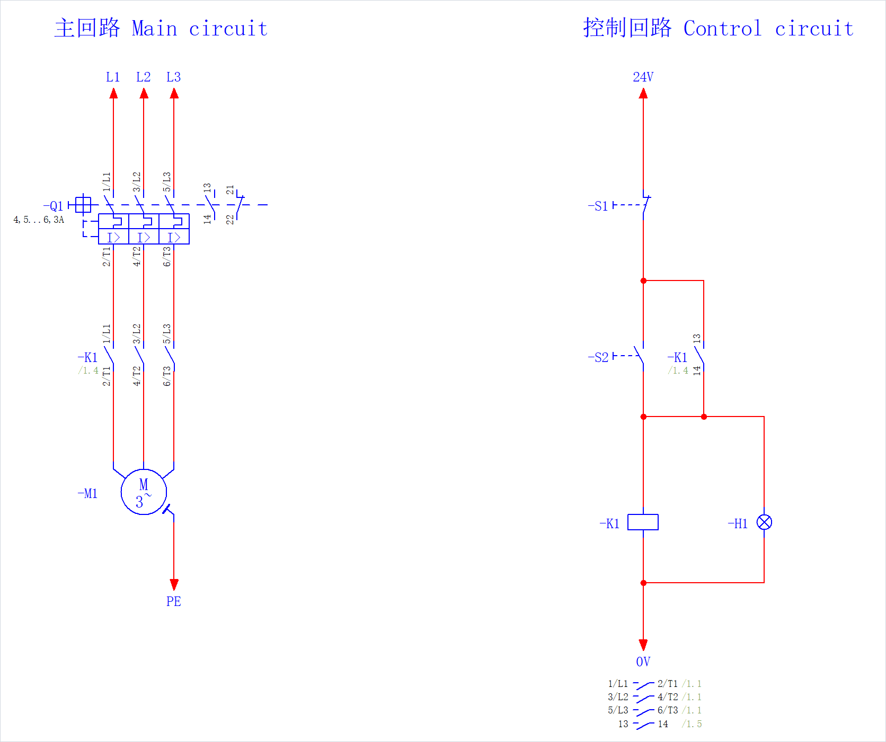

# EplanMcp

[简体中文](README.md) | **English**

**Work with EPLAN through conversation.** EplanMcp is an [MCP](https://modelcontextprotocol.io/) server that lets AI clients such as Claude Code read and modify EPLAN Electric P8 / Pro Panel projects through the EPLAN .NET API: query projects, draw schematics, place devices, update reports, and export drawings.

The engineer stays in control: writes only preview by default, writes to real projects are approved one by one, and operations can be undone and audited.

This page was produced by MCP tool calls: create the page, place devices (-Q1 comes from the parts library), autoconnect, export the image. Nothing was drawn by hand. Only the drawing area is shown.

> [!NOTE]
> This is a preview release (0.x) for testing. Tool arguments and results may still change. See the [CHANGELOG](CHANGELOG.md) for changes and the [roadmap](docs/roadmap.md) for plans. Most project documentation is in Chinese.

## What you can ask

Once your AI client is connected, ask or instruct it directly:

- "How many pages does this project have? Which pages is -K1 on?"
- "Which motors have no part assigned?"
- "Which devices are connected to the load side of =GAA+A1-FC1?"
- "Create a page, insert a circuit, and show me the full change and the expected result first."
- "On these pages, replace Motor with Drive in free text, English only, and preview it first."

## Why not let the AI write EPLAN scripts directly?

| | AI-written scripts | Through EplanMcp |
|---|---|---|
| Calling the API | Relies on model memory; interfaces get misused or invented | Fixed tool arguments, validated before the call; API behaviour comes from official documentation and [live verification](docs/eplan/api-notes.md) |
| Checking the result | "Succeeded but did nothing" is hard to notice | Reads back after writing; safety mismatches roll back, other deviations return warnings |
| Scope of change | A script can change any open project | Preview by default; real-project writes approved one by one |
| After a mistake | Find and repair it by hand | One Ctrl+Z restores a normal write; destructive operations are backed up first |
| Traceability | Hard to say what changed | Calls are recorded in a hash-chained audit log |

## Quick start

**Requires:** Windows 10/11 x64 · EPLAN 2026 Electric P8 or Pro Panel, with a licence that includes the **API extension** and allows unsigned add-ins · an MCP client such as Claude Code or Claude Desktop

1. **Install:** download `EplanMcp-<version>.zip` and `SHA256SUMS.txt` from [Releases](https://github.com/asckye/eplan-mcp/releases), verify the checksum, unblock the ZIP, and extract it to a short, fixed location such as `D:\EplanMcp`.
2. **Connect:** open `workbench\EplanMcp.Workbench.exe`, tick the EPLAN variants to register the add-in, and configure your client.
3. **Ask:** open a project in EPLAN and ask your client "How many pages does this project have?"

Installation needs no administrator rights. See the [getting started guide](docs/getting-started/en.md) for verification, upgrades, removal, and VM deployment.

## Capabilities

| Area | What it does |
|---|---|
| Read | Projects, pages, devices, connections, cables, terminals, PLC, parts, symbols, revisions, messages, check results, macros, placeholders, properties, and page objects |
| Draw and edit | Create projects and pages, place devices from parts or symbols, insert macros, place interruption and potential definition points, add text and graphics, generate connections, edit properties, replace page text |
| Check and report | Run EPLAN checks, check against engineering pack rules, review pages, create and update reports |
| Numbering and translation | Number pages, devices, terminals, cables, and connections; generate cables; translate projects |
| Import and export | Export PDF, DXF, images, PXF, part lists, labels, and untranslated text; import DXF/DWG, PXF, device and part lists, PLC data, and PDF comments |
| Parts and translation databases | Query, import, sync, and export the system parts database; import and export the translation database |
| Engineering packs and knowledge | Install, enable, query, and build packs; bind cabinet configurations; search, review, and update knowledge; compile context for a task |
| Plans | Compile several steps into a plan, review it, and approve it as a whole |
| Generic API layer | Search EPLAN APIs and actions, read call templates, and call them within the safety rules |

See the [tool index](docs/tools/README.md) for the full list, profiles, and read/write annotations. All tools are offered by default (tools that are off by default must be enabled); `serve --profile core` offers a fixed set of 25 common tools.

## How it works

- **`eplanmcp.exe` (Host, .NET 10)** talks to the AI client over stdio and owns tools, policy, approval, and audit.
- **EplanMcp Bridge (EPLAN add-in, .NET Framework 4.8.1)** calls the EPLAN API on EPLAN's main thread and connects to the Host over a named pipe limited to the current user.
- **Workbench** registers the add-in, configures clients, and handles approvals.

Everything happens in the EPLAN session you are using. See the [architecture](docs/architecture/architecture.md) and [ADRs](docs/adr/README.md) for the design.

## Safety model

- **Preview by default:** a write tool called without `dry_run` only returns the list of changes, with no approval and no write ([ADR-0049](docs/adr/0049-write-tools-preview-by-default.md)).
- **Approval:** normal writes inside the scratch area proceed automatically; real-project writes are approved one by one in Workbench or an EPLAN dialog ([ADR-0005](docs/adr/0005-safety-model.md), [ADR-0011](docs/adr/0011-approval-out-of-band.md)).
- **Backup first:** destructive operations need approval even in scratch and are backed up first; if the backup fails they do not run ([ADR-0013](docs/adr/0013-destructive-backup.md)). System parts database writes are also approved each time and backed up, because Ctrl+Z cannot restore them ([ADR-0019](docs/adr/0019-master-data-writes.md)).
- **Traceable:** calls are recorded in a hash-chained audit log. When a result is unknown, writes to the affected project and EPLAN instance pause until the engineer checks and confirms through the approval channel ([ADR-0010](docs/adr/0010-write-outcomes.md)).

## Current limits

- Tested on EPLAN 2026.0.3. 2024, 2025, and 2027 are not yet verified (planned for [M7](docs/roadmap.md)); 2022 and 2023 are not supported ([ADR-0009](docs/adr/0009-supported-eplan-versions.md)).
- 0.x releases ship an unsigned add-in ([ADR-0007](docs/adr/0007-licensing-and-distribution.md)).
- Drawing is still improving: the acceptance test of redrawing a small project exactly is in progress, and Pro Panel 3D layout drawing is not supported.
- AI makes mistakes: try on a scratch project first and check the preview before approving.
- Project content returned by tools enters your AI client; whether it reaches a model service depends on the client and model you use, so confirm this meets your confidentiality requirements before working on customer projects. Installing EplanMcp and connecting locally need no internet access.

## Building from source

See [CONTRIBUTING.md](CONTRIBUTING.md) (in Chinese) and the source build steps in the [Chinese README](README.md).

## Contributing

Please use [Issues](https://github.com/asckye/eplan-mcp/issues/new/choose) for problems and tool requests. Report security problems privately as described in [SECURITY.md](SECURITY.md). See the [code of conduct](CODE_OF_CONDUCT.md) for community rules.

## License

[MIT](LICENSE)

## Disclaimer

EplanMcp is an independent open source project. It is not affiliated with, endorsed by, or sponsored by EPLAN GmbH & Co. KG. EPLAN, EPLAN Electric P8, and EPLAN Pro Panel are trademarks or registered trademarks of EPLAN GmbH & Co. KG.
