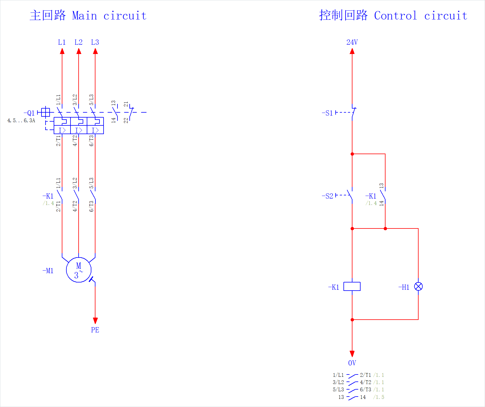

# EplanMcp

[](https://github.com/asckye/eplan-mcp/releases)
[](https://github.com/asckye/eplan-mcp/actions/workflows/build.yml)
[](LICENSE)
[](docs/adr/0009-supported-eplan-versions.md)

**简体中文** | [English](README.en.md)

**用对话操作 EPLAN。** EplanMcp 是一个 [MCP](https://modelcontextprotocol.io/) 服务器，让 Claude Code 等 AI 客户端通过 EPLAN .NET API 读取和修改 EPLAN Electric P8 / Pro Panel 项目：查询项目、绘制原理图、放置设备、更新报表、导出图纸。

工程师始终掌握控制权：写入默认只预览，真实项目逐次审批，操作可撤销、可审计。

<p align="center"></p>
<p align="center"><sub>这一页由 MCP 工具调用完成：建页、放置设备（-Q1 来自部件库）、自动连线、导出图片，没有手工绘制。图中只保留绘图区。</sub></p>

> [!NOTE]
> 当前是预览版（0.x），供测试使用，工具的参数和返回结构仍可能变化。版本变更见 [CHANGELOG](CHANGELOG.md)，后续计划见[路线图](docs/roadmap.md)。

## 能这样用

连接 AI 客户端后，直接用中文提问或下指令：

- “这个项目有多少页？-K1 在哪几页上？”
- “哪些电机没有部件？”
- “=GAA+A1-FC1 的负载侧接到哪些设备？”
- “先建页，再插入一个回路，给我看完整变更和预期结果。”
- “把这几页的自由文本中的 Motor 改成 Drive，只改英语，先预览。”

## 为什么不直接让 AI 写 EPLAN 脚本

| | 让 AI 直接写脚本 | 通过 EplanMcp |
|---|---|---|
| 调用 API | 靠模型的记忆，容易用错或编造接口 | 工具参数固定，调用前校验；API 行为来自官方文档和[实机验证](docs/eplan/api-notes.md) |
| 判断结果 | “返回成功但没有效果”很难发现 | 写入后读回核对，安全项不符自动回滚，其他偏差带警告返回 |
| 修改范围 | 脚本能改任何打开的项目 | 默认只预览，真实项目逐次审批 |
| 改错之后 | 靠人工查找和恢复 | 普通写入一次 Ctrl+Z 恢复，Destructive 操作先备份 |
| 事后追溯 | 说不清改了什么 | 调用记录于审计哈希链 |

## 快速开始

**需要：** Windows 10/11 x64 · EPLAN 2026 Electric P8 或 Pro Panel，授权须包含 **API 扩展**并允许加载未签名插件 · 支持 MCP 的客户端，如 Claude Code、Claude Desktop

1. **安装：** 从 [Releases](https://github.com/asckye/eplan-mcp/releases) 下载 `EplanMcp-<version>.zip` 和 `SHA256SUMS.txt`，校验后解除 ZIP 锁定，解压到短且固定的位置，如 `D:\EplanMcp`。
2. **连接：** 打开 `workbench\EplanMcp.Workbench.exe`，勾选 EPLAN 变体注册插件，并配置客户端。
3. **提问：** 在 EPLAN 中打开项目，然后问客户端“这个项目有多少页”。

安装无需管理员权限。校验、升级、卸载和虚拟机部署见[中文入门指南](docs/getting-started/zh-CN.md)。

## 能做什么

| 分组 | 能做什么 |
|---|---|
| 读取 | 查询项目、页、设备、连接、电缆、端子、PLC、部件、符号、修订、消息、检查结果、宏、占位符、属性和页面对象 |
| 绘图与修改 | 新建项目和页，从部件库或符号放置设备，插入宏，放置中断点和电位定义点，添加文字与图形，生成连接，修改属性，替换页面文字 |
| 检查与报表 | 运行 EPLAN 检查，按工程包规则检查，审查页面，生成和更新报表 |
| 编号与翻译 | 页面、设备、端子、电缆、连接编号，生成电缆，项目翻译 |
| 导入导出 | 导出 PDF、DXF、图片、PXF、部件清单、标签、未翻译文本；导入 DXF/DWG、PXF、设备/部件清单、PLC 数据、PDF 批注 |
| 部件库与翻译库 | 系统部件库查询、导入、同步与导出；翻译库导入与导出 |
| 工程包与知识 | 安装、启用、查询、构建工程包；绑定柜配置；搜索、审核与更新资源知识；为任务编译上下文 |
| 计划执行 | 把多步操作编成计划，审阅后整体批准执行 |
| 通用 API 层 | 搜索 EPLAN API 与 action，查看调用模板，在安全规则允许的范围内调用 |

完整清单、Profile 与读写注解见[工具索引](docs/tools/README.md)。默认提供全部工具（默认关闭的工具需另行启用），`serve --profile core` 只提供固定的 25 个常用工具。

## 工作方式

- **`eplanmcp.exe`（Host，.NET 10）**：通过 stdio 连接 AI 客户端，负责工具、策略、审批和审计。
- **EplanMcp Bridge（EPLAN 插件，.NET Framework 4.8.1）**：在 EPLAN 主线程上调用 EPLAN API，通过只对当前用户开放的命名管道连接 Host。
- **Workbench**：注册插件、配置客户端、处理审批。

所有操作都发生在你正在使用的 EPLAN 里。设计细节见[架构](docs/architecture/architecture.md)和 [ADR](docs/adr/README.md)。

## 安全模型

- **默认预览：** 写入工具省略 `dry_run` 时只返回变更清单，不审批也不写入（[ADR-0049](docs/adr/0049-write-tools-preview-by-default.md)）。
- **逐次审批：** 普通写入在 scratch 内自动放行；真实项目默认逐次经 Workbench 或 EPLAN 对话框审批（[ADR-0005](docs/adr/0005-safety-model.md)、[ADR-0011](docs/adr/0011-approval-out-of-band.md)）。
- **先备份：** Destructive 操作在 scratch 中也要审批，执行前自动备份，备份失败不执行（[ADR-0013](docs/adr/0013-destructive-backup.md)）。系统部件库写入同样每次审批并先备份，不能依靠 Ctrl+Z 恢复（[ADR-0019](docs/adr/0019-master-data-writes.md)）。
- **可追溯：** 调用记录于审计哈希链；结果未知时暂停相关项目与 EPLAN 实例的写入，待工程师核实并经审批渠道确认后解除（[ADR-0010](docs/adr/0010-write-outcomes.md)）。

## 当前限制

- 实测版本是 EPLAN 2026.0.3；2024、2025、2027 尚未验证，留待 [M7](docs/roadmap.md)，2022、2023 暂不支持（[ADR-0009](docs/adr/0009-supported-eplan-versions.md)）。
- 0.x 发布未签名插件（[ADR-0007](docs/adr/0007-licensing-and-distribution.md)）。
- 绘图能力仍在完善：按原图完整重画一个小项目的验收还在进行，Pro Panel 3D 布局绘制暂不支持。
- AI 可能出错：请先在 scratch 项目上试，并在批准前检查预览内容。
- 工具返回的项目内容会进入 AI 客户端，是否发送到模型服务取决于你使用的客户端和模型；处理客户项目前请确认符合保密要求。EplanMcp 的安装与本机连接不需要联网。

## 文档

| 想了解 | 读这里 |
|---|---|
| 怎么开始使用 | [中文入门指南](docs/getting-started/zh-CN.md) · [English guide](docs/getting-started/en.md) |
| 有哪些工具、每个工具怎么用 | [工具索引](docs/tools/README.md) |
| 里程碑状态、发布范围与排期 | [路线图](docs/roadmap.md) |
| 系统怎么设计、为什么这样设计 | [架构](docs/architecture/architecture.md) · [ADR](docs/adr/README.md) |
| CLI JSON 输出与安装验收 | [CLI 参考](docs/reference/cli.md) · [发布流程](docs/process/release.md#安装验收清单m5-发布前逐项通过) |
| EPLAN API 的已验证事实和覆盖情况 | [api-notes 主题索引](docs/eplan/api-notes.md) · [API 覆盖矩阵](docs/eplan/api-coverage.md) |
| 安全 | [项目威胁模型](docs/architecture/architecture.md#13-威胁模型) · [SECURITY.md](SECURITY.md) |
| 怎么参与开发 | [CONTRIBUTING.md](CONTRIBUTING.md) · [工程开发手册](docs/standards/engineering-handbook.html) |

<details>
<summary><strong>从源码构建（开发者）</strong></summary>

开发环境见 [CONTRIBUTING.md](CONTRIBUTING.md)。源码版同样支持读写，遵循上述安全模型。

1. 构建 eplanmcp 和 EPLAN 插件：
   ```powershell
   dotnet build src\EplanMcp.Host -c Release
   dotnet build src\EplanMcp.Bridge.Eplan -c Release
   ```
2. 在每个要用的 EPLAN 变体中注册一次插件（会启动 EPLAN；脚本默认使用 Release 构建，插件重建后需重启 EPLAN）：
   ```powershell
   eng\scripts\eplan-addin.ps1 -Action register -Variant 'Electric P8'
   ```
3. 在 EPLAN 中打开项目，然后自检，按输出处理 WARN / FAIL：
   ```powershell
   src\EplanMcp.Host\bin\Release\net10.0\eplanmcp.exe doctor
   ```
4. 加到 Claude Code（`<仓库目录>` 换成本仓库的完整路径）：
   ```powershell
   claude mcp add -s user eplan -- "<仓库目录>\src\EplanMcp.Host\bin\Release\net10.0\eplanmcp.exe" serve
   ```

验证与评测见 [Large 测试](tests/EplanMcp.Large.Tests/README.md)和 [Agent 评测](evals/README.md)。

</details>

## 参与贡献

问题和工具需求请提 [Issue](https://github.com/asckye/eplan-mcp/issues/new/choose)。开发环境和提交规范见 [CONTRIBUTING.md](CONTRIBUTING.md)，安全问题按 [SECURITY.md](SECURITY.md) 私下报告，社区规则见[行为准则](CODE_OF_CONDUCT.md)。

## 许可证

[MIT](LICENSE)

## 声明

EplanMcp 是独立的开源项目，与 EPLAN GmbH & Co. KG 无关联，也未经其认可或赞助。EPLAN、EPLAN Electric P8 和 EPLAN Pro Panel 是 EPLAN GmbH & Co. KG 的商标或注册商标。
