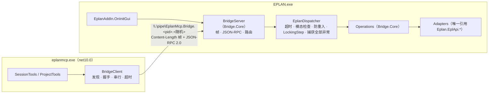

# 设计文档：M1 端到端骨架（Host ↔ 管道 ↔ Bridge ↔ EPLAN）

| 项 | 内容 |
|---|---|
| 状态 | In Review |
| 作者 | asckye |
| 关联 Issue | （待建） |
| 相关 ADR | [0002](../adr/0002-host-bridge-process-model.md)、[0003](../adr/0003-ipc-named-pipe-json-rpc.md)、[0004](../adr/0004-runtimes-and-target-frameworks.md)、[0006](../adr/0006-tool-surface-design.md)、[0008](../adr/0008-data-locations-and-instance-discovery.md) |
| 最后更新 | 2026-10-13 |

## 1. 背景
M1 的技术验证 S0–S4 已经给出结论（[spikes](../../spikes/README.md)）。M1 剩下的完成标准是：**在 Claude Code 中调用 `eplan_project_list` 拿到真实结果**，并有 `doctor` 和 CI。ADR 已经决定了进程模型、IPC 方式、运行时和实例发现方式；本文把这些决定落实为第一版可运行的代码结构和 Host–Bridge 协议细节，不改变任何 ADR。

## 2. 目标与非目标
- **目标**
  - 解决方案骨架：`Contracts`、`Bridge.Core`、`Bridge.Eplan`、`Host` 四个项目和对应的测试项目，构建规则沿用仓库根目录。
  - Host–Bridge 协议第 1 版：帧格式、`handshake`、`invoke`、错误结构。
  - 两个只读工具：[`eplan_session_status`](../tools/eplan_session_status.md)、[`eplan_project_list`](../tools/eplan_project_list.md)。
  - Bridge 在 EPLAN 启动时加载（`bLoadOnStart = true`），在 `OnInitGui` 中启动管道服务器；主线程调度遵守 S1 的四条硬规则。
  - 不装 EPLAN 也能跑的 Small / Medium 测试，包括"真实 Host + 真实 Bridge.Core + 假 EPLAN 适配层"的端到端测试。
  - CI：Windows runner 上构建（不含 `Bridge.Eplan`）、格式检查、Small + Medium 测试。
  - `eplanmcp doctor` 最小版。
- **非目标**
  - 任何写工具、策略引擎、审批、审计（M3）。
  - 多实例选择工具 `eplan_session_select`（M2）。M1 中有多个 EPLAN 实例时返回 `SESSION_NOT_SELECTED`。
  - `cancel`、进度通知（协议中预留，M4 实现）。
  - `install-addin`、`client-config` 等 CLI 子命令（M5）；M1 用开发脚本注册插件。
  - 工具契约快照测试（M2 开始引入 Verify，M1 只有两个工具）。

## 3. 方案概述

## 4. 详细设计

### 4.1 项目与依赖

| 项目 | 目标框架 | 依赖 | 说明 |
|---|---|---|---|
| `src/EplanMcp.Contracts` | netstandard2.0 | 无 | 协议版本、操作名、错误码（`ErrorReason`）、请求/响应 DTO。纯 POCO，不依赖序列化器 |
| `src/EplanMcp.Bridge.Core` | netstandard2.0 | Contracts；Newtonsoft.Json 13.0.3（`ExcludeAssets=runtime`，运行时用 EPLAN 自带的） | 帧读写、JSON-RPC 服务器、操作路由、调度抽象 `IMainThreadDispatcher`、适配层接口、M1 的两个操作。不引用 EPLAN |
| `src/EplanMcp.Bridge.Eplan` | net481 | Bridge.Core；EPLAN 程序集（`EplanBinPath`，`Private=false`） | 插件入口、主线程调度器、适配层、带 ACL 的管道工厂。没有 EPLAN 的机器（含 CI）不构建它 |
| `src/EplanMcp.Host` | net10.0 | Contracts；ModelContextProtocol 2.2.0；Microsoft.Extensions.Hosting | `eplanmcp.exe`：MCP 服务器、BridgeClient、工具、`doctor` |
| `tests/*.Tests` | net10.0 | xUnit v3 | 见第 7 节 |

管道服务器流的创建交给工厂注入：`Bridge.Core` 只接受一个 `Func<string, NamedPipeServerStream>`。net481 上由 `Bridge.Eplan` 用 `PipeSecurity` 创建（只允许当前用户，拒绝网络登录 SID `S-1-5-2`）；.NET 10 的测试中用 `PipeOptions.CurrentUserOnly` 创建。这样 `Bridge.Core` 不需要 `System.IO.Pipes.AccessControl` 包。

### 4.2 Host–Bridge 协议（第 1 版）

**传输与发现**（ADR-0003、ADR-0008）：Bridge 创建管道 `EplanMcp.Bridge.<pid>.<16 位十六进制随机值>`，最多 4 个并发实例（多个 Host 可以同时连接；EPLAN 主线程本身是串行的）。Host 列举 `\\.\pipe\` 中带此前缀的管道，用 `PipeOptions.CurrentUserOnly` 连接（同时校验服务端属于当前用户），连接超时 2 秒。前缀可以用环境变量 `EPLANMCP_PIPE_PREFIX` 覆盖，只供测试使用，避免和开发机上正在运行的 EPLAN 冲突。

**帧格式**：`Content-Length: <字节数>\r\n\r\n<UTF-8 JSON>`，与 LSP 相同。单帧上限 16 MiB；超过上限、缺少头部或头部格式错误时，视为协议错误并断开连接。

**消息**：JSON-RPC 2.0，所有字段 camelCase。

| 方法 | 方向 | params | result |
|---|---|---|---|
| `handshake` | Host → Bridge | `{protocolVersion, minProtocolVersion, hostVersion}` | `{protocolVersion, bridgeVersion, eplan: {processId, version, variant}}` |
| `invoke` | Host → Bridge | `{operation, correlationId, args}` | `{data}` |
| `cancel`（预留） | Host → Bridge，通知 | `{id}` | — |
| `progress`（预留） | Bridge → Host，通知 | `{id, progress, total?, message?}` | — |

- **版本**：当前为 1。Host 发送自己支持的范围 `[minProtocolVersion, protocolVersion]`，Bridge 返回自己的版本；不在范围内时，Host 返回 `BRIDGE_INCOMPATIBLE`，提示更新插件并重启 EPLAN（api-notes A8）。握手之前收到 `invoke`，Bridge 返回 `-32002`（未握手）。
- **业务错误**放在 JSON-RPC `error` 中：`code = -32000`，`data = {reason, message, retryable, metadata}`，`reason` 取自 Contracts 中的错误码表（[mcp-tool-design 6.3](../standards/mcp-tool-design.md#63-错误码表)）。协议错误使用 JSON-RPC 标准码（`-32700`、`-32600`、`-32601`、`-32602`、`-32603`）。
- **操作名**：`<资源>.<动作>`，M1 只有 `session.status`、`project.list`。增加操作不增加 RPC 方法（ADR-0003）。

### 4.3 Bridge 线程模型
1. 每个管道连接一个后台线程，读帧 → 解析 → 路由。**该线程上的一切异常都被捕获**，连接级错误只关闭这一个连接（编码规范 9.6 第 17 条）。
2. `invoke` 在后台线程上解析参数，然后通过 `IMainThreadDispatcher.Run(work, startTimeout)` 把**整个操作**（包括把 EPLAN 对象映射为 DTO）交给主线程，结果在后台线程上序列化。主线程上不做 I/O，不跨请求持有 EPLAN 对象。
3. `EplanDispatcher`（net481）是唯一调用 `Dispatcher.Invoke` 的地方，按 S1 的规则实现：
   - 用 EPLAN 预设的 WPF `Dispatcher` 的 `Invoke(Normal, 10 s, …)`；返回 null 表示超时，结果为 `EPLAN_BUSY`（被放弃的调度事后不会执行，A9）；
   - 委托内部依次：防重入检查（已有操作在执行 → `EPLAN_BUSY`）→ 主窗口被禁用（有模态对话框）→ `EPLAN_BUSY` → `new LockingStep()` → 执行 → 捕获**全部**异常并作为结果交回；
   - 不使用 `ExecuteInMainThreadSync`（没有超时）。
4. 同一时间最多只有一个操作在主线程上执行；多个连接的请求在 `Dispatcher` 队列中排队，各自受 10 秒的进入超时约束。

### 4.4 EPLAN API（M1 用到的）

| 用途 | API | 验证状态 |
|---|---|---|
| 主线程调度 | `EplanMainThreadDispatcher.GetMainThreadDispatcher()`、WPF `Dispatcher.Invoke(priority, timeout, …)` | S1 已验证（action 中延迟加载的情况）；**启动时加载（`OnInitGui`）时是否就绪待实机确认** |
| 读取锁 | `LockingStep` | S1 已验证 |
| 已打开的项目 | `ProjectManager.OpenProjects`，先设 `LockProjectByDefault = false` | XML 文档 + 反射：`OpenProjects` 在 `LockProjectByDefault = true`（默认）时会尝试锁定项目，失败抛 `ProjectLockingException`；该属性可写。**设为 false 是否只影响本实例、是否会改变 EPLAN 自身行为，待实机确认** |
| 当前项目 | `SelectionSet.GetCurrentProject(false)` | S1 已使用 |
| 项目属性 | `Project.ProjectName`、`ProjectFullName`、`IsReadOnly` | 反射确认存在；取值实机确认 |
| 授权 | `License.HasOption(LicenseOptions.APIExtension)` | A2 已验证 |
| 版本 / 变体 | `EPLAN.exe` 的文件版本；变体取命令行 `/Variant:`，取不到再查 `HKCU\Software\EPLAN\RemoteServer\*` 中 `ProcessID` 等于本进程的项 | 文件版本已读到 2026.0.3.25421；变体的两种来源待实机确认 |

### 4.5 Host
- `serve`（默认）：stdio MCP 服务器。日志只写 stderr。
- `BridgeClient`（实现 `IBridgeClient`）：第一次工具调用时才发现并连接；连接断开后下次调用重新发现。每个连接一个 `SemaphoreSlim(1)` 串行队列，排队超过 15 秒返回 `EPLAN_BUSY`。每次 `invoke` 的总超时为 30 秒，超时返回 `TIMEOUT`（M1 只有只读操作，超时不会留下半截修改）。
- 工具返回：成功时 `structuredContent` + 同内容 JSON 文本 + 一行摘要；失败时 `isError: true`，文本中是 `{"error": {reason, message, retryable, metadata}}`，不带 `structuredContent`（避免与 `outputSchema` 冲突）。
- `inputSchema` 补上 `additionalProperties: false`（S4 发现 SDK 不生成它）。
- `doctor`：Host 版本与数据目录、是否带 MSIX 包身份、EPLAN 安装位置、正在运行的 EPLAN 进程、发现的 Bridge 管道及握手结果、用户 PATH 长度（A1）。中英文输出跟随系统语言。

## 5. 安全与数据完整性
- 两个工具都是 Read 级，不修改项目。`OpenProjects` 的默认锁定行为被显式关闭，避免只读调用在多用户环境中锁住项目。
- 管道：ACL 只允许当前用户并拒绝网络登录；Host 端 `CurrentUserOnly`（SEC-03）。不再使用实例发现文件（ADR-0008）。
- Bridge 的所有入口（`OnInitGui`、`OnExit`、管道线程、调度回调）捕获全部异常；主线程调度有超时，从不无限等待（SEC-14）。
- 项目名称和路径来自项目数据，只放在 `structuredContent` 的数据字段中，一行摘要不回显它们（8.5）。
- 对威胁模型的影响：无新增信任边界。`EPLANMCP_PIPE_PREFIX` 只能把 Host 引向同一用户创建的管道，属于"以当前用户身份运行的恶意程序"，不在防护范围内。

## 6. 备选方案
- **握手时由 Bridge 推送已打开的项目**（架构 6.1 原文）：会让握手依赖主线程，EPLAN 正忙时连握手都失败。改为握手只返回静态信息，项目列表按需 `invoke`。
- **用 `System.IO.Pipes.AccessControl` 包在 netstandard2.0 中设置 ACL**：Bridge 会多一个运行时依赖（ADR-0003 要求零第三方依赖）。改为工厂注入。
- **业务错误放在 `result` 中（`{ok:false, error}`）**：调用方要检查两处。JSON-RPC 的 `error.data` 已经能承载结构化错误，选择它。

## 7. 测试与验证
- **Small**：Contracts 的 STJ ↔ Newtonsoft 往返；帧读写（正常、超长、缺头、半包）；JSON-RPC 路由（未握手、版本不兼容、未知操作、操作抛异常、调度器返回忙）；工具的错误映射与摘要。
- **Medium**：真实 `BridgeServer` + 假调度器和假适配层，跑在真实命名管道上；Host 的 `BridgeClient` 连接、握手、超时、断线重连；启动 `eplanmcp.exe serve`，用 MCP SDK 客户端调用两个工具，走完整条链路（不需要 EPLAN）。
- **Large**（实机，手动）：EPLAN 2026.0.3 中注册插件并重启 → Claude Code 中调用 `eplan_session_status`、`eplan_project_list` → 打开模态对话框时调用返回 `EPLAN_BUSY` → 退出 EPLAN 后返回 `EPLAN_NOT_CONNECTED`。结果写入 api-notes（4.4 中的待确认项）。
- **Agent 评测**：M2 引入评测框架时加入"列出已打开的项目并指出当前项目"。

## 8. 发布与兼容性
首次引入工具契约，不涉及破坏性变更。协议版本从 1 开始。没有功能开关；回退就是不注册插件。

## 9. 待定问题
- `OnInitGui` 时 `GetMainThreadDispatcher()` 是否已不为 null。`OnInitGui` 本身运行在主线程上，所以为 null 时退回到 `Dispatcher.CurrentDispatcher`（S1 已确认两者是同一个对象）；实机验证时记录实际走了哪条路径。
- 变体的获取方式是否可靠（实机验证时决定，不可靠就只报版本）。
