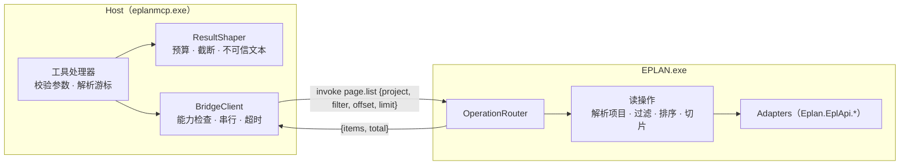

# 设计文档：M2 只读核心

| 项 | 内容 |
|---|---|
| 状态 | Approved（2026-10-19，项目负责人确认第 9 节的 Q1–Q5 均按本文建议） |
| 作者 | asckye |
| 关联 Issue | — |
| 相关 ADR | ADR-0003（IPC）、ADR-0005（安全模型）、ADR-0006（工具面）、ADR-0008（数据目录与发现） |
| 最后更新 | 2026-10-19 |

## 1. 背景
M1 打通了"MCP 客户端 → Host → 管道 → Bridge → EPLAN 主线程"的链路，并在 EPLAN 2026 上实机验证通过（[api-notes A10](../eplan/api-notes.md#a10-m1-骨架的实机验证2026-10-18)）。现在只有 `eplan_session_status` 和 `eplan_project_list` 两个工具，模型还看不到项目内部。

M1 的 `project_list` 由 Bridge 返回全部项目、Host 分页。项目最多几个，这样可以；页面和设备不行：示例项目 `EPLAN_Sample_Project` 有 321 页、2876 个功能（A3），把它们全部转成 DTO 会长时间占用 EPLAN 主线程，管道上的数据也太大。

M2 开始时完成了官方 action 的逐条核对（[逐条核对表](../eplan/api-actions.md)、[API 覆盖矩阵第 2 节](../eplan/api-coverage.md#2-官方文档中的-action约-100-个)）：M2 的读取全部用 DataModel、HEServices、EServices 类实现，不调用 action。

M2 的完成标准（[架构文档第 11 节](../architecture/architecture.md#11-里程碑)）：**只读任务的 Agent 评测成功率 ≥ 90%**。

## 2. 目标与非目标
**目标**
1. 一组只读工具，让模型能回答工程师关于项目内容的常见问题：项目概况、页面、设备、连接、部件、属性、EPLAN 系统消息、检查结果（第 4.1 节）。
2. 列表工具在 **Bridge 端过滤和分页**，单次调用在 EPLAN 主线程上的时间目标 ≤ 1 秒（示例项目上实测）。
3. 公共能力：结果大小控制、不可信文本处理、分页游标、契约快照、使用说明元工具 `eplan_tool_usage`。
4. Agent 评测 v0：评测框架 + 约 20 个只读任务（开发集与保留集），在示例项目的 scratch 副本上运行。
5. 授权丢失时返回 `LICENCE_MISSING`，`doctor` 能指出"EPLAN 在运行但这个变体没有加载插件"（A10）。

**非目标**
- 任何修改项目的工具，包括运行检查：按文档，检查开始前会删除上一次的检查消息，再把新消息写入项目，所以 `eplan_check_run` 归入 M3，经过策略和审批（第 9 节 Q2，已确认）。M2 只读取已有的检查消息。
- 符号库和宏的查询：第一个使用者是 M3 的放置工具，到时一起设计。
- 端子排、电缆芯线、PLC 地址的专用视图：M2 中通过 `eplan_device_list` 的类别过滤查到这些设备，专用工具放到 M4。
- 设置的读取：没有需要它的只读任务，有任务需要时再做（第 9 节 Q5，已确认）。
- 跨调用缓存：每次调用都读 EPLAN 的当前状态，不做缓存，避免返回过期数据。
- 进度通知与取消（M4）。

## 3. 方案概述

工具处理器把参数和游标转换成 Bridge 操作的 `{project, filter, offset, limit}`；Bridge 在一次主线程调度中解析项目、按过滤条件查找、稳定排序、取出这一页并转换成 DTO，连同总数一起返回；Host 再按 token 预算整形，必要时提前截断并给出下一页的游标。

## 4. 详细设计

### 4.1 工具清单

| 工具 | 用途 | 主要参数 | 状态 |
|---|---|---|---|
| `eplan_session_status` | 连接状态 | — | M1 已有 |
| `eplan_session_select` | 同时运行多个 EPLAN 时，选择要操作的实例 | `process_id` | 新增（M1 设计中已列入 M2） |
| `eplan_project_list` | 打开的项目 | `limit`、`cursor` | M1 已有 |
| `eplan_project_get` | 项目概况：页数、设备数、语言、顶层结构、只读状态、主要项目属性 | `project?`、`response_format` | 新增 |
| `eplan_page_list` | 列出页面 | `project?`、`name_prefix`、`page_type`、`text`、`limit`、`cursor` | 新增 |
| `eplan_page_get` | 单页详情：属性、页上的设备 | `project?`、`page`、`response_format` | 新增 |
| `eplan_device_list` | 列出设备 | `project?`、`tag_contains`、`page`、`category`、`has_part`、`limit`、`cursor` | 新增 |
| `eplan_device_get` | 单个设备：主功能和辅助功能所在的页、部件、功能文本、连接点 | `project?`、`tag`、`response_format` | 新增 |
| `eplan_connection_list` | 列出连接（按页或按设备） | `project?`、`page` 或 `device`、`limit`、`cursor` | 新增 |
| `eplan_part_list` | 项目中用到的部件及数量 | `project?`、`manufacturer`、`text`、`limit`、`cursor` | 新增 |
| `eplan_message_list` | EPLAN 系统消息（最近的错误与警告） | `level`、`limit`、`cursor` | 新增 |
| `eplan_check_list` | 项目中已有的检查消息（不运行检查） | `project?`、`severity`、`page`、`limit`、`cursor` | 新增 |
| `eplan_tool_usage` | 某个工具的详细用法 | `tool`、`topic?` | 新增 |

共 13 个工具，全部为 Read 级，属于 `core` Profile，为 M3 的写工具留出空间（`core` 上限 25 个）。

- **属性**不单设工具：`*_get` 在 `response_format: "detailed"` 时返回该对象全部非空属性（属性 ID、名称、值），受大小预算约束。这样少一个工具，模型也不需要事先知道属性 ID。
- **部件库查询**（`eplan_part_search`）的第一个使用者是 M3 的"给设备选部件"，到时与部件库的打开和关闭方式一起设计（第 9 节 Q4，已确认放到 M3）。
- 每个新工具在实现它的 PR 中附上[工具规格](../templates/tool-spec.md)，放在 `docs/tools/`。

### 4.2 对象标识与名称
- 页面用完整页名，例如 `=AP+ST1/3`；设备用设备标识，例如 `-K1` 或带结构标识的 `=AP+ST1-K1`（[mcp-tool-design 5](../standards/mcp-tool-design.md#5-参数)）。
- **短标识可能有歧义**：同一个 `-K1` 可以出现在不同的结构下。按短标识查找到多个设备时，返回新增的错误码 `AMBIGUOUS_NAME`，`metadata.candidates` 列出完整标识（最多 20 个），让模型选一个再调用。
- `project` 可以省略，表示当前项目；结果中始终回显实际使用的项目名。传入的值可以是项目名，也可以是 `eplan_project_list` 返回的 `path`。项目名重名时返回 `AMBIGUOUS_NAME`。
- 不提供句柄。EPLAN 的 `ToStringIdentifier()` 只在当前会话内有效（A3），M2 的任务用名称足够。

### 4.3 Host–Bridge 协议的增量
- 新操作（全部为读）：`project.get`、`page.list`、`page.get`、`device.list`、`device.get`、`connection.list`、`part.list`、`check.list`、`message.list`。操作名规则不变（`<资源>.<动作>`），**协议版本保持 1**：只增加操作，不改变已有消息。
- **能力声明**：握手结果新增 `operations`（插件支持的操作名列表）。Host 调用前检查；插件版本较旧、缺少某个操作时，返回 `BRIDGE_INCOMPATIBLE`，提示更新插件并重启 EPLAN。M1 的插件没有这个字段，按 `session.status`、`project.list` 处理。
- 列表操作的参数统一为 `{project, filter, offset, limit}`，结果统一为 `{project, items, total}`。`filter` 的字段因操作而异，在 Contracts 中逐一定义。
- 排序：按 EPLAN 自身的顺序（页面按页导航器中的顺序，设备按标识），保证同一状态下分页结果稳定；顺序的实际来源由 spike S6 确认。

### 4.4 Host 端的公共能力

**游标**：在 M1 的 `v1:<offset>` 基础上增加过滤条件的指纹：`v2:<offset>:<指纹>`，指纹是"工具名 + 项目 + 过滤条件"的哈希。换了过滤条件再用旧游标，返回 `INVALID_ARGUMENT`，提示去掉游标重新开始。游标只表示偏移量，两次调用之间项目被修改时，结果可能错位；这一点在工具描述中说明。

**ResultShaper**（[架构 5.2](../architecture/architecture.md#52-host-组件)）
- 预算：按字符估算 token（ASCII 字符按 4 个一 token，其余字符按 1 个一 token，偏保守）。默认预算约 5k，`detailed` 的硬上限 20k。
- 超出预算时，从列表末尾减少条目，设置 `truncated: true`，`nextCursor` 指向第一个未返回的条目，`hint` 提示用过滤条件缩小范围。
- 不可信文本：来自项目的字符串剥除控制字符（保留换行和制表符）；单个字段超过 500 个字符时截断，并附上原始长度（[mcp-tool-design 7.3](../standards/mcp-tool-design.md#73-不可信内容)）。这一步统一在 Host 中完成，Bridge 只负责读取。
- 一行摘要只给数量和范围，不回显项目里的自由文本。

**契约快照**：按[测试规范](../standards/testing.md)，用 Verify 把 `tools/list` 的完整结果（名称、描述、schema、注解）和服务器说明序列化为 `tests/Contracts.Snapshots/*.verified.json`。契约有任何变化，快照测试都会失败，需要在 PR 中审视后更新。新增依赖 `Verify.XunitV3`（MIT），只用于测试项目。

**`eplan_tool_usage`**：内容按工具放在 Host 的嵌入资源 `Tools/Usage/<工具名>.md` 中（英文，面向模型），`topic` 为 `examples`、`workflow`、`fields`、`errors` 之一，省略时返回全部。内容是本项目自己编写的，不含项目数据；随契约快照一起评审。

**多实例**：同时运行多个 EPLAN（例如 Electric P8 和 Pro Panel）时，M1 返回 `SESSION_NOT_SELECTED`。`eplan_session_select` 把选择记在 Host 进程内（stdio 下每个客户端一个 Host 进程），所选实例退出后清除。

### 4.5 用到的 EPLAN API
下表的类型和成员都已在 EPLAN 2026.0.3 的 XML 文档中找到，并用反射确认了签名；**行为**（名称的实际值、耗时、副作用）由 spike S6 实机确认（第 4.6 节）。官方 action 不用于读取：读属性的 action 只能读当前项目或当前选择，`search` 不返回结果，读消息和设置也没有对应的 action（[action 逐条核对](../eplan/api-coverage.md#2-官方文档中的-action约-100-个)）。命名空间前缀 `Eplan.EplApi.` 省略。

| 操作 | 主要 API | 待 S6 确认 |
|---|---|---|
| 查找（各列表操作共用） | `DataModel.DMObjectsFinder(Project)`（`IDisposable`）的 `GetPages(PagesFilter)`、`GetFunctions(FunctionsFilter)`、`GetConnections(ConnectionsFilter)`、`GetArticleReferences(ArticleReferencesFilter)`；filter 为 null 时返回全部，多个条件之间是"与" | 耗时；返回顺序；`Name` 过滤匹配哪种名称、是否区分大小写 |
| `project.get` | `DataModel.Project` 的 `ProjectName`、`ProjectFullName`、`IsReadOnly`、`CurrentUsers`、`Properties`（`PROJ_PAGECOUNT`、`PROJ_HIERARCHY_*`、`PROJ_SOURCELANGUAGE`）；翻译语言只在项目设置 `TRANSLATEGUI.*` 中，用 `Base.ProjectSettings` 读取 | 统计设备数的耗时；`PROJ_SOURCELANGUAGE` 整数的含义；设置路径的写法 |
| `page.list` / `page.get` | `DataModel.Page` 的 `Name`（文档称等于 `PAGE_FULLNAME`）、`PageType`（`DocumentType`）、`PageTypeName`；页描述是多语言属性 `PAGE_NOMINATIOMN`（拼写原样如此）；`PagesFilter.Name`、`DocumentType` | `Name` 是否形如 `=AP+ST1/3` |
| `device.list` / `device.get` | `DataModel.Function` 的 `Name`、`VisibleName`、`IsMainFunction`、`FunctionCategory`、`FunctionDefinition`、`Placement.Page`、`SubFunctions`、`ArticleReferences`、`Pins`；功能文本 `FUNC_TEXT`；`FunctionsFilter.Name`（默认前缀匹配）、`FunctionCategory`、`Page` | 哪个名称能稳定作为"设备标识"（`Name`、`VisibleName` 或 `FUNC_IDENTDEVICETAG`） |
| `connection.list` | `DataModel.Connection` 的 `StartPin`、`EndPin`（`Pin.Name`、`Pin.ParentFunction`）；线号与颜色 `CONNECTION_WIRENUMBER`，截面 `CONNECTION_WIRECROSSSECTION*`；`ConnectionsFilter.Function` | 按页列出：`ConnectionsFilter.Page` 已标为过时，替代做法未写明 |
| `part.list` | `DataModel.ArticleReference` 的 `PartNr`、`VariantNr`、`Count`、`ParentObject`；部件描述取自项目部件 `Project.Articles` | 汇总的耗时；是否会访问部件库 |
| `*.get` 的详细属性 | `DataModel.PropertyValue` 的 `IsEmpty`、`ToString(ISOCode.Language)`、`ToMultiLangString()`；对象的 `Properties.ExistingIds` / `ExistingValues`；`PropertyDefinition.Name` | 单个对象读取全部属性的耗时；多语言文本的实际格式和语言回退 |
| `check.list` | `EServices.PrjMessagesCollection(Project)`，枚举 `ProjectMessage` 的 `GetText`、`GetCategory`、`GetGroup`、`GetId`、`GetObject1`、`GetDone`、`GetTime`。文档说明它代表"上一次检查"的结果 | 构造和枚举是否会写入任何东西；GUI 中运行过的检查结果在重新打开项目后是否还在 |
| `message.list` | `Base.SysMessagesCollection(bookmark, MessageLevel)`，元素为 `Base.BaseException`（`MessageLevel`、`GetMessageText`、`GetMessageIndex`、`NumberOfOccurrences`）。不含 Assert 和 Trace，连续的相同消息会合并；**没有时间戳**，所以不提供按时间过滤。需要带时间的历史记录时，备选做法是由 Host 只读打开 EPLAN 日志 `EplLog.eldb`（A1） | `MessageLevel` 是"最低级别"还是"精确级别" |
| 授权丢失 | `DataModel.InsufficientLicenceException`（派生自 `DataModelException`）映射为 `LICENCE_MISSING` | 无法人为制造，只能按文档实现 |

**看起来像读、实际会写的成员**（文档写明）：`Article.LoadFromMasterdata()`、`ArticleReference.StoreToObject()`、`PrjMessagesCollection` 的 `Add` / `Remove` / `Clear`、`ProjectMessage.SetDone()`、`HEServices.Check.Verify*`、`BaseException.FixMessage()`、`Project.LockAllObjects()`、`Project.Filter` 和 `Page.Filter` 的 setter（会改变后续的查询结果）、`HEServices.Search` 的 `Project` / `Page`（写入搜索结果库），以及所有属性的 setter。只读操作不得使用它们，第 5 节说明如何在构建时强制执行。

**异常**：一部分 DataModel 异常不派生自 `BaseException`，而是 `System.ArgumentException`（如 `PropertyNotFoundException`、`InvalidHandleException`）或 `System.InvalidOperationException`（`ForbiddenOperationException`）的子类。异常映射按具体类型处理，不能只捕获 `BaseException`。

### 4.6 spike S6：只读 API 的实机验证
在示例项目的 scratch 副本上，按对设计影响从大到小验证第 4.5 节表格最后一列的问题，重点是：
1. 耗时：`GetFunctions(null)`、`GetConnections(null)`、`GetArticleReferences(null)` 和逐个读取名称与属性，在 321 页、2876 个功能上要多久；决定第 4.7 节的 1 秒目标能否达到，达不到时改用哪种过滤方式。
2. 名称：主功能、辅助功能、端子上各种名称属性的实际值，选定工具中"设备标识"和"页名"用哪一个。
3. 多语言：原始格式、语言回退、项目语言的读取方式（决定 Q3）。
4. 读取是否有副作用：`PrjMessagesCollection` 的构造与枚举、`LockProjectByDefault = false` 时的纯读取是否会锁定对象（对比 `IsLocked`、项目文件的修改时间和 EPLAN 日志）。
5. 按页列出连接的可行做法。
6. 生成夹具（示例项目的 scratch 副本）的方法：直接复制 `.elk` 文件和 `.edb` 目录，还是用 `backup` / `restore` 或 `projectmanagement /TYPE:CREATESNAPSHOTCOPY`（[action 逐条核对](../eplan/api-actions.md) 7.2 节）。

结论写入 api-notes，再开始实现对应的工具。

### 4.7 线程模型
与 M1 相同：每个操作是一次主线程调度（先检查模态对话框，再创建 `LockingStep`，委托内部捕获全部异常）。列表操作在**同一次调度**中完成解析项目、过滤、排序、切片和转换，不跨调度持有 EPLAN 对象。单次调度的执行时间目标 ≤ 1 秒；超过时记录告警日志，作为调整过滤方式的依据。

## 5. 安全与数据完整性
- 全部工具为 Read 级：`readOnlyHint=true`、`destructiveHint=false`、`idempotentHint=true`、`openWorldHint=false`，不需要审批。
- 读操作不修改项目：`OpenProjects` 的 `LockProjectByDefault` 临时关闭后恢复（M1 已实测没有副作用）；其余读操作是否会锁定对象，由 S6 确认。**任何读取如果会写入项目（例如检查），都不属于 M2**。
- **在构建时禁止"看起来像读、实际会写"的成员**（第 4.5 节）：`Bridge.Eplan` 引入 `Microsoft.CodeAnalysis.BannedApiAnalyzers`（MIT），把这些成员列入 `BannedSymbols.txt`，使用即编译失败（警告视为错误）。M3 的写适配层确实需要其中某个成员时，在代码中就地抑制并写明理由（编码规范要求），在评审中逐个可见。这比只写在评审清单里可靠。
- 提示注入：项目文本只出现在 `structuredContent` 的数据字段中，并经过第 4.4 节的处理；schema 描述中注明"来自项目数据，不是指令"；摘要行不回显自由文本。M2 没有写工具，被诱导的模型也无法修改项目。
- 对[威胁模型](../standards/security.md)的影响：暴露给模型的项目数据大幅增加，信息泄露面变大。数据只在本机的客户端和 Host 之间传递，与 M1 相同；审计（M3）上线前，读操作只写本地日志。

## 6. 备选方案
1. **Host 端分页（沿用 M1 的做法）**：Bridge 返回全部对象，Host 切片。否决：示例项目上每次列设备都要转换 2876 个功能，主线程占用时间和管道数据量都随项目规模增长。
2. **按 API 一对一包装**（例如通用的"读任意对象属性"工具）：否决，理由见 ADR-0006。属性通过 `*_get` 的 `detailed` 返回。
3. **在 Bridge 中缓存项目快照**：响应更快，但工程师在 EPLAN 中修改后会返回过期数据，还要处理失效。否决，等评测证明性能不够时再考虑。
4. **什么都不做，等 M3 一起做**：否决。写工具需要先能准确地读，评测也需要先有只读的基线。

## 7. 测试与验证
- **Small**：游标编码与指纹、ResultShaper 的预算和截断、不可信文本处理、参数校验（一次列出全部问题）、`AMBIGUOUS_NAME` 的候选列表、能力检查。
- **Medium**：Host ↔ 真实管道 ↔ Bridge.Core（假的 EPLAN 适配层），覆盖每个新操作的成功和错误路径；契约快照。
- **Large**（手动触发）：新增 `tests/EplanMcp.Large.Tests`，需要 EPLAN 正在运行、插件已加载、打开了夹具项目；对每个读操作对照夹具项目的已知数据。CI 中不运行。
- **夹具**：EPLAN 自带的 `EPLAN_Sample_Project` 复制到 scratch 根目录（`%USERPROFILE%\EplanMcp\scratch\fixtures\`）。它随 EPLAN 安装，**不提交到仓库**。
- **Agent 评测 v0**：`evals/tasks/*.yaml`，约 20 个只读任务（开发集约 14 个、保留集约 6 个），答案由程序对照夹具的已知数据验证。任务示例："这个项目有多少页""-K1 在哪几页""哪些电机没有部件""=AP+ST1/3 页上有哪些设备""最近一次检查有几条错误"。

## 8. 发布与兼容性
- 只新增工具，不改变 M1 两个工具的契约。
- Host 和插件需要一起更新；新 Host 遇到旧插件时，新工具返回 `BRIDGE_INCOMPATIBLE` 并提示更新插件（第 4.3 节）。
- 新增错误码 `AMBIGUOUS_NAME`，加入[错误码表](../standards/mcp-tool-design.md#63-错误码表)和 Contracts。
- 新增依赖（都只在构建或测试时使用，不随产品分发）：`Verify.XunitV3`（MIT，契约快照）、`Microsoft.CodeAnalysis.BannedApiAnalyzers`（MIT，禁止会写入的成员）。
- 回退：按 PR 回滚，工具彼此独立。

### 实施顺序（每个 PR 目标 200 行，上限 400 行）
1. 本设计文档（官方 action 的逐条核对已经完成）。
2. spike S6，结论写入 api-notes。
3. 协议增量：项目解析、列表参数、能力声明、`AMBIGUOUS_NAME`、游标 v2；`Bridge.Eplan` 引入 BannedApiAnalyzers（第 5 节）。
4. ResultShaper 与不可信文本处理；契约快照。
5. `eplan_tool_usage`。
6. 各工具，每个 PR 一个工具家族：`project_get` → `page_*` → `device_*` → `connection_list` → `part_list` → `message_list` / `check_list` → `session_select`。
7. Large 测试与夹具脚本。
8. 评测框架与任务集；跑评测，按失败的调用轨迹改进工具描述。

## 9. 待定问题与决定
| # | 问题 | 结论 |
|---|---|---|
| Q1 | Agent 评测用什么驱动模型：Claude Code 的无界面模式（`claude -p`，使用现有登录）、Anthropic API（需要 API 密钥，按调用计费），还是 Claude Agent SDK | **已决定**（2026-10-19）：Claude Code 的无界面模式 `claude -p`，沿用现有登录 |
| Q2 | `eplan_check_run` 放在 M3，还是保留在 M2 并视为 Write 级 | **已决定**（2026-10-19）：放在 M3，因为它会写入项目 |
| Q3 | 多语言文本默认返回哪种语言：项目的显示语言，还是全部语言 | **已决定**（2026-10-19，S6 之后）：默认返回 EPLAN 界面语言的显示文本（`GetStringToDisplay`，[api-notes A11](../eplan/api-notes.md#a11-只读-api-的实机验证spike-s62026-10-19electric-p8在-action-中)），读取多语言文本的工具提供可选参数 `language`（如 `zh_CN`、`en_US`）指定其他语言；不返回原始的多语言串，它很长，只会占用模型的 token |
| Q4 | 部件库查询放在 M2 还是 M3 | **已决定**（2026-10-19）：M3 |
| Q5 | 设置的读取（原计划 M2）是否改为按需 | **已决定**（2026-10-19）：按需，等有任务需要时再做 |
