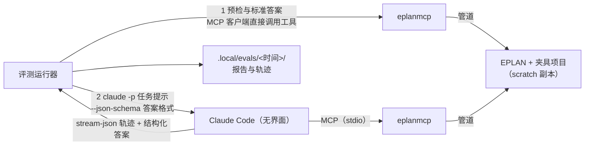

# 设计文档：Agent 评测 v0

| 项 | 内容 |
|---|---|
| 状态 | In Review（Q1、Q2 已由项目负责人决定） |
| 作者 | asckye |
| 关联 Issue | — |
| 相关文档 | [M2 设计](2026-10-18-m2-read-core.md) 第 7 节与 Q1；[测试规范第 5 节](../standards/testing.md#5-agent-评测)；[工具设计规范第 2 节](../standards/mcp-tool-design.md#2-设计流程) |
| 最后更新 | 2026-10-19 |

## 1. 背景
M2 的完成标准是"只读任务的 Agent 评测成功率 ≥ 90%"。13 个只读工具都已实现，但还没有评测框架。单元测试证明工具"能工作"，评测要回答的是模型"会不会用"：选对工具、一次传对参数、读懂结果、出错后能自行纠正（[测试规范第 5 节](../standards/testing.md#5-agent-评测)）。

M2 设计 Q1 已经决定：用 Claude Code 的无界面模式 `claude -p` 驱动模型，沿用现有登录。对本机 Claude Code 2.1.299 的核查（2026-10-19）：
- 可用的开关：`--json-schema`（结构化输出）、`--mcp-config` 与 `--strict-mcp-config`、`--allowedTools`、`--output-format stream-json`、`--no-session-persistence`、`--restricted`、`--tools`、`--disable-slash-commands`、`--model`、`--max-budget-usd`、`--max-turns`（`--help` 中没有列出，[CLI 参考](https://code.claude.com/docs/en/cli-reference)中有）。
- `--bare` **不读取登录态**，只接受 `ANTHROPIC_API_KEY` 或 `apiKeyHelper`（[无界面模式文档](https://code.claude.com/docs/en/headless#start-faster-with-bare-mode)），与 Q1"沿用现有登录"冲突，因此不用；改用为评测设计的 `--restricted`（2026-10-19 实测见 [api-notes C 节](../eplan/api-notes.md#c-mcp-客户端与-c-sdkspike-s42026-10-13)）。
- 桌面版自带的 `claude.exe` 单独运行时没有登录态（`claude auth status` 返回 `loggedIn: false`），需要工程师先在命令行登录一次（`claude auth login`，或用 `claude setup-token` 生成长期令牌）。

## 2. 目标与非目标
**目标**
1. 评测运行器 `evals/EplanMcp.Evals`：读取任务，驱动 `claude -p` 完成任务，按程序规则判定成败，统计调用次数、token、耗时和出错后的自我纠正，生成报告。
2. 任务集 v0：约 20 个只读任务，开发集约 14 个、保留集约 6 个，题目来自 M2 设计第 7 节和 [API 覆盖矩阵第 4 节](../eplan/api-coverage.md#4-国内工程师的高频任务需求信号)。
3. 运行器的判分、解析和任务校验有 Small 测试，进 CI；真正跑评测（需要 EPLAN、夹具和模型）是手动步骤。

**非目标**
- 写操作的评测（M3）。
- 在 CI 中跑评测：需要 EPLAN 授权、登录态，会计费（[开发流程第 7 节](../process/development-workflow.md#7-ci-关卡)：自托管 runner、发布前运行）。
- 用模型给答案打分（LLM 判分）：v0 只用程序判分，结果可复现。
- 比较不同模型或客户端：v0 固定一个模型。

## 3. 方案概述



**用 eplanmcp 本身作为标准答案的来源**：每个任务声明几次"标准调用"（工具名、参数、从结果中取哪个字段）。运行器在让模型作答之前，自己通过 MCP 客户端调用这些工具，得到夹具项目上的真实值；模型的结构化答案与之比较。这样：
- 仓库里不需要硬编码夹具的数据，换一份夹具（或 EPLAN 版本变化导致数据变化）不会让评测失效；
- 评测衡量的是"模型能否通过工具得到正确答案"。工具本身是否读对了 EPLAN，由 Large 测试负责（M2 设计第 7 节），两者分工明确。

## 4. 详细设计

### 4.1 任务文件
放在 `evals/tasks/<id>.yaml`，在[测试规范第 5 节](../standards/testing.md#5-agent-评测)格式的基础上细化：

```yaml
id: device-pages
set: dev                       # dev 或 holdout
prompt: |
  =GAA+A1-FC1 这个设备的触点分布在哪几页？
answer:                        # 模型答案的 JSON Schema，经 --json-schema 传给 claude
  type: object
  required: [pages]
  properties:
    pages: { type: array, items: { type: string } }
oracle:                        # 标准调用：运行器直接调用工具取值
  pages:
    tool: eplan_device_get
    args: { tag: "=GAA+A1-FC1" }
    pick: $.functions[*].page  # 辅助功能（触点等）所在的页
checks:
  - answer: $.pages
    set_equals: oracle.pages   # 不计顺序、去重
budget: { max_tool_calls: 12, max_minutes: 4 }
```

- `pick` 和 `answer` 用 JSONPath 的一个小子集：`$`、`.字段`、`[n]`、`[*]`。运行器自己实现，不引入 JSONPath 库。
- 比较方式：`equals`（数字按数值，字符串按原文）、`equals_ignore_case`、`set_equals`（数组，不计顺序、去重）、`contains`（数组包含、或字符串包含）、`at_least` / `at_most`（数字）。期望值可以是 `oracle.<名>` 或字面量。
- 任务加载时校验：`id` 与文件名一致、`set` 合法、`answer` 是对象 schema、每个检查引用的 `oracle` 都已定义、工具名已注册。校验失败的任务不运行，报告中列出。
- 文件格式用 YAML，与测试规范一致。解析用 `YamlDotNet`（MIT，只用于评测运行器，不随产品分发）。

### 4.2 运行一次任务
1. **预检**（每次运行一次）：
   - `claude auth status` 为已登录，否则停止，并提示工程师运行 `claude auth login`；
   - 运行器作为 MCP 客户端启动 `eplanmcp`，`eplan_session_status` 为已连接；
   - `eplan_project_list` 的当前项目是夹具：路径在 scratch 根目录（`%USERPROFILE%\EplanMcp\scratch\`，[ADR-0008](../adr/0008-data-locations-and-instance-discovery.md)）下，否则拒绝运行。工具虽然都是只读的，评测也只在 scratch 副本上进行（`CLAUDE.md` 硬性规则 1 的精神）。
2. **标准答案**：依次执行任务的 `oracle` 调用。标准调用失败时任务记为"无效"（不计入成功率），报告中写明原因。
3. **作答**：在仓库之外新建的空目录（系统临时目录下）中启动

   ```
   claude -p --output-format stream-json --verbose --no-session-persistence
     --restricted --tools "" --disable-slash-commands --strict-mcp-config --mcp-config <只含 eplanmcp 的配置>
     --allowedTools mcp__eplan --permission-mode dontAsk --permission-prompts none
     --json-schema <answer> --model <模型> --max-budget-usd <上限> --max-turns <调用上限 + 1>
   ```

   - `--restricted` 不读本机的用户和项目设置（钩子、权限规则等），关闭项目记忆（`CLAUDE.md`）；`--tools ""` 去掉全部内置工具，`--disable-slash-commands` 去掉技能，`--strict-mcp-config` 只连接 eplanmcp。工作目录放在仓库之外，祖先目录中的 `CLAUDE.md` 也不会被发现；
   - 只允许 eplanmcp 的工具，模型不能读文件或执行命令。运行器检查 `system/init` 事件：工具列表中出现 eplanmcp 和 `StructuredOutput`（`--json-schema` 用它提交答案，不计入调用次数）以外的工具，或 eplanmcp 没有连接，就立即终止，这次运行记为"无效"；
   - 提示原样使用任务中的中文，不追加"请调用某某工具"之类的引导，避免高估工具的易用性。提示从标准输入传入，而不是作为参数：以 `-` 开头的提示（例如"-FC1 在哪几页？"）会被当成开关；
   - 轨迹（`transcript.jsonl`）和标准错误写在 `.local/evals/<运行>/<任务>/`。
4. **预算**：运行器逐行读取 stream-json，统计主对话中的工具调用；超过 `max_tool_calls` 或超过 `max_minutes` 就终止进程（连同它启动的 eplanmcp），任务记为失败（"超出预算"）。`--max-budget-usd` 是费用上的兜底，`--max-turns` 是调用计数之外的兜底。
   - 认证失败、API 错误、没有 `result` 事件就退出等**环境问题**记为"无效"，不计入成功率；没有给出结构化答案、`--max-budget-usd` 或 `--max-turns` 用尽记为失败。
   - 因 API 错误无效、而且没有工具调用和花费的作答（认证失败除外），等一分钟后重试一次，两次都记入报告（补充于 2026-10-19 的重复运行之后：共享登录的刷新冲突让 6 次作答无效）。
5. **判分**：从最后的 `result` 事件中取结构化答案，逐条执行 `checks`。全部通过才算成功。

**stream-json 的具体格式**以本机 Claude Code 的实际输出为准，全部已实测（api-notes C 节）：`system/init` 和 `result` 事件先在未登录状态下确认；工具调用（`assistant` 消息中的 `tool_use` 块）、工具结果（`user` 消息中的 `tool_result` 块）和结构化答案的提交方式在第一次真实运行（2026-10-19）中确认，与解析器的实现一致。

### 4.3 指标与报告
每个任务记录：成败与失败原因、工具调用次数（按工具分）、出错的调用（`isError`）及其后是否成功纠正、输入/输出 token、费用、耗时。

每次运行生成 `.local/evals/<yyyyMMdd-HHmmss>/`：
- `report.json`：全部数据；
- `report.md`：中文摘要，按开发集和保留集分别给出成功率、调用次数和 token 的中位数，列出失败任务和失败原因；
- `<任务>/transcript.jsonl`：原始轨迹，**失败的轨迹是改进工具描述的第一手材料**（[工具设计规范第 2 节](../standards/mcp-tool-design.md#2-设计流程)）。

`.local/` 不进仓库（轨迹中有夹具项目的数据）。发布前的评测结果按[开发流程第 8 节](../process/development-workflow.md#8-版本与发布)摘要写入发布说明。

### 4.4 命令行
```
dotnet run --project evals/EplanMcp.Evals -- run [--set dev|holdout|all] [--task <id>] [--repeat <n>]
    [--model <模型>] [--claude <claude.exe 路径>] [--eplanmcp <eplanmcp.exe 路径>]
dotnet run --project evals/EplanMcp.Evals -- check     # 只校验任务文件，不需要 EPLAN 和模型
```
- `--repeat`：同一任务运行多次，成功率取平均，用来观察模型的波动。
- 默认的 `claude` 路径：先找 PATH，再找 Claude 桌面版自带的最新版本（`%APPDATA%\Claude\claude-code\<版本>\…\claude.exe`；在包外运行时是包的重定向目录 `%LOCALAPPDATA%\Packages\Claude_*\LocalCache\Roaming\Claude\claude-code\…`，api-notes C 节）。

### 4.5 任务集 v0
约 20 个任务，覆盖全部 13 个工具和几类常见难点：

| 类别 | 例子 | 考察点 |
|---|---|---|
| 项目概况 | "这个项目有多少页？" | 选对 `eplan_project_get` |
| 页面 | "=GAA+A1 下有哪些多线原理图页？" | 过滤参数、分页 |
| 设备 | "-FC1 在哪几页？" | 短标识有歧义（S6：`-FC1` 出现在两个结构下），模型应发现 `AMBIGUOUS_NAME` 并说明或追问 |
| 连接 | "=GAA+A1-FC1 的 2 号端子接到哪里？" | 读懂连接的两端 |
| 部件 | "项目用了哪些制造商的部件？各有几种？" | 汇总分页结果 |
| 消息与检查 | "最近一次检查有几条错误？" | 区分系统消息和检查消息 |
| 多语言 | "用英文列出 =GAA+A1&EFS1/1 的页描述" | `language` 参数 |
| 超出能力 | 题目要求修改项目（例如"把 -FC1 改名"） | 只有只读工具时，应说明做不到，不应声称已完成；用结构化答案中的 `done: false` 判定 |

开发集用来改进工具描述；保留集只在验收时运行，不据此调整描述（[测试规范第 5 节](../standards/testing.md#5-agent-评测)）。具体题目在任务集的 PR 中给出，每题都在夹具上人工核对过一次标准调用的结果。

### 4.6 代码结构
```
evals/
  EplanMcp.Evals/        net10.0 控制台：任务加载与校验、预检、标准调用、claude 驱动、stream-json 解析、判分、报告
  tasks/*.yaml
  README.md              怎么准备夹具、登录、运行、读报告
tests/EplanMcp.Evals.Tests/   Small：任务校验、JSONPath 子集、各比较方式、stream-json 解析、报告汇总
```
运行器引用 `ModelContextProtocol`（已有）作为标准调用的 MCP 客户端。`EplanMcp.Evals.Tests` 加入 `EplanMcp.Ci.slnf` 和 `tests/test-suites.json`。

## 5. 安全与数据完整性
- 模型只能调用 eplanmcp 的工具，全部是 Read 级；不允许内置的读写文件和执行命令。
- 预检拒绝在 scratch 根目录之外的项目上运行。
- 轨迹和报告只写在 `.local/`，不提交，不上传。
- 费用：每个任务有 `--max-budget-usd` 上限，运行前在终端显示任务数和预计上限。

## 6. 备选方案
1. **在任务文件中写死夹具的答案**（例如"321 页"）：简单，但夹具或 EPLAN 版本一变就要逐个改题，而且答案的出处不清楚。否决，改用标准调用。
2. **Anthropic API 或 Claude Agent SDK 直接驱动**：需要单独的 API 密钥和计费，且评测的不是工程师实际使用的客户端。M2 设计 Q1 已决定用 `claude -p`。
3. **用模型判分**：能评判开放式回答，但结果有波动、难以复现。v0 不用；需要评判解释类回答时再考虑。
4. **任务用 JSON 而不是 YAML**：不需要新依赖，但多行中文提示写起来不便，也与测试规范不一致。

## 7. 测试与验证
- **Small**（进 CI）：任务文件的校验（各种错误一次列出）；JSONPath 子集；每种比较方式的边界（数值与字符串、大小写、空数组）；stream-json 解析（工具调用计数、工具错误后的纠正、结构化答案、usage）；预算判定；报告汇总。
- **手动**：在夹具上跑一遍开发集，确认 stream-json 格式（见 4.2），录下解析器的测试样本。

## 8. 发布与兼容性
评测运行器和任务不随产品分发，不影响工具契约。新增开发期依赖 `YamlDotNet`（MIT），只用于 `evals/`。

### 实施顺序（每个 PR 生产代码与文档不超过 400 行）
1. 本设计文档。
2. 运行器骨架：任务模型、加载与校验、JSONPath 子集、比较方式；`check` 命令；Small 测试。
3. claude 驱动与 stream-json 解析、预算；Small 测试（按文档格式的样本）。
4. 预检、标准调用、报告；`run` 命令。
5. 夹具脚本（M2 实施顺序第 7 步，与 Large 测试共用）和任务集 v0。
6. 第一次真实运行：确认 stream-json 格式，补录样本；按失败的轨迹改进工具描述。

## 9. 待定问题
| # | 问题 | 建议 |
|---|---|---|
| Q1 | 评测固定用哪个模型 | **已决定**（2026-10-19）：固定为 Claude Sonnet 5.5（`claude-sonnet-5-5`），在报告中记录；需要时用 `--model` 对照其他模型 |
| Q2 | 任务文件用 YAML（新增 `YamlDotNet`）还是 JSON | **已决定**（2026-10-19）：YAML，见第 6 节 |
| Q3 | 每个任务的费用上限 | 建议默认 0.50 美元，任务可单独设置；实现先按此值，第一次真实运行后按实际费用确认 |
