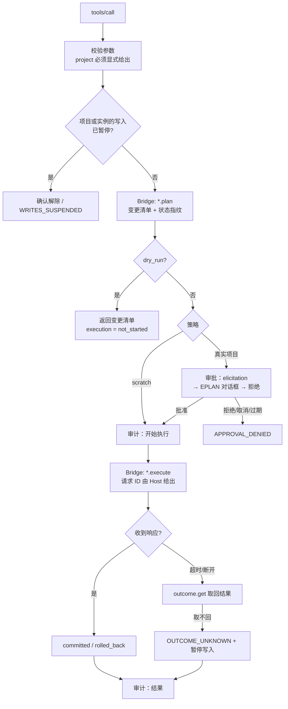

# 设计文档：M3 安全写入

| 项 | 内容 |
|---|---|
| 状态 | Approved（2026-10-19，项目负责人确认第 9 节的 Q1–Q6 均按本文建议） |
| 作者 | asckye |
| 关联 Issue | — |
| 相关 ADR | ADR-0005（安全模型）、ADR-0008（数据目录）、ADR-0009（支持的版本）、ADR-0010（写操作的结果与恢复） |
| 最后更新 | 2026-10-19 |

## 1. 背景
M2 交付了 13 个只读工具，评测和 Large 测试都已通过。M3 的范围见[架构文档第 11 节](../architecture/architecture.md#11-里程碑)：
- 写入的基础设施：策略引擎、审批（elicitation 和 EPLAN 对话框）、事务与撤销、审计哈希链、scratch 工作流；
- 第一批写工具：建页、放置设备或宏、设备标识、属性、连接。

完成标准是质量场景 Q1、Q2、Q3、Q6、Q7、Q9 通过，写入类 Agent 评测通过。ADR-0010 之后又加了 Q11、Q12。

规则已经由 ADR 定下。本文只把它们落实为组件、协议和实施顺序，并确定 ADR-0010 留给 M3 设计的几项：
- 结果记录的条数；
- 各工具的执行时限；
- `state\` 的文件格式；
- 确认表单的文字。

**EPLAN API 的现状**（[api-notes](../eplan/api-notes.md)）：

| 能力 | 状态 |
|---|---|
| 事务：`LockingStep` → `SafetyPoint` → `UndoStep`（在 SafetyPoint 内）→ `QuietModeStep` | 在 action 和主线程调度器中都验证过回滚与 Ctrl+Z（A7、A9） |
| 建页：`Page.Create(project, DocumentType, PagePropertyList)` | 已验证（S0、S2） |
| 改页属性：`page.Properties.PAGE_NOMINATIOMN.Set(…)` | 已验证，含回滚（S2） |
| 设备标识：设置 `Function.Name` | 已验证（A3） |
| 放置符号：`Function.Create(Page, SymbolVariant, PointD, PointD)` | 只在脚本中验证过：创建的功能没有名称，标识文字不会显示在图上 |
| 插入宏 | 没有查证过的 API |
| 新建连接 | 没有查证过的 API；相对的连接点只画出自动连线，要生成连接后才有 `Connection` |

## 2. 目标与非目标
- **目标**
  - **M3a**：写入基础设施全部完成，加上 API 已验证的工具：`eplan_page_create`、`eplan_page_update`、`eplan_device_update`（先只改设备标识）。
    - scratch 中的写入自动执行；真实项目的写入先列出变更、经工程师批准才执行。
    - 结果都带 `execution`，中断后能取回真实结果，结果未知时暂停写入。
    - 审计哈希链完整，Q1、Q2、Q3、Q6、Q7、Q9、Q11、Q12 自动化或有记录地验证。
  - **M3b**：spike S9 验证 API 之后，补上 `eplan_device_place`、`eplan_macro_insert` 和建连接的工具。
- **非目标**
  - Workbench 审批队列（M5）。
  - Destructive 级工具（删除、压缩、恢复备份）放到 M4；自动备份随之实现。
  - Code 级工具。
  - 检查的运行（`eplan_check_run`）：它会改写项目的消息，放到 M4 的工作流中，与本文的事务框架一起使用。

## 3. 方案概述
每个写工具走同一条流水线。工具只提供"规划"和"执行"两个 Bridge 操作，其余步骤由 Host 的公共代码完成：

## 4. 详细设计

### 4.1 Contracts 与协议（协议版本仍为 1）
- `BridgeError` 增加 `Execution`。成功结果的写操作数据也带 `Execution`，取值和不变式见 ADR-0010 第 1 节。
- `ErrorReason` 增加：
  - `ALREADY_EXISTS`、`POLICY_DENIED`、`APPROVAL_DENIED`、`APPROVAL_EXPIRED`、`PLAN_STALE`；
  - `AUDIT_UNAVAILABLE`、`OUTCOME_UNKNOWN`、`WRITES_SUSPENDED`。
- 每个写操作对应两个 Bridge 操作：
  - `<家族>.<动作>.plan`：只读，返回 `WritePlan { changes, fingerprint }`；
  - `<家族>.<动作>.execute`：带上计划中的参数和 `fingerprint`。
  例如 `page.create.plan` 和 `page.create.execute`。
- 新增操作 `outcome.get {requestId}`。Bridge 在握手的 `operations` 中声明它和各写操作；Host 只向声明了它的 Bridge 发送写操作，否则返回 `BRIDGE_INCOMPATIBLE`（ADR-0010 第 4 节）。

### 4.2 Bridge
- **写操作接口** `IWriteOperation`：
  - `Plan(args)` 在主线程上只读执行，与现有读操作相同。
  - `Execute(args, plan)` 在 `TransactionScope` 中执行：在调度器已有的 `LockingStep` 内，创建 `SafetyPoint`，再在其内创建 `UndoStep`（描述为 "AI: <工具名>"），最后是 `QuietModeStep(ShowNoDialogs)`（编码规范 9.3）。
  - 执行完先读回校验，通过后才 `Commit()`，然后 `CloseUndo()`。任何异常都 `Rollback()`。
- **状态指纹**：计划涉及的对象在规划时的状态，取 SHA-256。例如：
  - 建页：目标结构下已有页名的集合；
  - 改属性：这些属性的当前值。
  执行时重新计算，不同就返回 `PLAN_STALE`。指纹只覆盖计划涉及的对象，工程师改动项目中其他地方不影响执行。
- **结果记录**（ADR-0010 第 2 节）：
  - 以请求 ID 为键，保存在 `OperationRouter` 旁的内存表中，**最多 256 条**；"排队"和"执行中"的不会被挤出。
  - 先记录，再发送响应。
  - `outcome.get` 在管道线程上回答，不经过主线程。
  - 同一请求 ID 再次到达时，不执行，直接返回已记录的结果。
  - 多个 Host 共用一个 Bridge（最多 4 个连接），所以记录和去重都放在 Bridge 中。

### 4.3 Host
- **配置与数据目录**：
  - 新增 `HostDataLocations`，与插件的 `DataLocations` 规则相同：`EPLANMCP_HOME`，或 `%USERPROFILE%\EplanMcp`。
  - `config.json` 第一版只有两项：`scratchRoots`，默认 `<数据根目录>\scratch`；`writesOutsideScratch`，M3a 期间默认 `deny`（Q5），M3a 收尾时默认改为 `approve`。
  - 启动时校验；无效时拒绝启动，`doctor` 指出原因（架构 8.9）。
  - 没有任何工具可以修改它（SEC-02）。
- **scratch 判断**（SEC-05）：
  - 对项目路径和 scratch 根目录都取规范化的完整路径：解析 `..`、符号链接和联接点、8.3 短文件名，比较时不区分大小写。
  - 项目路径在某个根目录之下才算 scratch。
- **策略引擎** `PolicyEngine.Decide(tier, inScratch, config)`：纯函数，决策表由 Small 测试 100% 覆盖（ADR-0005）。
  - Write + scratch → 允许；
  - Write + 真实项目 → `writesOutsideScratch` 为 `deny` 时拒绝（`POLICY_DENIED`），为 `approve` 时需要审批；
  - Destructive → 始终审批（M4）；
  - Code → 拒绝。
- **计划存储** `PendingPlanStore`：
  - 计划保存在 Host 内存中：工具、参数、项目、变更清单、指纹。ID 是 128 位随机数，5 分钟后过期。
  - `requestState` = 计划 ID + 参数摘要 + 过期时间，用 HMAC-SHA256 签名。密钥在 Host 启动时随机生成，只存在内存中（S4）。
  - 校验签名、过期时间，以及计划与本次请求是否对应（SEC-06）。
- **审批** `ApprovalService`：
  - 客户端支持多轮请求并声明了 elicitation 时，抛出 `InputRequiredException` 发出表单（S4）；
  - 否则请 Bridge 在 EPLAN 中弹出审批对话框，以 EPLAN 主窗口为父窗口；
  - 两者都不可用时拒绝。
  - 表单只有确认选项，展示工具、项目、变更清单和"可以在 EPLAN 中用 Ctrl+Z 撤销"。文字见 4.6。
- **写入调用** `BridgeClient.InvokeWriteAsync(operation, args, requestId, limit)`：
  - 请求 ID 由调用方给出，写入审计的"开始执行"记录。
  - 等待超时或管道断开时，**不重发**：按同一个管道名重连，用 `outcome.get` 每秒查询一次，直到该工具的执行时限；到时仍"执行中"，按结果未知处理。
  - 读操作保持现有的行为（超时后返回 `TIMEOUT`）。
- **执行时限**：默认 60 秒，每个工具可以设定，上限 300 秒；建页按页数增加，每页 2 秒。读操作仍是 30 秒。
- **写入暂停**（ADR-0010 第 3 节），记录在 `state\suspended\` 中，每条一个 JSON 文件：
  - 项目：`project-<规范化路径的 SHA-256 前 16 位>.json`；
  - 实例：`instance-<进程号>-<进程启动时间>.json`。实例退出后（进程号和启动时间对不上）忽略并删除。
  - 字段：`project`、`instance`、`tool`、`requestId`、`time`、`reason`、`changes`（变更清单的前 20 行）。
  - 先写临时文件再改名，保证原子性。每次写操作之前检查；`doctor` 和 `eplan_session_status` 显示当前的暂停。
- **审计** `AuditLog`（架构 8.8）：
  - 每天一个 JSONL 文件。每条记录的哈希 = SHA-256(上一条的哈希 + 本条去掉哈希字段后的规范 JSON)。哈希链跨文件延续：每天第一条记录引用前一天最后一条。
  - 多个 Host 进程用 `audit\.lock` 排他打开来串行写入，写入后刷盘。写不进时，写操作返回 `AUDIT_UNAVAILABLE`。
  - `eplanmcp audit verify` 校验整条链，报告第一个断开的位置。
  - Host 启动时，找出只有"开始执行"、没有结果的记录，查询结果并补记；查不到就暂停写入。

### 4.4 第一批工具（M3a）
| 工具 | 级别 | 参数要点 | Bridge 操作 | API 状态 |
|---|---|---|---|---|
| `eplan_page_create` | Write | `project`（必填）；`pages`：1–50 项，每项是完整页名（如 `=GAA+A1&EFS1/5`）、`page_type`（默认 `Circuit`）、`description` 和 `language`；`dry_run` | `page.create.plan/execute` | 已验证，用页名设置结构标识的方式待 S9 确认 |
| `eplan_page_update` | Write | `project`；`pages`：页名 + 新的 `description`（指定 `language`）；`dry_run` | `page.update.plan/execute` | 已验证 |
| `eplan_device_update` | Write | `project`；`tag`（现有的完整或可见标识）、`new_tag`（第一版只改标识，设备属性在 M3b 加入）；`dry_run` | `device.update.plan/execute` | 已验证；对辅助功能和交叉引用的影响待 S9 确认 |

- 一次调用 = 一次审批 = 一个撤销步骤；批量建页同样只有一个撤销步骤（api-coverage 第 4 节）。
- 名称已存在时，规划阶段就返回 `ALREADY_EXISTS`，不进入审批。
- 每个工具在实现前按模板写工具规格，其中包含各阶段失败时的 `execution`。

### 4.5 spike
- **S8 写操作中断**（ADR-0010）：在第一个写工具合并之前进行，需要项目负责人在场。
- **S9 写入 API**：都在 scratch 副本上进行，不需要强制结束 EPLAN。验证内容：
  - 用完整页名设置结构标识；
  - 改名对辅助功能、交叉引用和连接的影响；
  - 放置带名称的设备并显示标识；
  - 插入窗口宏和符号宏；
  - 新建连接（或生成连接）；
  - 在调度器中写入时 `User.eod` 是否也被改写（A11）。

### 4.6 表单文字
审批表单和解除暂停的确认表单，文字跟随系统界面语言（与 `doctor` 相同），中文和英文各一份：
- **审批**：标题"批准 AI 修改 EPLAN 项目？"，正文为工具、项目、"将进行以下修改"加上变更清单，选项"批准 / 拒绝"，注明"批准后可在 EPLAN 中按 Ctrl+Z 撤销'AI: <工具>'这一步"。
- **解除暂停**：标题"上次 AI 修改的结果未知"，正文为时间、工具、计划中的变更清单，以及"请先在 EPLAN 中核实，必要时用 Ctrl+Z 撤销"，选项"已核实，继续 / 保持暂停"。

### 4.7 线程模型
- 规划和执行都在 EPLAN 主线程上执行，经现有调度器，进入主线程的超时仍是 10 秒。
- `outcome.get` 在管道线程上执行。
- 审批等待在 Host 中进行，不占用 EPLAN 主线程。在 EPLAN 中弹出的审批对话框例外：它是主线程上的模态窗口，期间其他调用返回 `EPLAN_BUSY`。

## 5. 安全与数据完整性
- 级别：第一批工具都是 Write；审批规则见 4.3，scratch 之外的写入一律经过审批。
- 失败时的状态：事务中失败一律回滚（`rolled_back`）。中断后取回真实结果；取不回时返回 `OUTCOME_UNKNOWN` 并暂停写入，跨会话、跨重启有效，只能由人解除。
- 提示注入：变更清单中的项目文本按不可信数据处理（ResultShaper）。审批表单原样展示将要发生的修改，最终由工程师判断。
- 威胁模型：落实 T2、T3、T4、T5、T6、T11、T12、T15 对应的 SEC-01、02、05、06、07、09、18。

## 6. 备选方案
- **M3 一次做完五类工具**：放置设备、插入宏、建连接的 API 都没有查证，写入框架和这些未知数会互相拖累。否决，改为 M3a/M3b 两段。
- **只在 scratch 中写入，真实项目一律拒绝**：最安全，但与 ADR-0005 不符，而且工程师最终要在真实项目上用。只作为 M3a 期间的临时默认值（Q5 已决定）。
- **审批状态放在客户端**：MRTR 允许，但计划内容可能被篡改（T2）。否决，计划只保存在 Host 中。
- **按项目文件的修改时间做状态指纹**：EPLAN 的每次 action（哪怕只是读取）都会改写项目的 `User.eod`（A11），修改时间不可靠。否决。

## 7. 测试与验证
- **Small**：
  - 策略决策表全覆盖；scratch 路径判断（`..`、符号链接、短文件名、大小写）；
  - `requestState` 的签名、篡改、过期、重放；
  - 审计哈希链与 `audit verify`（Q9）；审计不可写时拒绝（Q7）；
  - `execution` 的两条不变式和错误码映射；暂停记录的读写与过期实例。
- **Medium**：用假 Bridge 测试：
  - 途中断开、延迟提交、重复请求 ID、Host 重启后补记（Q11）；
  - 通过 SDK 客户端走完 MRTR 审批的批准、拒绝、取消、过期（S4 的自测模式）。
- **Large**：
  - 夹具使用示例项目的副本，放在 scratch 中；另放一份在 scratch 之外，扮演"真实项目"，测试中只拒绝、从不批准；
  - Q1（拒绝后项目没有变化）、Q2（故障注入后回滚）、Q6（规划之后改动项目，返回 `PLAN_STALE`）；
  - Q3（一次 Ctrl+Z 撤销整步）要操作 EPLAN 界面，先手工验证并记入 api-notes；
  - Q12 由 S8 验证。
- **Agent 评测**：新增写入任务，每次作答都在一份新的 scratch 副本上进行，作答后用读工具核对结果。每次作答前怎样换上新副本，见 Q4。

## 8. 发布与兼容性
- 只新增工具、错误码和可选字段，不破坏已有契约；读工具的行为不变。
- `CHANGELOG` 的 Added 记录新工具，Changed 记录错误结构增加 `execution`。
- 实施顺序（每个 PR 目标 200 行，上限 400 行）：
  1. Contracts：`execution`、新错误码、`outcome.get`、`WritePlan`；
  2. Host 数据目录、`config.json`、scratch 判断、策略引擎；
  3. 审计哈希链与 `audit verify`；
  4. Bridge 结果记录、`outcome.get`、去重；
  5. Host 写入调用：请求 ID、取回结果；
  6. 写入暂停：记录、检查，在 `doctor` 和 `eplan_session_status` 中显示；
  7. 计划存储与 `requestState`；
  8. 审批：elicitation 渠道与表单文字；
  9. spike S8（项目负责人在场）、spike S9；
  10. Bridge `TransactionScope` 与 `eplan_page_create`（含工具规格、Large 测试）；
  11. `eplan_page_update`、`eplan_device_update`；
  12. EPLAN 对话框审批渠道；
  13. 写入评测任务与 Large 测试 Q1、Q2、Q6，M3a 收尾；
  14. M3b：按 S9 的结论设计放置设备、插入宏、建连接。

## 9. 待定问题与决定

| # | 问题 | 结论 |
|---|---|---|
| Q1 | M3 是否分成 M3a（基础设施 + 页工具 + 改设备标识）和 M3b（放置、宏、连接，等 S9） | **已决定**（2026-10-19，项目负责人按建议）：分两段 |
| Q2 | 审批表单的语言 | **已决定**（2026-10-19，项目负责人按建议）：跟随系统界面语言，中文和英文各一份（4.6）；变更清单中的项目数据原样 |
| Q3 | 写操作的执行时限 | **已决定**（2026-10-19，项目负责人按建议）：默认 60 秒，上限 300 秒，建页每页加 2 秒；结果记录 256 条 |
| Q4 | 写入评测每次作答前如何恢复夹具：每题用不同文件名的副本并由运行器打开，还是允许运行器重启 EPLAN | **已决定**（2026-10-19，项目负责人按建议）：先验证"运行器打开另一个副本"（A11：`ProjectOpen` 不一定改变当前项目），不行再考虑重启 |
| Q5 | M3a 期间，真实项目的写入是否先一律拒绝，直到 EPLAN 对话框渠道和 Large 测试 Q1–Q3 都通过 | **已决定**（2026-10-19，项目负责人按建议）：是：`config.json` 默认只允许 scratch，M3a 收尾时改为按 ADR-0005 审批 |
| Q6 | S4 的界面人工确认（表单如何显示中文变更清单，三种回答的往返）放在第 8 步之前 | **已决定**（2026-10-19，项目负责人按建议）：是，由项目负责人在交互式会话中确认 |
