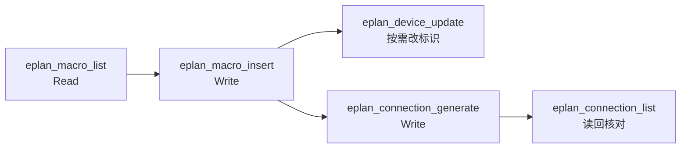

# 设计文档：M3b 插入宏、生成连接

| 项 | 内容 |
|---|---|
| 状态 | Approved（2026-10-20，项目负责人确认第 9 节的 Q1–Q4 均按本文建议） |
| 作者 | asckye |
| 关联 Issue | — |
| 相关 ADR | ADR-0005（安全模型）、ADR-0010（写操作的结果与恢复） |
| 最后更新 | 2026-10-20 |

## 1. 背景
[M3 设计](2026-10-19-m3-safe-writes.md)把写工具分成两段：
- M3a：基础设施和建页、改页、改设备标识，正在实现；
- M3b：放置设备、插入宏、建连接，要等 spike S9 验证 API。

[S9](../../spikes/S9-write-api/README.md)（api-notes A13）的结论：

| 能力 | 结果 |
|---|---|
| 插入窗口宏 `Insert.WindowMacro` | ✅ 可行。设备取目标页的结构，**有显示标识**；只有 `SafetyPoint` 能撤回，`Transaction.Abort()` 撤不回 |
| 按库符号新建设备 `Function.Create` | ⚠️ 在 `SafetyPoint` 中必定失败，只能用 `Transaction`；新设备**不显示标识** |
| 生成连接 `Generate.Connections(Page[], bool)` | ✅ 把画出的自动连线变成 `Connection`，在 `SafetyPoint` 中提交过 |

另外，官方 XML 文档说明了两个参数：
- `Generate.Connections` 的第二个参数是 `bRebuildAllConnections`：true 重建全部连接，false 只更新；
- `Insert.WindowMacro` 有带 `NumerationMode` 的重载，取值 `None`（默认：不改设备标识，结构跟随目标页）、`Number`、`NumberPreferPrefix`、`NumberWithQuestionMark`。

EPLAN 自带的数据中有 695 个窗口宏（`.ema`），只有 50 个符号宏（`.ems`），后者基本是 FESTO 的流体元件。

## 2. 目标与非目标
- **目标**：
  - 代理能找到可用的窗口宏（`eplan_macro_list`）；
  - 能把宏放到页上的指定位置（`eplan_macro_insert`），得到带标识、能显示的设备；
  - 能为指定的页生成连接（`eplan_connection_generate`）；
  - 三个工具都沿用 M3a 的写入流水线和 `TransactionScope`（`SafetyPoint`），一次调用一个撤销步骤。
- **非目标**：
  - 按库符号放置单个设备（Q1）。前提是两件事先被验证：用 `Transaction` 包装时 Ctrl+Z 能否撤销，以及怎样显示设备标识；
  - 按坐标画单根导线；
  - 页宏（`.emp`）、符号宏；
  - 3D 布局（M4b）；删除（M4）。
  - 设备属性（功能文本等）的修改，单独写规格，不在本文范围内。

## 3. 方案概述

所有写入都只用 `SafetyPoint` 一种包装，与 M3a 相同。设备的放置一律通过窗口宏。它既能回滚，又能显示标识。需要"放一个线圈"时，用只含这个线圈的宏。

## 4. 详细设计

### 4.1 `eplan_macro_list`（Read）
- 列出宏目录下的 `.ema` 文件。宏目录是 `$(MD_MACROS)`，由 `PathMap.SubstitutePath` 得到，已验证（A4）。
- 参数：`name_contains`（文件名或相对路径，不区分大小写）、`limit`/`cursor`。
- 每项返回：`path`（相对于宏目录）、`name`。
- `detailed` 只对单个宏可用，打开宏，返回它的表达类型、变体数和描述。打开宏是否改动项目由 S10 确认。
- 只扫描文件系统，不打开每个宏：示例数据有 695 个宏，逐个打开太慢。

### 4.2 `eplan_macro_insert`（Write）
- **参数**：
  - `project`、`page`（完整页名）；
  - `macro`：`eplan_macro_list` 返回的相对路径；
  - `x`、`y`：宏的插入点，单位毫米，原点在页的左下角（A3）；
  - `variant`：默认 0；
  - `representation`：默认按页类型选择，电路图页用 `MultiLine`；
  - `numbering`：`keep` 或 `number`（Q2）；
  - `dry_run`。
- **规划**：
  - 解析宏路径。必须在宏目录之下：规范化规则同 SEC-05，拒绝 UNC 路径和联接点跳出，扩展名必须是 `.ema`；
  - 打开宏，确认它有要求的表达类型；
  - 确认插入点在页的幅面之内（读取幅面的 API 由 S10 查证）；
  - 变更清单：`insert macro <文件名> at (x, y) on page <页名>`，能读出宏内的设备时一并列出（S10）；
  - 指纹：页上全部功能的会话内标识，以及宏文件的大小和修改时间。
- **执行**：
  - 在 `TransactionScope` 中调用 `Insert.WindowMacro(path, representation, variant, page, PointD, MoveKind.Absolute, numbering)`；
  - 读回插入的功能，与插入前的设备标识集合比较：
    - `keep` 时，宏中的设备标识若与已有设备相同，EPLAN 会把它们合并为一个设备。这种情况回滚，返回 `ALREADY_EXISTS`，列出冲突的标识，提示改用 `number`，或先用 `eplan_device_update` 改名；
    - `number` 时，确认插入后没有发生合并。
  - 位置被同样的符号占用时，EPLAN 抛出 "S029181"（A13），回滚并返回 `INVALID_ARGUMENT`，提示换一个位置。
- **输出**：插入的设备（`tag`、`visibleTag`、`category`）、对象数、`execution`、`undo`。
- **时限**：默认 60 秒。

### 4.3 `eplan_connection_generate`（Write）
- **参数**：`project`、`pages`（1–50 个完整页名）、`dry_run`。
- 调用 `Generate.Connections(pages, false)`，即只更新、不重建全部连接（Q4）。
- **规划**：无法预先算出会生成哪些连接。变更清单只写"更新页 P 上的连接（现有 N 个）"，表单注明"可能新增或删除连接"。
- **执行**：读回这些页上的连接，与执行前比较，在结果中列出新增和删除的连接（最多 100 条，超出时截断并给出总数）。
- **指纹**：这些页上的连接，以及页上全部功能的会话内标识。

### 4.4 共同点
- 包装和 M3a 完全相同：`LockingStep → SafetyPoint → UndoStep → QuietModeStep`。`Transaction` 不进入产品代码。
- 读回校验通过才 `Commit()`。

### 4.5 spike S10（在 Bridge 调度器中进行，不在 action 中）
S9 全部在 action 中运行。M3b 的工具在调度器中执行，所以以下各项都在调度器中验证：
1. 宏中的设备与已有设备同名时，`NumerationMode` 各取值的结果：会不会合并，`Number` 能否避免合并；
2. 插入宏、生成连接之后，Ctrl+Z 能否一步撤销；
3. `SafetyPoint` 能否回滚 `Generate.Connections`，以及"只更新"会不会删除连接；
4. 不插入时能否读出宏内的设备；`WindowMacro.Open` 是否改动项目；
5. 读取页幅面的 API；
6. 在调度器中写入时，`User.eod` 是否被改写（A11）；
7. 留给 Q1：`UndoStep` 包住 `Transaction` 时，能否用 Ctrl+Z 撤销按符号新建的设备；用什么 API 显示设备标识。

## 5. 安全与数据完整性
- 三个工具中，两个是 Write：scratch 中自动执行，真实项目需要审批（M3a 的流水线）。
- **新的输入面：文件路径**。`macro` 是工具参数中的第一个文件路径。如果允许任意路径，它可能指向：
  - UNC 共享，访问时会泄露 Windows 凭据的哈希；
  - 任意文件，可能触发 EPLAN 的解析缺陷。

  所以只接受宏目录之下的相对路径，规范化后再判断。建议在[威胁模型](../standards/security.md)中新增 T16 和对应的 SEC-19，与本设计一起评审。
- 宏中的名称和描述来自外部数据，按项目数据处理，经过 ResultShaper。
- 失败时的状态：事务中失败一律回滚。读回发现设备合并，同样回滚。

## 6. 备选方案
- **现在就做按符号放置，用 `Transaction` 包装**：
  - 新设备不显示标识，工程师在图上看不到它；
  - Ctrl+Z 的效果没有验证；
  - `TransactionScope` 要分两种包装，宏和符号不能出现在同一次写入中，增加 ADR-0010 状态判断的复杂度。

  暂缓，见 Q1。
- **允许任意宏路径**：有凭据泄露的风险，否决。
- **对整个项目生成连接**：影响面太大，变更清单无法说清楚。否决，只按页生成（Q4）。
- **什么都不做，只提供 M3a 的工具**：代理无法画图，M3 的完成标准（放置设备或宏、建连接）达不到。否决。

## 7. 测试与验证
- **Small**：
  - 宏路径的判断：`..`、UNC、联接点、扩展名、大小写；
  - 插入点范围；变更清单；摘要；schema 快照；注解。
- **Medium**：在假 Bridge 上测试：
  - 合并冲突时返回 `ALREADY_EXISTS`（`rolled_back`）；
  - 位置占用时返回 `INVALID_ARGUMENT`；
  - 连接的新增和删除列表。
- **Large**（示例项目的 scratch 副本）：
  - 把 `Contactor_Feedback_Control.ema`（S9）插到新页上，再生成连接，用 `eplan_connection_list` 核对；
  - 在已有同名设备的页上用 `keep` 插入，返回 `ALREADY_EXISTS`，项目不变。
- **Agent 评测**："在 scratch 项目的新页 `=GAA+A1&EFS1/60` 上放一个接触器反馈控制回路，并生成连接"。作答后用读工具核对设备和连接。

## 8. 发布与兼容性
- 只新增工具，不改变已有契约。
- 实施顺序（每个 PR 目标 200 行，上限 400 行）：
  1. spike S10；
  2. 威胁模型 T16、SEC-19，宏路径的判断；
  3. `eplan_macro_list`；
  4. `eplan_macro_insert`；
  5. `eplan_connection_generate`；
  6. 写入评测与 Large 测试，M3b 收尾。
- M3b 在 M3a 的第 10 步（`TransactionScope`）之后开始；S10 不依赖它，可以先做。

## 9. 待定问题

| # | 问题 | 结论 |
|---|---|---|
| Q1 | 按库符号放置单个设备，是否放到 S10 第 7 项验证之后？ | **已决定**（2026-10-20，项目负责人按建议）：**是**。M3b 只用窗口宏放置；S10 证实 Ctrl+Z 能撤销、标识能显示之后，再单独设计 `eplan_device_place` |
| Q2 | `eplan_macro_insert` 的 `numbering` 默认取什么？ | **已决定**（同上）：**`number`**，由 EPLAN 分配不冲突的标识，避免设备被合并（以 S10 第 1 项的结果为准）。代理需要特定标识时，再用 `eplan_device_update` 改 |
| Q3 | 宏的来源只限 `$(MD_MACROS)`，还是在 `config.json` 中加 `macroRoots`？ | **已决定**（同上）：**只限 `$(MD_MACROS)`**。确有需要时再加配置项，届时按 SEC-02 只能通过配置文件修改 |
| Q4 | `eplan_connection_generate` 的范围是指定页（最多 50 页），还是整个项目？ | **已决定**（同上）：**指定页**，只做"更新"，不做"重建全部" |
