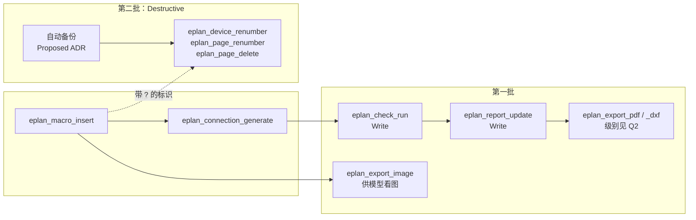

# 设计文档：M4 工程工作流

| 项 | 内容 |
|---|---|
| 状态 | Approved（2026-10-20，项目负责人确认第 9 节的 Q1–Q8 均按本文建议；Q2、Q4 的 Proposed ADR 另行确认） |
| 作者 | asckye |
| 关联 Issue | — |
| 相关 ADR | ADR-0003（IPC）、ADR-0005（安全模型）、ADR-0006（工具设计）、ADR-0010（写操作的结果与恢复） |
| 最后更新 | 2026-10-20 |

## 1. 背景
M3 建立写入流水线（策略、审批、审计、`TransactionScope`、ADR-0010 的结果恢复）和第一批写工具，M3b 再加上插入宏、生成连接。M4 建立在它们之上。[架构第 11 节](../architecture/architecture.md#11-里程碑)给 M4 的范围是：
- 报表更新、检查、导出（PDF/DXF/图片）、宏、重编号等面向任务的工具；
- 耗时操作的进度与任务支持；
- 受控 action 白名单。

完成标准是"典型工作流的端到端 Agent 评测通过"和"[API 覆盖矩阵](../eplan/api-coverage.md)中 M4 的条目全部完成"。[M3 设计](2026-10-19-m3-safe-writes.md)的非目标又放进来两项：Destructive 工具（删除等）连同自动备份，以及 `eplan_check_run`（运行检查会改写项目的消息）。

覆盖矩阵中 M4 有 30 个 action、79 行，多数是导入、部件库、翻译。本文只挑能闭合典型工作流的部分，其余推迟（Q1）。

**EPLAN API 的现状**（"XML"指 EPLAN Bin 目录中的官方 IntelliSense 文档，本文逐个核对过签名）：

| 能力 | API | 状态 |
|---|---|---|
| 运行检查 | `HEServices.Check.VerifyProject(Project, String, Boolean)`、`VerifyPages(ArrayList, String)` | `VerifyProject` 在 action 中实机验证（S6，A11）：3.9 秒，消息 0 → 20 条，改写 `Message`、`Project`、`Blob` 数据文件。调度器和事务中的行为未验证 |
| 更新报表 | `HEServices.Reports.GenerateProject(Project)`、`Reports.Update(Page)` | 只有 XML |
| 导出 PDF | `HEServices.Export.PdfProject(Project, …)`、`PdfPages(ArrayList, …)` | 只有 XML。方案为空时用界面上次使用的方案；给出文件名时，方案中的"文件名格式""子目录格式"仍然生效 |
| 导出图片 | `Export.GraphicPage(Page, String, Format, Int32, Int32, Compression, Boolean)` | S10 在调度器中用它导出过 PNG（A14）；是否改动项目文件未验证 |
| 导出 DXF/DWG | `Export.DxfDwgPagesToDisk(Page[], String, String, String)` | 只有 XML。最后一个参数会"在导出前把项目翻译成该语言" |
| 方案 | `Base.SchemeSetting`：`Init`、`GetLastUsed`、`CheckIfSchemeExists`、`GetCount`、`GetName` | 只有 XML。PDF 方案在 `USER.PDFExportGUI.SCHEMAS`，DXF 在 `USER.DXF.SCHEMES`；检查方案的节点没有查到 |
| 删页 | `DataModel.Page.Remove()` | S0 在 action 中删过页（A5）；事务中未验证 |
| 重编号 | `HEServices.Renumber.DeviceTags(IFunctionBase[], …)`、`Renumber.Pages(Page[], …)` | 只有 XML。`Enums.DeviceTags.PostNumerate` 只给带 `?` 的标识编号；过滤方案传空串用界面上次的，传 null 不过滤 |
| 备份 | `DataModel.ProjectManager.CopyProject(String, String, CopyMode.Snapshot)`；`HEServices.Backup.Project(…)` | 只有 XML。`Snapshot` 是"以非独占方式复制全部"；`Backup.Project` 会锁定项目，且文档写明"备份后 strProjectPath 失效" |
| EPLAN 的进度 | `Base.Progress`（带 `Canceled()`）；`Base.IEplProgress` + `ProgressFactory.RegisterProgress` | 只有 XML。后者文档写明用于离线程序 |

**协议与 SDK 的现状**：
- ADR-0003 已定下 `cancel` 方法和 `progress` 通知，但都没有实现：Bridge 忽略通知，Host 的 `PipeBridgeChannel` 跳过收到的通知。Bridge 的连接按顺序处理请求，执行期间读不到同一连接上的新消息。
- C# SDK 2.2.0（XML 文档）：工具方法的 `IProgress<ProgressNotificationValue>` 参数，在客户端给出 `progressToken` 时转成进度通知，否则丢弃；`CancellationToken` 参数响应客户端的 `notifications/cancelled`。SDK 没有实现 Tasks 扩展，只有为"任务增强执行"准备的钩子 `RequestHandlers.SetWithAlternate`。
- MCP 规范：`progress` 必须递增，双方应限制频率；客户端超时也通过 `notifications/cancelled` 取消请求，且可以在收到进度通知时重置超时（MAY）；被取消的请求不应回复。

## 2. 目标与非目标
- **目标**
  - **第一批**：代理能完成"改图 → 检查 → 更新报表 → 导出给人看"：`eplan_check_run`、`eplan_report_update`、`eplan_export_image`、`eplan_export_pdf`、`eplan_export_dxf`。
  - 耗时操作发送进度、可以取消，取消的结果落在确定的 `execution` 上。
  - 导出的文件只写进服务器新建的目录。
  - **第二批**：Destructive 流水线（每次审批，执行前自动备份），加上 `eplan_page_delete`、`eplan_device_renumber`、`eplan_page_renumber`。备份方案经 Proposed ADR 决定后才开工（Q4）。
  - 典型工作流的端到端 Agent 评测通过。
- **非目标**
  - Tasks 扩展（Q6）；受控 action 白名单（Q5）。
  - 导入、翻译、部件库、压缩、主数据更新、宏生成，线号、端子和电缆编号（4.7）。
  - 恢复备份的工具：M4 只做备份，恢复由工程师在 EPLAN 中打开备份副本。
  - Pro Panel 3D 和生产数据导出（M4b）。

## 3. 方案概述
写工具继续走 M3 的流水线；Destructive 工具在审批之后、执行之前多一步备份。导出不改项目，结果只是新目录中的文件。所有耗时调用共用一套进度和取消机制。

## 4. 详细设计

### 4.1 第一批工具
| 工具 | 级别 | 参数要点 | API | 状态 |
|---|---|---|---|---|
| `eplan_check_run` | Write（Q3） | `project`；`pages`（可选，1–50 页，省略为整个项目）；`scheme`；`dry_run` | `Check.VerifyProject(project, scheme, false)`、`Check.VerifyPages` | 见第 1 节 |
| `eplan_report_update` | Write（Q3） | `project`；`pages`（可选：只更新这些报表页，用 `Reports.Update(Page)`；省略时 `Reports.GenerateProject`）；`dry_run` | 同左 | 只有 XML |
| `eplan_export_image` | Q2 | `project`；`pages`（1–20）；`format`：`png`/`jpg`；`width_px`（默认 1600，上限 4000）；`inline` | `Export.GraphicPage(page, 目录, format, 24, width, Compression.None, false)` | S10 用过 |
| `eplan_export_pdf` | Q2 | `project`；`pages`（可选）；`scheme`；`color`：`color`/`grey`/`black_white`；`file_name` | `Export.PdfProject`、`Export.PdfPages` | 只有 XML |
| `eplan_export_dxf` | Q2 | `project`；`pages`（可选）；`scheme`（DXF 还是 DWG 由方案决定） | `Export.DxfDwgPagesToDisk(pages, scheme, 目录, "")` | 只有 XML |

- **方案**：省略 `scheme` 时用 EPLAN 当前的方案，结果中回显它的名称（`SchemeSetting.GetLastUsed`）。名称不存在时返回 `INVALID_ARGUMENT`，`metadata.candidates` 列出可用的方案（最多 20 个）。这样不需要新的列表工具。传入方案会不会改写界面的"上次使用"（用户设置），由 S11 验证；会的话，执行后写回原值。
- **`eplan_check_run`**：
  - 变更清单："按方案 S 检查 N 页；现有 M 条检查消息将被替换"。指纹：页的集合和现有消息数。
  - 结果：各级别的消息数和前 20 条消息，格式与 `eplan_check_list` 相同；要看更多就调用它。
  - 时限 120 秒。
- **`eplan_report_update`**：事先算不出会新建、替换或删除哪些报表页。变更清单只写范围："更新全部报表（现有报表页 N 页）；可能新建、替换或删除报表页"，与 M3b 的 `eplan_connection_generate` 相同（Q7）。执行后比较前后的报表页名，列出增删（最多 100 条）。时限 300 秒。
- **导出**：
  - 不传语言参数，DXF 的语言参数传空串，避免"导出前翻译项目"（S11 验证不翻译）。
  - `inline`：最多 4 页，把图片作为 MCP image 内容一并返回，让模型能"看"页面（S13 验证客户端能否转交给模型）。
  - 图片逐页导出，每页之后报告进度、检查取消；PDF、DXF 是一次 EPLAN 调用。
  - 时限 300 秒。
- **命名**：导出工具沿用覆盖矩阵规划的 `eplan_export_<格式>`。资源 `export` 已在词表中，动作位置放的是格式；实现前在[工具设计规范](../standards/mcp-tool-design.md) 3.3 节补一句。

### 4.2 第二批：Destructive 工具
| 工具 | 参数要点 | API | 状态 |
|---|---|---|---|
| `eplan_page_delete` | `project`；`pages`（1–50）；`dry_run` | `Page.Remove()` | S0（action 中） |
| `eplan_device_renumber` | `project`；`pages`（可选）；`only_unnumbered`（默认 true，即 `PostNumerate`）；`scheme`；`start`、`step`；`dry_run` | `Renumber.DeviceTags(IFunctionBase[], …)`，过滤方案传 null | 只有 XML |
| `eplan_page_renumber` | `project`；`pages`；`start`、`step`；`keep_text`；`subpages`：`retain`/`consecutive`/`to_main`；`dry_run` | `Renumber.Pages(Page[], …)` | 只有 XML |

- `only_unnumbered` 接上 M3b：`number` 方式插入的宏会留下 `-?QA1` 这类标识（A14），这个选项只给它们编号。
- 删页的变更清单逐页列出页名和页上的设备数。重编号的结果由 EPLAN 的规则决定，清单只列范围：对象、方案、起始值和步长（Q7）。执行后读回全部名称，结果和审计列出每个改变的名称（最多 200 条，超出时给出总数）。
- 流程：审批（每次，scratch 中也要，ADR-0005）→ 备份（4.5）→ `TransactionScope` → 读回 → 提交。备份不代替事务：失败照样回滚，Ctrl+Z 照样一步撤销。

### 4.3 耗时操作：进度与取消
**Host**：
- 耗时工具的处理器接收 SDK 绑定的 `IProgress<ProgressNotificationValue>` 和 `CancellationToken`。
- 等待 Bridge 期间，每 5 秒发一次心跳：`progress` 为已用秒数，不给 `total`，`message` 如 "Updating reports (40 s)"。有 Bridge 的分步进度（"第 3/20 页"）时改用分步进度，`progress` 仍然递增。
- 客户端取消后：
  - 请求还在 Host 的队列中：直接移除，不发给 Bridge；
  - 已经发出：通知 Bridge 取消，再按 ADR-0010 取回真实结果，写入审计。
- 规范规定不回复被取消的请求，模型看不到这个结果。如果已经提交，下一次调用的规划会看到项目的现状（例如名称已存在）。

**Bridge**：
- **进度**：执行中的操作把进度写进一个只保留最新值的槽，由管道一侧的线程用 `progress` 通知（带请求 ID）发出。主线程从不等待管道。
- **取消**：执行期间同一连接上的消息读不到，所以取消和 `outcome.get` 一样走新的连接：操作 `operation.cancel {requestId}`，在管道线程上设置取消标志，不经过主线程。
- 操作只在安全点检查标志：每页之前、EPLAN 调用返回之后、提交之前。写操作在提交前发现取消就回滚（`rolled_back`）；已提交的不撤回。一次 EPLAN 调用（如 `GenerateProject`）中途无法打断。
- 新操作在握手的 `operations` 中声明，协议版本仍为 1。旧 Bridge 没有 `operation.cancel` 时，Host 只能取消排队中的请求。

**线程模型**：每次工具调用只占一次主线程调度，与 M3 相同。一个写操作不拆成多次调度：拆开后工程师可以在中间修改项目，事务也跨不过去。调用期间 EPLAN 界面不响应，工具描述写明大致耗时。时限超过 M3 定下的 300 秒上限时（S11 测量），另请项目负责人决定。

### 4.4 导出文件的位置
- 导出根目录：`<数据根目录>\exports\`，与 `scratch\`、`audit\` 同级（ADR-0008）。
- 每次调用由 Host 新建目录 `exports\<项目名>\<UTC 时间>-<随机后缀>\`。参数中没有目录；只有 `eplan_export_pdf` 可以给 `file_name`：只是文件名，不能含路径分隔符、驱动器号或 `..`，扩展名由工具补上。
- Host 规范化路径，确认它在根目录之下、每一级都不是符号链接或联接点（SEC-19 的规则），再把完整路径交给 Bridge；Bridge 确认目录存在而且为空，才调用 EPLAN。
- 方案可能在目录中建子目录、决定文件名。所以导出后 Host 递归列出目录：每个文件都必须在目录之下，不能是链接。结果返回目录的完整路径，以及每个文件的相对路径和大小。
- 失败或取消时删除这个目录（只删本次新建的）。成功的导出不自动清理（Q8）。
- 威胁模型加入 T17（导出写到允许的目录之外、覆盖已有文件、写到 UNC 共享）和对应的 SEC-20。

### 4.5 Destructive 前的自动备份（方案，待 Proposed ADR）
ADR-0005 只规定"执行前自动备份"，没有规定怎么备份。备份改变审批流水线（执行前多一步，多一种拒绝），属于 L3，本文只给出供 ADR 讨论的方案（Q4）：
- **时机**：审批通过之后、执行之前。备份失败就不执行，返回新的错误码 `BACKUP_FAILED`（`execution: not_started`）。
- **方式**：`ProjectManager.CopyProject(项目, 备份路径, CopyMode.Snapshot)`。文档说它以非独占方式复制全部，可能不需要关闭项目；得到的是可以直接打开的项目副本。备选 `Backup.Project(…, Backup.Type.MakeBackup, …)` 得到 `.zw1` 归档，但文档写明要锁定项目。两者都由 S12 验证。
- **位置**：`<数据根目录>\backups\<项目名>\<UTC 时间>\`。路径写入审计和工具结果（`backup`）。
- **保留**：不自动删除备份（删除也是删数据）；`doctor` 报告备份占用的空间。

### 4.6 spike
S11、S12 在示例项目的 scratch 副本上进行，由协调人在实机上执行，不需要强制结束 EPLAN；S13 不需要 EPLAN。结论都写入 api-notes。

**S11 工作流 API**（在 Bridge 调度器中）：
1. `Check.VerifyProject` / `VerifyPages` 在 `TransactionScope` 中：耗时；只改消息还是也改设计数据；`SafetyPoint` 能否撤回新消息，Ctrl+Z 是否一步撤销；按页检查是否删除其他页的消息；检查方案在哪个设置节点。
2. `Reports.GenerateProject` 与 `Reports.Update(Page)`：耗时；新建、替换、删除了哪些页；能否回滚、一步撤销（决定 Q3）。
3. 三种导出：文件是否只出现在给定目录中（对照方案中配置的目录、文件名格式、子目录）；项目 `.edb` 是否不变（A11、A14 的办法）；传入方案是否改写"上次使用"；目标文件已存在时的行为；DXF 语言参数为空串时不翻译。
4. 这些调用中 EPLAN 是否显示自己的进度窗口，在 `QuietModeStep(ShowNoDialogs)` 下是否仍显示；工程师在窗口中点"取消"后，调用是抛出异常，还是正常返回不完整的结果。
5. 321 页的示例项目整体导出 PDF、更新报表的耗时（决定时限）。

**S12 Destructive 写入与备份**：
1. 在 EPLAN 中打开着的项目上调用 `CopyProject(…, CopyMode.Snapshot)`：是否需要关闭或独占；副本能否打开、是否完整；耗时和大小；源项目文件是否变化。对照 `Backup.Project(MakeBackup)`。
2. `Page.Remove()` 在 `TransactionScope` 中：回滚、一步撤销；对交叉引用和报表页的影响。
3. `Renumber.DeviceTags`（`PostNumerate`，过滤方案为 null）与 `Renumber.Pages`：回滚、一步撤销；静默模式下是否弹对话框；编号方案的取值。

**S13 客户端的进度与取消**（假 Bridge，不需要 EPLAN）：
1. Claude Code 调用工具时是否带 `progressToken`，是否显示进度；
2. 用户中断时是否发送 `notifications/cancelled`；
3. 超过 2 分钟转到后台之后，进度和结果怎样处理；
4. 工具结果中的 image 内容能否交给模型。

### 4.7 之后的候选（不在 M4）
| 能力 | API | 建议 |
|---|---|---|
| 线号；端子、电缆编号；生成电缆 | `ConnectionService.DesignateConnections`、`Renumber.Terminals`、`CableService` | 需求强（覆盖矩阵第 4 节的"线号管理器"）。第二批的 Destructive 流水线稳定后，作为下一组单独设计 |
| 导入（DXF/PXF、设备清单、部件清单、PDF 注释） | `HEServices.Import`、相应 action | 输入文件要有导入根目录（同 SEC-19），多数是 Destructive |
| 翻译 | `HEServices.Translate` | 改写全部文本，还依赖系统翻译库 |
| 部件库导入导出、同步 | `PartsService`、`Synchronize` | 写的是系统部件库，超出项目范围 |
| 压缩、主数据更新、修正项目条目 | `ProjectManagement.CompressProject`、`Masterdata.UpdateProject`、`CorrectProjectItems` | 文档没说明会删除什么（api-actions 7.2） |
| 宏生成 | `Masterdata.GenerateMacrosFromMacroProject` | 写主数据目录 |
| scratch 副本 | `CopyProject(…, Snapshot)` | S12 证实可行后，可以单独设计 ADR-0005 第 6 节的 `eplan_scratch_create` |

## 5. 安全与数据完整性
- **级别**：检查和报表是 Write（Q3）；导出不改项目，级别见 Q2；第二批是 Destructive，每次审批（包括 scratch），执行前备份。
- **新的输出面：导出文件**（T17、SEC-20，4.4）：模型不能选择位置，只能给文件名；每次写进新建的空目录，不覆盖任何已有文件；导出后核对每个文件的位置。
- **不可信内容**：检查消息、报表页名来自项目，经过 ResultShaper。`inline` 图片中的文字无法清洗，模型可能把图上的文字当成指令；最终防线仍是写操作的策略和审批（架构 8.5）。
- **拒绝服务**（T9）：耗时调用期间 EPLAN 界面不响应。页数上限、执行时限、每个实例一个串行队列（SEC-13），工具描述写明耗时。
- **失败时的状态**：写工具同 M3；提交前取消就回滚；导出失败或取消时删除本次目录；备份失败时不执行。
- **用户设置**：如果传入方案会改写"上次使用"，执行后写回原值（S11 之后在工具规格中定下）。

## 6. 备选方案
- **通用的 action 运行器 `eplan_action_run` 代替任务工具**：参数和结果都是字符串，没有变更清单、指纹和读回，action 内部的事务也不受控制。否决（Q5）。
- **用 `IEplProgress` 接管 EPLAN 的进度**：文档写明用于离线程序；在界面中它会替换工程师看到的进度窗口。否决；M5 的离线宿主可以再考虑。
- **让模型给出导出路径**（像 SEC-19 那样限制为根目录下的相对路径）：要处理覆盖、已有文件和子目录，而模型并不需要选择位置。否决，只允许文件名。
- **重编号先试运行再回滚，得到具体的变更清单**：审批之前就改动项目；EPLAN 在试运行中崩溃时项目状态未知。否决（Q7）。
- **备份时由 Host 直接复制 `.elk` 和 `.edb`**：EPLAN 打开着项目，复制到的数据是否一致不知道。否决。
- **一次做完覆盖矩阵中的全部 M4 条目**：多数写的是系统级数据，或者需要输入文件，工作量和风险都超出一个里程碑。否决（Q1）。

## 7. 测试与验证
- **Small**：导出目录（新建、规范化、链接、目录外的文件、文件名校验）；进度的节流和递增；取消发生在各阶段时的 `execution`；`BACKUP_FAILED` 的不变式；方案名不存在时的候选列表；schema 快照，注解与级别一致。
- **Medium**（假 Bridge）：
  - Bridge 的进度通知转发给客户端，以及心跳；
  - 排队中取消、执行中取消（回滚）、提交后取消；`operation.cancel` 走新的连接；
  - 备份失败时不执行；Destructive 在 scratch 中也要审批。
- **Large**（scratch 夹具）：
  - 检查后的消息数（S6：示例项目 20 条）；报表更新前后的报表页；
  - 导出 3 页 PDF 和图片：只在本次目录中产生文件，项目文件不变（扩展 `NoSideEffectTests`）；
  - 第二批：删页、重编号的回滚和读回；备份副本能够打开。审批不用 elicitation（ADR-0011），Large 测试中由只在测试中注册的审批渠道代替工程师批准 Destructive 调用；这个渠道不能出现在发布的构建中，实现时在 Destructive 流水线的工具规格中定下。
- **Agent 评测**：
  - 第一批："在 scratch 项目的新页 `=GAA+A1&EFS1/60` 上放一个接触器反馈控制回路并生成连接，运行检查，更新报表，导出这一页的 PDF，报告错误数和文件名"。作答后用读工具和导出目录核对。
  - 第二批："把这一页上带 ? 的设备标识编号"。

## 8. 发布与兼容性
- 只新增工具、可选字段和错误码 `BACKUP_FAILED`；协议版本不变。
- `CHANGELOG` 的 Added 记录新工具；覆盖矩阵按 Q1 的决定更新 M4 的各行。
- 实施顺序（每个 PR 目标 200 行，上限 400 行）：
  1. Proposed ADR：导出的级别与注解（Q2）、Destructive 前的自动备份（Q4）；威胁模型 T17、SEC-20；
  2. spike S11（实机）、S13（假 Bridge）；
  3. Contracts 与 Bridge：`progress` 通知、`operation.cancel`、安全点检查；
  4. Host：进度转发、心跳、取消；
  5. 导出目录；
  6. `eplan_check_run`（含工具规格、Large 测试）；
  7. `eplan_report_update`；
  8. `eplan_export_image`、`eplan_export_pdf`、`eplan_export_dxf`（Q2 的 ADR 接受之后）；
  9. 第一批的评测与 Large 测试；
  10. spike S12；备份的 ADR 接受后，Destructive 流水线：备份、`BACKUP_FAILED`、审计字段；
  11. `eplan_page_delete`；
  12. `eplan_device_renumber`、`eplan_page_renumber`；
  13. 第二批的评测与 Large 测试，M4 收尾。

## 9. 待定问题

| # | 问题 | 结论 |
|---|---|---|
| Q1 | M4 是否只做第一批（检查、报表、三种导出）和第二批（删页、两种重编号），其余条目（4.7）移到 M4 之后？ | **已决定**（2026-10-20，项目负责人按建议）：**是**。完成标准改为"两批工具完成、端到端评测通过"；覆盖矩阵中其余 M4 行改标"M4 之后"，各自单独设计 |
| Q2 | 导出的级别。导出不改项目（S11 验证），只在导出目录中新建文件：按 ADR-0005 的定义是 Read，但写了文件，`readOnlyHint: true` 并不准确 | **已决定**（同上）：**Read 级（不需要审批），注解 `readOnlyHint: false`、`destructiveHint: false`**。这改变 ADR-0005 第 1 节"级别与注解一一对应"的规则，**需要 Proposed ADR**；接受前导出工具不合并。S11 发现导出会改动项目时，改为 Write |
| Q3 | `eplan_check_run`、`eplan_report_update` 的级别 | **已决定**（同上）：**都是 Write**：scratch 中自动执行，真实项目需要审批。报表页由项目数据生成，随时可以重建。前提是 S11 证实两者都能被 `SafetyPoint` 回滚、一步撤销；报表做不到时改为 Destructive |
| Q4 | Destructive 前的自动备份怎么做 | **已决定**（同上）：按 4.5：`CopyProject(…, Snapshot)` 复制到 `<数据根目录>\backups\`；备份失败就不执行；scratch 中同样备份（与 ADR-0005 一致）；不自动删除备份。属于审批模型，**需要 Proposed ADR**，接受前第二批不开工 |
| Q5 | 受控 action 白名单（`eplan_action_run`）是否在 M4 实现 | **已决定**（同上）：**不在 M4**。需要的 action 都做成任务工具（有 `dry_run`、变更清单、读回）。确有需要时写 Proposed ADR，规定 action 的级别如何标定、参数如何约束 |
| Q6 | 是否支持 Tasks 扩展 | **已决定**（同上）：**M4 不做**：SDK 2.2.0 没有实现，Claude Code 的支持也没有测过（R4）。用进度通知、取消和执行时限；架构 6.5 相应改为"SDK 支持后再做" |
| Q7 | 报表更新和重编号事先算不出具体变化，变更清单能否只列范围 | **已决定**（同上）：**能**：与 M3b 的 `eplan_connection_generate` 相同，执行后在结果和审计中列出实际变化；不做"试运行再回滚" |
| Q8 | 导出目录是否可以配置、是否自动清理 | **已决定**（同上）：**固定**为 `<数据根目录>\exports\`，M4 不加配置项；成功的导出不自动清理，`doctor` 报告占用的空间 |
