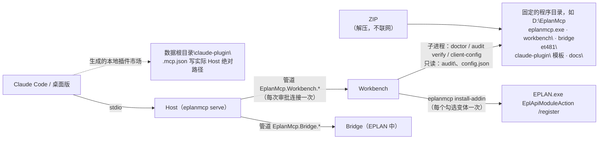

# 设计文档：M5 可运维

| 项 | 内容 |
|---|---|
| 状态 | Approved（2026-10-20，项目负责人确认第 9 节的 Q1–Q13：Q1 先选 A（WinUI 3），后改为 WPF 加 TIA 的主题（ADR-0017），Q2 改为界面也用 Maple Mono CN，其余按本文建议；ADR-0014、0016、0017 均已接受，0017 取代 0015） |
| 作者 | asckye |
| 关联 Issue | — |
| 相关 ADR | ADR-0002（进程模型）、ADR-0004（运行时）、ADR-0007（授权与分发）、ADR-0008（数据目录）、ADR-0011（审批渠道）；本文提议的 [ADR-0014](../adr/0014-workbench-approval-channel.md)（Workbench 进程与审批管道，已接受）、[ADR-0015](../adr/0015-workbench-ui-stack.md)（Workbench 界面技术，已接受）、[ADR-0016](../adr/0016-per-user-installer.md)（安装与分发，已接受） |
| 最后更新 | 2026-10-22：按项目负责人决定改为 ZIP；原安装器与固定目录方案由 ADR-0016 修订取代 |

## 1. 背景
[架构第 11 节](../architecture/architecture.md#11-里程碑)给 M5 的范围是：按用户安装的安装包；Workbench（客户端配置向导、审批队列、审计浏览，中英双语）；Claude Code 插件形式的交付包（一键安装，附中文入门指南）；离线宿主与 CI 实机测试；发布流水线（SBOM、来源证明，视情况加 EADN 签名）。完成标准是：在一台干净的机器上，非开发人员按中文入门指南安装成功；[安装验收清单](../architecture/architecture.md#71-安装验收清单m5-发布前逐项通过) I1–I10 全部通过。

**现状**：
- 安装只有开发脚本：`eng\scripts\eplan-addin.ps1` 用 `EPLAN.exe /Variant:"…" EplApiModuleAction /register:"<dll>"` 注册插件（会启动 EPLAN），README 用 `claude mcp add` 配置客户端。`install-addin`、`client-config` 两个子命令还没有实现（[M1 设计](2026-10-13-m1-skeleton.md)第 2 节）。
- 审批：`ApprovalService` 按注册顺序询问渠道，渠道返回 null 表示"现在不能问"，换下一个；只有 `EplanDialogChannel` 一种渠道，它经 Bridge 的 `approval.ask` 在 EPLAN 中弹出模态对话框，等待期间占住 Host 到这个 EPLAN 的队列。
- 数据根目录 `%USERPROFILE%\EplanMcp\`（ADR-0008）：`config.json`、`audit\`、`logs\`、`scratch\`、`state\`、`exports\`、`backups\`。
- Large 测试在开发机上手工运行，没有自托管 runner（[testing.md](../standards/testing.md) 第 4 节，风险 R9）。CI 用 `EplanMcp.Ci.slnf`，不构建插件：插件编译时要引用本机 EPLAN 的 API 程序集。
- 发布清单（[开发流程第 8 节](../process/development-workflow.md#8-版本与发布)、SEC-16）要求 CI 构建、SHA-256、CycloneDX SBOM、构建来源证明，不发布本地构建的二进制。
- 架构 5.1 写的 Workbench 是 .NET 10 WPF、字体 Maple Mono CN。**项目负责人 2026-10-20 决定：Workbench 的界面按 Microsoft Fluent UI（Fluent 2）及其组件库设计。** 选哪一种 Fluent 实现由 4.5 比较，作为 Q1 请项目负责人决定。
- 项目负责人的 TIA_Portal_Openness_MCP 项目（下称 TIA）已有 WPF Workbench 和管道审批，ADR-0011 借鉴过它。本文的 Workbench 管道沿用它的做法，下文注明出处。

**本文依赖的已验证事实**（[api-notes](../eplan/api-notes.md)）：A5（注册与影子副本）、A6（MSIX 客户端启动的进程写 `%LOCALAPPDATA%`、`%APPDATA%` 被重定向）、A8（插件程序集在 EPLAN 退出前不能卸载）、A10（注册后同一会话立即加载；注册按变体保存；退出时调用 `OnExit`）、A12（按变体注册）、B2（三种官方注册方式；注册信息在 STATION 设置中；插件被影子复制，EPLAN 运行时可以替换原始 DLL）、B5（离线程序的要求）。

**术语**：本文的"离线宿主"指 EPLAN 的离线程序（`EplApplication` 无界面运行，B5、架构 5.4）；"离线机器"指不能上网的电脑。两者无关。

## 2. 目标与非目标
- **目标**
  - G1 **ZIP**：一个压缩包，解压到短且固定的程序目录，在 Workbench 注册与撤销；不需要管理员或联网，数据目录独立；满足 I1–I10。
  - G2 **Workbench**：审批队列（ADR-0011 的渠道之一，规则与 EPLAN 对话框相同）、审计浏览、客户端配置向导、连接与授权状态，中英双语，Fluent 2。
  - G3 **Claude Code 插件**：随 ZIP 附带市场模板，由 Host 在数据目录生成含实际程序路径的本地市场，两条命令装好，带入门技能。
  - G4 **中文入门指南**：非开发人员在干净机器上按它装成功，即 M5 的完成标准。
  - G5 **离线宿主与实机测试**：离线宿主让 Large 测试不必用界面中的 EPLAN；实机测试在开发机上手动运行，不用自托管 runner（[ADR-0020](../adr/0020-no-self-hosted-runner.md)）。
  - G6 **发布流水线**：打标签后由 CI 构建全部产物，附 SHA-256、SBOM、来源证明；签名按 Q6。
- **非目标**
  - 自动更新：检查新版本要联网（I5）。新版本由工程师下载 ZIP，关闭程序后整体替换目录。
  - 在 Workbench 中修改安全配置：安全配置只通过配置文件修改（SEC-02）。Workbench 只读显示 `config.json`，并可以用系统默认程序打开它。
  - 在 Workbench 中编辑项目或发起 AI 操作（架构 5.1）；AI 操控 Workbench 界面（TIA 的 control 管道）。
  - 批量批准、会话内免审批（ADR-0005 后果：另写 ADR）；解除写入暂停的单独按钮（ADR-0010 决定只在下一次写入前经审批渠道确认）。
  - 2024、2025、2027 的安装验证（M6，S7）。M5 的支持矩阵只有 2026。
  - EADN 签名（ADR-0007，1.0 前重新评估）；.NET 8 插件（ADR-0004）。
  - 为其他 MCP 客户端做插件包：其他客户端只由配置向导写配置。

## 3. 方案概述
工程师解压 ZIP 后打开 `workbench\EplanMcp.Workbench.exe`，由 Workbench 调用 Host 的官方注册与客户端配置命令。客户端照旧经 stdio 启动 Host。Workbench 由工程师启动（或登录时自启动），在固定管道上等 Host 来问；Workbench 不在时照旧弹出 EPLAN 对话框。自检、审计校验、注册和客户端配置都复用 Host 子命令。

## 4. 详细设计

### 4.1 安装布局
| 位置 | 内容 |
|---|---|
| `<程序目录>\eplanmcp.exe` | Host，自包含单文件（ADR-0004） |
| `<程序目录>\workbench\EplanMcp.Workbench.exe` | 工程师打开的 Workbench（自包含，ADR-0017） |
| `<程序目录>\bridge\net481\` | 插件 `EplanMcp.Bridge.Eplan.dll` 及 `Bridge.Core`、`Contracts`（架构 7） |
| `<程序目录>\claude-plugin\` | 本地插件市场模板（4.7） |
| `<程序目录>\docs\` | 入门指南（4.8）、第三方许可证 |
| `<数据根目录>\claude-plugin\` | Host 生成的本地市场，包含实际 Host 绝对路径（Part B） |
| `<数据根目录>\state\addins.json` | `install-addin` 的注册记录（4.2），供卸载和 `doctor` 使用 |
| `<数据根目录>\workbench\` | Workbench 的设置；日志写 `<数据根目录>\logs\workbench-*.log` |

- ZIP 唯一顶层目录为 `EplanMcp-<version>\`，内容直接来自 CI 暂存的 `app\`，不再套一层 `app\`。工程师可把整个目录改名为 `D:\EplanMcp`；注册后保持这个位置。
- 程序目录与默认数据根目录 `%USERPROFILE%\EplanMcp` 分开；`EPLANMCP_HOME` 只改数据根目录。升级整体替换程序目录，保留配置、审计、scratch、日志等数据。
- 不修改 PATH 或全局环境，不创建卸载项和开始菜单入口。可选登录自启动仍由 Workbench 设置管理（只写当前用户的 `EplanMcp Workbench` 项）；删除程序前先在设置中关闭。

### 4.2 插件注册：`eplanmcp install-addin`
- **方式**：只用 B2 中的命令行 `EPLAN.exe /Variant:"<变体>" EplApiModuleAction /register:"<app>\bridge\net481\EplanMcp.Bridge.Eplan.dll"`，与 `eplan-addin.ps1` 相同，不写注册表、不往 EPLAN 目录复制文件（I2）。这条命令会启动 EPLAN，插件在同一会话中立即加载（A10）。
- **范围**：版本按 `doctor` 的办法在 `Program Files\EPLAN\Platform\<版本>\Bin\` 下查找，只处理支持矩阵中的版本（ADR-0009）。注册按变体保存（A10、A12），各版本有哪些变体没有核实（[eplan-versions](../eplan/eplan-versions.md) 3.5），所以由工程师勾选要用的变体，`--variant` 可以重复。
- **记录**：每次成功注册写入 `state\addins.json`（版本、变体、DLL 路径、时间）；`uninstall-addin` 按记录逐个执行 `/unregister:"EplanMcp.Bridge.Eplan"`，`doctor` 报告"EPLAN 在运行但插件没有加载"的变体（A10 的要求）。
- **升级**：DLL 的路径不变，不需要重新注册。EPLAN 加载的是影子副本，运行中也可以替换原始 DLL（B2），重启 EPLAN 后生效（A8）。握手报告插件版本，`eplan_session_status` 和 Workbench 据此提示"插件已更新，请重启 EPLAN"（I3）。开发中一直是"原路径重新构建、重启 EPLAN"，安装路径下由 S14 再确认。
- **S14 的结果**（2026-10-21，[spike S14](../../spikes/S14-addin-registration/README.md)，api-notes A23）：
  - 注册按机器保存在工作站设置中（`C:\Users\Public\Eplan\Settings\…\STATION.<…>.xdb`），标准用户可写；
  - 命令行注册总会另起一个新的 EPLAN 实例，注册在其中生效并立即加载，这个实例不会自己退出；
  - `/unregister` 有效，但设置中的键保留；
  - 原路径替换 DLL 后重启即生效；
  - 带下载标记的 DLL 无法加载；
  - 注册不落在 MSIX 重定向的目录中。
- **流程**（按 S14 修改）：`install-addin` 对每个勾选的变体：
  1. 该变体的 EPLAN 正在运行时拒绝，请工程师先关闭它：否则会再起一个装着全部插件的实例。
  2. 去掉 `<程序目录>\bridge\` 下所有文件的 `Zone.Identifier`（相当于 `Unblock-File`）。
  3. 执行注册命令，等这个命令启动的 EPLAN 进程出现它的 Bridge 管道（证明插件已加载），最多 2 分钟。
  4. 正常关闭这个实例（它没有项目）。它显示登录、授权等对话框时不强行关闭，请工程师处理后自己关闭。
  5. 写入 `state\addins.json`。
- **判断是否已注册**：看 `state\addins.json` 和 Bridge 的握手，不看设置中的键：撤销后键仍保留（S14）。`doctor` 另外报告插件文件带下载标记的情况。
- **一台电脑一个用户**（项目负责人 2026-10-21 决定，Q15）：注册是整台电脑的；ZIP 改造后仍由一个用户管理程序目录，跨用户访问与注册覆盖的限制不变（ADR-0016 修订）。处理方式：
  - 保持按用户安装；
  - 已有的 EplanMcp 注册指向另一个用户的目录时，`install-addin` 拒绝并说明原因；
  - `doctor` 报告这种情况；
  - 入门指南写明"一台电脑由一个 Windows 用户使用 EplanMcp"。
  - 判断方法（2026-10-21，实机核对之后）：工作站设置 `Setting.eod` 中的路径经 zlib 压缩后分页保存（A23），不读它。改为看握手：`install-addin` 第一次启动的 EPLAN 加载了另一个 Windows 用户目录中的插件（`%USERPROFILE%` 上级目录中的其他用户名，`Public` 除外）时，不撤销、不再注册，报 `other_user`。**只能部分做到**：那个用户的插件这个用户读不到时，EPLAN 加载失败（系统消息窗口），看不出是谁的注册，这次注册会覆盖它；旧版插件不报告路径时，也会先撤销再注册。`doctor` 的报告留到后续 PR。项目负责人 2026-10-21 接受这个限制（"Q15 接受部分做到"）。
- **MSIX 环境**：注册不受重定向影响（S14），`install-addin` 不再因 MSIX 环境而拒绝；`client-config` 仍然拒绝（它写 `%APPDATA%` 等位置）。
- **实现**（2026-10-21，第 8 节步骤 4；上文没有规定的地方按下面做）：
  - 命令行：`install-addin [--variant <变体>]… [--format json]`、`uninstall-addin [--format json]`。不带 `--variant` 时注册找到的全部变体；Workbench 按勾选逐个传 `--variant`。变体是 `<Program Files>\EPLAN\<变体>\<版本目录>\Bin\W3u.exe` 存在的目录（A22），`--variant` 不区分大小写；有一个没有安装时什么都不做，并列出已安装的变体。
  - 版本：支持范围 2024–2027 内的都注册，未实测的（ADR-0009）附说明；范围外的跳过；只有范围外的版本时报 `no_eplan` 并列出找到的版本。
  - 插件：只看运行中的 `eplanmcp.exe` 旁边。安装布局为 `<app>\bridge\net481\EplanMcp.Bridge.Eplan.dll`，去掉整个 `<app>\bridge\` 的下载标记；开发时（Host 在 `src\EplanMcp.Host\bin\<配置>\<框架>\`）用同一配置的 `src\EplanMcp.Bridge.Eplan\bin\<配置>\net481\` 中的插件，去掉这个目录的标记；两处都没有时报告找过的路径。
  - 运行中的判断：本 Windows 会话中有任何 `EPLAN.exe` 在运行就拒绝。从外面判断不出运行中的 EPLAN 是哪个变体：`HKCU\Software\EPLAN\RemoteServer\<端口>` 的 `EplanProductVariant` 实测是授权名称"Eplan Demo System"（A1），不是变体名，所以不用它。
  - 启动：经 shell 启动 `EPLAN.exe`，工作目录是 EPLAN 的 `Bin`：EPLAN 不继承 eplanmcp 的句柄（否则读取 eplanmcp 输出的安装程序、Workbench 要等到 EPLAN 退出），留下的 EPLAN 也不占用 `app\` 目录。
  - 等待与关闭：每 0.5 秒查一次管道，等到所启动进程的 `EplanMcp.Bridge.<进程号>.*` 出现，最多 2 分钟；然后像点关闭按钮一样请 EPLAN 关闭，每 3 秒再请一次，最多 60 秒。每次请求之前都要刷新进程对象：.NET 的 `Process` 缓存第一次找到的主窗口句柄，EPLAN 启动早期是启动画面，不刷新时请求都发给了它（A23，第二轮实机核对）。主窗口不可用（有模态对话框，例如插件加载失败或撤销出错时的"系统消息"窗口）或到时没有退出时，不强制结束，请工程师自己关闭。
  - 判断已注册：管道只说明有一个注册加载了，不说明是这一次的（A23：已注册在路径 A 时，插件在启动时从 A 加载，`/register` 路径 B 没有生效）。所以握手要报告 EPLAN 注册插件的位置（`addinPath`，取自 `IEplAddInShadowCopy.OnBeforeInit`，B2；传的是 DLL 还是目录未核实，两种都接受），与要注册的 DLL 相同才算"已注册"，写入记录。
  - 路径变化：握手报告的是另一个路径，或者没有报告（旧版插件）时，先关闭这个 EPLAN，再单独启动一次 EPLAN 执行 `/unregister`（等管道、再等 10 秒、关闭），然后第三次启动执行 `/register`。第三次启动时没有已注册的插件，管道只能来自这次注册，所以握手不报告路径时也算"已注册"；仍报告另一个路径时为"未确认"（`path_mismatch`），不记录；第三次启动的 EPLAN 在管道出现前退出时，旧注册已撤销、新的没有做成，删除这一项的记录。**这样能否让新路径生效还没有实机确认**；第一个或第二个 EPLAN 没有关闭时到此为止，报"未确认"。插件没有回应握手（试 3 次）时看不出加载的是哪一个注册，不撤销、不再注册，报"未确认"（`handshake_failed`），但写入记录：这次的注册可能已经生效。
  - 结果：2 分钟内没有管道、EPLAN 仍在运行为"未确认"，EPLAN 留着，**也写入记录**：工程师处理完登录或授权对话框后注册仍会生效，卸载要能撤销它；管道出现之前 EPLAN 就退出为"失败"，不记录。任何一项有问题时退出码为 1，跳过的不算。
  - 撤销：只运行现在仍然安装着的 `EPLAN.exe` 和变体，从不运行记录中写的其他程序；EPLAN 或变体已经不在时跳过并删除这条记录。撤销时插件先加载、再执行 `/unregister`（A23），所以同样等管道出现、再等 10 秒，然后删除记录、关闭 EPLAN；未确认或失败时保留记录，可以再运行一次。`/unregister` 按程序集名撤销，不论注册指向哪里：别人后来注册的也会被撤销，启动 EPLAN 之前看不出来。
  - `doctor` 的三项检查（插件文件带下载标记、记录的变体在运行但插件没有加载、Q15 的情况）留到后续 PR。

### 4.3 ZIP、升级、卸载与离线
- **交付**：只提供 ZIP，见 ADR-0016 的 2026-10-22 修订；不再构建 Inno Setup。
- **首次运行**：校验 ZIP → 属性中“解除锁定”后解压全部文件 → 移至短且固定的目录 → 打开 `workbench\EplanMcp.Workbench.exe` → 勾选检测到的变体并注册 → 在客户端页配置客户端 → 在状态页自检。Host 注册前已保证去掉整个 `bridge\` 的下载标记；解锁 ZIP 还覆盖 Workbench 等文件。
- **升级**：等待写入结束，关闭 EPLAN、客户端和 Workbench（从托盘退出），用新 ZIP 整体替换原程序目录，路径不变时无需重新注册；再打开 Workbench 更新客户端配置或生成的插件市场。不强制结束 Host，不支持降级；路径改变时须重新注册并重写配置。
- **卸载**：先移除客户端配置/Claude Code 市场并关闭登录自启动；关闭 EPLAN 和客户端，在 Workbench 撤销全部已记录注册。成功后退出 Workbench 并删除程序目录；撤销失败先处理问题，保留程序重试。数据根目录中的全部数据保留，由工程师决定是否删除。
- **离线**：ZIP 自带自包含 Host、Workbench、插件、市场模板、指南和许可证，不需要另装 .NET，不联网、不绑定电脑。客户端自己的模型服务不在本项目范围内。

### 4.4 Workbench
**功能**（中英双语，默认跟随系统语言，可以切换，切换立即生效）：
1. **审批队列**（4.6、ADR-0014）：等待中的审批和解除暂停的确认，以及本次运行中已回答的记录（不持久化，审计才是记录）。
2. **审计浏览**：只读。按日期、工具、项目、审批决定、执行结果筛选，显示一条记录的全部字段，打开所在文件夹。读取方式与 `AuditLog.ReadLines` 相同：共享读写，不加锁，忽略最后一个未写完的行，从不写入。"校验完整性"调用 `eplanmcp audit verify --format json`，并说明哈希链查不出末尾整段被删除（架构 8.8）。
3. **客户端配置向导**：按 TIA 的做法，客户端以卡片列出（Q7 的 11 种，可以多选），副标题显示本机是否检测到；调用 `eplanmcp client-config <客户端> --dry-run --format json` 显示将要写入的差异，工程师确认后写入，原文件先备份。Claude Code 推荐用插件（4.7），向导给出两条命令；已装插件时不再为 Claude Code 写配置（4.7"二选一"）。
4. **状态**：`eplanmcp doctor --format json` 的结果分组显示：EPLAN 安装与支持矩阵、运行中的实例和变体、插件是否加载及是否需要重启、授权、MSIX 环境、用户 PATH 长度、数据目录、写入暂停、导出与备份占用的空间、下一次审批会用哪个渠道。打开时和按"刷新"时各运行一次，不自动轮询。
5. **设置**：语言、主题（跟随系统、浅色、深色）、登录时启动；`config.json` 只读显示。

**进程**：
- 每个用户、每个数据根目录一个 Workbench（ADR-0014）。再次启动时把已有的窗口带到前台后退出。
- 由工程师打开 `<程序目录>\workbench\EplanMcp.Workbench.exe`，或登录时自启动（Q3）。**Host 从不启动 Workbench**（与 TIA 相同）：Host 可能由 MSIX 客户端启动，子进程会继承重定向（A6）；无人值守的代理也不应在桌面上弹出程序。
- 关闭窗口时缩到托盘，队列照常工作；托盘菜单"退出"时如果还有等待中的问题，先提示，退出后这些问题按"已取消"返回，不执行。
- 不连接 Bridge，不引用 Host 的程序集。调用 `eplanmcp.exe` 时用参数列表启动（不经命令行解释器），有超时，输出按带 `schemaVersion` 的 JSON 解析。

**提醒**：新问题到达时托盘图标显示待处理数，任务栏按钮闪烁；窗口最小化或隐藏时，托盘弹出提示，点击后显示窗口。**不抢焦点**：工程师可能正在 EPLAN 中打字，按键不能落到 Workbench 上（ADR-0011 不设默认按钮也是这个原因）。

**spike S16（Workbench 的窗口与提醒）**，不需要 EPLAN：
1. 非前台进程能否把窗口显示在其他窗口之上而不激活它（Windows 的前台限制），EPLAN 最大化时工程师能否注意到；
2. 托盘提示、任务栏闪烁在 Windows 10、11 上的表现；未打包的程序发系统通知需要什么（TIA 记录了 Windows App SDK 的 `AppNotificationManager` 作为备选）；
3. 讲述人能否读出待处理数、倒计时（只在 30 秒、10 秒时播报）和变更清单；
4. 第二个实例把第一个带到前台的办法。

### 4.5 界面技术：Fluent 2 的实现方式（Q1，ADR-0015）
项目负责人已决定用 Fluent 2。适合"在 EPLAN 旁边运行的 Windows 桌面工具"的实现有下面几种（2026-10-20 查阅的官方文档，出处见 ADR-0015）：

| 约束 | A：WinUI 3（Windows App SDK 2.5，未打包、自包含） | B：WPF + .NET 10 自带的 Fluent 主题 | C：Blazor Hybrid（WebView2）+ Fluent UI Blazor 5 | D：WebView2 + Fluent UI Web Components 3 |
|---|---|---|---|---|
| 按用户安装、无管理员 | 可以：自包含后直接复制；未打包的程序没有包身份 | 可以：自包含，可以单文件 | 依赖 WebView2 运行时：Windows 11 预装，Windows 10 上"少数"设备没有；可以按用户离线安装，或随程序带固定版本（250 MB 以上） | 同 C |
| 离线机器 | 可以；SDK 的修复只随我们的新版本到达 | 可以 | 离线时 WebView2 不更新，浏览器内核停在安装时的版本 | 同 C |
| .NET 10 | 实际可用，官方没有明确写出 | 原生；.NET 10 是 LTS，支持到 2028-11 | 支持 net10.0 | 只有宿主是 .NET |
| Fluent 2 的还原度 | 最高，控件本身就是 Fluent 样式 | 较好但不完整：`ThemeMode` 仍标为实验性（WPF0001），.NET 10 的说明写"Fluent 样式仍在进行中" | 较好（Web 版 Fluent） | 较好 |
| 无障碍 | 原生 UIA、高对比度 | UIA 成熟；高对比度的崩溃在 9.0.1、10 中修复 | 经 Chromium 的 UIA；原生与网页混合时的焦点未核实 | 同 C |
| 托盘、置顶、单实例 | 没有内置托盘：用第三方库（H.NotifyIcon.WinUI，MIT），或自己封装 Win32 `Shell_NotifyIcon`；单实例用 `AppInstance` | WinForms `NotifyIcon`（TIA 的做法）；`Topmost`；互斥体 | 由 WPF 宿主提供 | 同 C |
| 中英文切换 | `.resw`；第三方报告未打包时改界面语言会出错（未经微软证实） | `.resx`，简单 | `IStringLocalizer` | 自己实现 |
| 长期维护 | SDK 大版本"不超过每六个月一次"，2.x 的服务期到 2027-04；没有 XAML 设计器 | 变化最少，与 Host 同一个运行时 | 两套技术；Fluent UI Blazor 写明"不是 ASP.NET Core 的正式部分"、尽力支持，5.0 刚重写（2026-09） | 两套技术，加上 npm 依赖和自己写的消息桥 |
| 体积 | 大（没有官方数字） | 最小 | 程序 + WebView2 | 同 C |

另外两种不考虑：.NET MAUI 在 Windows 上就是 WinUI 3 外加一层抽象；WPF-UI（lepoco，MIT）还原度好，但 NuGet 把 4.0–4.2 标为"有严重缺陷"而废弃，变动较大。

**选 A**（Q1，项目负责人 2026-10-20 确认）：项目负责人要求按 Fluent UI **及其组件库**设计，在 Windows 桌面上，Fluent 2 的组件库就是 WinUI 3：控件本身就是 Fluent 2 的样式和交互，不需要自己补样式，原生支持 UIA 和高对比度。A 的风险用下面的办法控制：SDK 的大版本至少每年跟进一次，每次按 S18 的清单复查；托盘用 Win32 `Shell_NotifyIcon` 的小封装，不引入第三方库；中英文用自己的文字表（ADR-0015 第 5 条），不用 `.resw` 的界面语言切换，从而避开未打包时的问题；体积和 .NET 10 的可用性由 S18 实测。S18 发现 A 无法满足时改用 B：B 与 Host 同一个运行时、依赖最少，代价是 Fluent 2 只还原到 WPF 主题的程度，`ThemeMode` 仍是实验性 API（WPF0001）。C、D 不建议：离线机器上的 WebView2，以及变更清单这种不可信文本进入网页渲染。

项目负责人 2026-10-20 还问过 Fluent UI 与苹果的设计风格（Apple Human Interface Guidelines）哪个更合适。建议 Fluent UI：苹果的规范和组件只面向苹果平台，Windows 上没有官方实现，每个控件都要自己画，讲述人、高对比度和键盘焦点也要自己保证；Workbench 放在 EPLAN 和 Windows 的对话框旁边使用，用 Windows 自己的设计语言，工程师不必面对两套交互习惯。

**2026-10-20 改定**：项目负责人决定视觉与 TIA 的 Workbench 一致（Ant Design v5），改用 WPF 并复用 TIA 的主题，字体仍用 Maple Mono CN（[ADR-0017](../adr/0017-workbench-wpf-tia-theme.md)，2026-10-20 接受）。下面的 A（WinUI 3）和观感规则已由它取代，界面规则见 [Workbench 界面规范](../standards/workbench-ui.md)。

**观感**（项目负责人 2026-10-20：喜欢苹果的观感）：控件仍用 WinUI 3 原生的，只通过主题资源调整观感（轻量样式），不重新绘制控件，这样无障碍和高对比度不受影响：
1. **留白**：间距以 8 px 为单位，页面边距 24–32 px；分组之间靠留白区分，少用分隔线。
2. **颜色克制**：界面以中性色为主，强调色只用于选中状态和链接；Destructive 和警告用系统的状态色；审批卡片的两个按钮仍然一样（ADR-0014）。
3. **排版**：用 WinUI 的字号层级（说明 12、正文 14、小标题 20、标题 28），一页最多四级；字体用 Maple Mono CN（见下面的"字体"），不用苹果的 SF 字体（它的许可证只允许用于苹果平台的软件，正式实现前再核对原文）。
4. **形状**：卡片式分组，圆角用 WinUI 的默认值（控件 4 px、卡片 8 px），阴影轻。
5. **材质与导航**：Windows 11 上用 Mica 背景，Windows 10 上用纯色；页面导航用左侧的 `NavigationView` 侧边栏。
6. **动效**：只用 WinUI 自带的过渡。
7. **高对比度**：在高对比度主题的资源字典中不覆盖任何颜色，全部回到系统颜色。

S18 的 WinUI 3 原型按这些规则做，附浅色、深色截图，供项目负责人确认观感。

**字体**（Q2，项目负责人 2026-10-20 决定）：界面文字（中英文）和等宽的数据区都用 Maple Mono CN（SIL OFL 1.1，官方发布包 `MapleMono-CN`）。字体文件随程序放在 `app\workbench\` 中，只由 Workbench 自己加载，不安装到系统；只带用到的字重，不修改、不裁剪字体文件；许可证文本随安装包附带。加载失败时回退到系统字体 Segoe UI Variable 和 Microsoft YaHei UI。不用苹果的 SF 字体。等宽字体比 Segoe UI 宽，页面布局按实际宽度留余量。微软的排版指南建议简体中文最小 12px（Regular），回退字体也照此。官方发布包 `MapleMono-CN.zip`（v7.9）含全部字重和斜体，共约 141 MB；每个字重的实际体积、未打包时从程序目录加载字体、中文显示由 S18 核对。

**spike S18（界面技术原型）**：按 Q1 的结论，只做审批卡片一页，在 Windows 10 和 11 的虚拟机上核对：讲述人、高对比度、200% 缩放、中文字体回退、Windows 10 上的外观（Mica 需要 Windows 11 22621）、冷启动时间和发布体积；另查托盘封装、单实例、Maple Mono CN 的加载与体积、.NET 10 下的构建和自包含发布能否在 CI（windows-2025 镜像）上用 `dotnet` 命令完成。S18 发现 A 无法满足时，改用 B，ADR-0015 随之修改。

### 4.6 审批队列
**Host 一侧**（`WorkbenchChannel`，注册在 `EplanDialogChannel` 之前，即 ADR-0011 的顺序）：
- 每次审批连接一次 Workbench 的管道，连接超时 250 毫秒（TIA 的取值）。管道不存在、超时、对端不是本安装中的 Workbench、协议版本不兼容，或者 Workbench 说不接收新问题（例如已有 50 个在等），都返回 null，由 EPLAN 对话框询问。
- 问题送达 Workbench 之后，**只在 Workbench 中回答**：连接断开（Workbench 退出或崩溃）按"已取消"处理，不执行，也不再转到 EPLAN 对话框，避免同一问题出现在两个窗口中。模型可以再调用一次，那时 Workbench 已不在，会改为 EPLAN 对话框。
- 不占用 Host 到 EPLAN 的队列：等待期间 EPLAN 照常可用，工程师可以先在 EPLAN 中查看再回答；项目因此发生的变化由执行前的指纹比对发现（`PLAN_STALE`）。
- 期限、绑定和"只能使用一次"都在 Host 中判断（`ApprovalService.Checked`，SEC-06）。客户端取消调用时通知 Workbench 移除这个问题。执行结束后把执行结果发给 Workbench，只用来更新"已回答"中的显示，不能批准任何东西（TIA 的 `Kind=result`）。
- 进度通知的 `Where` 为 "in the EplanMcp Workbench"；审计中的渠道名为 `workbench`；`doctor` 报告 Workbench 是否在运行。

**界面**（ADR-0011 第 4 节，加上队列特有的规则）：
- 左侧是等待中的问题，最早到期的在上；右侧是选中问题的详情：标题（"批准 AI 修改 EPLAN 项目？"或"上次 AI 修改的结果未知"，文字同 [M3 设计 4.6](2026-10-19-m3-safe-writes.md#46-对话框文字)）、工具、级别、项目的完整路径、EPLAN 实例（版本、变体、进程号）、发起的客户端（客户端自报的名称，标注"未验证"）、变更清单、撤销说明、倒计时、两个按钮。Destructive 操作醒目标出，并写明"执行前先备份到 …"（ADR-0013）。
- 每个问题单独回答，**没有"全部批准"**。
- "批准""拒绝"一样大、样式相同：**不用 Fluent 的强调色主按钮**；都不是默认按钮，没有快捷键，只能点击，或在按钮获得焦点后按 Enter、空格。问题显示或切换时，焦点放在标题上，不在按钮上。
- **500 毫秒防误触**：详情区每次显示一个不同的问题、窗口每次由隐藏变为可见之后，500 毫秒内两个按钮都不响应。回答完一个问题、下一个顶上来时，多点的一下不会落到下一个问题上。
- 倒计时用文字加进度条显示，最后 20 秒变为警告色；到期后问题移到"已回答"，状态为"已过期"。
- 变更清单来自项目数据，按 5 节的规则显示。

### 4.7 Claude Code 插件
**内容**（随 ZIP 的 `claude-plugin\` 模板，Part B 在数据根目录生成可安装市场；不含程序文件）：
- `.claude-plugin\marketplace.json`：本地插件市场 `eplanmcp-local`，其中一个插件 `eplan-mcp`，来源 `./eplan-mcp`；
- `eplan-mcp\.claude-plugin\plugin.json`：名称、版本（与产品版本相同）、说明、许可证；
- `eplan-mcp\.mcp.json`：服务器 `eplan`，命令为 `eplanmcp.exe` 的完整路径，参数 `serve`；
- `eplan-mcp\skills\getting-started\`：`SKILL.md` 和 `guide.zh-CN.md`（4.8）。

**怎样找到 `eplanmcp.exe`**（2026-10-22 修订，Part B 实现）：`client-config` 的插件生成模式将模板复制至 `<数据根目录>\claude-plugin\`，用运行中的 Host 实际绝对路径生成 `.mcp.json`，Workbench 调用并显示安装命令。S17 发现本地市场不复制、插件有缓存副本，当时加载的是源目录；绝对路径使源目录和副本都指向同一个 Host，不依赖 `${CLAUDE_PLUGIN_ROOT}` 的位置，也不再硬编码用户目录下的 `app`。程序移动后必须重新生成；普通 `client-config` 已使用当前 Host 的绝对路径。

**安装**：先在 Workbench 生成市场，再执行页面给出的 `claude plugin marketplace add "<生成市场的绝对路径>"` 和 `claude plugin install eplan-mcp@eplanmcp-local`。默认市场位于 `~/EplanMcp/claude-plugin`，自定义数据根目录以页面显示为准；不直接安装随包模板。S17 的断网与桌面版共享配置验证范围不变。

**插件与 `client-config claude-code` 二选一**：插件的服务器与用户或项目范围中命令相同的服务器重复时，Claude Code 只启动后者（S17 与文档）。所以已装插件时，`client-config claude-code` 拒绝写入并说明原因；向导对 Claude Code 只推荐插件。

**技能**：`SKILL.md` 是给模型看的，按架构 8.11 用英文（Q12）：工程师问"怎么开始""EPLAN 连不上""为什么没有弹出审批"时，先调用 `eplan_session_status`，再按 `guide.zh-CN.md` 中对应的一节用工程师的语言说明；安装、注册插件、改配置都是工程师自己的操作，模型只说明步骤，不代为执行。

**spike S17（客户端与插件）**，不需要 EPLAN：在没有网络的虚拟机上用本地插件市场安装插件，Claude Code 命令行和桌面版各一次；`${USERPROFILE}` 在插件 `.mcp.json` 中是否展开；Claude 桌面版 `claude_desktop_config.json` 的实际位置（A6：桌面版的文件在包的重定向目录中），这决定 `client-config claude-desktop` 写到哪里。

**S17 的结果**（部分完成，[spike S17](../../spikes/S17-client-plugin/README.md)）：上面几段已按它修改；桌面版 `claude_desktop_config.json` 的位置见 4.11。还要做：在没有网络的虚拟机上实际安装（命令行、桌面版各一次），以及交互会话中的 `/plugin` 命令和工具名前缀。

### 4.8 中文入门指南
- 源文件 `docs/getting-started/zh-CN.md`、`en.md`，随 ZIP 放在 `<程序目录>\docs\`，并同步复制为插件技能的 `guide.zh-CN.md`、`guide.en.md`。
- 章节：
  1. 准备：Windows 10/11 x64；EPLAN 2026（Electric P8 或 Pro Panel）及包含 API 扩展、允许加载未签名插件的授权（ADR-0007）；Claude Code 或 Claude 桌面版。
  2. 下载与校验：从 GitHub Releases 下载 ZIP 和校验和，`Get-FileHash` 比对后解除 ZIP 锁定；程序未签名（Q6）。
  3. 安装：解压到短且固定的目录，打开 `workbench\EplanMcp.Workbench.exe`，勾选变体注册；
  4. 自检：运行 `doctor` 或打开 Workbench 的"状态"，逐项看懂结果；
  5. 连接客户端：Claude Code 装插件，桌面版用配置向导；
  6. 第一次对话：只读提问（"这个项目有多少页"）；
  7. 第一次修改：先复制一份到 scratch，在 scratch 中试；对真实项目的修改在 Workbench 或 EPLAN 中批准，用 Ctrl+Z 撤销；
  8. 常见问题：按 I1–I10 和 `doctor` 的每一项给出处理办法；
  9. 升级与卸载：数据保留在哪里。
- **验收**：一名非开发人员在干净的虚拟机上（标准用户账户，没有开发工具，只装 EPLAN 2026 和客户端，I8）只按指南操作，记录用时、每一处卡住或需要别人帮忙的地方，以及 SmartScreen 的提示和智能应用控制的状态（4.10）；I1–I10 逐项留证据。结果写进发布说明。人员和虚拟机见 Q11。

### 4.9 离线宿主与实机测试
- **离线宿主** `EplanMcp.Bridge.Offline`：net481 x64 的 STA 程序，用 `EplApplication.Init` 无界面运行 EPLAN（B5），与插件共用 `Bridge.Core`、操作和适配层（架构 5.4），创建同样格式的管道。参数：管道前缀（CI 中的 Host 用 `EPLANMCP_PIPE_PREFIX` 只找它，不碰工程师的 EPLAN）、启动时打开的 scratch 项目、空闲退出时间。它不声明 `approval.ask`，所以只能写 scratch，这正是 CI 需要的。启动时自己打开测试项目，不新增打开项目的操作或工具，与 M3 设计 Q4 的决定一致。
  - 实现（第 8 节步骤 12）：`EplanMcp.Bridge.Offline.exe --variant-bin <变体的 Bin> --project <scratch 副本的链接文件> [--pipe-prefix <前缀>] [--idle-exit <秒>]`，前缀默认与插件相同；链接文件可以是 `.elk`、修订中的 `.ell`，或完成的修订 `.elr`（只读打开，api-notes B5；2026-10-21 为 `eplan_revision_list` 的 Large 测试加入，能否打开 `.ell`、`.elr` 待实机确认）；退出码 0 为正常停止，1 为 EPLAN 或 Bridge 失败，2 为命令行错误。握手中 `eplan.offline` 为 true，Host 不经它询问审批。启动过程见架构 5.4。
- **它测不了**：模态对话框（Q5）、EPLAN 中的审批对话框、Ctrl+Z（Q3）、插件的注册与加载。这些仍在发布前用界面中的 EPLAN 手工检查，列在发布清单中。
- **spike S15（离线宿主）**：`EplApplication.Init` 在开发机上的授权和登录对话框（`allowLicenseDlg`、`allowLoginDlg`）、是否另占一个授权、与界面中的 EPLAN 能否同时运行、启动耗时；回滚、撤销、`LockingStep` 的规律是否与插件中相同（A7、A9）；未签名的离线程序在开发机授权下能否运行（B8、ADR-0007）；在没有登录桌面的上下文中（runner 作为服务）能否运行。
- **CI**：~~自托管 runner 与 `live.yml`~~ 取消（ADR-0020）。Large 测试和 Agent 评测由维护者在开发机上手动运行：合并写入类工具或 Bridge 的改动之前、每次发布之前；能在离线宿主上运行的测试类按 `[Trait("Host", "Offline")]` 运行。

### 4.10 发布流水线
在 `main` 上打 `vX.Y.Z` 标签后运行 `release.yml`（[开发流程第 8 节](../process/development-workflow.md#8-版本与发布)），三个作业：
1. **构建**（GitHub 托管的 runner）：Host（自包含单文件，win-x64）、Workbench（自包含）；Small、Medium 测试；CI 中设 `ContinuousIntegrationBuild=true`，带 Source Link；用 CycloneDX 的 .NET 工具（`dotnet-CycloneDX`，Apache-2.0）生成 SBOM。
2. **插件**（ADR-0020）：维护者在开发机上运行 `eng/scripts/release-addin.ps1 -Tag vX.Y.Z`：从标签的干净检出构建 Release 版插件（`EplanSign=false`，ADR-0007），在离线宿主上运行 Large 测试，把插件和 SHA-256 上传到草稿发布。发布工作流下载插件并比对 SHA-256，不一致就失败。
3. **打包**（托管 runner）：将暂存 `app\` 内容打成 `EplanMcp-<version>.zip`，唯一顶层目录为 `EplanMcp-<version>\`；附逐文件清单、SHA-256、合并 SBOM，并为 ZIP 和其中每个文件生成来源证明，为 ZIP 绑定 SBOM 证明。只更新已有草稿，不自动发布；ADR-0020 的插件交接不变。

- 来源证明用 `gh attestation verify <ZIP> -R asckye/eplan-mcp` 校验（需要联网；离线核对 SHA-256）。插件不由 CI 构建，其证明只能证明发布工作流收到的就是维护者上传的文件（ADR-0020）。
- GitHub 托管的 Windows runner 以管理员身份运行，证明不了"不需要管理员"，所以 I1 在第 16 步的干净机器验收中用标准用户账户验证（ADR-0020）。
- **签名的现状**（Q6）：0.x 程序不签名。指南要求校验 ZIP 后在属性中解除锁定；若仍被 SmartScreen、智能应用控制或组织策略阻止，联系管理员按组织规定处理，不要求更改系统安全设置。后续程序签名由项目负责人另行决定预算，插件的 EADN 签名仍按 ADR-0007。

### 4.11 Host 新增的命令
| 命令 | 用途 |
|---|---|
| `install-addin [--variant <变体>]… [--format json]`、`uninstall-addin [--format json]` | 4.2；撤销总是按全部记录进行，所以原来的 `--all` 不再需要 |
| `client-config <客户端>… [--dry-run\|--remove] [--format json]` | 写入或移除客户端的 MCP 配置，写入前显示差异、备份原文件（架构 7）；可以一次写多个客户端，分别报告结果；保留文件中其他服务器和设置；记录写入过的条目，供卸载时移除。客户端与配置文件见下表 |
| `doctor --format json`、`audit verify --format json` | 给 Workbench 用；JSON 带 `schemaVersion`，结构用快照测试固定（`client-config`、`install-addin`、`uninstall-addin` 的 `--format json` 也是这样） |

**客户端与配置文件**（Q7；配置格式与位置沿用 TIA 已核实的那一份，TIA 的 `docs/getting-started/configuration.md`；实现时逐个用真实客户端核对）：

| 客户端（`client-config` 的名字） | 配置文件 |
|---|---|
| Claude Code（`claude-code`） | `%USERPROFILE%\.claude.json`；推荐改用插件（4.7） |
| Claude 桌面版（`claude-desktop`） | MSIX 安装：`%LOCALAPPDATA%\Packages\Claude_<包 ID>\LocalCache\Roaming\Claude\claude_desktop_config.json`（S17：包外进程看不到文档写的 `%APPDATA%\Claude\`，api-notes A6）；非 MSIX 安装：`%APPDATA%\Claude\claude_desktop_config.json`。桌面版运行时频繁改写这个文件，写入前请工程师完全退出桌面版 |
| Codex（`codex`） | `%CODEX_HOME%\config.toml`，未设置时 `%USERPROFILE%\.codex\config.toml` |
| Gemini CLI（`gemini-cli`） | `%USERPROFILE%\.gemini\settings.json` |
| Qwen Code（`qwen-code`） | `%USERPROFILE%\.qwen\settings.json` |
| Kimi Code CLI（`kimi-code`） | `%KIMI_CODE_HOME%\mcp.json`，未设置时 `%USERPROFILE%\.kimi-code\mcp.json` |
| CodeBuddy Code（`codebuddy`，元宝） | `%USERPROFILE%\.codebuddy\.mcp.json` |
| OpenCode（`opencode`，DeepSeek / GLM / Grok 等模型） | `%USERPROFILE%\.config\opencode\opencode.json` |
| Qwen Agent（`qwen-agent`） | `%USERPROFILE%\.qwen-agent\mcp.json` |
| Cursor（`cursor`） | `%USERPROFILE%\.cursor\mcp.json` |
| VS Code Copilot（`vscode-copilot`） | `%APPDATA%\Code\User\mcp.json`；只检测到 Insiders 时用它的目录 |

写入配置不代表已经与该客户端联调过；Agent 评测只用 Claude 做过，其他客户端中模型调用工具的准确度未测。审批、写入策略与审计都在 Host 中，与客户端无关（ADR-0011）。

这些命令在 stdout 输出，只在 `serve` 以外使用（CLAUDE.md 规则 5 只约束 `serve`）。

### 4.12 虚拟机连接（Q14，ADR-0018）
项目负责人 2026-10-20 要求"和TIA mcp一样加入虚拟机连接的系统"：EPLAN 在虚拟机中、AI 客户端在宿主机上时也能用。做法与 TIA 相同，并把防火墙限制到宿主机 IP（[ADR-0018](../adr/0018-vm-http-transport.md)，2026-10-21 接受）：
- **虚拟机中**：Workbench 的"MCP 与客户端"页选择"虚拟机 ↔ 宿主机"，填写虚拟机的 IPv4 和端口（默认 8766），生成密钥。
  - "网络权限"经管理员授权建防火墙规则，只放行宿主机的 IPv4；
  - "启动服务"以子进程运行 `eplanmcp serve --http`，Workbench 退出时一起停止；
  - Host、Bridge、审批、审计、scratch 都在虚拟机中，与 stdio 方式相同。
- **宿主机上**：同样选择"虚拟机 ↔ 宿主机"，填写虚拟机地址、端口和同一把密钥，选择客户端，"测试连接"后写入名为 `eplan-vm` 的远程服务器配置（4.11 的表中能发送请求头的客户端）。
- **安全**：TB7、T24–T27、SEC-27–30（[security.md](../standards/security.md)）：
  - 每个请求都要密钥，用恒定时间比较；
  - 带不允许的 `Origin` 头的请求一律拒绝；
  - 只绑定所选地址；
  - 明文传输是接受的剩余风险。
- **会话**（2026-10-21 改定，S19）：HTTP 方式不保存会话状态；一个服务只对应 Workbench 启动它时选定的一个 EPLAN 实例；客户端名称取得到就用；审计记下每个请求的来源地址（ADR-0018 第 8 条）。Claude 桌面版不能用于这种方式（第 10 条）。
- **spike S19**（虚拟机或第二台电脑）：
  - Kestrel 加 SDK 的 HTTP 传输在自包含单文件中的体积和启动时间；
  - 4.11 表中各客户端对远程服务器、请求头、`Origin` 的实际行为；
  - 普通用户经 UAC 建防火墙规则；
  - 按会话保存状态的改法。

## 5. 安全与数据完整性
- **新的信任边界**：Host ↔ Workbench 的管道，Workbench ↔ 工程师的界面，安装包与 CI runner。威胁模型增加 T19–T23 和 SEC-22–26（[security.md](../standards/security.md)，单独的 PR）。
- **冒充 Workbench**：管道只允许当前用户，拒绝网络登录；第一个实例独占管道名；Host 核对管道服务器进程的映像路径是本安装中的 Workbench，Workbench 同样核对连接方是本安装中的 `eplanmcp.exe`。这一项和 TIA 一样只防"错配"（开发构建连上安装的版本、别的程序占了名字），**不能防同一用户的恶意程序**（security.md 第 2 节）。
- **剩余风险**（Q9）：同一用户的程序，包括代理经客户端的 shell 工具执行的命令，可以用 UI Automation 操作任一个审批窗口（S8 的驱动程序就这样回答过 EPLAN 的对话框，A15），也可以替换按用户安装目录中的文件。ADR-0011 防的是客户端自己回答或被配置为自动回答，不是同一用户下的恶意程序。入门指南提醒工程师保留客户端对 shell 命令的确认。
- **审批界面中的项目文本**：变更清单只作为纯文本显示在等宽的数据区中，标注"来自项目的数据"；剥除控制字符和双向文字控制符（如 U+202E），把换行显示为可见的符号，每行和整个清单都有长度上限，超出时注明"还有 N 行"。界面元素不由项目文本生成。Workbench 的日志不记录变更清单（SEC-10）。
- **安装包**：只发布 CI 构建的产物；不需要管理员权限，不写 PATH、EPLAN 目录和 EPLAN 的注册表；注册插件只经 `EplApiModuleAction`；卸载不删数据。
- **数据完整性**：Workbench 只读审计和配置；升级不强制结束 Host；问题在 Workbench 中断开按"已取消"处理，项目不变。

## 6. 备选方案
- **Host 当管道服务器，Workbench 枚举 Host 并取问题**（TIA 的 operator 管道是这个方向，但它不用于审批）：Host 要多开一个服务器，Workbench 要发现动态增减的 Host。Workbench 当服务器只需要一个固定名称，与 TIA 的审批管道相同。否决（ADR-0014）。
- **问题和回答写成 `state\` 中的文件**：任何能写数据根目录的程序都能伪造回答，还要轮询和清理。否决。
- **Host 在需要时启动 Workbench**：见 4.4。否决。
- **Workbench 引用 Host 的程序集、自己实现自检和审计校验**：规则会有两份。否决，改为调用子命令。
- **插件中带上 `eplanmcp.exe`**（TIA 的插件带启动程序）：插件缓存每个版本一个目录，EPLAN 注册的 DLL 和 Workbench 在 `app\` 中，两处版本可能不同。否决（4.7）。
- **MSIX 打包、安装到 `%LOCALAPPDATA%` 或 Program Files**：见 ADR-0016。否决。
- **只发压缩包（TIA 的做法）**：解压位置不固定，注册和客户端配置会指向不同的地方，也没有卸载项；用资源管理器解压时，下载标记可能传给解压出的文件，插件可能因此无法加载（S14 第 7 项）。作为 Q5 的备选。

## 7. 测试与验证
- **Small**：队列的排序、倒计时和到期；防误触的状态机（显示新问题、窗口重新可见、500 毫秒内的点击）；变更清单的清洗（控制字符、U+202E、换行、长度）；Workbench 协议的消息往返和严格解析（未知字段、超长帧）；`WorkbenchChannel` 的各种结果（不在运行、映像路径不符、送达后断开、绑定不符由 `ApprovalService` 拒绝）；`install-addin` 拼出的命令行；`client-config` 的合并、差异和移除；`doctor --format json` 的快照。
- **Medium**：Host 与假的 Workbench 管道服务器：批准、拒绝、到期、取消、断开；映像路径不符时改用 EPLAN 对话框；名字被别的程序先占用；多个 Host 同时提问；客户端取消调用后 Workbench 移除问题。
- **手工与实机**：S14–S18；发布前的 Workbench 冒烟清单（[testing.md](../standards/testing.md) 第 2 节）：讲述人、高对比度、200% 缩放、中英文切换、键盘操作；4.8 的干净机器验收；CI 中离线宿主上的 Large 测试。
- **Agent 评测**：不新增题目。插件中的服务器与评测用的配置相同，`tools/list` 一致即可（S17 中核对）。

## 8. 发布与兼容性
- 不改变工具契约；Host 与 Bridge 的协议不变。新增的契约：Workbench 管道协议（第 1 版）、`doctor` 和 `audit verify` 的 JSON 输出（带 `schemaVersion`）、`state\addins.json`。
- `CHANGELOG` 记录 ZIP、Workbench、插件和命令；不改变工具契约。
- 实施顺序（每个 PR 目标 200 行，上限 400 行）：
  1. 本设计文档；ADR-0014、0016、0017（已接受；0017 取代 0015）；威胁模型 T19–T23、SEC-22–26。
  2. spike S16、S17、S18（不需要 EPLAN）；S14、S15（实机，项目负责人的机器）。
  3. `doctor`、`audit verify` 的 `--format json`。
  4. `install-addin`、`uninstall-addin`、`state\addins.json`（S14 之后）。
  5. `client-config`（S17 之后）。
  6. Workbench 协议（共享的小程序集）与 Host 的 `WorkbenchChannel`，含 Medium 测试。
  7. Workbench 骨架（ADR-0017 已接受，S18 之后）：单实例、托盘、管道服务器、审批队列。
  8. 审计浏览。
  9. 状态、客户端配置向导、设置。
  10. 插件市场与技能；中文入门指南。
  11. ZIP 交付（2026-10-22，项目负责人决定，ADR-0016 修订）：A 为流水线、回归检查和文档；审阅后 B 实现 Workbench 变体勾选注册/撤销、Host 定位取消上级目录必须名为 `app` 的限制、Host 生成含绝对路径的本地市场，补 Small/Medium 测试。B 完成前不发布 ZIP。
  12. 离线宿主与离线 Large 测试（S15 之后）。
  13. ~~`live.yml` 与自托管 runner（Q8）~~：取消（2026-10-21，项目负责人决定不装 runner，ADR-0020）。
  14. 发布工作流：SBOM、来源证明、签名（Q6）。
  15. 虚拟机连接（ADR-0018 已接受，S19 之后）：`serve --http`、认证与 Origin 检查、按会话的状态、Workbench 的"虚拟机 ↔ 宿主机"、`client-config` 的远程服务器、`doctor` 的检查。
  16. 干净机器验收（Q11），按结果修正，M5 收尾；验收包括一次虚拟机连接。

## 9. 待定问题
| # | 问题 | 结论 |
|---|---|---|
| Q1 | Fluent 2 用哪一种实现（4.5） | **已决定**（2026-10-20，项目负责人："可以用winUI3"）：**A：WinUI 3（Windows App SDK，未打包、自包含）**；原建议 B，负责人要 Fluent 的组件库后改为 A（4.5）。S18 用原型核对，A 无法满足时改用 B。不选依赖 WebView2 的 C、D，也不用苹果的设计规范和组件（4.5）。ADR-0015 已接受。**2026-10-20 改定**：项目负责人学习 TIA 的 Workbench 后决定"学规范，视觉也和TIA一致"，并选择"改用 WPF，复用 TIA 主题"，字体仍用 Maple Mono CN；[ADR-0017](../adr/0017-workbench-wpf-tia-theme.md) 2026-10-20 接受，取代 ADR-0015 |
| Q2 | 界面字体：架构和 README 定的 Maple Mono CN，还是 Fluent 2 的系统字体 | **已决定**（2026-10-20，项目负责人改定："字体的话用我之前推荐的"）：界面文字和数据区都用 **Maple Mono CN**，随程序附带、不安装到系统，附 OFL 许可证；加载失败时回退到 Segoe UI Variable、Microsoft YaHei UI（4.5） |
| Q3 | Workbench 是否在登录时自启动 | **已决定**（同上）：安装程序中给一个勾选项，**默认勾选**，设置中可以关闭；写在当前用户的启动项中，卸载时删除。Workbench 不在时照旧用 EPLAN 对话框，自启动只是让队列可用 |
| Q4 | 程序目录能否选择 | **2026-10-22 修订**：解压到短且固定的任意目录，与数据目录分开（4.1） |
| Q5 | 分发技术 | **2026-10-22 修订**：只提供 ZIP，删除 Inno Setup；Workbench 调用 Host 注册、撤销与配置（ADR-0016 修订） |
| Q6 | 程序是否签名（4.10） | **0.x 不签名**，保留 SHA-256 与证明；校验后解除 ZIP 锁定，不更改系统保护。后续签名预算由项目负责人决定，插件 EADN 签名仍按 ADR-0007 |
| Q7 | 配置向导在 M5 支持哪些客户端 | **已决定**（2026-10-20，项目负责人按建议），**同日改定**：项目负责人问能否用于 Claude Code 以外的 AI 后决定"与 TIA 相同，再加 Claude 桌面版"：Claude Code（推荐插件）、Claude 桌面版、Codex、Gemini CLI、Qwen Code、Kimi Code CLI、CodeBuddy Code、OpenCode、Qwen Agent、Cursor、VS Code Copilot，见 4.11 的表 |
| Q8 | 自托管 runner 装在哪台机器、用哪个账户 | **已决定**（同上）：开发机上单独的 Windows 标准用户，夜间运行。需要项目负责人同意在开发机上安装 runner，并由 S15 确认授权能否与工程师自己的 EPLAN 同时使用；不行就只在发布前手动触发。项目负责人已同意，先做 S15，结论满意再安装。**改为不装 runner**（2026-10-21，项目负责人："这个不用做runner"）：替代做法见 [ADR-0020](../adr/0020-no-self-hosted-runner.md)（已接受：项目负责人："ADR-0020 同意"） |
| Q9 | 同一用户的程序（包括代理经 shell 执行的命令）能操作审批窗口，是否接受为剩余风险（第 5 节） | **已决定**（同上）：**接受**，写进威胁模型和入门指南（保留客户端对 shell 命令的确认）；有了代码签名之后，再考虑由 Host 核对 Workbench 的签名 |
| Q10 | 插件市场的分发 | **2026-10-22 修订**：ZIP 附模板，Host 在数据根目录生成含实际程序绝对路径的本地市场；不发布远程市场（4.7） |
| Q11 | 干净机器验收由谁、在哪台机器上做（4.8） | **已决定**（同上）：需要项目负责人安排一名非开发人员，和一台装有 EPLAN 2026 及授权的虚拟机（同时验证 I8） |
| Q12 | 插件技能用什么语言 | **已决定**（同上）：`SKILL.md` 给模型看，用英文（架构 8.11）；入门指南给工程师看，用中文 |
| Q13 | 卸载时是否删除数据 | **已决定**（同上）：**不删除**：配置、审计、日志、scratch、导出、备份都保留，结束页列出位置（4.3） |
| Q14 | EPLAN 在虚拟机、AI 在宿主机时怎样连接（4.12） | **已决定**（2026-10-20，项目负责人："需要和TIA mcp一样加入虚拟机连接的系统"；选择"同 TIA，并把防火墙限制到宿主机 IP"，放在 M5）：虚拟机中的 Host 以 HTTP 提供 MCP，共享密钥认证，防火墙只放行宿主机，不加 TLS。[ADR-0018](../adr/0018-vm-http-transport.md) 2026-10-21 接受 |
| Q15 | 一台电脑有多个 Windows 用户使用 EPLAN 时怎样处理插件注册（4.2） | **已决定**（2026-10-21，项目负责人："保持按用户安装，写明限制"）：注册按机器保存（S14），一台电脑由一个 Windows 用户使用 EplanMcp；注册已指向另一个用户的安装时 `install-addin` 拒绝，`doctor` 报告，入门指南写明。2026-10-21 实机核对后，判断只能靠握手中插件报告的路径，**部分做到**（局限见 4.2），项目负责人："Q15 接受部分做到" |
