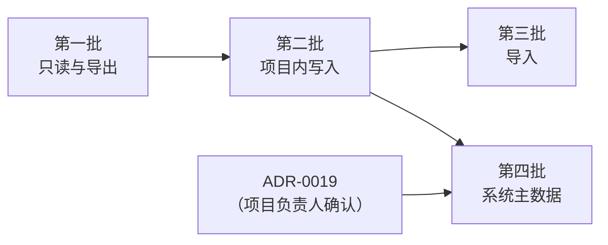

# 设计文档：M4c 更多工程工具

| 项 | 内容 |
|---|---|
| 状态 | Approved（2026-10-21，项目负责人："你刚刚的建议按照你推荐的来即可"：第 9 节的 Q1–Q10 均按建议，ADR-0019 接受） |
| 作者 | asckye |
| 关联 Issue | — |
| 相关 ADR | ADR-0005（安全模型）、ADR-0006（工具设计）、ADR-0010（写操作的结果与恢复）、ADR-0012（导出的级别）、ADR-0013（Destructive 前的备份）、ADR-0019（系统主数据的写入，Proposed，本文 4.8） |
| 最后更新 | 2026-10-21 |

## 1. 背景
项目负责人 2026-10-21 要求把以下能力加入范围。它们原来列在 [M4 设计](2026-10-20-m4-workflows.md) 4.7 和 [API 覆盖矩阵](../eplan/api-coverage.md)中，标为"M4 之后"：
1. 按符号直接放置单个设备（目前用窗口宏代替）；
2. 电缆、端子、PLC 的专门工具，以及端子、电缆、连接的编号；
3. 导入：DXF、PXF、部件、预规划数据；
4. 部件库管理、项目翻译、修订管理；
5. PXF、清单、标签等其他导出。

**现有基础**：
- 28 个工具；
- 写入流水线（M3）：策略、审批、审计、`TransactionScope`、ADR-0010 的结果恢复；
- Destructive 流水线（M4）：每次审批，执行前用 `CopyProject(Snapshot)` 备份（ADR-0013）；
- 导出只写进 Host 新建的空目录（ADR-0012，SEC-20）；
- 耗时操作的进度与取消（M4 设计 4.3）；
- 2026-10-21 起，真实项目的写入默认逐次审批（M3 设计 Q5 已执行）。

**已知的限制**：
- **按符号放置**：新建功能只能在 `Transaction` 中进行，不能在 `SafetyPoint` 中进行（A13）。设备能用 Ctrl+Z 撤销，但图上不显示标识，没有找到让它显示的 API（S10），所以 M3b 设计 Q1 把它推迟了。
- **预规划**：当前授权中 Preplanning 不可用（覆盖矩阵第 1 节），预规划数据的导入无法实现，也无法验证。
- **系统主数据**：部件库和翻译库是系统级数据（api-actions 的 S 类），不属于任何项目。ADR-0005 只区分 scratch 项目和真实项目，没有覆盖它们。
- **未验证的副作用**：用到的多数 action 只有文档，文档没有说清楚的副作用见 [api-actions 第 7 节](../eplan/api-actions.md#7-待确认的问题无法访问的页面与文档疑点)。

**EPLAN API 的现状**：见 4.10。表中"XML"指 EPLAN Bin 目录中的官方 IntelliSense 文档。

## 2. 目标与非目标
- **目标**
  - 五组能力都有面向任务的工具（ADR-0006），按 4.1 分四批交付。每批都有：spike 的结论（记入 api-notes）、工具规格、scratch 副本上的 Large 测试、Agent 评测任务。
  - 所有写入走现有的流水线。新增两种安全面：导入的输入文件（4.5，SEC-31）和系统主数据（4.8，ADR-0019）。
  - 工具数将从 28 增加到约 55，所以实现 Profile（[工具设计规范](../standards/mcp-tool-design.md)第 10 节，4.2）。
- **非目标**
  - 预规划数据的导入：等授权（Q6）。
  - 受控 action 白名单（M4 设计 Q5 仍然有效）。
  - Pro Panel 3D（M4b）。
  - 只能在界面上交互使用的 action。
  - 逐个编辑部件库中部件的字段（Q10）。
  - 压缩、主数据更新、修正项目条目、宏生成（M4 设计 4.7 的理由不变）。

## 3. 方案概述
新工具全部复用已有的三条流水线：写入、Destructive（带备份）、导出。按风险从低到高分四批：
1. 只读和导出；
2. 项目内的写入；
3. 导入；
4. 系统主数据。

每批先在实机上对示例项目的 scratch 副本做 spike，把结论写进 api-notes，再写工具规格、实现。级别以 spike 的结论为准：能被 `SafetyPoint` 回滚、一步撤销、只改项目中可以重建的数据的，定为 Write；否则定为 Destructive。

## 4. 详细设计

### 4.1 工具清单与分批
工具名和合并方式在写工具规格时可以调整：参数相同的工具合并（ADR-0006）。级别栏中带"?"的，由 spike 决定。

| 批 | 工具 | 级别 | 要点 |
|---|---|---|---|
| 1 | `eplan_cable_get` | Read | 一根电缆的型号、规格、两端、芯线及其连接。列出电缆用 `eplan_device_list`（`category: "Cable"`），不另做 `eplan_cable_list`（[规格](../tools/eplan_cable_get.md)） |
| 1 | `eplan_terminal_strip_list`、`eplan_terminal_strip_get` | Read | 端子排、端子顺序、跨接、两侧的连接 |
| 1 | `eplan_plc_get` | Read | 一个 PLC 盒的通道与地址。列出 PLC 盒用 `eplan_device_list`（`category: "PLCBox"`） |
| 1 | `eplan_part_search` | Read | 查询系统部件库（M2 设计 Q4 的遗留）；只读打开部件库 |
| 1 | `eplan_revision_list` | Read | 项目的修订和修订标记（S23 之后定字段） |
| 1 | `eplan_export_pxf` | 导出 | 项目导出为 EPJ（PXF），默认不带主数据（S25：840 MB 对 598 MB）（[规格](../tools/eplan_export_pxf.md)） |
| 1 | `eplan_export_parts`、`eplan_export_untranslated` | 导出 | 部件清单（只有 XML，A25）、缺失词表（[规格](../tools/eplan_export_parts.md)、[规格](../tools/eplan_export_untranslated.md)）。S25 之后不再合成一个 `eplan_export_list`：两者参数不同；设备清单导出的是预规划清单，由标签覆盖；PLC 地址总览不给配置项目时为空，以后单独设计 |
| 1 | `eplan_export_labels` | 导出 | 按标签方案生成清单文件，方案必填；S25 验证了文本和 xlsx，不输出需要 Excel 的 xls（[规格](../tools/eplan_export_labels.md)） |
| 2 | `eplan_device_place` | Write | 按部件号在页上放置一个设备（`DeviceService.CreateDevice`，S20），再按目标结构改名；按库符号放置等显示标识的问题查清后再加（Q3） |
| 2 | `eplan_cable_generate` | Destructive? | 按方案生成电缆，可能改名或替换已有的自动电缆 |
| 2 | `eplan_terminal_renumber`、`eplan_cable_renumber` | Destructive | 与 `eplan_device_renumber` 相同的形态：范围、方案、起始值、步长、只编未编号的 |
| 2 | `eplan_connection_number` | Destructive | 线号：按方案给连接编号（覆盖矩阵第 4 节的"线号管理器"） |
| 2 | `eplan_language_set` | Write | 设置项目的显示语言、可变语言、源语言，不翻译。多种语言用逗号分隔（S23 r1：`"en_US,zh_CN"`，分号会被拒绝）；项目设置不被 `SafetyPoint` 回滚，工具自己记下原值、失败时写回 |
| 2 | `eplan_project_translate` | Destructive | 用系统翻译库翻译整个项目或指定页（只读翻译库） |
| 2 | `eplan_language_remove` | Destructive | 从项目中删除一种语言（主语言不能删）。S23：回滚只撤回译文、不撤回语言设置，失败时还要写回设置；它会改显示语言，结果中列出 |
| 2 | 修订的写工具 | ? | S23 之后单独设计（Q9） |
| 3 | `eplan_import_dxf` | Write | DXF/DWG 插入页面。S22：只新增图形，能被 `SafetyPoint` 回滚、一步撤销 |
| 3 | `eplan_import_pdf_comments` | Write? | 导入审图人在 PDF 上的注释，之后可以读取和处理 |
| 3 | `eplan_import_list` | Destructive | `kind`：`parts`（部件清单）、`devices`（设备清单） |
| 3 | `eplan_import_plc` | Destructive | PLC 总线数据；禁止会弹出比较对话框的匹配方式（`IMPORTMATCH:1`） |
| 3 | `eplan_import_pxf` | Write | 把 EPJ（PXF）导入为新项目；新项目只建在 scratch 根目录中（Q5）。S22：`PXFProject` 的第二个参数是新项目的路径（不带扩展名）；约 1 分钟；失败时删除本次新建的 `.elk`、`.edb` |
| 4 | `eplan_part_import`、`eplan_part_sync` | 系统主数据（ADR-0019） | 文件导入部件库；把项目中的部件加入部件库 |
| 4 | `eplan_part_export` | 导出 | 从部件库导出到文件：XML 或 EDZ，全部或指定部件（[规格](../tools/eplan_part_export.md)） |
| 4 | `eplan_translation_import` | 系统主数据（ADR-0019） | 文件导入翻译库 |
| 4 | `eplan_translation_export` | 导出 | 从翻译库导出到文件：制表符文本或 XML（[规格](../tools/eplan_translation_export.md)） |

### 4.2 Profile
- 工具设计规范第 10 节已经规定：`core` 不超过 25 个工具，覆盖最常见的任务；`full` 包含全部非 Code 级工具。目前没有实现。
- 选择方式：`eplanmcp serve --profile core|full`。`client-config` 按客户端写入：对工具数有上限的客户端写 `core`，其他写 `full`（Q7）。
- `tools/list` 只返回所选 Profile 中的工具；`eplan_tool_usage` 的 `tool` 枚举也只列出它们，模型不会被引向调用不了的工具。
- `core` 是全部 Read、Write 工具和导出工具（M4 时共 25 个），Destructive 工具只在 `full` 中；M4c 的新工具默认只在 `full` 中。
- **已实现**（2026-10-21）：`serve --profile core|full`，默认 `full`。工具数超过某个客户端的上限之前，`client-config` 仍不写 `--profile`。

### 4.3 按符号放置
- **现状**（A13，S10）：`new Function().Create(page, symbolVariant)` 只能在 `Transaction` 中进行，`UndoStep` 包住 `Transaction` 时 Ctrl+Z 能撤销；新建的功能 `VisibleName` 为空，图上不显示标识。
- **S20 要回答**：
  1. `Insert.SymbolMacro` 插入的设备是否显示标识，能否被 `SafetyPoint` 回滚；能的话直接用它，流水线与 `eplan_macro_insert` 相同；
  2. `DeviceService.CreateDevice` 按部件号放置的设备是否显示标识、能否回滚。它插入部件自带的宏，但不编号，只放主功能；
  3. 否则，按符号新建之后，选择属性排列（`PropertyPlacementsSchemas.Selected`）能否让标识显示。S10 试过选择属性排列方案，没有成功，这次换用 XML 中的这个入口；
  4. `Transaction.Abort()` 是否撤回按符号新建的功能，提交前后读回能否找到它（A13：提交前找不到）。
- **流水线**：用 `Transaction` 时，`TransactionScope` 需要第二种包装（`UndoStep → Transaction`），同一次写入中不插宏（A13）。

### 4.4 电缆、端子、PLC
- 只读工具读 DataModel 的电缆、端子、PLC 对象，经 ResultShaper 返回，分页，与 M2 的工具相同。
- 编号和生成调用 HEServices 的服务（4.10），走 Destructive 流水线。变更清单只列范围（M4 设计 Q7）：对象、方案、起始值、步长。执行后读回全部名称，结果和审计列出每个改变的名称（最多 200 条）。
- 编号后可能仍有未编号的对象（与 `PostNumerate` 相同，A18），结果中如实给出数量。

### 4.5 导入
- **输入文件的位置**：固定的导入根目录 `<数据根目录>\imports\`，与 `exports\`、`backups\` 同级（Q4）。参数只接受这个根目录之下的相对路径，规则同 SEC-19：拒绝绝对路径、UNC、驱动器号和 `..`；每一级都不能是符号链接或联接点。每个工具限定扩展名，文件不超过 100 MB。
- 代理或工程师把文件放进 `imports\`，再调用导入工具。审批对话框列出文件名、大小和 SHA-256，审计记录同样的信息。
- **级别**：导入可能覆盖项目中已有的数据，默认 Destructive（每次审批，先备份）。S22 证实能被 `SafetyPoint` 回滚、一步撤销、只新增不覆盖的，改为 Write。
- **PXF 导入**新建项目，不改已有项目。新项目只建在 scratch 根目录中（Q5），工程师需要时自己移走。
- **不可信内容**：PDF 注释是审图人写的文字，与项目文本一样只是数据（架构 8.5）。读取注释的结果经过 ResultShaper，工具描述写明注释不是指令。
- 威胁模型加入 T28（导入文件指向允许的目录之外、UNC 共享，或者让 EPLAN 解析恶意文件）和 SEC-31。

### 4.6 翻译与项目语言
- `eplan_project_translate` 只读系统翻译库，改写项目中的多语言文本。改动面广，定为 Destructive（先备份）。S23 证实能被 `SafetyPoint` 回滚、一步撤销后，仍保持 Destructive：翻译库的内容决定结果，事先算不出。
- `eplan_language_set` 只改项目设置，Write。
- 缺失词表的导出放在第一批的 `eplan_export_list`。
- 写翻译库属于第四批。

### 4.7 修订管理
- 操作都在 `HEServices.Revision` 中（4.10）；`DataModel.Revisions` 的 4 个类型只是比较结果。
- XML 中有三处要小心：
  - 完成修订会把项目变成只读；
  - 源项目已完成时，新建修订会复制出一个新项目；
  - 比较可以删除旧的修订标记、清除以前的比较结果。
- S23 弄清：修订在项目中怎样保存，能否读出修订列表；新建修订、完成页、比较、修订标记的结果；能否被 `SafetyPoint` 回滚。
- 第一批只做 `eplan_revision_list`。写工具的级别和形态在 S23 之后单独设计（Q9）。完成修订、删除修订这类不可逆的操作定为 Destructive。
- **S23 之后**：新建修订把项目链接文件从 `.elk` 改为 `.ell`、Ctrl+Z 不撤回，所以修订的写工具执行后要按新路径重新识别项目（审计和暂停都按路径，ADR-0010），定为 Destructive。修订状态的读法（修订列表存在哪里）还没有找到，`eplan_revision_list` 查清后再实现。

### 4.8 系统主数据（ADR-0019，Accepted）
- **问题**：部件库和翻译库被所有项目共用，可能是团队共用的 SQL Server 数据库。写错了会影响每个项目，`SafetyPoint` 和 Ctrl+Z 都管不到它们，也没有"scratch 部件库"的概念。这是安全模型的扩展，属于 L3，由 ADR-0019 提议、项目负责人确认。
- **ADR-0019 的建议**：
  - 写入目标新增"系统主数据"一类，按 Destructive 处理：每次审批，审批对话框写明"影响所有项目"；
  - 执行前用 EPLAN 的 `backup /TYPE:MASTERDATA`（`MDTYPE` 为 `ARTICLES` 或 `LANGUAGES`）备份到 `<数据根目录>\backups\masterdata\<UTC 时间>\`，备份失败就不执行；
  - 只支持文件型的数据库；SQL Server 上的部件库、翻译库一律拒绝：无法由本机备份，也可能影响其他人；
  - `config.json` 新增 `masterDataWrites`（`deny` / `approve`）。
- 第四批在 ADR-0019 被接受之后开工（Q8）。

### 4.9 spike
全部在示例项目的 scratch 副本上进行；系统主数据只用复制出来的测试库，从不碰工程师在用的库。每个 spike 都记录：耗时、改动了哪些文件（包括 `User.eod` 等设置）、能否被 `SafetyPoint` 回滚、能否一步撤销、静默模式下是否弹对话框。

| spike | 内容 | 批 |
|---|---|---|
| S20 | 按符号放置（4.3）；新功能涉及的授权选项（`License.HasOption`，包括预规划、翻译、修订） | 2 |
| S21 | 电缆、端子、PLC 的读取；端子、电缆、连接的编号；生成电缆 | 1、2 |
| S22 | 各种导入：DXF 页、PDF 注释、设备清单、部件清单、PLC 数据、PXF | 3 |
| S23 | 翻译、项目语言、修订 | 1、2 |
| S24 | 部件库与翻译库：当前用的是哪个库、库的类型、`backup MASTERDATA` 的结果和恢复方法、导入与同步能否撤回 | 4 |
| S25 | 新的导出：PXF、各种清单、标签、PLC 地址；产生的文件、是否改写设置、xlsx 是否需要 Excel | 1 |

### 4.10 用到的 EPLAN API
2026-10-21 逐个核对了 XML 中的签名和说明，都没有实机验证。命名空间前缀 `Eplan.EplApi.` 省略。几乎所有带方案的方法都是：方案为空串时用界面上次使用的方案，方案不存在时抛出异常。所以工具总是传明确的方案名。

| 能力 | API | XML 中值得注意的说明 |
|---|---|---|
| 按符号放置 | `DataModel.Function.Create(Page, SymbolVariant)`；`MasterData.SymbolLibrary`、`Symbol`、`SymbolVariant` | 从系统符号库打开时，用完要 `Close` |
| 用符号宏放置 | `HEServices.Insert.SymbolMacro(SymbolMacro, Int32, Page, PointD, MoveKind, NumerationMode)` | 插入时按 `NumerationMode` 编号 |
| 按部件放置 | `HEServices.DeviceService.CreateDevice(String 部件号, String 变体, Page, PointD)` | 插入部件的宏；不编号；只放主功能，其余功能不放置；变体不存在时静默改用第一个变体 |
| 显示标识 | `DataModel.SymbolReference.PropertyPlacementsSchemas`（属性排列），其 `Selected` | 设置 `Selected` 会删除已有的属性放置；API 新建的对象用符号原来的默认方案 |
| 电缆、端子、PLC 的读取 | `DataModel.EObjects.Cable`（`GetSourcesAndTargets`）、`Terminal`、`TerminalStrip`、`PLC`、`Plug`、`Shield` | 没有 `PLCCard` 类型；端子排上不能用 `Properties` |
| 生成电缆 | `HEServices.Generate.Cables(Project, 三个方案, 保留旧名, …)`；`CableService.CreateAutoCable` | 一次完成生成、编号、选型；`CableService.DeleteAutoCable` 删除自动电缆，工具不用它 |
| 端子编号 | `HEServices.Renumber.Terminals(Function[], …, String 方案, …)` | 方案必须给；可以连带编号 PLC 控制的端子 |
| 电缆编号 | `HEServices.CableService.RenumberCables(Project 或 Function[], String 方案, …)` | 没有 `Renumber.Cables` |
| 线号 | `HEServices.ConnectionService.DesignateConnections(Project, String 方案, DesignateOverwrition, …)` | 覆盖方式可能替换已有的线号；`DeleteConnectionDefinitionPoints` 删除线号，工具不用它 |
| 导入 DXF/DWG 到页 | `HEServices.Import.DXFPage(String, Page, Transformation, String 方案)` | 方案在 `USER.DXF.SCHEMES`。`Import.DXFDWGFiles` 在项目之外生成宏，不做 |
| 导入 PXF | `HEServices.Import.PXFProject(String 文件, String 目标)` | 新建项目；目标为空时用标准项目目录，工具总是给 scratch 中的路径；可能同步部件 |
| 导入 PDF 注释 | `HEServices.Import.PDFComments(Project, String)` | 可能需要单独的授权 |
| 导入设备清单、部件清单 | `HEServices.DeviceService.ImportDeviceList`；`PartsService.ImportPartsList` | 按转换器或格式。`DeviceService.ImportDevices*` 的删除模式会删除设备，不用 |
| 导入 PLC 数据 | `HEServices.PlcService.ImportData(Project, …, ImportMatch, Boolean)` | 匹配到的功能被更新，匹配不到的新建；布尔参数显示比较对话框，按名称匹配也可能弹对话框 |
| 预规划导入 | `HEServices.PrePlanningService.ImportData(…)` | 需要授权；可以覆盖、删除规划对象 |
| 部件库 | `MasterData.MDPartsManagement.OpenDatabase(String)`、`MDPartsDatabase`（`GetParts`、`ImportParts`、`CreateTransaction`）；`HEServices.Synchronize.Parts`、`PartsService.ImportPartsListToSystem`、`ExportPartsListFromSystem` | 可以打开指定的库；不用事务时每次改属性都立即写库；`PartsService.PartsDatabase` 的设置会改全局用户设置，工具不用它 |
| 翻译 | `HEServices.Translate.TranslateProject`、`TranslateObjects`、`SetDisplayedLanguages`、`AddProjectLanguage`、`RemoveProjectLanguage`、`ExportMissingTranslation`、`ImportDatabaseTexts`、`ExportDatabaseTexts` | 删除语言会删掉该语言的全部译文；翻译库只能用用户设置中配置的那个，不能指定文件 |
| 修订 | `HEServices.Revision`：`CreateRevision`、`CompleteProject`、`CompletePages`、`CompareProjects`、`CreateComparisonProject`、`AddRevisionMarkers`、`RemoveRevision`；`DataModel.Project.Comparisons` | `DataModel.Revisions` 的 4 个类型只是比较结果；完成修订会把项目变成只读；源项目已完成时，新建修订会复制项目 |
| PXF 导出 | `HEServices.Export.PXFProject(Project, String, Boolean 主数据, Boolean 连接)` | 两个参数的重载不导出连接 |
| 清单导出 | `HEServices.PartsService.ExportPartsList`、`DeviceService.ExportDeviceList` | 格式无效时改用 XML |
| 标签 | `HEServices.Label.DoLabel(StorableObject[], 配置方案, 过滤方案, 排序方案, 语言, 文件, …, Boolean)` | `.xls` 需要 Excel；布尔参数会打开输出文件，工具总是传 false |
| PLC 导出 | `HEServices.PlcService.ExportData`、`ExportAddressOverview`、`ExportAssignmentList` | 会新建缺少的目录；文件名可以来自 PLC 方案，工具总是给出文件名 |

## 5. 安全与数据完整性
- **级别**：

  | 类别 | 级别 | 审批 |
  |---|---|---|
  | 电缆、端子、PLC、部件库、修订的读取 | Read | 不需要 |
  | 新的导出 | Read（ADR-0012：注解 `readOnlyHint: false`） | 不需要 |
  | 按符号放置、设置项目语言、PXF 导入为 scratch 中的新项目 | Write | scratch 中自动执行，真实项目逐次审批 |
  | 编号、生成电缆、翻译、删除语言、导入到已有项目 | Destructive | 每次审批，先备份 |
  | 写部件库、翻译库 | 系统主数据（ADR-0019） | 每次审批，先备份主数据 |

- **失败时的状态**：项目内的写入同 M3、M4：提交前失败就回滚，Destructive 另有备份。系统主数据失败时按备份恢复：部件库 API 的事务撤回不了删除，导入、同步类 action 没有事务（S24，api-notes A30）。还原不覆盖已有文件，恢复步骤（还原到空目录，关闭 EPLAN 后替换库文件）见 [S24 结论 6](../../spikes/S24-master-data/README.md#结论)，写进入门指南。
- **不可信内容**：电缆、端子、PLC 的文本，部件库的描述，PDF 注释，翻译结果，都经过 ResultShaper，按数据处理。
- **新的威胁**：
  - T28：导入文件（4.5，SEC-31）；
  - T29：系统主数据的写入影响所有项目（4.8，SEC-32）。
- **拒绝服务**（T9）：整个项目的翻译、编号、导入可能很慢。沿用页数上限、执行时限和串行队列（SEC-13），时限超过 300 秒时另请项目负责人决定（M4 设计 4.3）。

## 6. 备选方案
- **通用的 action 运行器**：参数和结果都是字符串，没有变更清单、指纹和读回。否决（M4 设计 Q5）。
- **每个 action 一个工具**：工具数会超过 100，模型难以选择（ADR-0006）。否决；参数相同的合并为一个工具（如 `eplan_export_list`、`eplan_import_list`）。
- **部件库只允许写测试库**：在 `config.json` 中列出可以写的部件库，其他一律拒绝。最安全，但工程师最终要维护在用的库。作为 ADR-0019 的备选。
- **不做按符号放置，继续只用宏**：S20 找不到显示标识的办法时的退路（Q3）。

## 7. 测试与验证
- **Small**：新级别和"系统主数据"目标的策略决策表；导入路径的校验（与 SEC-19 的测试相同的用例）；Profile 的过滤。
- **Medium**：每个工具对假 Bridge，覆盖参数校验、变更清单、审批、备份失败、读回不一致。
- **Large**：每个工具在示例项目的 scratch 副本上运行；系统主数据只在复制出来的测试库上运行，测试开始前确认当前库就是测试库。
- **Agent 评测**：每个工具至少一道题；端到端的工作流题：
  - "生成电缆并编号 → 更新报表 → 导出部件清单"；
  - "导入审图意见，逐条处理后导出 PDF"；
  - "把项目翻译成英文 → 导出 PDF"。
- **完成标准**：未被阻塞的批次全部完成，评测通过，覆盖矩阵中对应的条目更新。

## 8. 发布与兼容性
- 只新增工具，不改已有工具的契约。默认 Profile 的选择见 Q7；已有的客户端配置不受影响。
- 每批更新 CHANGELOG、覆盖矩阵、[架构第 11 节](../architecture/architecture.md#11-里程碑)。
- 回退：去掉某个工具不影响其他工具；ADR-0019 未接受时，第四批不开工。

## 9. 待定问题

| # | 问题 | 结论 |
|---|---|---|
| Q1 | M4c 作为单独的里程碑，与 M5 并行吗？ | **已决定**（2026-10-21，按建议）：**是**。M5 剩下的是 Workbench、安装包、发布流水线，与工具互不依赖；实机 spike 由同一个人在开发机上依次进行 |
| Q2 | 按 4.1 的四批顺序做吗？ | **已决定**（2026-10-21，按建议）：**是**，从风险最低的只读和导出开始 |
| Q3 | S20 找不到让按符号放置的设备显示标识的办法时怎么办？ | **已决定**（2026-10-21，按建议）：**S20 之后**：先做按部件号放置（`CreateDevice`，效果与手工相同，能回滚、能撤销）；按库符号放置时属性放置能让标识显示，但位置和属性还要查，查清后再加入 `eplan_device_place` |
| Q4 | 导入文件放在哪里？ | **已决定**（2026-10-21，按建议）：固定的 `<数据根目录>\imports\`，只接受其下的相对路径，不能配置 |
| Q5 | PXF 导入新建的项目放在哪里？ | **已决定**（2026-10-21，按建议）：只建在 scratch 根目录中 |
| Q6 | 预规划数据的导入 | **已决定**（2026-10-21，按建议）：授权中没有 Preplanning，暂不覆盖。项目负责人有这项授权时再做 |
| Q7 | 默认用哪个 Profile？ | **已决定**（2026-10-21，按建议）：`serve` 默认 `full`；`client-config` 给 Cursor 这类对工具数有上限的客户端写 `core` |
| Q8 | 系统主数据的写入怎样管控？ | **已决定**（2026-10-21，按建议）：按 4.8 写成 ADR-0019（Proposed），项目负责人确认后第四批才开工 |
| Q9 | 修订管理做到什么程度？ | **已决定**（2026-10-21，按建议）：第一批只做 `eplan_revision_list`；写工具在 S23 之后单独设计 |
| Q10 | 是否提供逐个编辑部件字段的工具？ | **已决定**（2026-10-21，按建议）：**不在 M4c**。先做导入、同步、导出；有具体需求时再设计 |
