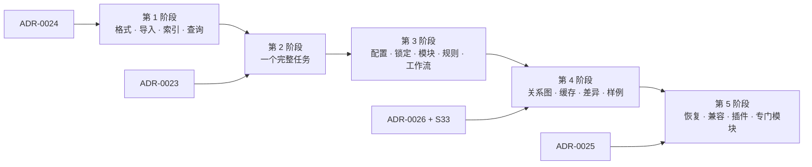

# 设计文档：M6 工程包（engineering packs）

| 项 | 内容 |
|---|---|
| 状态 | Approved（2026-10-21，项目负责人：ADR-0023 到 0026"四个都接受"；第 10 节的 Q1–Q12"全部按建议"，其中 Q11 为"不再单独审批"） |
| 级别 | L2（总体设计）。其中改变审批模型、包的信任边界、Code 级和 IPC 的四项写成 ADR（2026-10-21 接受）：[0023](../adr/0023-plan-approval-and-backup.md) 计划级审批与备份、[0024](../adr/0024-pack-trust-and-container.md) 工程包的信任与容器安全、[0025](../adr/0025-code-plugin-worker.md) 代码插件、[0026](../adr/0026-eplan-events-and-push.md) EPLAN 事件订阅与 Bridge→Host 推送 |
| 作者 | asckye |
| 关联 Issue | — |
| 相关 ADR | 0005、0006、0010、0011、0012、0013、0019、0021、0022、0023–0026（本设计提出，2026-10-21 接受） |
| 最后更新 | 2026-10-21 |

## 1. 背景

### 1.1 项目负责人的要求（2026-10-21，按调整后的范围批准为 M6）
工程师交给 AI 的材料：一个基本项目（`.zw9`）、一个或多个完成的参考项目（`.zw1` 备份，或 `.elk` + `.edb` 目录）、宏、公司的物料对应表、说明和规则，以及要生成或修改什么。AI 调用 EplanMcp 分析、整理这些材料；EplanMcp 读取真实数据、校验，生成资源索引和**工程包**（清单自动生成，普通用户从不手写 YAML、JSON、规则或插件）；AI 再查询、规划、调用；EplanMcp 执行工程操作并校验结果。

| 能力 | 要点 |
|---|---|
| 资源库 | 导入、分类、搜索、详情、页面预览、来源位置 |
| 电气关系图 | 功能、连接点、连接、端子、电缆、PLC、设备标识、页；路径追踪、跨页、影响分析；区分事实与推断 |
| 规则包 | 适用范围、输入、检查逻辑、来源、版本、结果、可选的修复 |
| 参数化电路模块 | 来自宏和页模板；能从完成的项目中提取（例如 3 个回路扩到 8 个） |
| 声明式工程计划 | 编译为有序操作，每步有读取和修改范围、前置条件、预期结果 |
| 三层校验与差异审查 | 对象数据、电气关系、图纸；计划与实际的差异 |
| 长任务、按需上下文 | 可恢复；上下文按依赖缓存和失效 |
| 其他 | 验收样例库；能力和版本检测；只返回计划的可选算法插件 |

- **配置分层**：通用基础 → 公司 → 产品系列或柜型 → 项目 → 单个柜。一个项目可以有多个柜，每个柜绑定自己的配置，并映射到项目结构；区分默认值和硬约束；每个生效的值都能追溯到来源；工具显式带项目、柜和配置的标识。
- **版本**：开发时是普通目录，导入导出用 `.eplanpack`（ZIP）；EPLAN 原生文件保持原格式；项目锁定包的版本；迁移时给出差异并重新校验。
- **事实、推断、规则分开**：从参考项目提取的事实、AI 推断的候选、公司正式规则分别记录；强制规则必须有来源；缺口要标出来，绝不悄悄变成强制规则。
- 负责人建议的工具家族：`eplan_pack_*`、`eplan_profile_*`、`eplan_asset_*`、`eplan_context_get`、`eplan_workflow_*`、`eplan_plan_apply`、任务状态工具；工具之外提供 MCP Resources；订阅、通知、MCP Tasks 只在客户端支持时使用。

### 1.2 协调人的调整（项目负责人已批准）
1. 参数化模块建立在 EPLAN 自己的机制上：宏 + 占位符对象 + 值集（`Eplan.EplApi.DataModel.Graphics.PlaceHolder`、`PlaceHolder.ValueSetsClass`、`PlaceHolderText`、`IPlaceHolder`）；本项目的元数据只补充接口、部件映射、适用条件和验收。
2. 检查 EPLAN Cogineer 授权（`LicenseOptions` 有 `CogineerDesigner`、`CogineerBuilder`、`*Advanced`、`CogineerSilentMode`）：有授权时评估集成，不重复造；没有时本项目做一个边界写清楚的轻量等价物。
3. 不用 microsoft/RulesEngine（规则是运行时编译的 C# lambda 表达式，等于让包携带可执行代码）；用自己的受限规则格式：只用目录中登记的属性和关系，固定的比较和组合运算符。
4. 稳定的对象定位符（第 4.6 节按 S28 的实测修订）。
5. 参考项目一律先复制到 scratch 再打开（打开或还原旧版本项目会不可逆地升级它），记下源文件的 EPLAN 版本。
6. 一份规范的项目快照（规范化的对象、属性、连接、页），差异、校验和缓存共用。
7. 客户数据绝不进仓库（CLAUDE.md 第 4 条）；测试包只从 EPLAN 示例项目派生。
8. 工程师修正事实、推断、规则的界面，以后放在 Workbench 中。
9. 协调人在 EPLAN 上做的 spike 从 S27 开始编号（S26 已被 ADR-0021 预留）；S27、S28（r0、r1）、S29 已经完成（api-notes A31–A33），其余为 S30–S33，见 4.18。

### 1.3 现状（以 main `87ea297` 的代码为准）
"已实现"指代码中有、测试覆盖；"部分"指有基础但不够 M6 用；"仅设计"指只写在文档里；"缺失"指没有。

| # | 能力 | 状态 | 依据 | 对 M6 的意义 |
|---|---|---|---|---|
| 1 | 写入流水线 | 已实现 | `src/EplanMcp.Host/Safety/WritePipeline.cs`：规划 → 策略 → 写入暂停 → 审批 → 备份（Destructive）→ 审计 `execution_started` → 执行 → 审计 `execution_result` | 一次工具调用只有一对 `*.plan`/`*.execute` 操作、一个 Bridge 事务；计划的每一步复用这些段，计划级的部分要新建（ADR-0023） |
| 2 | 变更清单与指纹 | 已实现（单步） | `src/EplanMcp.Contracts/WritePlan.cs`（`Project`、`ProjectPath`、`Changes`、`Fingerprint`、`Details`）、`PlannedChange.cs`；`src/EplanMcp.Bridge.Core/Operations/Fingerprint.cs`（排序后的行做 SHA-256）；每个工具只覆盖它触及的对象，行中多用 `ToStringIdentifier()`；`PLAN_STALE` 由各 `*ExecuteOperation.cs` 返回 | 运行时字符串标识含按打开分配的数据库号（S28），**不能用于跨调用保存的计划**；`dry_run` 不返回计划令牌 |
| 3 | Destructive 备份 | 已实现 | `Safety/BackupFolders.cs`、`Bridge.Core/Operations/ProjectBackups.cs`、`Bridge.Eplan/Adapters/EplanProjectBackup.cs`（`CopyProject(…, Snapshot)`，核对页数） | 计划开始前的备份直接复用 |
| 4 | 结果恢复与写入暂停 | 已实现 | `Bridge.Core/Operations/OutcomeRecords.cs`（内存，256 条）、`Host/Bridge/BridgeClient.Writes.cs`（`outcome.get` 轮询）、`Safety/DanglingWrites.cs`、`Safety/SuspensionStore.cs` | 逐步沿用；多步计划还需要计划级的结果（ADR-0023） |
| 5 | 审计 | 已实现 | `src/EplanMcp.Host/Audit/AuditLog.cs`：`approval`、`suspension_release`、`execution_started`、`execution_result`、`writes_suspended`，哈希链；读和导出不审计 | 增加计划、工作区和包的记录种类 |
| 6 | 审批 | 已实现 | `Safety/ApprovalService.cs`、`WorkbenchChannel.cs`、`EplanDialogChannel.cs`；决定绑定请求 ID、指纹、参数摘要，只用一次 | 计划级审批绑定计划哈希（ADR-0023） |
| 7 | 策略与配置 | 已实现 | `Safety/PolicyEngine.cs`（Code 级恒为 Deny）、`ScratchPaths.cs`、`HostConfig.cs`（`scratchRoots`、`writesOutsideScratch`、`approvalTimeoutSeconds`，未知成员拒绝启动） | 插件要用 Code 级（ADR-0025）；新的安全配置只能写在配置文件中（SEC-02） |
| 8 | 工具面 | 已实现 | 51 个工具（`tests/Contracts.Snapshots/server-contract.verified.json`），在 `src/EplanMcp.Host/McpServerSetup.cs` 注册；`Tools/ToolProfiles.cs`：`core` 25 个，`full` 全部 | 没有新建项目和还原 `.zw1` 的工具；M6 的工具只进 `full` 和新工具集（4.5，ADR-0022） |
| 9 | MCP 的其他能力 | 缺失 | 没有 Resources、资源模板、Prompts、订阅、Tasks、`listChanged`；只有进度通知和取消 | 新增 Resources；Tasks 按客户端支持（4.13） |
| 10 | 握手与能力 | 部分 | `Contracts/HandshakeResult.cs`（`ProtocolVersion`、`BridgeVersion`、`Eplan`、`Operations`、`BuildTarget`、`AddinPath`）、`EplanInstanceInfo.cs`（`ProcessId`、`Version`、`Variant`、`ApiExtensionLicence`、`Offline`）；`Operations` 就是能力清单；`BridgeProtocol.CurrentVersion = 1` | 缺授权选项（Cogineer、Pro Panel、Preplanning）和能力目录的版本（4.4） |
| 11 | Bridge→Host 推送 | 部分 | `Bridge.Core/Server/BridgeConnection.cs` 只在调用期间发 `progress`；`EplanAddIn` 只实现 `IEplAddIn`、`IEplAddInShadowCopy`，没有订阅任何 EPLAN 事件 | 缓存失效需要事件（ADR-0026） |
| 12 | 对象标识 | 部分 | 一律按名称：`Bridge.Core/Operations/ProjectResolver.cs`、页名、`DeviceTags.cs`（歧义时 `AMBIGUOUS_NAME`）；没有句柄和 `HANDLE_EXPIRED`（架构 8.1 只是设计）；分页游标 `Tools/PageCursor.cs` 只记偏移 | 需要跨调用的定位符（4.6） |
| 13 | 项目与实例的身份 | 部分 | 项目只按规范化路径（`ScratchPaths.Canonical`）；实例按管道名 + 进程号（`Host/Bridge/BridgeEndpoint.cs`）和进程号 + 启动时间（`SuspensionStore.StartOf`） | 缓存键还缺打开代次（4.7） |
| 14 | 缓存与快照 | 缺失 | `Bridge.Eplan/Adapters/EplanProjectReader.cs` 明确不缓存；没有快照、代次、观察计数 | 4.6、4.7 |
| 15 | 宏 | 部分 | `macro.list` 只扫描 `.ema`（`Bridge.Core/Operations/MacroFiles.cs`）；`macro.get`（`Adapters/EplanMacroReader.cs`）返回表达类型、变体、设备；`macro.insert` 只接受 `$(MD_MACROS)` 下的窗口宏（M3b 设计 Q3） | 产品代码中没有页宏、占位符、值集；S29 已验证占位符和值集的读写（A33），见 4.10 |
| 16 | 新建项目与还原 | 仅设计 | 产品代码中没有 `ProjectManager.CreateProject` 和项目还原；`eplan_scratch_create` 只出现在 ADR-0005 第 6 节和 ADR-0021 第 8 节；最接近的是 `eplan_import_pxf` 在 `<scratch>\imported\` 中新建项目（`Adapters/EplanProjectImporter.cs`、`Tools/ImportTools.cs`）。S27 已验证新建、还原和不打开项目判断版本（A31） | 4.5 的 `eplan_project_create`；剩余问题在 S30 |
| 17 | 只读数据与导出 | 已实现 | 页、设备、连接、电缆、端子排、PLC、部件、消息、检查结果的读工具；导出 PDF/DXF/图片（`Host/Exports/ExportRunner.cs`，ADR-0012） | 快照提取和页面预览的基础；按工具逐个读取不适合整项目提取（4.6） |
| 18 | 长任务 | 部分 | 进度与取消（`Safety/CallProgress.cs`、`BridgeProgress.cs`）；跨 Host 重启只留下审计和暂停记录；没有 MCP Tasks（M4 设计 Q6 推迟） | 4.13 |
| 19 | 离线宿主 | 已实现 | `src/EplanMcp.Bridge.Offline`：打开一个项目，经它只能写 scratch（Host 的审批渠道不可用） | 以后可以在离线宿主中提取参考项目，不占工程师的 EPLAN |
| 20 | 能力目录与覆盖 | 已实现 | `catalog/eplan-2026.0.3/`：Action 目录 `actions.json`（`A:<action>[/TYPE]`）和 SDK 成员目录（XML 文档注释 ID，生成器 `eng/catalog`），口径见[覆盖设计](2026-10-21-api-capability-coverage.md)；实现映射 `catalog/mapping/`、覆盖状态 `catalog/coverage.json`（`eng/coverage` 生成，CI 检查），报告见[覆盖报告](../eplan/coverage-report.md) | 能力声明引用同一套 ID，按版本的状态从覆盖数据读取（4.4） |
| 21 | 工具集与发现 | 仅设计 | [ADR-0022](../adr/0022-domain-toolsets.md)（Accepted，未实现）；代码中只有 `core`、`full` | M6 工具分到两个新工具集（4.5） |
| 22 | 受控 action 运行器 | 仅设计 | ADR-0021（Accepted，未实现） | 计划的步骤不经运行器（4.8） |
| 23 | 测试与评测 | 已实现 | Small / Medium / Large 三层（`tests/`，CI 不跑 Large）；测试项目只来自 EPLAN 示例项目（`eng/scripts/eval-fixture.ps1`）；评测 `evals/tasks/`（34 个）、`evals/tasks-attended/`（6 个） | 测试包同样只从示例项目派生 |
| 24 | 工程包清单 | 进行中 | PR #393–#396（未合并）新建 `src/EplanMcp.Packs`：SemVer 与 EPLAN 版本范围、`pack.json` 模型 v0、校验、JSON Schema | 4.1 以这份 v0 为基础 |
| 25 | 配置分层、资源索引、关系图、规则、模块、工作流、组合计划、三层校验、差异、插件 | 缺失 | `src/` 中没有 asset、rule、diff、workflow 一类的类型 | 本设计的其余内容 |

**已经实测的事实**（协调人 2026-10-21）：
- **新建与还原**（S27，A31）：`CreateProject(链接文件, .zw9)` 3.5 秒，新项目建好就以独占方式打开；`restore /TYPE:PROJECT` 还原到已存在的项目时**不报错、照样覆盖**；`GetProjectDataCompatibility` / `GetProjectDatabaseVersion` 不打开项目就能判断版本（0.02–0.3 秒）；`.zw9`、`.zw1` 是 7z 归档；`.edb\ProjectInfo.xml` 的属性 `10043` 是最新更改或更新的 EPLAN 版本。旧版本项目的升级行为没有测（本机只有 2026.0.3）。
- **对象标识**（S28 r0、r1，A32）：同一示例项目的两份文件副本中，825 个对象（全部主功能和页）的 `StorableObject.ObjectIdentifier` 全部相同；用 `backup` 备份再 `restore /TYPE:PROJECT` 还原为新项目、用 `eplan_export_pxf` 导出再 `eplan_import_pxf` 导入为新项目之后，825 个也全部相同。不同的只有 `DatabaseIdentifier`（按打开的项目分配，文档说重新打开就变）。`ToStringIdentifier()` 的格式是 `数据库号/类型号/对象号/0`。文档说 `ObjectIdentifier` 在同类对象中唯一，对象删除后再新建时编号可能被重用。
- **占位符与值集**（S29，A33）：不插入宏就能读出占位符、值集、变量和值，扫描 695 个示例宏 21 秒，72 个带占位符、38 个带值集；`ApplyRecord`、`AddRecord` + `SetValue` 都能用 API 完成，并能被 `SafetyPoint` 回滚；值是多语言文本。没有验证提交后的撤销、新建占位符对象、`WindowMacro.Create`。
- **提取耗时**（S28，A32）：整个示例项目（321 页、2,876 个功能、2,060 个连接、44,735 个图形放置）枚举约 1 秒，读全部功能的名称、页、坐标 0.06 秒。示例规模的完整提取是秒级的。

## 2. 目标与非目标

**目标**
1. 工程师的材料经 `eplan_pack_import` 导入后，自动生成带哈希和来源的清单与资源索引；用户不手写 YAML、JSON、规则或插件。
2. AI 能按需查询资源、上下文和配置（每个生效的值可追溯），把意图写成声明式计划；计划编译为有序操作，一次审批后执行，返回三层校验和差异。
3. 一个项目多个柜，每个柜绑定自己的配置；工具显式带项目、柜和配置标识，柜与柜的上下文从不混用。
4. 工程包有版本，项目锁定版本；迁移给出差异并重新校验。
5. 事实、推断、正式规则分开记录；强制规则必须有来源；缺口标出来。
6. 4.17 的必测场景全部有自动化测试或实机测试。
7. 复用现有的安全机制，改变安全模型和 IPC 的地方写成 ADR（0023–0026，2026-10-21 接受）。默认值都不变；唯一的放宽（允许列表中的插件每次运行不再单独审批）由项目负责人决定，记在 ADR-0025。

**非目标**
- 重做 EPLAN 的编辑界面或 Cogineer 的配置器界面。
- 让工程包携带可执行内容（ADR-0024）；规则不用表达式编译。
- 在仓库中保存客户数据；测试包只从示例项目派生。
- 多用户的包服务器：只有本地目录和 `.eplanpack` 文件交换。
- 对电气设计的正确性负责（架构 1.2）：规则检查和校验是给工程师的辅助。
- 在真实项目上做试验：参考项目一律先复制到 scratch；目标项目默认建在 scratch 中。
- 预规划（没有授权）、Pro Panel 3D 模块（在 M4b 之后）只在第 5 阶段视授权而定。

## 3. 方案概述
Host 中新增一组组件，管理工程包、配置、快照、上下文、计划、校验和任务；Bridge 只增加读取快照、解析定位符、新建与还原项目、插入模块等"怎么做"的操作，和以后的事件推送；安全判断仍全部在 Host 中。计划的每一步仍是现有的一对 `*.plan`/`*.execute` 操作，外面包一层计划流水线：一次审批、计划开始前一次备份、逐步执行、计划级结果（ADR-0023）。

```mermaid
flowchart LR
    client["MCP 客户端"]
    subgraph host["Host（.NET 10）"]
        tools["工具与 Resources<br/>pack / asset / cabinet / context / workflow / plan / task"]
        store["包仓库<br/>开发目录 · 已安装版本 · .eplanpack"]
        cfg["配置解析<br/>分层 · 柜绑定 · 锁"]
        snap["规范快照<br/>定位符 · 内容哈希"]
        ctx["上下文与缓存<br/>依赖 · 失效"]
        graph["关系图 · 规则求值"]
        plan["工作流编译 · 计划仓库"]
        pipe["计划流水线（ADR-0023）<br/>复用 WritePipeline 的各段"]
        verify["三层校验 · 差异"]
        tasks["任务仓库"]
    end
    subgraph bridge["Bridge（EPLAN 进程内）"]
        ops["快照提取 · 定位符解析<br/>新建/还原项目 · 模块插入<br/>现有 *.plan / *.execute"]
        ev["事件订阅（ADR-0026）"]
    end
    wb["Workbench<br/>导入 · 修正 · 计划审批与差异"]
    worker["插件工作进程（ADR-0025）<br/>数据进 · 计划出"]
    client -- stdio --> tools
    tools --> store & cfg & ctx & plan & tasks
    ctx --> snap --> ops
    plan --> pipe --> ops
    pipe --> verify --> snap
    graph --> snap
    ev -. "失效通知" .-> ctx
    pipe -- "审批" --> wb
    plan -- "可选" --> worker
```

### 3.1 组件放在哪里

| 组件 | 位置 | 职责 | 复用 |
|---|---|---|---|
| 包仓库 | Host | 开发目录的读写、构建版本、安装与导出 `.eplanpack`、校验（ADR-0024） | 数据根目录、导出目录（ADR-0012） |
| 资源索引 | Host | 分类、搜索、详情、预览、来源 | 导出图片作为页面预览 |
| 配置解析 | Host | 分层合并、硬约束、溯源、柜绑定、锁 | — |
| 规范快照 | Bridge 提取，Host 组装和存放 | 规范化的对象、属性、连接、页；定位符；内容哈希 | 读操作的适配层 |
| 上下文与缓存 | Host | 按需上下文、依赖登记、失效、写前重新核对 | 握手中的实例身份 |
| 关系图与规则 | Host | 在快照上建图、追踪、影响分析、规则求值 | — |
| 工作流编译与计划仓库 | Host | 声明式计划 → 有序步骤；持久化 | `WritePlan`、各 `*.plan` 操作 |
| 计划流水线 | Host | 计划级审批、备份、逐步执行、结果、暂停 | `WritePipeline` 的各段、`ApprovalService`、`BackupFolders`、`outcome.get`、`SuspensionStore`、`AuditLog` |
| 校验与差异 | Host | 三层校验；基准、计划、实际的三方差异 | 导出图片（图纸层） |
| 任务仓库 | Host | 长任务的状态、检查点、恢复 | 审计中的悬空写入处理（`DanglingWrites`） |
| 新的 Bridge 操作 | Bridge | `project.snapshot`、`object.resolve`、`project.create`、`project.restore`、`module.insert`、`macro.placeholders` | `TransactionRunner`、`OutcomeRecords`、`ProjectBackups` |
| 事件推送 | Bridge → Host | 页、连接、项目打开关闭等事件的失效通知（ADR-0026） | 管道连接 |
| 导入与修正界面、计划审批 | Workbench | 导入向导；事实、推断、规则的修正；计划的差异预览与审批 | 审批管道（ADR-0014） |
| 插件工作进程 | 单独的进程 | 算法插件：纯数据进，计划草稿出（ADR-0025） | — |

### 3.2 一次典型任务
1. 工程师把基本项目、参考项目和公司资料放进 `<数据根目录>\imports\`；AI 调 `eplan_pack_import`。Host 校验文件，把参考项目复制或还原到 scratch，记下源文件的 EPLAN 版本，提取快照和事实，生成开发包的清单和索引。
2. AI 用 `eplan_asset_search`、`eplan_asset_get` 查资源，用 `eplan_asset_update` 写候选和模块元数据，用 `eplan_pack_build` 冻结成版本；工程师把项目或柜绑定到配置（`eplan_cabinet_bind`，锁定版本）。
3. AI 用 `eplan_context_get` 取上下文，用 `eplan_workflow_plan` 编译计划，得到计划 ID、步骤、读写范围、前置条件、预期结果和差异预览。
4. `eplan_plan_apply`：重新核对 → 一次审批 → 备份 → 逐步执行 → 三层校验 → 差异；耗时长时返回任务 ID。
5. AI 用 `eplan_plan_get` 把校验结果和差异交给工程师审查。

### 3.3 数据目录
在 [ADR-0008](../adr/0008-data-locations-and-instance-discovery.md) 的数据根目录下新增：

```
%USERPROFILE%\EplanMcp\
  imports\                    工程师放入的材料（.zw1、.zw9、.elk + .edb、宏、资料、.eplanpack），只读使用
  packs\<包 ID>\<版本>\        已安装的工程包，不可变，使用前按清单哈希核对
  packs-dev\<包 ID>\           开发中的工程包，普通目录，只经工具写入
  workspaces\<项目键>\         项目绑定：柜、配置值、锁定的包版本（binding.json）
  cache\snapshots\  cache\context\     规范快照（按内容哈希）与上下文缓存，可以随时删除
  state\plans\  state\tasks\          计划与任务（与已有的 state\suspended\ 并列）
  plugins\<ID>\<版本>\         代码插件（ADR-0025，默认关闭）
  scratch\references\  scratch\projects\   参考项目的副本；目标项目（默认位置）
```

### 3.4 复用现有机制

| 现有机制 | 在 M6 中的用法 |
|---|---|
| `WritePipeline` 的各段 | 计划的每一步；计划流水线在外面增加计划级审批、备份和结果（ADR-0023） |
| `WritePlan` / `PlannedChange` | 每步的变更清单；计划的变更清单是各步的拼接，带步骤号 |
| 指纹与 `PLAN_STALE` | 每步执行前重算；持久化的计划另用定位符和内容哈希写前置条件 |
| ADR-0013 的 `CopyProject(Snapshot)` | 计划开始前备份一次 |
| ADR-0010 的 `outcome.get` 与写入暂停 | 每步照用；计划的结果由各步的结果推出 |
| 握手的 `operations` | 能力检测的一部分（4.4） |
| 导出目录（ADR-0012） | 页面预览、图纸层校验的图片、`.eplanpack` 的导出 |
| 审计哈希链 | 新增 `plan_approval`、`plan_result`、`workspace_change`、`pack_change` 记录 |
| 离线宿主 | 以后用于参考项目的批量提取 |

## 4. 详细设计

### 4.1 工程包的格式与资源模型
并行的代码栈 PR #393–#396 已经实现清单的 v0 草案（`src/EplanMcp.Packs`，`schemaVersion` 1）。本节以它为基础，只写补充和调整。落盘格式按开发流程属于 L3：原则由本节和 ADR-0024 定下；具体字段在第 1 阶段验收之前仍可调整，不作对外承诺。

#### 4.1.1 三种形态
| 形态 | 位置 | 谁能写 | 用途 |
|---|---|---|---|
| 开发目录 | `packs-dev\<包 ID>\` | 只经工具（`eplan_pack_import`、`eplan_asset_update`）；工程师也可以手工修改，下次读取时重新校验 | 导入、整理、修正 |
| 已安装的版本 | `packs\<包 ID>\<版本>\` | 没有人：构建或安装时写入一次，之后设为只读，每次使用前按清单哈希核对 | 项目锁定的对象 |
| `.eplanpack` | 导出目录或 `imports\` | — | 在工程师之间交换；ZIP，内容与已安装的版本相同 |

安装 `.eplanpack` 按 ADR-0024 校验后解到 `packs\` 下；构建开发目录得到的版本与安装得到的版本格式相同。EPLAN 自己的 `.zw1`、`.zw9` 是 7z 归档（A31），在包中作为普通文件保存，不解开。

#### 4.1.2 清单 `pack.json`
| 字段 | v0 | 本设计 |
|---|---|---|
| `schemaVersion`、`id`、`name`、`version`、`description` | 已有；`id` 为小写字母和数字，以 `.` 或 `-` 连接；版本为 SemVer 2.0.0 | 沿用 |
| `compatibility` | `eplanVersions`（EPLAN 版本范围，不带运算符时按前缀匹配）、`variants`、`capabilities`（能力目录 ID 或工具名） | 沿用；`capabilities` 的写法见 4.4 |
| `dependencies` 与 `pack.lock.json` | 依赖范围（npm 写法的子集）；锁记下解析出的版本和哈希 | 沿用。这是包自己的依赖锁，与项目绑定中的锁（4.1.5）是两回事 |
| `resources` | 每个文件或项目：路径、种类、子类型、SHA-256、大小、文件数、`bundled` / `referenced`、来源（输入名加相对路径，从不记本机的绝对路径）、文件中读出的 EPLAN 版本 | 沿用。参考项目默认 `referenced`（不随包携带）；`referenced` 的资源每次使用前按哈希核对（ADR-0024）；种类在 v0 之外增加 4.1.3 的知识文档 |
| `configuration` | `company`、`cabinetTypes`、`projects`、`cabinets` 四个作用域 | 包中只用 `company` 和 `cabinetTypes`（基础包另有 `base`）；项目和柜的值属于具体的 EPLAN 项目，放在项目绑定中（4.3）。建议格式定稿前去掉 `projects`、`cabinets` |
| `rules`、`mappings`、`workflows`、`docs`、`acceptanceSamples` | 带 `standing`（`official` / `candidate`）的资源引用 | 沿用；`official` 的规则必须有来源（4.2） |
| `facts` | 从资源文件读出的值及证据（如版本、归档格式），只记测得的 | 沿用，只放文件级的事实；从参考项目快照提取的工程事实数量大，放在知识文档中 |
| `provenance` | 生成程序、作者（从不取自 Windows 账户）、时间、输入名 | 沿用 |
| 签名（新增，不在清单中） | — | 签名覆盖清单的摘要，所以不能写进清单，而是旁边的分离文件 `pack.sig`，可选（ADR-0024） |
| `migrations`（新增） | — | 从哪些旧版本迁移、改了什么（4.1.5） |

- **包摘要**：`pack.json` 按 RFC 8785（JSON 规范化）序列化后的 SHA-256。`resources` 中有每个文件的哈希，所以摘要覆盖包的全部内容。项目绑定和计划都记摘要。
- 清单永远由 EplanMcp 生成：导入、`eplan_asset_update`、构建时重算；工程师手工修改开发目录后，下一次读取时重算，并在 `status` 中报告变化。
- **参考项目默认不随包携带**：包中只放提取的事实、预览、源文件的哈希和 EPLAN 版本。参考项目往往很大，又含客户数据。需要携带时，在 scratch 副本上用 `Backup.Project` 打成 `.zw1` 放进包（A18：它会改写被备份项目的文件，所以只在副本上做）。

#### 4.1.3 知识文档
EPLAN 原生文件之外，EplanMcp 生成的结构化内容都是 JSON 文档，作为资源列在 `pack.json` 中，用同一种信封（借鉴 Backstage 的实体格式）：
```json
{
  "apiVersion": "eplanmcp.pack/v1",
  "kind": "Module",
  "id": "acme.panels.base@1.2.0:Module/motor-dol",
  "metadata": { "name": "motor-dol", "title": { "zh": "直接起动电机回路", "en": "DOL motor circuit" }, "tags": ["motor"] },
  "origin": { "kind": "reference_project", "resource": "projects/ref-a.elk", "page": "=AP+ST1/3", "locator": { } },
  "status": { "level": "ok", "problems": [] },
  "spec": { }
}
```
- `id` = `<包 ID>@<版本>:<种类>/<名称>`，开发目录中版本写作 `dev`。MCP 资源的 URI 为 `eplanpack://<包 ID>/<版本>/<种类>/<名称>`。
- `origin` 是来源位置：清单中的资源、参考项目中的页和定位符（4.6）；工程师和 AI 都能据此回到 EPLAN 中查看。
- `status` 记录加载问题，不抛异常：有问题的资源照样列出，标明不可用的原因。
- 按约定放在 `knowledge/<种类>/<名称>.json`、预览放在 `previews/`；是否合法不看目录名，看清单中登记的种类和扩展名（ADR-0024）。

| 种类 | 内容 |
|---|---|
| `Module` | 参数化模块（4.10） |
| `ConfigSchema`、`ConfigLayer` | 配置项定义；一层配置（4.3） |
| `Rule`、`Candidate`、`Gap` | 正式规则、候选、缺口（4.2）；v0 的 `standing` 区分前两者 |
| `FactSet` | 从参考项目快照提取的一组事实（4.2） |
| `MaterialMapping` | 参数值到部件的对应：沿用 v0 的种类名和 `mappings` 槽，内容是带信封的 JSON 文档 |
| `Workflow` | 可复用的工作流（4.8） |
| `Sample` | 验收样例：输入、预期的校验结果 |
| `Preview` | 页面预览（PNG；SVG 的限制见 ADR-0024） |

#### 4.1.4 自动生成
`eplan_pack_import` 按扩展名和内容识别材料：`.zw1` 是项目备份；`.zw9` 是基本项目；`.ema`、`.emp` 是宏；含 `.elk` 和 `.edb` 的目录是项目；`.eplanpack` 是工程包；表格和文本先作为 v0 的 `MaterialMapping` 或 `Document`，由 AI 整理成结构化的 `MaterialMapping`、`Candidate` 等。识别不了的文件拒绝，并说明原因。AI 用 `eplan_asset_update` 写入整理的结果，Host 按种类的 schema 校验，重算索引和清单。AI 不能写 `FactSet`（只来自提取），也不能把规则设为正式（4.2）。

#### 4.1.5 版本、锁定与迁移
- **版本号**：主版本：模块接口、规则的含义或配置项被删改；次版本：新增资源；修订号：不改变接口的修正。
- **构建**：`eplan_pack_build` 把开发目录冻结为一个版本。同一个包 ID 和版本已经存在而摘要不同时拒绝；版本从不覆盖。
- **项目锁定**：项目绑定 `workspaces\<项目键>\binding.json` 的 `locks` 记录每个柜的配置链上每个包（包括依赖）的 ID、版本和摘要。计划记下锁的摘要，执行时不同就拒绝（4.8）。
- **安装新版本不改变任何锁**：旧版本留在 `packs\` 中；还有绑定锁定某个版本时，拒绝删除它。
- **迁移**（`eplan_pack_migrate`，第 3 阶段）：
  1. 列出资源的增删改；
  2. 列出每个柜生效配置的变化，附溯源；
  3. 列出规则的变化；
  4. 在项目的 scratch 副本（`CopyProject(Snapshot)`）上按新版本重新跑规则检查和验收样例；
  5. 工程师经审批渠道确认后才更新锁（它改变以后的计划受哪些规则和配置约束）。

  迁移不改动 EPLAN 项目本身；新版本要求的改动另行生成计划。

### 4.2 事实、推断与正式规则

| 类别 | 来自 | 能否作为强制检查 | 必须带 | 谁能改 |
|---|---|---|---|---|
| 事实（`FactSet`；文件级的在清单 `facts` 中） | 从参考项目的快照或资源文件中测得 | 不能 | 参考项目哈希、快照哈希、定位符，或文件中的位置 | 只有提取器；要改就重新提取 |
| `Candidate` 候选 | AI 或插件根据事实推断 | 不能；只作为建议显示 | 依据（事实 ID）、推断者、置信度、状态（`proposed` / `accepted` / `rejected`） | AI 可以新建；工程师接受或拒绝 |
| `Rule` 正式规则 | 公司文件，或由候选转来 | `mandatory` 可以，`recommended` 只提示 | `mandatory` 必须有来源：文件资源和位置，或工程师确认的记录 | 只有工程师确认才能设为正式 |
| `Gap` 缺口 | 资料缺失、参考项目之间互相矛盾 | 不能 | 缺什么、相关的事实 | AI 可以新建；工程师补资料后关闭 |

- 没有来源的 `mandatory` 规则在构建时报 `PACK_INVALID`。
- 参考项目之间互相矛盾时记为缺口，不归纳成规则。
- 候选转为正式规则、缺口关闭，都要工程师经审批渠道确认（AI 不能替公司宣布一条规则是正式的），确认记录写进规则的 `source` 和审计。以后由 Workbench 的修正界面完成（第 3 阶段之后）。
- 规则检查、关系图的结果都标明依据是事实还是推断（4.12）。

### 4.3 配置分层

层的顺序：`base`（通用基础）→ `company`（公司）→ `cabinet_type`（产品系列或柜型，v0 的 `cabinetTypes`）→ `project`（项目）→ `cabinet`（单个柜）。前三层是包中的 `ConfigLayer` 资源；后两层是项目自己的值，存在项目绑定 `workspaces\<项目键>\binding.json` 中，不进包。

- **配置项**由包中的 `ConfigSchema` 定义：名称、类型、单位、枚举或范围、说明、哪些层可以设置。没有定义的项一律拒绝。
- **每一处设置**要么是默认值（`default`），要么是硬约束（`constraint`：`fixed` 固定值，或 `allowed` 集合或范围）。
- **合并**：从 `base` 到 `cabinet` 逐层处理。默认值后者覆盖前者；硬约束取交集，下层只能收窄，放宽时报 `CONFIG_CONFLICT`；最后生效的默认值必须满足全部硬约束，否则同样报 `CONFIG_CONFLICT`，指出冲突的两处来源。**从不悄悄截断或改写一个值。**
- **溯源**：每个生效的值都带 `trace`，逐层列出 `{layer, source, pointer, kind, value}`，`source` 是 `<包 ID>@<版本>:ConfigLayer/<名称>` 或绑定的修订号。

| 层 | 来源 | `motor.starter`（例） |
|---|---|---|
| base | `eplanmcp.base@1.0.0:ConfigLayer/defaults` | default `dol` |
| company | `acme.panels.base@1.2.0:ConfigLayer/company` | constraint allowed `[dol, star_delta]` |
| cabinet_type | `acme.panels.m200@2.0.1:ConfigLayer/m200` | default `star_delta` |
| cabinet `+A2` | 绑定修订 7 | default `dol` |
| **生效** | | `dol`，trace 4 项 |

- **柜**：`binding.json` 中 `cabinets: [{id, title, layers, values, structure}]`，另有 `revision` 和 `locks`（4.1.5）。`structure` 把柜映射到项目结构（位置代号 `+`，可选高层代号 `=`）。两个柜的映射重叠时拒绝绑定；每个对象至多属于一个柜，没有映射到任何柜的对象不能被柜的计划修改。只有一个柜的项目有一个覆盖全部结构的默认柜，第 2 阶段只用它。
- **显式标识**：写入和计划类工具必须给 `project`；项目有多个柜时必须给 `cabinet`；计划记下绑定的修订号和锁的摘要，执行时任何一个变了就拒绝（4.8）。上下文、规则检查、校验都只在一个柜的范围内取数据（4.7），所以柜与柜从不混用。
- 项目绑定放在数据根目录，不写进 EPLAN 项目。项目被移动、复制到别处时绑定不跟着走，见待定问题 Q4。

### 4.4 能力与版本检测
- **来源**：
  - 握手：EPLAN 版本、变体、是否离线、`operations`；
  - 握手新增 `licence`：Bridge 启动时对一组登记的 `LicenseOptions` 调 `License.HasOption`（只检查，不占用授权；从不调 `LockOption`，A2），例如 `APIExtension`、`ElectricP8`、`ProPanel*`、`Cogineer*`、`Preplanning*`。只增加字段，协议版本仍为 1（与 ADR-0010 增加 `outcome.get` 的做法相同）；
  - API 能力目录（`catalog/`，[覆盖设计](2026-10-21-api-capability-coverage.md)）：成员 ID；按 EPLAN 版本记录的状态（`live_verified` 等）取自 `catalog/coverage.json`，[覆盖报告](../eplan/coverage-report.md)是它的可读形式。
- **包的要求**写在 v0 的 `compatibility` 中：`eplanVersions`、`variants`，以及 `capabilities` 中按前缀区分的条目：

  | 写法 | 含义 | 例 |
  |---|---|---|
  | `A:<action>[/TYPE]` | Action 目录的条目 | `A:backup/PROJECT` |
  | `O:<类型>.<名称>` | 能力目录的重载组（覆盖设计 3.1）；v0 的模式不允许成员 ID 中的括号和逗号，所以不写完整的成员 ID | `O:Eplan.EplApi.DataModel.Graphics.PlaceHolder.ApplyRecord` |
  | `op:<操作>` | Bridge 操作（握手的 `operations`） | `op:module.insert` |
  | `licence:<选项>` | `LicenseOptions` 的名称 | `licence:CogineerBuilder` |
  | `plugin:<ID>` | 可选的插件（ADR-0025） | `plugin:acme.terminal-allocation` |
  | `eplan_*` | 工具名 | `eplan_macro_insert` |

  资源和工作流的步骤可以有自己的要求。
- **判定**：`op:`、`licence:`、工具名和 EPLAN 版本、变体是硬要求，不满足时用到它们的资源在索引中标为不可用（照样列出），计划编译时报 `CAPABILITY_MISSING`，`metadata.missing` 列出缺的项；`A:`、`O:` 的条目在当前版本上不是 `live_verified` 时只给警告，真正的约束来自实现它的 Bridge 操作是否存在。
- **源版本**（S27，A31）：不打开项目，在 Bridge 中用 `ProjectManager.GetProjectDataCompatibility` / `GetProjectDatabaseVersion` 判断（不到 1 秒）；不靠 EPLAN 时读 `.edb\ProjectInfo.xml` 的属性 `10043`，只取需要的字段（文件中有创建者的个人信息）。`.zw1`、`.zw9` 是 7z 归档，先还原或新建到 scratch 再判断；在 Host 中直接读 7z 要引入新的依赖，按 L2 另议。源版本比当前 EPLAN 新的材料打不开，导入时就拒绝；需要升级的只在 scratch 副本上升级（S30）。

### 4.5 工具与资源面

#### 4.5.1 工具
新工具分到两个工具集（ADR-0022）：`pack`（包、资源、柜）和 `workflow`（上下文、计划、任务、关系、规则、差异），都只在 `full` 中，不进 `core`。"本地数据"指只写 EplanMcp 自己的数据目录、不碰 EPLAN 项目，按 ADR-0012 的方式标注（`readOnlyHint: false`、`destructiveHint: false`），不需要审批，写审计。三处例外要工程师经审批渠道确认：安装别人的 `.eplanpack`（ADR-0024）、改变项目锁、把候选设为正式规则（4.2）。

| 工具 | 级别 | 作用 | 阶段 |
|---|---|---|---|
| `eplan_pack_import` | 本地数据；参考项目复制或还原到 scratch（scratch 中的新项目，Write 自动允许）；安装别人的 `.eplanpack` 要确认 | 导入材料到开发包：识别、复制、提取、生成清单和索引 | 1 |
| `eplan_pack_list` | Read | 已安装和开发中的包、版本、被哪些项目锁定 | 1 |
| `eplan_pack_get` | Read | 清单摘要、问题、缺口、能力是否满足 | 1 |
| `eplan_pack_build` | 本地数据 | 冻结开发包为一个版本；可选导出 `.eplanpack` 到新建的导出目录 | 1（导出：3） |
| `eplan_pack_migrate` | Read；更新锁要工程师确认 | 迁移的差异与重新校验（4.1.5） | 3 |
| `eplan_asset_search` | Read | 按文字、种类、包、标签、适用条件搜索资源 | 1 |
| `eplan_asset_get` | Read | 详情、页面预览（图片内容或资源链接）、来源位置 | 1 |
| `eplan_asset_update` | 本地数据 | 在开发包中新建或修改候选、模块元数据、工作流、映射、缺口；不能写事实，不能把规则设为正式 | 1–3 |
| `eplan_cabinet_list` | Read | 项目的柜、配置链、结构映射、锁 | 3 |
| `eplan_cabinet_bind` | 本地数据；改锁要工程师确认 | 绑定或修改柜：配置层、值、结构映射 | 3 |
| `eplan_context_get` | Read | 按需上下文（4.7） | 2（最小）、4 |
| `eplan_project_create` | Write（scratch 中自动；之外逐次审批） | 从 `.zw9` 新建项目，或把 `.zw1`、项目副本还原到 scratch（[规格](../tools/eplan_project_create.md)；当前 Bridge 只支持 `.zw9` / `.zw1`，项目副本及 pack 资源输入待后续 PR） | 2 |
| `eplan_workflow_plan` | Read | 把工作流或内联步骤编译为计划（4.8） | 2 |
| `eplan_plan_apply` | 按步骤的最高级别 | 一次审批、计划前备份、逐步执行、校验（ADR-0023） | 2 |
| `eplan_plan_get` | Read | 计划、各步结果、校验、差异 | 2 |
| `eplan_rule_check` | Read | 在快照上按规则检查项目或柜；可选把修复生成计划 | 3 |
| `eplan_connection_trace` | Read | 路径追踪、跨页、影响分析（4.12） | 4 |
| `eplan_project_diff` | Read | 两个快照、两个项目之间的差异 | 4 |
| `eplan_task_get`、`eplan_task_list`、`eplan_task_cancel` | Read、Read、取消 | 长任务的状态、列表、取消（4.13；[get 规格](../tools/eplan_task_get.md)：第 2 阶段仅 Host 内存任务，持久化与恢复在第 5 阶段） | 2（get）、5 |

- **与现有工具的关系**：`eplan_rule_check` 只在快照上求值，不写 EPLAN；`eplan_check_run` 是 EPLAN 自己的检查，会写消息，两者在描述中写明区别。`eplan_macro_*` 只管 `$(MD_MACROS)`；包中的宏经 `eplan_asset_*` 查询，经计划插入。`eplan_project_create` 实现 ADR-0005 第 6 节 `eplan_scratch_create` 的用途（那个名称从未发布），见 Q2。
- **负责人建议的 `eplan_profile_*` 改名为 `eplan_cabinet_*`**：本项目中 Profile 已经指工具 Profile（ADR-0006、ADR-0022、`serve --profile`），再用于工程配置会让工程师和模型混淆；`eplan_config_*` 也不合适，`config.json` 是只能手工修改的安全配置（SEC-02）。见 Q1。
- **资源词表**（工具设计规范 3.2）新增 `pack`、`asset`、`cabinet`、`context`、`workflow`、`plan`、`rule`、`task`；动作新增 `build`、`migrate`、`bind`、`apply`、`trace`、`diff`，以及只用于规则的 `check`（`check` 同时是已有的资源词）。
- **新错误码**：`PACK_INVALID`、`RESOURCE_NOT_FOUND`、`CAPABILITY_MISSING`、`CONFIG_CONFLICT`。计划冲突沿用 `PLAN_STALE`，`metadata.conflicts` 列出变化了的定位符；参数错误沿用 `INVALID_ARGUMENT`，`metadata.pointer` 指出 JSON 中的位置。

#### 4.5.2 MCP Resources
| URI 模板 | 内容 | 同样能取到它的工具 |
|---|---|---|
| `eplanpack://{pack}/{version}/manifest` | 清单 | `eplan_pack_get` |
| `eplanpack://{pack}/{version}/{kind}/{name}` | 一个资源 | `eplan_asset_get` |
| `eplanpack://{pack}/{version}/previews/{file}` | 页面预览（`image/svg+xml`、`image/png`） | `eplan_asset_get` |
| `eplanmcp://plans/{planId}` | 计划与结果 | `eplan_plan_get` |
| `eplanmcp://tasks/{taskId}` | 任务状态 | `eplan_task_get` |

- 每个资源的内容都能经工具取到：多数客户端不让模型自己读取资源。工具结果中附 `resource_link`，支持资源的客户端可以直接打开。
- MCP 2026-07-28 要求资源的列表和读取结果带 `ttlMs` 和 `cacheScope`（未在 SDK 2.2.0 上核实）：已安装的包不可变，给长 TTL；开发包、计划、任务给短 TTL。
- 订阅（`subscriptions/listen`、资源更新通知）只用于计划和任务，只对订阅了的客户端发；其他客户端用 `eplan_task_get` 轮询。
- **不支持动态发现的客户端**：用静态工具集 `--toolsets pack,workflow` 或 `full`（ADR-0022）；不支持 Resources 的用工具；不支持 Tasks 的用 4.13 的等待加轮询。

### 4.6 规范快照与稳定定位符

#### 4.6.1 快照
差异、校验、缓存、事实提取和规则求值共用一份规范快照。

| 内容 | 规范化 |
|---|---|
| 页 | 页名、类型、结构标识、页属性中登记的一组 |
| 功能（设备） | 标识、显示的标识、类别、主/辅、页、位置（毫米）、符号、部件引用、登记的属性 |
| 连接点、连接 | 两端的连接点（定位符 + 连接点名）、页、登记的连接属性 |
| 端子与端子排、电缆与芯线、PLC 地址 | 归属、编号、地址、登记的属性 |
| 占位符与值集 | 变量、值集、当前值、引用的对象（S29 已验证不插入就能读出，A33） |

- **登记的属性**来自能力目录的数据字典 ID（例如 `Function` 的 `FUNC_TEXT`），在 Contracts 中列出；规则只能引用这些属性（4.11）。多语言文本带语言代码，坐标一律毫米，数字按区域无关的格式。
- **提取**：新的 Bridge 读操作 `project.snapshot {project, pages?}`。S28 表明示例项目整体枚举约 1 秒，所以示例规模一次调用即可；更大的项目按页分块，每块一次调度，单块时间有上限，不长时间占住工程师的 EPLAN。S31 实测：读每个对象的全部已有属性约 8–10 分钟、150 MB，不可行；只读页属性、功能全名和连接两端约 5 秒，所以只读登记的属性。批量读取时每个 `AnyPropertyId`、`PropertyValue` 都要释放，否则 EPLAN 会因内存耗尽退出（A36）。登记的属性集、规范化和哈希公式见 [Bridge 操作的细化设计](2026-10-21-m6-bridge-snapshot.md)。
- **内容哈希**：每个对象按规范化的内容算哈希；每页的哈希由页中对象的哈希排序后算出；快照哈希由各页的哈希算出（借鉴 Speckle 的内容寻址）。项目没有变化时，两次提取的哈希必须相同：S31 证实同一次打开中逐字节相同；关闭再打开后，值为运行时字符串标识（`库号/类型/编号/索引`）的属性会变，规范化时要去掉库号或换成定位符；`PROPUSER_*` 等最后修改人的个人信息不进快照；坐标按 0.001 mm 取整。`PAGE_LASTAUTOMODIFICATIONDATE`/`TIME` 能指出改了哪一页，可以只重新提取这些页，最终以内容哈希为准（S31）。
- **存放**：`cache\snapshots\<项目键>\<快照哈希>.jsonl.gz`，每行一个对象；附元数据：项目键、EPLAN 实例、打开代次、提取器版本、能力目录版本、时间、范围（整个项目或部分页）。缓存目录可以随时删除，需要时重新提取。

#### 4.6.2 定位符
按 S28 的实测（1.3），定位符这样设计：
1. **主键是"项目键 + 类型号 + `ObjectIdentifier`"**。它在文件副本之间、备份还原和 PXF 导出导入之后都不变（S28 r0、r1 实测）；同一份文件关闭再打开之后也不变，删除的编号没有被重用（S30 实测）；但它只在一个项目内唯一：两份副本各自新建的对象、从同一个基本项目新建的项目会有相同的编号（S30）。
2. **执行前一律用名称、页、类型、位置核对**：对象删除后再新建时编号可能被重用，所以主键对上而描述对不上时，当作失效，从不改指别的对象。
3. 由 `.zw1` 还原、PXF 导入（不带主数据）得到的新项目中，对象保留原来的编号（S28 r1）；从基本项目新建、在 EPLAN 中"另存为"或复制的项目是否保留，**未验证**（S30）。在此之前，跨后两种操作的引用只按描述部分查找，并标为推断。
4. **运行时字符串标识（`ToStringIdentifier()`）和 `DatabaseIdentifier` 绝不跨调用保存**，包括计划、快照、事实和缓存键。现有工具在一次调用之内用它算指纹，不受影响。

```json
{ "project": "<项目键>", "type": 17, "oid": 59641,
  "kind": "function", "name": "=+-CU1", "page": "=AP+ST1/3", "pos_mm": [120.0, 180.5] }
```
- 类型号的取法在实现时确定（S28 中取自字符串标识的第二段，实现时优先找直接的 API）。没有标识的对象（图形、文字）只靠页、类型、位置和内容哈希核对。连接用两端的定位符和连接点名。
- 解析（Bridge 读操作 `object.resolve`）：先按主键找，再核对描述；主键找不到或核对不通过时，读操作可以按描述（页、类型、名称、位置容差）给出候选，标为"重新定位"，写操作一律报错（`RESOURCE_NOT_FOUND`，或 `AMBIGUOUS_NAME` 带候选）。位置容差由 S31 定。
- **项目键**：规范化的项目路径（同 `ScratchPaths.Canonical`）。文件副本共享 `ObjectIdentifier`，所以副本只能靠路径区分；`PROJ_GUID` 记下来，用于判断两个项目是否同源：它是"名称@秒数"，文件副本和备份还原沿用原值，PXF 导入和从基本项目新建生成新值（S30）。参考项目的副本与原件同源，从副本提取的事实可以指回原件中的对象。
- **持久化计划的前置条件**用定位符和内容哈希写，不用现有的会话指纹；每步执行前 Bridge 照常在同一次调用中重算会话指纹（4.8）。

### 4.7 按需上下文与缓存
- `eplan_context_get(project, cabinet?, scope, include, max_tokens?)`：返回一个柜范围内的紧凑上下文：生效配置及溯源、相关的模块、规则、事实、快照中范围内的对象、关系图的邻域。结果带 `contextRef = {snapshotHash, generation, bindingRevision, lockDigest}`；计划记下它，执行时据此判断是否要重新核对。`scope` 只能缩小到柜内（页、结构、对象类型、定位符），从不扩大到别的柜。
- **缓存键**：（EPLAN 实例 = 进程号 + 启动时间，项目键，打开代次，范围，配置版本 = 绑定修订号 + 锁摘要，提取器版本）。
- **打开代次**：Bridge 按项目路径维护的计数。有事件时（ADR-0026）在项目打开时加一；没有事件时，Bridge 在每次调用中发现项目从 `OpenProjects` 中消失又出现，或者它的 `DatabaseIdentifier` 变了（重新打开时改变，A32；只在 Bridge 的内存中比较，从不保存），就加一。没有事件时只能在下一次调用时发现，所以写前必须重新核对（下文）。
- **依赖登记**：每个缓存项记下它依赖的页（页名 + 页哈希）、对象（定位符）、"项目的全部连接"这一伪依赖、包摘要和绑定修订号。

| 失效来源 | 精度 | 处理 |
|---|---|---|
| 本项目自己的写入：某步 `committed` | 精确：该步的修改范围 | 依赖这些页和对象的项无效 |
| 某步 `rolled_back` | — | 不变 |
| 某步 `unknown` | 整个项目 | 该项目的全部项无效，并按 ADR-0010 暂停写入 |
| EPLAN 的页事件（ADR-0026，经验证的） | 页 | 依赖这些页的项标为"待核对" |
| `onDMObjectsAltered`（S33 实测：修改项目时触发，回滚的修改也触发，**不带可读的范围**） | 不知道是哪些页、修改是否保留 | 该项目的缓存项标为"待核对"，再用页的修改日期（S31）找出变化的页，以内容哈希为准；原先设想的 `Page.ConnectionDirty` 事件不存在（S33） |
| 项目关闭、重开，EPLAN 实例退出 | 项目或实例 | 全部项无效 |
| 时间（TTL） | — | 来自快照的项默认 120 秒后标为"待核对"（可配置）；包和配置的项按摘要寻址，不过期 |

- **三种状态**：有效、待核对、无效。待核对的项在使用前重新提取依赖的页，比较页哈希，相同就恢复有效。
- **写前重新核对**：缓存只用来加快分析，**从不作为写入的依据**。计划执行时每步都在 Bridge 中重新规划、重算指纹，并按定位符和内容哈希核对前置条件（4.8）。
- **本地观察计数不是 EPLAN 的数据库版本**：Host 和 Bridge 可以统计看到的事件和自己的写入，但 EPLAN 没有公开的项目修订号（至今没有找到；有可靠的就在 S31 中记下）。计数相同不能证明项目没有变化：没有事件的修改、另一个 EPLAN 实例、离线修改都看不到。
- 实现：自己的内存索引加磁盘快照（理由见 4.15 对 HybridCache 的评估）。

### 4.8 计划与执行

#### 4.8.1 计划
| 字段 | 说明 |
|---|---|
| `planId`、`planHash` | 随机 ID；计划内容（不含状态）的 SHA-256 |
| `project`、`cabinet` | 项目键与路径；柜 ID |
| `bindingRevision`、`lockDigest`、`contextRef` | 编译时的配置和上下文（4.3、4.7） |
| `inputs` | 按工作流的参数 schema 校验过的输入 |
| `steps[]` | `{index, op, args, tier, readScope, modifyScope, preconditions, expected, plannedChanges, dependsOn}` |
| `tier` | 各步的最高级别 |
| `createdAt`、`expiresAt` | 默认 24 小时后过期（Q7） |
| `status` | 4.8.3 |

- **操作目录是封闭的**：`op` 只能是登记过的计划操作，每个对应一对现有或新增的 Bridge 操作，例如 `project.create`、`page.create`、`page.update`、`device.update`、`device.place`、`macro.insert`、`module.insert`、`connection.generate`、`report.update`，以及 Destructive 的重编号和删页。AI 和工作流不能自造操作，计划也不经 `eplan_action_run`。
- `readScope`、`modifyScope` 用页、结构和定位符表示，必须在柜内；`preconditions` 是执行前必须成立的事实（对象存在或不存在、属性值、范围内的内容哈希）；`expected` 是执行后应当成立的结果，供校验使用（4.9）。
- 计划存放在 `state\plans\<planId>.json`，只经工具创建；执行时核对 `planHash`，文件被改过就拒绝。

#### 4.8.2 编译：`eplan_workflow_plan`
1. 按工作流的参数 schema 校验输入，错误报 `INVALID_ARGUMENT` 并指出位置；引用的资源找不到报 `RESOURCE_NOT_FOUND`；缺能力报 `CAPABILITY_MISSING`。
2. 解析定位符；**用到 EPLAN 中的选择时，在这里把选择解析为定位符并写死在计划中**，执行时不再读取选择，所以选择改变不会悄悄改变计划的目标。
3. 按适用条件和规则检查输入与生效配置。
4. 读取范围不依赖前面步骤的步，调用 Bridge 的 `*.plan` 得到真实的变更清单；依赖前面步骤的步（例如在第 1 步新建的页上插入宏），由 Host 按操作和资源预测变更（例如 `macro.get` 列出的设备），允许按模式匹配（编号产生的标识），执行时再由 Bridge 真实规划。
5. 检查每步的修改范围在柜内、不与别的柜重叠；生成差异预览（按步、按页分组）。

#### 4.8.3 执行：`eplan_plan_apply(plan_id)`
1. **核对**：计划没有过期、`planHash` 相同、绑定修订号和锁摘要没变、项目身份相同、能力仍然满足；对不依赖前面步骤的步，按定位符和内容哈希核对前置条件。任何一项不符时报 `PLAN_STALE`，`metadata.conflicts` 列出变化的对象；**工程师在此期间手工修改了范围内的对象，就是这样被发现的**。
2. 策略按计划的最高级别判定，一次审批（ADR-0023），计划开始前备份一次（ADR-0023、ADR-0013）。
3. **逐步执行**：每步先重新规划（Bridge `*.plan`），变更清单必须与批准的一致（预测的步按模式匹配）、修改范围不超出批准的范围，否则在这一步之前停下；然后调用现有的 `*.execute`，每步一个 `SafetyPoint` 和一个撤销步骤（描述"AI: plan <ID 前 8 位> 2/5 macro.insert"），读回，记录结果。
4. 第一个失败就停下，不继续后面的步骤。结果按 ADR-0023 的计划级结果报告，审计逐步记录。
5. 全部完成后做三层校验（4.9）和差异，写进计划的结果。

- 计划只能执行一次：已经执行过的计划再次执行时拒绝；剩余的步骤要重新编译出新计划（4.13）。
- 计划状态：`compiled` → `approved` → `running` → `committed`、`partially_committed`、`rolled_back`、`not_started`、`unknown`（ADR-0023），另记 `verification: passed / failed / skipped`。
- 插件返回的计划草稿与工作流编译出的计划格式相同，经同样的编译和校验（4.14）。

### 4.9 三层校验与差异审查

| 层 | 检查什么 | 数据 | 结果 |
|---|---|---|---|
| 对象数据 | 预期的对象存在、属性值相符、修改范围之外没有变化 | 执行前后的快照（修改范围及其邻页） | 逐项通过、失败或未知 |
| 电气关系 | 预期的连接、端子分配、电缆芯线、PLC 地址、跨页关系；适用的规则 | 执行后快照上的关系图（4.12） | 同上，并标明依据是事实还是推断 |
| 图纸 | 修改范围内的页没有重叠、没有超出图框；修改范围之外的页图像不变；附修改页的前后图片 | 导出目录中的图片（ADR-0012）；放置的外框 | 自动判断只有"重叠、越界、范围外不变"三项，其余作为证据交给工程师 |

- 图纸层的"范围外不变"要求同一页两次导出的图像逐像素相同，先在第 4 阶段核实 EPLAN 的导出是否稳定（例如带不带时间戳），不稳定时改为只比较对象哈希。
- **差异**是基准（执行前快照）、计划（预期结果）、实际（执行后快照）三方比较：

| 类别 | 含义 |
|---|---|
| 按计划完成 | 预期的变化出现了 |
| 计划了但没有出现 | 预期的变化没有出现 |
| 计划外，在修改范围内 | 例如自动编号多编了一个；逐条列出 |
| 修改范围之外 | 不应出现；出现时作为警报，请工程师检查 |
| 执行期间的外部修改 | 步骤之间有不是计划造成的变化（工程师在 EPLAN 中同时修改） |

- 差异的结构化结果放在计划结果中，`eplan_plan_get` 默认只给摘要，`response_format: detailed` 给全部条目；以后由 Workbench 显示。

### 4.10 参数化模块
- **建立在 EPLAN 的机制上**：宏（窗口宏 `.ema`；页宏 `.emp` 在第 3 阶段之后）+ 占位符对象（`Eplan.EplApi.DataModel.Graphics.PlaceHolder`、`IPlaceHolder`）+ 值集（`PlaceHolder.ValueSetsClass`、`AddRecord`、`SetValue`、`ApplyRecord(String, Boolean)`）。S29（A33）实测：不插入宏，用 `WindowMacro.Open` 逐个变体读 `PlaceHolder`，就能读出占位符、值集名、变量名和值表，扫描 695 个示例宏 21 秒（72 个带占位符、38 个带值集），所以导入时把它们写进资源索引；项目中的占位符用 `DMObjectsFinder.GetPlaceholdersWithFilterScheme(null)` 列出；值是多语言文本，包中按语言保存。`PlaceHolderText` 的分组类型是表头、数据、表尾、页脚，属于表单和图框，与页模板和标题栏有关，不是宏的参数（S32 核实）。
- **本项目的元数据只补充四样**：
  - 接口：参数（名称、类型、单位、取值，对应的占位符变量）；对外连接（端子、电位、电缆端，用相对于宏的定位符）；标识规则；
  - 部件映射：参数值到部件，可以按公司层不同；
  - 适用条件：对生效配置的约束（4.11 的谓词）；
  - 验收：插入后预期的对象和关系，以及验收样例。
- **插入**（计划操作 `module.insert`）：在一个 `SafetyPoint` 中插入宏（沿用 `macro.insert` 的路径），找到插入的占位符，套用预定义的值集（`ApplyRecord`），或者新建一条记录写入参数值后套用（`AddRecord` + `SetValue` + `ApplyRecord`）。S29 已验证这些都能用 API 完成，并与插入一起被 `SafetyPoint` 回滚；提交后一次 Ctrl+Z 能否撤销、`ApplyRecord(名称, false)` 的区别、改布尔属性的值集是否逐项生效，还没有验证（S32 没有覆盖）。做不到时降级为"插入宏后用 `device.update` 改属性"，在计划中分成两步。
- **从完成的项目中提取（例如 3 个回路扩到 8 个）**：在参考项目的关系图上找结构相同、属性不同的重复回路，生成候选模块，把不同的属性作为参数；工程师确认后：参考项目本来就用了带占位符的宏的，直接复用；否则在参考项目的 scratch 副本上用 `WindowMacro.Create(…)` 从这些放置生成宏，新建占位符（`PlaceHolder.Create`、`AddReference`）并为每个实例写一条值集，写进开发包的 `native/`（只在项目之外写文件，同导出级）。S32 已验证这条路径：`WindowMacro.Create`/`PageMacro.Create` 写出的宏保留占位符和值集，API 新建的占位符用 `SetPropertyEntry(对象, 属性, "<变量名>")` 绑定变量后 `ApplyRecord` 生效；写出的宏含来源项目的本机路径，导入包时作为缺口提示（A37）。原注（S32）。
- **宏的位置**：`macro.insert` 现在只接受 `$(MD_MACROS)` 下的宏（M3b 设计 Q3、SEC-19）。M6 增加第二个根目录：已安装的包目录（不可变，每次使用前按清单哈希核对），由 ADR-0024 决定。
- **Cogineer**：2026.0.3 的 `LicenseOptions` 有 `CogineerDesigner`、`CogineerDesignerAdvanced`、`CogineerBuilder`、`CogineerBuilderAdvanced`、`CogineerSilentMode`；S32 实测：开发机（演示授权）这 5 个选项都可用，但没有安装 Cogineer（安装目录中没有它的程序集），所以集成 spike 受环境所限；能力检测用 `License.GetLicenseModules` 实时读取。`Eplan.EplApi.*` 的 XML 文档中没有 Cogineer 的类型，集成只能经 action（eBUILD 帮助提到 `ExecuteCogineerProjectBuilderAction`，未核实）。
  - **有授权时**：另做 spike 评估集成：包引用 Cogineer 的配置，由它生成；模块元数据和规则照用。集成方式写成 ADR。
  - **没有授权时**，本项目的模块是轻量的等价物，边界是：没有配置器界面，没有典型回路的层级和规则编辑器；生成就是计划中的宏插入加值集；布局只有宏自身的布置加计划给出的坐标，不自动排版。两者用同一种 EPLAN 数据（宏、占位符、值集），以后换用 Cogineer 时资料不作废。

### 4.11 规则格式
规则不用表达式编译，用受限的 JSON 结构，在 Host 中解释执行：
```json
{
  "kind": "Rule",
  "metadata": { "name": "motor-needs-overload-relay" },
  "spec": {
    "severity": "mandatory",
    "source": { "kind": "document", "asset": "acme.panels.base@1.2.0:Note/design-guide", "location": "4.2" },
    "scope": { "kind": "function", "where": { "eq": ["function.category", "Motor"] } },
    "check": { "some": { "relation": "same_potential", "where": { "eq": ["function.category", "OverloadRelay"] } } },
    "message": { "zh": "电机 {name} 的主回路中没有过载继电器", "en": "Motor {name} has no overload relay in its main circuit" },
    "fix": { "workflow": "acme.panels.base@1.2.0:Workflow/add-overload-relay", "inputs": { "motor": "$object" } }
  }
}
```
- **运算数**：登记的属性（`function.name`、`function.category`、数据字典 ID）、登记的关系（4.12）、生效配置（`config.<项>`）、字面值（数字可以带单位）。
- **运算符**：比较 `eq`、`ne`、`lt`、`le`、`gt`、`ge`、`in`、`not_in`、`exists`、`empty`、`starts_with`、`ends_with`、`matches`（.NET 正则，`NonBacktracking`，带超时）；组合 `all`、`any`、`not`；关系量词 `some`、`every`、`count`（沿关系最多 3 跳）。没有算术、函数、变量和循环。
- **限制**：嵌套不超过 8 层；单条规则在一个柜上的求值有时间上限；超限或缺数据时结果为 `unknown`，不当作通过。
- **结果**：`{rule, version, locator, status: pass / fail / not_applicable / unknown, evidence, basis: fact / inference}`。
- **修复**只引用一个工作流，生成计划，从不直接执行。
- 规则在快照和关系图上求值，不调用 EPLAN，所以 `eplan_rule_check` 是 Read。

### 4.12 关系图
- **节点**：页、功能、连接点、连接、端子、端子排、电缆、芯线、PLC 地址。
- **边**带依据：`fact` 是 EPLAN 数据中直接有的关系（连接对象的两端、端子归属、芯线归属、PLC 地址分配、交叉引用）；`inference` 是推出来的（经设备内部连接的电位延续、按名称配对的中断点、按名称匹配的电缆芯线），附推理的依据。
- **查询**：两点之间的路径追踪；跨页（中断点、交叉引用）；影响分析（改动或删除某个设备会波及哪些连接、端子、电缆、PLC 地址、报表页）。经 `eplan_connection_trace` 和 `eplan_context_get(include: graph)` 提供，回答中的每一段都标明依据。
- 关系图由快照建立，随快照的失效而失效（4.7）。

### 4.13 长任务
- S28 表明示例规模的整项目提取是秒级的，所以第 1 阶段的导入和提取同步执行，不依赖任务机制。需要任务的是：等审批的计划执行、迁移中的重新校验、大项目的导入。
- **任务**：`taskId`、种类、状态（`queued`、`running`、`waiting_approval`、`succeeded`、`failed`、`cancelled`、`interrupted`、`unknown`）、进度、检查点（已完成的步骤及其结果）、结果的引用。存放在 `state\tasks\<taskId>.json`，状态变化追加记录。
- **等待加轮询**：可能耗时长的工具带 `wait_seconds`（默认 90，最大 110，低于 Claude Code 转后台的 2 分钟）；到时完成就直接返回结果，否则返回 `{taskId, status}`，用 `eplan_task_get` 查询。返回任务 ID 不会取消任务。
- **MCP Tasks**：客户端声明支持 Tasks 扩展时，同一个任务以 MCP 任务返回；SDK 的任务存储接到我们的任务仓库上（SDK 中的位置与版本按 4.15 核实）。
- **中断与恢复**：
  - 只读的步骤可以从检查点重做；
  - 写步骤从不自动重做：Host 重启后，沿用 `DanglingWrites` 的做法，从审计中找出只有 `execution_started` 的步骤，向原来的 EPLAN 实例取回结果（`outcome.get`），取不回就按 ADR-0010 暂停写入；任务记为 `interrupted` 或 `unknown`；
  - 继续剩余的步骤要用 `eplan_plan_apply(plan_id, resume: true)`：Host 按当前状态重新编译剩余的步骤，生成新计划，**重新审批**（ADR-0023）；
  - 客户端断开或 Host 被结束时，Bridge 只会把正在执行的那一步做完，不会再收到下一步，所以执行到哪里总能确定。

### 4.14 算法插件
- 插件是可选的算法（例如端子分配、布局建议），只返回计划草稿，从不直接调用 EPLAN。决策见 ADR-0025，要点：
  - 在单独的工作进程中运行，输入是纯数据（快照的一部分、生效配置、参数），输出是计划草稿；工作进程拿不到 Bridge 的管道和数据目录；
  - Code 级，默认关闭；启用要在 `config.json` 中按插件的 SHA-256 列出，列入后每次运行不再单独审批（项目负责人 2026-10-21 决定）；
  - `AssemblyLoadContext` 只用于在工作进程中加载插件的依赖，不是安全边界；
  - 草稿经 4.8.2 同样的编译和校验，执行仍要审批。
- 工程包从不包含插件（ADR-0024）；包可以在 `compatibility.capabilities` 中用 `plugin:` 声明可选的插件，没有时相关的资源标为不可用。

### 4.15 参考项目的评估
现状和许可证是 2026-10-21 在 GitHub、NuGet、PyPI 和官方文档的网页上核对的；标"未核实"的没有确认。结论分三种：**采用**（作为依赖）、**借鉴**（只借思路，自己实现）、**不用**。

| 参考 | 现状与许可证 | 结论 | 理由 | 采用或借鉴前的小验证 |
|---|---|---|---|---|
| Helm | 活跃，v4.3.1（2026-10-15）；Apache-2.0；Go | 借鉴 | 清单（ID、SemVer、依赖）、带摘要的锁、分层合并后再按 schema 校验、"清单 + 包哈希 + 签名"的来源证明都直接适用；Go 不能嵌入 Host | 三层合并的优先级；合并结果违反 schema 时拒绝；包内改一个字节，摘要和签名校验失败 |
| Backstage 软件目录 | 活跃，v1.56.1；Apache-2.0；TypeScript | 借鉴 | 统一的实体信封、来源位置注解、加载问题写进 `status` 而不抛异常、来源消失时标为孤儿 | 包被删除后，引用它的资源标为孤儿；加载错误带来源位置 |
| Suplanus.Sepla | 36 星，没有发布包；提交稀疏（2023、2024-11、2026-09-29）；MIT；.NET Framework 4.7.2，引用 EPLAN 2.9 | 不用作依赖，只作 API 用法参考 | Bridge 除 EPLAN 自带的程序集外不带第三方依赖（架构 5.1）；目标版本老，维护少 | 不需要：占位符和值集的用法已由 S29 在 EPLAN 2026 上实测（A33） |
| microsoft/RulesEngine | 活跃，6.0.1（2026-07-03）；MIT | 不用 | 规则是 System.Linq.Dynamic.Core 在运行时编译的 lambda 表达式，等于包携带可执行代码；历史上有过反射逃逸的漏洞（CVE-2024-51417） | 不适用；只借鉴它的 JSON 形状（规则组、嵌套运算符、成功和失败的消息） |
| Workflow Core | 一度停滞，2026-09 恢复，3.21.0；MIT；netstandard2.0 | 借鉴 | 每步持久化步骤指针、补偿步骤、等待事件可借鉴；它自带后台轮询宿主，与"EPLAN 主线程 + 人工审批"不合；DSL 按 .NET 类型名从配置加载类型 | 自己的测试：计划执行到一半时结束进程，恢复后已提交的步骤不重做 |
| Microsoft.Extensions.Caching.Hybrid | 10.11.0（2026-10-14）；MIT；net8+ 和 netstandard2.0 | 借鉴（按标签失效），暂不采用 | 我们的缓存有三种状态（有效、待核对、无效），快照在磁盘上按内容寻址；它只支持按标签逻辑删除，单项默认上限 1 MB；Host 单进程，Bridge 队列本来串行，防击穿用处不大 | 需要时再验证：并发时工厂只执行一次；按标签失效后工厂重新执行；超过 1 MB 的项 |
| Speckle 连接器 | 旧仓库 speckle-sharp 已于 2026-05-12 归档，现行 speckle-sharp-connectors 活跃；Apache-2.0；C# | 借鉴 | 内容哈希作为对象 ID、加上跨版本稳定的应用 ID（对应我们的定位符）、大属性分离、主线程上下文抽象 | 同一对象两次提取哈希相同；改一个属性只改变该对象和所在页的哈希（S31） |
| KiDiff | 活跃；GPL-2.0；Python | 借鉴 | 两级差异：语义差异加逐页光栅图比较、按阈值给结果；GPL 代码不能链接 | 同一页导出两次像素差为 0（先确认导出是否带时间戳）；改一个标签只在局部出现差异（第 4 阶段） |
| KiBot | 活跃，1.9.1（2026-07-28）；仓库 LICENSE 为 AGPL-3.0，PyPI 标 GPLv3+（不一致）；Python | 借鉴 | 工作流的组织：前置检查 + 具名输出 + 分组 + `extends` + 带参数的导入 | 工作流文件能按 schema 校验；前置检查失败时不执行后面的步骤 |
| MCP C# SDK | 活跃，2.3.0（2026-10-20），仓库用 2.2.0；Apache-2.0 | 采用（已是依赖） | Resources 用特性声明，URI 模板即资源模板；2026-07-28 的订阅是 `subscriptions/listen`；Tasks 在扩展包 `ModelContextProtocol.Extensions.Tasks` 中，可以自己实现任务存储（版本和包名未在本仓库核实） | 2026-07-28 下资源的列表和读取带 `ttlMs`、`cacheScope`；声明 Tasks 的客户端拿到任务、旧协议的客户端拿到普通结果；Host 重启后任务仍能查询；常用客户端是否支持 Tasks、资源订阅 |
| AppWithPlugin（`AssemblyLoadContext`） | 微软文档与 dotnet/samples；示例代码 MIT（按文件判断，未核实） | 借鉴，只在插件工作进程内 | 每个插件一个加载上下文，用 `AssemblyDependencyResolver` 解析依赖；文档明确说不可信代码不能安全地加载进可信进程，所以隔离靠单独的进程（ADR-0025） | 两个插件依赖冲突的版本时都能加载；契约类型的身份一致；超时的工作进程被结束 |
| EPLAN Cogineer | `LicenseOptions` 中有 5 个选项；`Eplan.EplApi.*` 中没有 Cogineer 类型；开发机的授权未知 | 有授权时评估集成，否则自己做轻量等价物 | 见 4.10 | S32 检查授权；有授权时另做集成的 spike |

### 4.16 阶段



| 阶段 | 内容 | 依赖 | 验收标准 |
|---|---|---|---|
| **1 分析、总体设计、清单与资源模型、基本导入、自动清单、资源索引、AI 查询入口** | 本设计与 ADR 定稿；`src/EplanMcp.Packs` 的清单（以 v0 为起点）、知识文档的信封和 JSON Schema；包仓库（开发目录、构建版本、导入 `.eplanpack` 的校验）；`project.snapshot`、`object.resolve`；`eplan_pack_import`（宏、资料、基本项目、参考项目）、`eplan_pack_list/get/build`、`eplan_asset_search/get/update`；只读的 MCP Resources | ADR-0024；S27、S28、S29（已完成）、S31；PR #393–#396 的 v0 代码 | 用示例项目派生的材料导入，清单和索引全部自动生成；每个资源有来源和哈希；参考项目在 scratch 副本上打开，源文件导入前后哈希相同，记下源版本；路径穿越、超大、哈希不符的测试包被拒绝（Small）；评测"找到某个宏并说明来源"通过；找不到的资源返回 `RESOURCE_NOT_FOUND` |
| **2 一个完整任务** | `eplan_project_create`；计划模型（`eplan_workflow_plan`、`eplan_plan_apply`、`eplan_plan_get`）和计划流水线；`module.insert` 的最小版本；对象数据层校验和计划对实际的差异；`eplan_task_get`；最小的 `eplan_context_get`（默认柜） | 第 1 阶段；ADR-0023；S30；S32 中提交后的撤销（或 4.10 的降级方案） | 从基本项目在 scratch 中新建目标项目，用参考项目生成一个回路（或做一处真实修改），返回校验和差异；每步一次 Ctrl+Z；中途失败时计划级结果正确、备份可用；编译后手工修改范围内的对象，执行返回 `PLAN_STALE` 并列出冲突；改变 EPLAN 中的选择不影响计划；执行中超时或断开后结果能确定；带审批的评测任务通过 |
| **3 公司和柜的配置、版本锁定、参数化模块、规则检查、可复用的工作流** | 配置分层与柜（`eplan_cabinet_list/bind`）；锁与 `eplan_pack_migrate`；模块的接口、部件映射、适用条件、验收；从完成项目提取模块；规则格式与 `eplan_rule_check`（修复生成计划）；包中的工作流；事实、候选、规则分离的强制检查；导出 `.eplanpack` | 第 2 阶段；S32（模块写回为宏、Cogineer 授权） | 必测场景 1、2、3、6、8；没有来源的强制规则构建失败；候选从不自动变成正式规则 |
| **4 关系图、上下文依赖、缓存失效、差异、验收样例** | 关系图（事实与推断、追踪、跨页、影响分析）、`eplan_connection_trace`；`eplan_context_get` 的依赖缓存与失效；电气关系层和图纸层校验；完整的差异审查与 `eplan_project_diff`；验收样例库 | 第 3 阶段；ADR-0026 和事件 spike S33 | 必测场景 4 加强版（按关系范围发现冲突）；自己的写入和工程师的修改（事件或 TTL）之后不用过期的上下文；准备好的用例中差异分类正确；样例在示例项目上通过 |
| **5 长任务恢复、客户端兼容、算法插件、专门模块** | 持久化任务与恢复；支持的客户端用 MCP Tasks；客户端兼容矩阵（Resources、Tasks、工具列表变更）；插件工作进程；视授权做 Cogineer 集成、Pro Panel 3D 模块（M4b 之后）、预规划 | 第 4 阶段；ADR-0025；授权 | 必测场景 7 包括 Host 重启后恢复；插件返回非法计划被拒绝、超时被结束；不支持 Tasks 的客户端走轮询 |

### 4.17 必测场景与阶段

| # | 场景 | 阶段 | 测试 |
|---|---|---|---|
| 1 | 同一输入，在不同的公司或柜配置下得到不同的结果 | 3 | Small（合并与溯源）+ Medium（假 Bridge 上编译出不同的计划）+ Large（两个柜各执行一次） |
| 2 | 同一项目的柜从不混用配置和上下文 | 3 | Small（范围过滤、重叠映射被拒绝）+ Medium（跨柜的修改范围被拒绝） |
| 3 | 原生资源和生成的结果都能追溯到来源 | 1（资源）、2（结果） | Small（清单、`origin`、溯源）+ Large（生成对象的来源指回参考项目） |
| 4 | 手工修改让旧计划发现冲突 | 2（定位符和内容哈希）、4（关系范围） | Medium（假 Bridge 改变内容哈希）+ Large（工程师在编译和执行之间改对象） |
| 5 | 选择改变不会悄悄改变计划的目标 | 2 | Medium（编译后改变选择）+ Large |
| 6 | 安装新版本后旧项目仍用锁定的版本 | 3 | Small（锁、安装、拒绝删除被锁定的版本） |
| 7 | 超时或断开后正确判定执行结果 | 2（单次调用内）、5（Host 重启后恢复） | Medium（假 Bridge 在步骤之间断开、延迟提交）+ Large（S8 的做法，只在 scratch 副本上） |
| 8 | 错误参数、缺资源、缺能力都明确报错 | 1–3 | Small（`INVALID_ARGUMENT` 带位置、`RESOURCE_NOT_FOUND`、`CAPABILITY_MISSING`）+ Agent 评测 |

### 4.18 spike
由协调人在开发机的 EPLAN 2026.0.3 上执行，只用示例项目、EPLAN 自带的基本项目和宏的 scratch 副本，结论写进 api-notes。S27–S29 已在 2026-10-21 完成；原定的"还原与版本"并入了 S27，"提取吞吐量与定位符"并入了 S28，"占位符与值集"提前做成 S29，留下的问题归到 S30–S32。

| # | 主题 | 要回答的问题 |
|---|---|---|
| **S27** | 新建、还原、不打开判断版本（**已完成**，A31，`spikes/S27-project-create`） | 已回答：`CreateProject` 用 `.zw9` 新建 3.5 秒，新项目以独占方式打开，`Close()` 正常；`restore /TYPE:PROJECT` 覆盖已有项目不报错，所以还原只能到新建的空目录；`GetProjectDataCompatibility` / `GetProjectDatabaseVersion` 不打开项目判断版本；`ProjectInfo.xml` 的属性 `10043`；`.zw9`、`.zw1` 是 7z |
| **S28** | 对象标识与整项目提取（**已完成** r0、r1，A32，`spikes/S28-identity-extract`） | 已回答：文件副本之间、备份还原之后、PXF 导出导入之后 `ObjectIdentifier` 都相同（各 825 个），`DatabaseIdentifier` 不同；字符串标识的格式；示例项目整体枚举约 1 秒，读常用属性不到 0.1 秒 |
| **S29** | 占位符与值集（**已完成** r1、r2，A33，`spikes/S29-placeholders`） | 已回答：不插入就能读出 695 个宏中的占位符、值集、变量和值（21 秒）；`GetPlaceholdersWithFilterScheme(null)` 列出项目中的占位符；`ApplyRecord`、`AddRecord` + `SetValue` 可用，并与插入一起被 `SafetyPoint` 回滚；值是多语言文本 |
| **S30**（完成，2026-10-21） | 对象标识与项目在生命周期中的变化 | 结果见 [spike S30](../../spikes/S30-identity-lifecycle/README.md)；未做的："另存为"和复制项目、其他对象类型的编号分配。原定范围：同一份文件关闭再打开后 `ObjectIdentifier` 是否不变；删除后再新建时编号是否被重用、多快被重用；从基本项目新建、在 EPLAN 中"另存为"或复制之后是否保留原编号；复制、还原、新建时 `PROJ_GUID` 是否变化；`CreateProject` 的独占打开对后续读写、对工程师在界面中打开它有什么限制。旧版本升级（还原或打开旧版本项目是否自动、不可逆地升级，`OpenProject(…, 升级: false)` 和 `GetProjectDataCompatibility` 返回什么，`10043` 是否改写）**受环境所限**：本机只有 2026.0.3，等有旧版本的非客户样例再做 |
| **S31**（完成，2026-10-21） | 快照提取的完整性与确定性 | 结果见 [spike S31](../../spikes/S31-snapshot/README.md)。原定范围：读取全部登记属性、连接点、端子、电缆芯线、PLC 地址、占位符的耗时和内存；项目不变时两次提取的内容哈希是否相同；位置的精度与核对容差；EPLAN 有没有可靠的项目修改标记；按页分块时单块的耗时；提取是否改写 `User.eod`（A17） |
| **S32**（完成，2026-10-21） | 模块写回为宏、新建占位符、Cogineer 授权 | 结果见 [spike S32](../../spikes/S32-macro-create/README.md)；未做：Ctrl+Z、`ApplyRecord(名称, false)`、布尔值集、`PlaceHolderText`。原定范围： `WindowMacro.Create`、`PageMacro.Create` 把放置写成宏文件（写到 `$(MD_MACROS)` 之外），以及插入这样的宏；`PlaceHolder.Create`、`AddReference` 新建占位符，把值集写回宏文件；提交应用结果后的持久性和一次 Ctrl+Z 能否撤销、`ApplyRecord(名称, false)` 的区别、改布尔属性的值集是否逐项生效（S29 没有覆盖）；`PlaceHolderText` 的用途；用 `License.HasOption` 检查 5 个 Cogineer 选项 |
| **S33**（完成，2026-10-21） | EPLAN 事件（ADR-0026 的前提） | 结果见 [spike S33](../../spikes/S33-events/README.md)。原定范围： 哪些事件名可用、参数是什么（例如 `Page.ConnectionDirty` 没有参数）、在哪个线程上触发、批量操作时的频率、`SafetyPoint` 回滚时是否也触发、处理函数的开销 |

## 5. 安全与数据完整性
- **级别**：导入、整理、构建、绑定只写 EplanMcp 自己的数据目录，按"本地数据"处理（4.5），写审计；改变项目锁和把候选设为正式规则，要工程师经审批渠道确认。读操作、规则检查、差异是 Read。`eplan_project_create` 是 Write。计划按最高步骤级别，Destructive 步骤照样每次审批（ADR-0023）。插件是 Code 级，默认关闭（ADR-0025）。
- **参考项目**：只在 scratch 副本上打开，从不打开原件；源文件导入前后核对哈希。还原只还原到新建的空目录（文档说目标已存在时会被覆盖）。
- **工程包是不可信的输入**：路径穿越、大小和数量上限、哈希、可选签名、不自动执行任何内容，见 ADR-0024。包中的文字（说明、规则消息、资源名）和项目数据一样只放在数据字段中（架构 8.5），说明中的"指令"从不变成规则或计划。
- **失败时项目的状态**：每步有自己的 `SafetyPoint` 和撤销步骤；计划开始前有备份；第一个失败就停下；结果未知时暂停写入（ADR-0010、ADR-0023）。
- **威胁模型**（[security.md](../standards/security.md)，实现各 ADR 时加入，编号按当时的最大值顺延）：恶意或损坏的工程包（ADR-0024）；计划文件在审批和执行之间被改（`planHash` 绑定，4.8.1）；插件代码（ADR-0025）；推送通道上的事件洪泛或伪造（ADR-0026）；AI 冒充公司把候选写成正式规则（4.2）。

## 6. 备选方案
- **什么都不做，让模型自己串工具**：现状。模型每次都要重新理解参考项目，没有可追溯的配置，多步修改没有整体的审批和备份。否决。
- **只做 RAG 式的资料检索，不做计划**：能回答问题，但修改仍是逐个工具调用，没有前置条件、预期结果和整体校验。否决。
- **一个事务包住整个计划**：回滚是原子的，但会长时间占住 EPLAN 主线程，按符号新建功能不能放进 `SafetyPoint`（A13），进程死亡时照样留下部分修改（A15）。改为每步一个事务加计划前的备份（ADR-0023）。
- **规则用 microsoft/RulesEngine 或 C# 脚本**：等于包携带可执行代码。否决（4.11）。
- **直接集成 Cogineer 作为唯一的模块机制**：授权未知，也没有公开的 API 类型。改为同一套 EPLAN 数据上的轻量等价物，有授权时再评估（4.10）。
- **包放在 EPLAN 的主数据目录中**：EPLAN 和其他工具都会改写那里的文件，也无法保证不可变。否决（ADR-0024）。

## 7. 测试与验证
- **Small**：清单与资源 schema、摘要、锁、版本规则；配置合并、硬约束、溯源、柜的范围；规则解释器（运算符、限制、`unknown`）；定位符的核对；计划编译（封闭的操作目录、范围、选择写死）；`.eplanpack` 的路径穿越、大小、哈希、签名；计划级结果的不变式（ADR-0023）。
- **Medium**：假 Bridge 上的整条计划流水线：一次审批、备份、逐步执行、中途失败、步骤之间断开、`PLAN_STALE` 冲突、Host 重启后的悬空步骤；Resources 与 Tasks 的协议往返；插件工作进程的超时和非法输出。
- **Large**（开发机手动运行，ADR-0020）：示例项目的 scratch 副本上的导入、提取、新建项目、计划执行、Ctrl+Z、三层校验；4.17 中标为 Large 的场景。
- **测试材料**：EPLAN 示例项目、`EPLAN_Sample_Macros` 和自带的基本项目（如 `IEC_bas003_sample_project.zw9`），都从本机的 EPLAN 安装中复制，与 `eng/scripts/eval-fixture.ps1` 相同，从不提交进仓库；客户数据从不进仓库。
- **Agent 评测**：查找资源并说明来源；按配置为两个柜生成不同的结果；计划被 `PLAN_STALE` 拒绝后重新编译而不是重试；包说明中的注入文本不改变行为；缺能力时如实报告。

## 8. 发布与兼容性
- 只新增工具、Resources 和 Bridge 操作，不改变现有工具的契约；握手只增加字段，协议版本仍为 1。新工具只在 `full` 和新工具集中，现有客户端配置不受影响。
- 计划级结果的 `partially_committed` 只出现在计划工具中（ADR-0023），现有写工具的 `execution` 仍是 4 个值。
- 清单、资源、锁、计划、任务的格式都带 `schemaVersion`；格式变化时由 EplanMcp 迁移，旧版本只读不写。
- 安全相关的新配置项（插件开关和允许列表、企业资源的根目录）只能在 `config.json` 中修改（SEC-02），`doctor` 显示当前值。
- 回退：M6 的组件都在 Host 中，按工具集关闭即可；数据目录中新增的目录可以保留或删除，不影响 EPLAN 项目。

## 9. 风险与环境限制

| # | 风险或限制 | 影响 | 应对 |
|---|---|---|---|
| 1 | 授权中没有 Preplanning | 预规划相关的模块和导入不能做 | 第 5 阶段视授权而定 |
| 2 | Cogineer 授权未知；Pro Panel：A2 记录借用授权中有 `ProPanelProfessional`，M4b 还没有开始 | 集成与 3D 模块的范围不定 | S32 检查 Cogineer；3D 模块排在 M4b 之后 |
| 3 | 开发机只装了 EPLAN 2026.0.3 | 旧版本参考项目的升级行为无法实测；包的 `compatibility.eplanVersions` 只验证过一个版本 | S27 已验证同版本的还原和版本检测；升级按文档最保守地处理（一律先复制），有旧版本的非客户样例时在 S30 中补测；S7 有其他版本后补测 |
| 4 | 测试数据只有示例项目 | 真实客户项目的规模、命名习惯、异常数据覆盖不到 | 规则和提取的限制写明；客户数据只在工程师本机使用 |
| 5 | 对象编号可能被重用；从基本项目新建、另存为之后是否保留未验证（还原和 PXF 之后保留，S28 r1） | 定位符可能指错对象 | 执行前一律按描述核对（4.6.2）；S30 |
| 6 | 大项目的提取和关系图耗时 | 上下文变慢，占住 EPLAN | 按页分块、每块有时间上限，缓存；S31 测量 |
| 7 | 组合计划的审批内容多，工程师容易不看就批准 | 审批失去意义 | 按步、按页分组的差异预览；Destructive 步骤单独标出（ADR-0023） |
| 8 | 工程师在执行期间同时修改项目 | 计划与实际不符 | 每步重新规划和核对，差异中单列"外部修改" |
| 9 | 工具数量增长 | 模型难以选择，token 增加 | 工具集（ADR-0022），新工具不进 `core` |
| 10 | 格式锁定 | 早期格式写进包后难改 | `schemaVersion` 与迁移；1.0 前格式按双向门处理 |
| 11 | 客户端对 Resources、Tasks、订阅的支持不一 | 部分能力只在个别客户端可用 | 每项都有工具的替代路径（4.5.2、4.13） |

## 10. 待定问题
项目负责人 2026-10-21：ADR-0023 到 0026"四个都接受"；下列问题"全部按建议"，其中 Q11 选"不再单独审批"。目前没有未决的问题。

| # | 问题 | 结论 |
|---|---|---|
| Q1 | 负责人建议的 `eplan_profile_*` 是否改名为 `eplan_cabinet_*`？ | **已决定**（2026-10-21，按建议）：改名（4.5.1 的理由） |
| Q2 | 是否用 `eplan_project_create` 代替 ADR-0005 第 6 节预留的 `eplan_scratch_create`？ | **已决定**（2026-10-21，按建议）：是，同一个工具覆盖从基本项目新建和还原副本 |
| Q3 | 架构第 11 节原有的"M6 多版本"怎么办？ | **已决定**（2026-10-21，按建议）：改为 M7，内容和完成标准不变（已改） |
| Q4 | 项目绑定（柜、锁）只放在数据目录，还是同时写进 EPLAN 项目（例如用户属性），随项目走？ | **已决定**（2026-10-21，按建议）：先只放数据目录，不写项目；需要随项目走时另议 |
| Q5 | 目标项目是否默认建在 `scratch\projects\`，建到 scratch 之外按审批？ | **已决定**（2026-10-21，按建议）：是 |
| Q6 | 参考项目默认不随包携带？ | **已决定**（2026-10-21，按建议）：是（4.1.2） |
| Q7 | 计划的有效期默认 24 小时？ | **已决定**（2026-10-21，按建议）：是，可在 `config.json` 中改 |
| Q8 | Workbench 的修正界面出来之前，候选转为正式规则用审批对话框确认？ | **已决定**（2026-10-21，按建议）：是 |
| Q9 | 本地数据的写入（导入、整理、构建、绑定）不审批、只审计？ | **已决定**（2026-10-21，按建议）：是；改锁和设正式规则要确认 |
| Q10 | 有 Cogineer 授权时是否花一个 spike 评估集成？ | **已决定**（2026-10-21，按建议）：是 |
| Q11 | 插件按 SHA-256 列入允许列表后，每次运行是否还要审批？ | **已决定**（2026-10-21）：**不再单独审批**；这是对 ADR-0005 Code 级的一处窄的放宽，记在 ADR-0025 中 |
| Q12 | 第 2 阶段的完整任务具体做什么？ | **已决定**（2026-10-21，按建议）：用 `IEC_bas003_sample_project.zw9` 在 scratch 中新建目标项目，从示例项目的副本中取一个电机回路，作为模块生成到目标项目中 |
