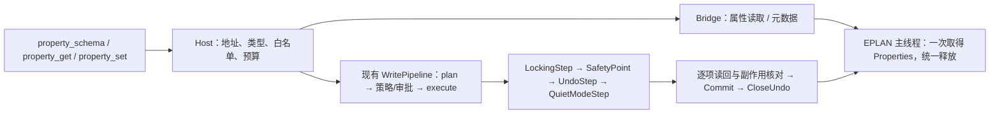

# 设计文档：通用 EPLAN 属性读写

| 项 | 内容 |
|---|---|
| 状态 | Draft（仅设计，未进行本设计的实机验证） |
| 级别 | L2；沿用既有安全级别、审批、IPC 和计划格式 |
| 作者 | asckye |
| 关联 Issue | 待建立 |
| 相关 ADR | [0003](../adr/0003-ipc-named-pipe-json-rpc.md)、[0005](../adr/0005-safety-model.md)、[0010](../adr/0010-write-outcomes.md)、[0012](../adr/0012-export-tier.md)、[0013](../adr/0013-destructive-backup.md)、[0019](../adr/0019-master-data-writes.md)、[0021](../adr/0021-action-run-whitelist.md)、[0022](../adr/0022-domain-toolsets.md)、[0023](../adr/0023-plan-approval-and-backup.md)、[0028](../adr/0028-plan-record-format.md) |
| 最后更新 | 2026-10-25 |

## 1. 背景

负责人于 2026-10-25 决定：M6 第 2 阶段之后依次完成通用属性读写、官方 action 每行的白名单状态、绘图工具。本设计负责第一项。
现有工具只能改设备标识、页描述，不能通用地查询或修改功能文本、技术参数、部件分配和连接属性。
[覆盖报告](../eplan/coverage-report.md)记载：数据字典有 68 个含非过时属性的对象类型、8,585 条非过时属性记录，Bridge 使用其中 42 条。
这里的记录按对象类型区分；同一个数值 ID 出现在不同类型上，不代表同一条可写能力。

事实依据与复用点：

- [api-notes](../eplan/api-notes.md) A13/A17：改名须处理全部相关功能、检查冲突和读回；页描述必须保留未修改的语言。
- A32/A34：对象号仅在项目内有效；`PROJ_GUID` 不能区分副本，运行时数据库号不能持久化。
- A33：占位符“当前值”读取可能要求写锁；不能把所有 getter 都当安全只读。
- A36：全属性读取可能产生数百万值；释放错误会使 EPLAN 内存耗尽或访问冲突退出。
- A39：action 可有重编号、重复对象、外部数据等副作用，不能作为属性 setter 的通用后备路径。
- [EplanProperties](../../src/EplanMcp.Bridge.Eplan/Adapters/EplanProperties.cs) 已读已有属性和索引；[快照读取器](../../src/EplanMcp.Bridge.Eplan/Adapters/EplanSnapshotReader.cs)按登记属性读取并管理生命周期。
- [EplanPageDescriptions](../../src/EplanMcp.Bridge.Eplan/Adapters/EplanPageDescriptions.cs)、[设备改名](../../src/EplanMcp.Bridge.Eplan/Adapters/EplanDeviceRenamer.cs)、[占位符写入](../../src/EplanMcp.Bridge.Eplan/Adapters/EplanPlaceholderWriter.cs)提供语义参考，不原样复用旧的属性列表获取方式。
- [SnapshotCanonical](../../src/EplanMcp.Bridge.Core/Operations/SnapshotCanonical.cs) 与 [SnapshotProfiles](../../src/EplanMcp.Contracts/SnapshotProfiles.cs)的登记集是快照哈希契约，不是全属性读权限或写白名单。

外部 checklist：[covagashi/Eplan_2026_IA_MCP_scripts 的 live.py](https://github.com/Canary-ECAD/eplan-mcp/blob/0681c75cb5c2d75cbb6ca0db5e83625fdb1c6f4d/eplan-p8-mcp-server/mcp_server/api/actions/live.py)（原仓库已重定向，MIT，2026-10-25 查阅）。
只借其任务检查项：功能文本的语言保留、连接点名称按索引处理、同名多功能的歧义；不复制代码，不采用运行时反射或动态脚本。连接点名称与连接线的 designation 是不同属性。

## 2. 目标与非目标

- **目标**：已寻址对象可按字典 ID 精确读属性；写入仅开放随产品发布、逐批在 scratch 验证的 `(对象类型, ID)` 条目。
- **覆盖目标**：每条非过时属性都有可追踪的读取状态；所有允许读取的属性最终可读，个人信息、路径、内部属性保留明确排除；写集合按验证批次增长。
- **首发范围**：Project、Page、Function（含端子、PLC、电缆的适用属性）、Connection；随后接入项目内 ArticleReference 等对象，其他类型逐类接入，不能宣称首发覆盖 68 类。
- **非目标**：主数据写入、项目/用户/工作站设置、用户自定义属性的创建和写入、任意反射/API/action、全项目属性转储、隐式重编号/翻译/部件同步。
- `eplan_property_set` 固定为 Write，只开放经验证可撤销的普通赋值；破坏性变化拒绝并交已有 Destructive 任务工具。数量多本身不自动等于 Destructive。

## 3. 方案概述

Host 解析业务地址、验证发布白名单，Bridge 在主线程取得对象的属性列表，按 ID 读写；写入完整复用现有流水线。字典元数据描述能力，不授予权限。



## 4. 详细设计

### 4.1 工具规格要点

以下按[工具规格模板](../templates/tool-spec.md)列出决策，实现 PR 再落成三个 `docs/tools/` 规格及英文 usage。
三个工具归一个 `property` 工具集；首发仅 `full`，`core` 的 25 项保持不变。
ADR-0022 的工具集发现尚未实现时先用现有 Profile 注册，不以此阻塞属性工具；实现后支持静态选择和按需加载，加载不授权。
`schema` 作为“描述属性定义”的领域动作，在工具规范中补充；不用一个任意参数网关代替三个 schema。

| 工具 / 英文 title | 任务 | 级别 | 注解：readOnly / destructive / idempotent / openWorld |
|---|---|---|---|
| `eplan_property_schema` / Describe EPLAN properties | 查 ID、正式名称、值类型、索引/语言及读写限制 | Read | true / false / true / false |
| `eplan_property_get` / Read EPLAN properties | 批量读取明确指定的对象与属性 | Read | true / false / true / false |
| `eplan_property_set` / Set EPLAN properties | 预览并设置白名单中的项目属性 | Write | false / false / true / false |

`set` 只做确定值赋值，重复相同请求无变化；不含递增、追加、自动编号等非幂等语义。未知结果仍禁止重放。
全部输入对象 `additionalProperties: false`，枚举与上限进入 JSON Schema；描述、schema 说明、摘要和错误用英文，项目文字保持原文。

| 参数 | 工具 | 类型 / 必填 / 默认 | 约束 |
|---|---|---|---|
| `project` | get / set；schema 可选 | string；set 必填 | 沿用 ProjectResolver；get 省略时使用当前/唯一项目并回显；一次调用只涉及一个项目 |
| `queries` | get | array；必填 | 1–50 组 `{target, properties:[selector]}`，每组 1–20 个 selector，展开最多 200 个属性请求 |
| `object_type` | schema | string；必填 | 字典中对象类型的枚举；不是对象运行时的数字 type |
| `properties` / `name_contains` | schema | selector[] / string；可选 | 二者互斥；都省略时分页列该类型的安全定义；不访问项目值 |
| `target` | schema | 对象地址；可选 | 有 target 时 project 必须可解析，返回该实例的运行时定义和许可状态 |
| `changes` | set | array；必填 | 1–100 项 `{target, property, value, language?}`；展开最多 50 个对象、100 个赋值；不做无限匹配 |
| `dry_run` | set | bool；false | true 只规划并返回完整变更摘要；不审批、不建写事务 |
| `language` | get | string；可选 | EPLAN ISO 代码，如 `zh_CN`；省略沿用 GUI 语言及现有语言回退规则 |
| `response_format` | 三者 | enum；`concise` | `concise` / `detailed` |
| `limit` / `cursor` | get / schema | int / string；50 / 无 | limit 1–200，按结果行分页；cursor 不透明 |

**selector**：`{property_id: integer}` 或 `{property_name: string}`，恰选一个，可加 `index: integer`。
名称必须是字典正式符号名，例如 `FUNC_TEXT`，不用本地化显示名或模糊别名；schema 把正式名称解析为 ID。自定义标识名首发拒绝，不把任意字符串传给 API。
实际对象类型决定适用性；相同 ID 在另一类型获准不产生继承权限。Function 的派生类型须逐项声明适用类别。

**target** 是互斥地址联合：

1. `{project_object:true}`：顶层 project 本身。
2. `{page:"=AP+ST1/3"}`：精确页全名；不是“这页所有对象”。
3. `{device_tag:"=AP+ST1-K1", page?:"..."}`：精确设备全名定位一个主功能；多个主功能/表达类型仍匹配时返回 `AMBIGUOUS_NAME` 和候选定位符，不选第一个，不默认改全部辅助功能。
4. `{locator:ObjectLocator}`：复用当前 `page|function|connection` 和项目、type、oid、名称/页/类别/位置核对；连接优先走此地址。
5. 后续 ArticleReference 批次扩展 `{owner:ObjectLocator, article_reference_index:integer}`，限定 owner 为主功能，索引来自读取结果，并同时核对旧部件号/变体；不扩充已有 locator 三种 kind 的含义。

写入规划补齐地址的核对信息；顶层项目与 locator.project 不符时拒绝。项目路径仅用作现有寻址身份，不作为属性值返回。
对象号、数据库号和 `PROJ_GUID` 不单独授权；对象删除、项目重开或副本切换后重新解析，描述不符绝不按名称改指别的对象（A32/A34）。
其他字典类型后续以明确的 target 分支和类型化读取适配器接入；未提供地址路径的类型返回 `CAPABILITY_MISSING`，报告仍为 registered/partial 或有依据的 env_blocked。

调用示例（文档中的工程名称为示意）：

```json
{"object_type":"Function","properties":[{"property_id":20011}]}
```

```json
{"project":"Line1","queries":[{"target":{"device_tag":"=AP+ST1-K1"},"properties":[{"property_name":"FUNC_TEXT"}]}],"language":"zh_CN"}
```

```json
{"project":"Line1","changes":[{"target":{"device_tag":"=AP+ST1-K1"},"property":{"property_id":20011},"language":"zh_CN","value":"输送电机"}],"dry_run":true}
```

### 4.2 输出、预算和错误

三者均声明 `outputSchema`，返回 `structuredContent`、同内容 JSON 文本块和一行不含自由文本的数量摘要；两个 JSON 副本一起计算预算。

| 工具 | structuredContent 形状及 concise / detailed |
|---|---|
| schema | `{catalog_version, object_type, items, total, cursor, truncated}`；item 含 ID、正式名称、read/write 状态及原因；detailed 加类型/边界/索引/单位/来源/版本和运行时差异 |
| get | `{project, items, total, cursor, truncated, warnings}`；item 含 query 序号、对象地址、ID、index、status、value、language；detailed 加类型、read_only、computed、display、texts、unit 和 format |
| set | 现有写结果信封，含 `{project, changes, changed_count, execution, undo, warnings}`；每条变更含对象、ID、index、语言、before/after、副作用；dry-run 和无变化为 not_started |

get 行状态为 `value|empty|not_applicable|read_refused`；API 不适用与空值分开。禁止读取的 ID 先做策略检查，不能用“是否有值”泄露信息。
schema 的 `api_writable` 与 `write_allowed` 分开：前者来自运行时定义，后者只来自发布白名单；未知写明 unknown/null，不推断为 true。
默认结果约 5k token，硬上限 20k；桥接块另限 1 MiB，低于现有 16 MiB 帧上限。单个文本视图沿用 CleanText 的 500 字符截断并标原长度。
get/schema 按对象、ID、index、language 稳定排序分页；游标绑定查询、会话、项目身份和已读内容指纹，变化或过期为 INVALID_ARGUMENT，提示重新读取；不跨页宣称原子快照。
`total` 是本次明确选择集的结果行数；尚未枚举完索引时为 null，不能伪装为全项目总数。长单值截断没有“写回即还原”的保证。
set 不分页执行、不截断审批范围；完整清单放不进现有审批通道/预算时，在写入前拒绝并要求缩小 changes；不能只批准前 N 项。
单条字符串写入首版最多 500 字符，每次输入最多 64 KiB；这是产品预算，仍须满足更严格的属性定义限制。

| reason | 适用情形 / 下一步 | set.execution |
|---|---|---|
| `INVALID_ARGUMENT` | 未知 ID/名称、类型/索引/单位不符、重复目标键、超限；一次列出所有 violations，用 schema 核对 | not_started；执行读回发现为 rolled_back |
| `POLICY_DENIED` | 不在白名单、敏感/内部属性、主数据或设置；只解释限制 | not_started |
| `CAPABILITY_MISSING` / `LICENCE_MISSING` | 对象适配器或授权不可用；返回缺失能力 | not_started，事务中授权失败为 rolled_back |
| `AMBIGUOUS_NAME` / `PAGE_NOT_FOUND` / `DEVICE_NOT_FOUND` | 业务地址不唯一或不存在；最多 20 个安全候选 | not_started |
| `PLAN_STALE` | locator 核对失败，或审批后目标值/依赖变化；重新规划 | not_started |
| `EPLAN_OPERATION_FAILED` | API 失败或实际影响超出计划；附本次系统消息 | rolled_back |

连接、模态窗口、锁、审计、审批、取消、超时及 `OUTCOME_UNKNOWN`/`WRITES_SUSPENDED` 沿用现有错误；Read 不带 execution。
单个合法但在实例上不适用的读属性可返回行状态；请求格式、策略、对象身份或基础设施失败则整次 isError，不能静默丢项。

### 4.3 读取路径与值表示

只读公开、非过时、非 internal、未被敏感规则排除的字典属性，不要求已在写白名单中。
Project/Page/Function/Connection 先提供通用读取路径，Article/ArticleReference、图形、3D、拓扑、规划、修订、主数据定义逐类验证；无对应对象/授权时如实报告，不生成虚假空值。
不自动打开任意项目/库/文件；只使用已解析的项目和已配置的只读主数据服务，主数据查询仍可使用既有任务工具。
读取 computed/read-only 属性不触发更新、编号、生成连接、报表或同步；需要写锁/会更改设计数据的 getter 不走 Read，记 read_refused 并保留证据（A33）。

- **类型**：返回 `value_type`（text、boolean、integer、number、datetime、enum、multi_language、opaque）和对应 JSON 值；未知类型只给安全显示文本、不可写，不用 `ToString()` 假装数值。
- **多语言**：value 是选中语言的显示值，回显实际语言及 fallback；显式指定语言不回退。detailed 的 texts 按语言列全部存储项，包括 `??_??`，逐项清洗/计入预算；不直接返回 `de_DE@...;` 编码供写回。
- **索引**：显式 index 读单项；省略时只枚举已有 Indexes，每块最多 200 行后续游标继续。不假设起始值为 0/1；非索引属性收到 index 拒绝。必须在 IsEmpty 前判断索引性，避免 IndexedPropertyException。
- **单位/格式**：分别返回存储值、display、unit、format/source；例如截面及对应单位 ID 联合解释，保留 `1,5` 这类实际存储形式，不按当前区域设置猜成数字或自动换算。
- **计算属性**：标明 computed/read_only 和观察时刻，不视为稳定身份或输入；没有可靠定义时标 unknown。

### 4.4 元数据来源及 A36 生命周期

[字典](../../catalog/eplan-2026.0.3/data-dictionary.jsonl)目前只有 object/name/value、obsolete 等字段，**没有完整的类型、范围、单位、索引和可写性**。
schema 无实例时只能返回目录事实和随批次核实的描述；缺少信息为 unknown。不得凭 setter 存在或属性名推定可写。
运行时元数据使用 `Eplan.EplApi.DataModel.PropertyDefinition` 的 Type、IsReadOnly、IsIndexed、MaxIndex、LowerBound、UpperBound、IsNamePart、IsInternal、IsPropertyLicensed，与发布条目比较；枚举、单位和特殊格式需批次补证据。
上述 API 在目录中可查；其完整语义、边界含义及通用 Property 访问器在本工具中的行为仍须 scratch 验证。缺少必需写约束就不开放该条目。

Bridge.Eplan 是唯一引用 EPLAN 类型的层。用 `Eplan.EplApi.DataModel.UniversalPropertyList.Property(AnyPropertyId[, index])` 的公开访问器及必要的类型化访问器；C# 调用形式先编译核对，不使用运行时反射。
Contracts 放 DTO 和发布条目数据，Bridge.Core 做纯校验/比较，Host 做策略、审批、预算。仅新增 invoke 操作 `property.schema`、`property.get`、`property.set.plan/.execute`，不新增 RPC 方法或改变帧/握手协议（ADR-0003）。

每个主线程工作单元的纪律：

1. 按真实对象去重；每个对象只取得一次 Properties，同一列表用于元数据、所有索引、读前值、写入和读回，完成后统一释放一次。
2. `AnyPropertyId`、`PropertyValue`（含索引项）、`PropertyDefinition`、边界值和 `MultiLangString` 都在所有成功/异常/取消路径逐个释放；不只释放数组或外层列表。
3. 禁止释放列表后再次访问同一对象的 Properties，包括便利函数、快照或旧适配器间接重取。规划与执行是独立主线程调用，各自重新解析对象并建立独立生命周期。
4. 不把 EPLAN 对象、列表、值或延迟枚举存入 Host/游标/缓存；离开主线程只返回复制的 DTO。
5. get/schema 默认每块 2 秒软预算，在安全点分页，单次执行硬时限 20 秒，Host 等待 30 秒；不承诺能中断一个正在执行的 native getter。慢属性暂停开放并记录，不扩大超时掩盖问题。
6. set 规划/执行各限 30 秒，审批时间沿用配置；预计超过 2 秒报告进度，每对象/写入前后检查取消。执行超时走 outcome.get，不重发。

定向查询只取请求的 ID，不为过滤少数属性先调用 ExistingValues 物化整张列表；需要枚举时也分块并释放整个返回数组中的每个对象。

### 4.5 写白名单、值语义与副作用

白名单使用 Contracts 中随产品发布的静态数据，键为 `(EPLAN 主版本, 字典对象类型, property_id, 适用类别)`，不接受本地或 MCP 加条目。
每项必须记录：正式名称、值类型、长度/数值上下界/枚举/格式、是否允许空值、合法 index 与单位、语言模式、setter/读回方式、依赖/副作用、规范化比较、测试及 api-notes 来源。
值约束以字典 ID 关联运行时 PropertyDefinition 和已核实官方定义；产品上限可更严格。未核实的范围不能填“任意”；类型/定义与条目不一致立即拒绝。
仅对验证过的主版本、变体及授权组合开放；换主版本退回待验证，不改变仓库支持版本范围。字典只读、computed、敏感或不在名单中的 ID 一律拒绝。

- `value` 为 JSON 类型联合，不把数字/布尔转成任意字符串；禁止 NaN/Infinity。枚举只接收条目公布的名称或数值之一，不能混用。
- 首版不接受 null/reset/delete；空字符串仅在条目明确允许时清空一个标量或一种语言，不删除对象/索引/其他译文。
- 多语言必须逐 change 指定 language，内部合并完整原值后用 `Eplan.EplApi.Base.MultiLangString` 写入；不自动添加项目语言、不翻译、不解析用户输入的 `@`/`;` 为语言编码。
- 索引属性写必须给 index，使用定义和该实例允许的范围，不自动追加索引；同一对象/ID/index/language 重复拒绝。
- computed、名称组成部分、编号、自动维护的时间/修改人等不作裸赋值。设备/页改名继续用已有工具，保留 A13 的组语义和冲突检查。
- `FUNC_MOUNTINGLOCATION` 是候选工程属性；不混同 `DESIGNATION_LOCATION` 等设备/页结构标识。会改名、传播交叉引用或影响其他对象时，必须有专用语义适配器、完整依赖预览和边界核对；做不到就不入名单。
- 部件号/变体作为一个原子赋值组，先核对项目中可用的部件及变体；只修改项目分配。不得顺便导入、更新部件库或运行 PartsToSystem/SystemPartsToProject；需要同步时使用独立任务工具。
- 连接的截面/颜色/名称须核对连接定义点、源/目标及相关连接的传播；不隐式 Generate/Number。新建/删除/重编号或范围不可逐项预览的变化拒绝。
- 主数据属性写入一律拒绝，即使当前项目是 scratch；部件库/翻译库操作继续按 ADR-0019 专用工具处理。项目设置、`PROJ_HIERARCHY_*` 等配置拒绝，不能借“项目属性”绕过 Code/设置边界。

### 4.6 规划、审批、事务与 M6

一次 set 的多对象 changes 编译为一个计划、一次审批、一个 SafetyPoint 和一个 UndoStep；全部成功或全部回滚，不逐对象审批或部分提交。
先做全部参数/白名单检查与目标解析，再读取 before、完整语言值、关联对象/部件/连接；计划展示每项 before → after、所有预计传播和被影响对象数量。
指纹覆盖真实读写值（所有语言/索引）、地址核对信息、依赖及白名单版本，不能只用修改时间或快照 standard 哈希；未登记的属性也必须参与本次计划指纹。
`dry_run` 不审批；无变化不建事务、不留空撤销步骤。超过已验证的影响范围或完整清单容不下时拒绝，不自动分批执行。
沿用策略：scratch 中 Write 自动允许；scratch 外经既有配置和独立窗口审批；无窗口、拒绝、超期、审计不可写均不执行。
审批绑定现有请求 ID、计划指纹和参数摘要；执行时在同一主线程调用内重新规划核对，随后 `LockingStep → SafetyPoint → UndoStep → QuietModeStep`。
提交前逐项重新读取原始类型值、全部语言/索引及副作用守卫，与批准计划比较；EPLAN 静默丢字段/转换超出已验证规则也回滚。成功 Commit 后 CloseUndo，返回撤销说明。
审计复用 execution_started/result、参数摘要、对象/ID/index/语言、计划指纹、变更数量和结果，不将完整自由文本/个人信息或属性路径写入默认日志。
事务失败为 rolled_back；回滚失败或执行中断后取不回结果为 unknown，暂停项目及原实例写入；提交后的告警不能谎报 rolled_back（ADR-0010）。

后续将同一编译器/执行器注册为封闭 M6 step op `property.set`，复用同样白名单、输入和副作用守卫，不允许步骤直接传任意 Bridge 操作。
按 ADR-0023 一次批准整个 M6 计划、开始前备份，property.set 内多对象为一个步骤；不同步骤仍各自提交/撤销，后步失败不自动撤销前步。
扩展步骤 schema、预测/冲突规则、目标范围、前后值校验和 PlanVerifier；不能只添加 op 字符串。
standard 快照之外的属性通过本步骤显式的前置条件和校验证据参与；不修改 `eplanmcp.snapshot/1` 登记集或哈希。需要扩集时另做版本化设计，ADR-0028 的记录格式不在此更改。

### 4.7 首批验证清单

下表均为**候选**，并非当前已获准的写名单。类型为拟定输入形状，最终按 PropertyDefinition/官方定义核实；有冲突先改设计/条目，不猜测。
各批均执行第 7 节的写入、独立读回、持久化、一步撤销与故障回滚门槛；通过的具体条目才加入名单，失败者保留状态和原因。

| 批次 | 对象、ID / 正式名称 | 拟定值约束及专项验证 |
|---|---|---|
| B1 功能文本/技术数据 | Function：20011 `FUNC_TEXT`；20027 `FUNC_TECHNICAL_CHARACTERISTIC` | 文本≤500 字符及定义上限；20011 按语言修改；20027 是否多语言需核实。测中文、空值、`;`/`@`、未改译文、辅助功能保持原值 |
| B2 安装位置 | Function：20024 `FUNC_MOUNTINGLOCATION` | 文本/多语言性、长度和命名规则待核实；核对其与结构安装位置的差别、继承来源、跨页主辅功能、交叉引用；意外改名则不开放裸 setter |
| B3 连接工程字段 | Connection：31002 `CONNECTION_WIRECROSSSECTION`、31059 `CONNECTION_WIRECROSSSECTION_UNIT`；31004 `CONNECTION_WIRENUMBER`；31011 `CONNECTION_DESIGNATION` | 截面用有单位的正值候选，单位枚举、逗号小数及存储类型实测；31004 的颜色/编号语义按界面对照，不凭现有 Colour 字段认定。测定义点继承、两端及相关连接传播，拒绝超范围 |
| B4 页属性 | Page：11011 `PAGE_NOMINATIOMN`；11901 `PAGE_SUPPLEMENTARYFIELD` | 前者多语言合并，对照现有 page_update；后者文本/索引及 MaxIndex 先核实。测其他语言/索引、页名和幅面不变；11016 幅面先只读，避免外部路径/格式副作用 |
| B5 项目工程信息 | Project：10013 `PROJ_DRAWINGNUMBER`；10014 `PROJ_COMMISSION`；10901 `PROJ_SUPPLEMENTARYFIELD` | 文本及补充字段索引待核实；仅工程信息，不包括项目名、路径、结构/设置。测其他页/项目不变，项目级撤销/回滚以及重新打开后的值 |
| B6 部件号/变体分配 | Function：20100 `FUNC_ARTICLE_PARTNR`、20101 `FUNC_ARTICLE_VARIANT`；ArticleReference：20481 `ARTICLEREF_PARTNO`、20488 `ARTICLEREF_VARIANT` | 字符串部件号+经核实的变体类型/枚举；索引指向既有分配槽，两者成组。先读后决定一条权威写路径，禁止重复写两个视图；核对数量、其他引用、功能模板和连接，证明库未改写；不能回滚/撤销则保持拒绝 |
| B7 连接点名称 | Function：20022 `FUNC_CONNECTIONDESIGNATION` | 按定义的索引逐项文本，不能把分隔符拼接列表塞到首项；核对实际 pin 数、未改 pin、端子/PLC 特殊类别及连接。与 Connection 的 31011 分开计数 |

## 5. 安全与数据完整性

执行 [security.md](../standards/security.md) SEC-01/02/05–14/18/19；无新信任边界，通用属性仍是项目数据进入模型的 TB3 路径。
在取值前按 ID/类型排除全部 `PROPUSER_*`，尤其 3010–3013 修改人的代码、姓名、邮件、电话，以及创建者/联系人、凭据、授权、数据库连接串、个人信息和本机/UNC 路径属性。
2000 运行时对象字符串标识也不作为工程属性输出；ProjectInfo.xml 等旁路不读取。类型/元数据不能判定敏感性的新属性先拒绝、待审查分类。
安全分类随产品发布，覆盖所有 get 模式和 schema 实例读取；禁止借 detailed、texts、display、错误或审计绕过。自由文本中的路径/联系信息另做脱敏；无法可靠清洗的整值拒绝，不追踪链接或打开路径。
结果、审批视图用 CleanText 去控制字符/双向符号、标注截断；原始值只在受控执行比较中使用，不能用清洗/截断后的视图计算指纹或当作旧值还原。
不返回可点击的项目文本链接，不把属性文本拼成工具说明或摘要指令；默认日志不含值，符合 SEC-08/10/12。

**分级边界**：当前设计全为 L2，不新增 ADR。普通属性替换是 ADR-0005 已定义的 Write；遇到删除、大范围重编号、不可逐项撤销或主数据修改时拒绝，继续使用既有 Destructive 工具及 ADR-0013/0019 的审批/备份。
如果以后要求同一个 set 接受 Destructive 条目并动态取安全级别，将新增 ADR-0021 之外的例外，须先单独提交 Proposed ADR，由负责人接受；本设计不预先授权，也不把所有 set 一律升为 Destructive。

## 6. 备选方案

- 每个属性一个工具：工具数量失控，索引/语言/审批重复；保留常用任务工具，在内部共享属性服务。
- 所有有 setter 的属性都能写：定义的可写性不证明可回滚和副作用边界；否决。
- 反射/脚本或 action 兜底：扩大执行面，绕过语义校验和白名单；否决。
- 用 detailed 项目/设备查询代替 get：只能读已有非空值、缺少精确类型与空/不适用状态，无法服务统一写前读回；不足以满足目标。

## 7. 测试与验证

- **Small**：地址联合、ID/正式名解析、白名单逐类型/版本拒绝、运行时定义漂移、值/索引/语言/单位/边界、重复键、合并译文、fingerprint、行状态、预算/游标、敏感规则、工具注解及规范化比较；Fake 属性资源计数检验异常/取消路径释放。
- **Medium**：真实 Host + Fake Bridge 的 get/schema/set 契约、两种序列化器往返、完整清单一次审批、dry-run/无变化、拒绝/超期/无窗口、审计失败、PLAN_STALE、取消/断线/outcome.get、unknown 后暂停；文件读写和覆盖生成检查属于 Medium。
- **Large 只在 scratch 的 `writes/LargeWrite` 副本**：由[夹具流程](../../tests/EplanMcp.Large.Tests/README.md)建立独立起点，每批记录 EPLAN 完整版本、变体、授权、日期、对象/ID/索引/语言和实测限制；本设计阶段不运行。
- 每条写候选：dry-run 无变化 → 成功写入 → 独立 get 及 EPLAN 属性对话框核对 → 保存/重开后仍一致 → 一次 Ctrl+Z 恢复本次全部变化且保留此前撤销历史（持久性与撤销用独立副本）→ 写到第二对象时注入失败并核对全部回滚、不留空 UndoStep。
- 副作用门：比较主辅功能、名称、交叉引用、部件分配、连接两端和关联对象；检查其他项目、主数据库/设置及设计数据文件，区分已知 User.eod/eox 行为；模板同步/生成/未知传播不能只凭请求值读回成功放行。
- 读取门：每对象类测普通/空/不适用/只读计算/索引/多语言/缺许可、删除和重开后的 locator；重复读同批目标监测工作集回落及设计数据未变化，结合 A36 的资源释放审查，不能用进程未崩溃代替证明。
- **Agent 评测**：查 schema 后改两设备中文功能文本并保留德文；改连接截面；拒绝主数据/设置及不在名单的 ID；同名歧义先选定位符；遇到属性中的提示注入仍只执行用户任务。用实际读回验收，不采信模型自述。

### 7.1 覆盖状态映射

保留现有“68 个对象类型”和 `dictionaryProperties.used=42` 的历史静态引用口径，另在 `catalog/coverage.json` 增加按属性/方向的生成视图，不把 getProp 的一次引用算作全部验证。
目录键采用 `D:<Object>.<正式名称>`，记录 numeric ID 和 read/write 两方向；同号不同对象、别名不重复混算，索引/语言作为证据范围而非新增分母。
生成视图是可重建的报告，不作为运行时授权存储；不改计划/审计落盘格式。原始目录不手改，证据放现有 mapping/overlay 的扩展，具体输入字段在覆盖 PR 定稿并校验。

| 状态（沿用覆盖设计） | read | write |
|---|---|---|
| `registered` | 有目录记录，尚无可达地址/读取路径 | 尚未验证、未入发布名单；默认拒绝 |
| `implemented` | 有目标类型适配器、值转换与工具可达路径 | 有受控条目实现；尚未通过实机门时不能发布启用 |
| `automated_test` | 有具体类型/属性行为测试；非仅 schema 测试 | 类型/边界/失败行为通过 Small/Medium，仍不代表可启用 |
| `live_verified` | 指定对象/ID 在实机对照成功，证据包含语言/索引/只读限制 | 指定条目所有第 7 节门通过，才允许加入可执行白名单 |
| `partial` | 通路存在，但部分属性类型/索引/语言/对象范围未覆盖，逐项注明缺口 | 某些类别/格式/副作用未验证，缺口部分拒绝 |
| `env_blocked` | 确有安装/模块/授权阻断，写明条件和出处 | 同左；不能将未安排测试记成 env_blocked |
| `excluded` | deprecated/internal/unsafe（敏感、会写数据的 getter）等明确理由 | computed/read-only、主数据、设置、危险传播等用 not_applicable/unsafe 和具体理由 |

同一条证据不能把全类型每个 ID 推为 live_verified；只读成功不升级 write，已有 page_update 等证据按确切属性/场景关联，不能泛化到新通用路径。
报告按类型和方向同时列全部 8,585 条、各状态数量、排除理由、允许集合、实机验证数；另给安全排除后的可读分母，不能隐藏距全部字典的差额。写分母不假称所有非过时属性都应可写。
实现覆盖扫描关联动态 ID 发布表与 invoke 可达路径，overlay 给逐项实机证据；只有表项、生成代码或一个通用操作名不计完成。
`generate/check` 保持确定性，覆盖输入变动须重生成 tools.json、coverage.json、coverage-report.md；本设计不提前修改统计或标已验证。

## 8. 发布与兼容性

新增工具/参数分支按次版本发布，现有 page_update/device_update/placeholder_apply 契约不变；底层共享前先补生命周期回归。
首发写名单只含已通过的 B1 条目，其他批次逐项发布；schema 返回实际可用状态。某批未通过不会阻塞已验证的读取能力，但不能带风险默认开放。
回退可移除未发布条目；已发布条目按工具契约管理，安全缺陷先停用并在 CHANGELOG 记录。更新工具说明、契约快照、api-notes 和覆盖证据，与实现同 PR 审视。

### 8.1 PR 拆分与关卡

估算为生产代码+文档改动行；测试/生成文件/快照/夹具按流程不计，**每个 PR ≤400**，若超出继续拆分。S/M/L 指 Small/Medium/Large；依赖按顺序，未完成的入口不注册。

| PR | 单一交付 | 估算行 | 验证 / EPLAN 关卡 |
|---|---|---:|---|
| P0 | 本设计先合并 | ≤400 | 文档链接、自查，无 EPLAN |
| P1 | 属性描述与白名单 DTO、纯校验基础 | 250 | S 序列化/类型/拒绝；无 EPLAN |
| P2 | schema 规格、Host 目录查询和元数据契约 | 300 | S/M schema 快照；未知约束不授权 |
| P3 | Bridge Project/Page 元数据和读适配器 | 300 | S/M；L 定义、普通/索引/语言、A36 门 |
| P4 | Bridge Function/Connection 读适配器及 get 操作 | 320 | S/M；L 歧义/locator/计算/许可/A36 门 |
| P5 | get 规格、Host 工具、预算/分页及发布注册 | 300 | S/M 契约、脱敏；L/Agent 读任务，依赖 P3/P4 |
| P6 | set 规划、值比较、依赖/副作用守卫 | 320 | S/M stale/范围/语言；L B1 规划不写 |
| P7 | 事务执行、统一列表生命周期和逐项读回 | 300 | S/M 失败路径；L B1 写/撤销/回滚全门，入口仍未注册 |
| P8 | set 规格、Host 流水线及已验证 B1 发布 | 300 | S/M 审批/审计/恢复、契约；L/Agent 完整调用 |
| P9a / P9b | 覆盖输入/动态 ID 映射；方向报告与文档 | 各 280 | S/M 多类型同号、缺证据、确定性、generate/check；逐 ID 引用 Large 证据 |
| P10a / P10b | B2 安装位置；B3 连接字段白名单 | 各 280 | 各自 S/M + L 全门；未查明传播不开放 |
| P11a / P11b | B4 页属性；B5 项目属性白名单 | 各 240 | 各自 S/M + L 全门，项目属性/设置边界 |
| P12a / P12b | ArticleReference 读取及地址；B6 分配语义/白名单 | 各 320 | 各自 S/M/L；P12b 加库不变、原子组、模板/连接副作用门 |
| P13 | B7 连接点名称白名单 | 240 | S/M + L 索引/pin/连接守卫全门 |
| P14a / P14b | M6 property.set 编译/依赖；执行/校验/证据接入 | 各 320 | S/M 计划哈希/单批范围/未知结果；L 一次批准及逐步撤销语义 |
| 后续每 PR | 一个其余对象类型的安全分类、地址和读取适配器 | ≤350 | S/M + 该类型 L 读取门；缺授权保留 env_blocked，不能推全类型完成 |

所有实现 PR 运行现有构建、格式、Small/Medium、契约、链接及覆盖检查；涉及 EPLAN 的变更合并前附相应 Large 实测记录（含未通过/隔离项），每个写批次缺任一门就不开放。

## 9. 待定问题

- 由各批实现者在开放前核实 PropertyDefinition 的真实类型/上下界/索引/空值、连接颜色语义、安装位置传播和部件赋值是否触发模板变化；结论写 api-notes 和具体条目。这些是验证门，不是让负责人猜 API 行为。
- 没有需要负责人接受的新 L3 决策；若出现必须放宽安全默认值、写设置/主数据、混合安全级别或改变快照/计划持久化格式的需求，停止该扩展，另提 Proposed ADR 后再安排实现。
