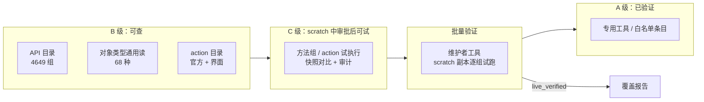

# 设计文档：EPLAN API 补齐（ADR-0032 实施计划）

| 项 | 内容 |
|---|---|
| 状态 | Approved（项目负责人 2026-10-30 接受 ADR-0032，并决定推迟 v0.5.0、先补齐 API） |
| 作者 | 维护者 |
| 相关 ADR | [ADR-0032](../adr/0032-generic-api-layer.md)、[ADR-0030](../adr/0030-action-catalog-tiers.md)、[ADR-0021](../adr/0021-action-run-whitelist.md)、[ADR-0005](../adr/0005-safety-model.md) |
| 最后更新 | 2026-10-31 |

## 1. 背景

2026-10-30 的客户页验收预演在 scratch 上全部阶段通过，但与原图仍有 6 处差异，负责人要求"和原版一模一样"，决定推迟 v0.5.0，先把 EPLAN API 相关工具全部做完，再重画客户页。

覆盖报告（`docs/eplan/coverage-report.md`）的现状：操作层 4014 组中实现 350 组、实机验证 164 组；对象类型 68 种中实现 12 种；官方 action 137 行中实现 7 行；界面 action 约 1050 个尚未纳入。负责人 2026-10-30 提供的 EPLAN 功能区截图（开始、插入、编辑、视图、设备、连接、工具、预规划、主数据）中约 150 个按钮，能用约 45 个，部分能用约 15 个，其余约 90 个没有工具。

## 2. 目标与非目标
- **目标**
  - 覆盖报告四个分母（操作层、对象类型、官方 action、界面 action）中，每一项都至少可查（B 级），能在 scratch 中经审批执行（C 级），或有明确的排除理由。
  - 截图中每个功能区按钮都有对应的工具、C 级条目或排除理由，并按本计划第 4 节逐批变为 A 级。
  - 客户验收页的 6 处差异全部由工具解决，重画结果与原图一致（第 4.5 节）。
  - 每一批都有 Small/Medium 测试与 scratch 上的 Large 测试，批量验证结果写回覆盖报告。
- **非目标**
  - 不为每个重载组单独注册 MCP 工具（工具设计规范第 10 节）。
  - 不提供基于字符串的任意反射调用（ADR-0032）。
  - 不在 scratch 之外执行未验证能力；不改变已发布工具的契约。
  - 不分发 EPLAN 安装文件或整理出的界面 action 清单（ADR-0030）。

## 3. 方案概述

## 4. 分批计划

每批独立推送 main（本地门禁），每个新工具先写工具规格。顺序按"先可查、再可试、再验证、再专用"，并优先解决客户页差异。

### 4.1 第 1 批：可查（B 级，只读）
| 编号 | 工具（暂定名） | 内容 | 数据来源 |
|---|---|---|---|
| B1 | `eplan_api_search` / `eplan_api_get` | 按命名空间、类型、名称、说明搜索全部重载组；返回签名、文档摘要、排除原因、覆盖状态和到达它的工具 | 仓库内 `catalog/eplan-2026.0.3/`，Host 内读取，不需要 EPLAN |
| B2 | `eplan_object_find` / `eplan_object_get` | 68 种对象类型的通用查找与属性读取：按类型、页、名称查找，分页返回定位器与属性（ID、名称、索引、值，按语言） | Bridge，只读 |
| B3 | `eplan_action_catalog_search` / `eplan_action_catalog_get` | 官方 action（177 行）与本机界面 action（`MFTools.xml` 等运行时读取）；返回名称、菜单位置、界面文字、已知参数、级别与验证记录 | Host 读本机安装，不入库 |

### 4.2 第 2 批：可试（C 级，只在 scratch，逐次审批）
| 编号 | 工具 | 内容 |
|---|---|---|
| C1 | `eplan_api_try` | 只接受目录中登记、未被排除的方法组；参数只允许简单值与对象定位器；Bridge 中按目录生成的分发表执行（不按字符串反射）；执行前后业务快照与文件指纹对比；超时或模态对话框报 `unknown` 并暂停写入 |
| C2 | `eplan_action_try` | 界面 action 的 C 级执行，规则同 ADR-0030 |
| C3 | 对象属性写入白名单扩展 | 每个属性登记可写性、取值校验与读回；按批加入 `eplan_property_set` |

### 4.3 第 3 批：批量验证
| 编号 | 内容 |
|---|---|
| V1 | 维护者工具：在 scratch 副本上逐组试跑读取类与写入类（写入在 `SafetyPoint` 中），记录弹窗、耗时、改动、能否回滚、能否一步撤销 |
| V2 | 结果写入 `catalog/mapping/overlay.yaml` 与覆盖报告（live_verified / env_blocked / 不可回滚），结论写进 api-notes；通过者按 ADR-0021 流程升为 A 级 |

### 4.4 第 4 批：专用工具（A 级），按功能区
| 功能区 | 主要能力 |
|---|---|
| 编辑 | 删除对象、复制/粘贴/多重复制、旋转、镜像、比例缩放、组合与取消组合、对齐/分布、置顶/置底 |
| 插入 | 黑盒、设备连接点、结构盒、插头/插针与插头定义、屏蔽、连接定义点、母线连接点、分散式端子、路径功能文本、圆/弧/多段线/椭圆、尺寸标注、图片 |
| 设备 / PLC | PLC 编址与分配、插头导航、PLC 连接点显示属性 |
| 连接 | 电位与源目标、连接定义点、全部重新分配、对齐与格式化 |
| 工具 | 按表格模板生成报表、自动处理、结构标识符、图层、属性排列、更换、同步 |
| 主数据（并入 M9） | 部件新建/修改、表格与图框设计、宏创建 |
| 预规划、拓扑、修订、`EServices.Ged`、Pro Panel 3D / 安装板 | 按命名空间分组的专用工具，范围在第 3 批验证结果出来后细化 |

### 4.5 客户页差异（必须在重画前解决）
| # | 差异 | 归属 |
|---|---|---|
| D1 | W3 的 RD 芯：经母线节点的连接作为芯线 | 连接（第 4 批），需先 spike：EPLAN 在星形网络中如何分配芯线 |
| D2 | 同页同名中断点 I2/I5（`-HMT-13S1`） | 连接；需先验证 EPLAN 同页同名中断点的配对规则 |
| D3 | PLC 通道显示 `-KF1`、`&EFA1/1.2` 与插头 `-X10` | 设备 / PLC：PLC 连接点显示属性、插头定义 |
| D4 | 电缆文字竖排 | 编辑：属性文字旋转与单独移动 |
| D5 | 辅助触点 `-SUP1`（中断点生成需要的真实连接） | 连接：中断点生成不再依赖辅助器件 |
| D6 | 端子排定义文字 `-X6 = 操作控制盒` | 插入：端子排定义放置到指定位置 |

## 5. 安全与数据完整性
- B 级全部只读；对象属性值是项目数据，按"数据而非指令"处理，返回经 `ResultShaper` 清洗与预算控制。
- C 级只作用于 scratch 根目录下的项目，scratch 外 `POLICY_DENIED`，不提供绕过；每次审批，审批内容显示条目、参数原文、"未验证"标记；默认关闭，`config.json` 显式开启。
- C 级执行前后快照对比、超时与模态对话框检测、审计标记沿用 ADR-0010 / ADR-0030 的机制。
- A 级专用工具沿用写入流水线：审批、事务、读回、一步撤销。
- security.md 在 C1 发布前补充"方法组试执行"的威胁说明。

## 6. 备选方案
- 每个重载组一个 MCP 工具：被否决，工具数量超出模型可选范围（工具设计规范第 10 节）。
- 只提供 C 级任意执行、不做专用工具：被否决，无法逐项读回核对，不满足"和原版一模一样"的验收。
- 先修客户页 6 处差异、再补 API：负责人 2026-10-30 否决，要求先系统补齐。

## 7. 测试与发布
- 每个工具：Small（规划、校验）、Medium（Host 流水线与假 Bridge）、Large（scratch 实机，含撤销）。
- 第 3 批之后每周更新覆盖报告；截图功能区对照表随批次更新。
- 全部批次与客户页重画（与原图一致）完成后，再按发布清单发布 v0.5.0。
