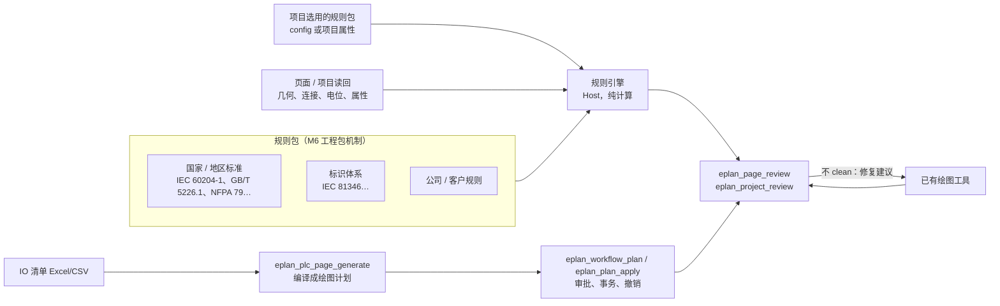

# 设计文档：M12 审图规则与按清单生成图纸

| 项 | 内容 |
|---|---|
| 状态 | Approved（项目负责人 2026-10-31：同意方向并要求纳入各国规范；第 6 节 Q1–Q4 按推荐执行） |
| 作者 | 维护者 |
| 相关 ADR | [ADR-0005](../adr/0005-safety-model.md)、[ADR-0032](../adr/0032-generic-api-layer.md)、M6 工程包相关 ADR |
| 相关规格 | [eplan_page_review](../tools/eplan_page_review.md) |
| 最后更新 | 2026-10-31 |

## 1. 背景
`eplan_page_review`（2026-10-31 同意）给绘图加上"画完自审、修复、再审"的闭环，第一片只检查几何与连接问题（悬空线头、意外连通、同名中断点配对 A65、芯线归属 A64）和与目标清单的差异。工程师交付前还要人工核对两类内容：一是公司、客户和所在国家的设计规范（标识、线号、颜色、截面、端子），二是电气逻辑（电位、电压等级、保护）。同时，PLC 页这类按清单重复绘制的页面占用大量时间，客户验收页本身就是一页 PLC DI 页。

## 2. 目标与非目标
- **目标**
  - G1 规范审图：把设计规范写成可加载的**规则包**，`eplan_page_review` 和新的项目级审查按所选规则包检查，问题清单与几何检查格式一致。
  - G2 各国规范：同一机制承载不同国家与地区的标准，项目在配置中选用一个或多个规则包（例如欧盟机械电气 IEC 60204-1 + IEC 81346 标识，中国 GB/T 5226.1，北美 NFPA 79 / UL 508A），也可以叠加公司和客户的规则包。
  - G3 电气逻辑检查：基于连接与电位读回的检查（电位与电压等级混接、PE 颜色、保护设备后截面放大、PLC 输入接到电源等）。
  - G4 按清单生成 PLC 页：给一张 IO 清单（Excel/CSV），生成完整的 PLC 卡件页（通道、地址、传感器/执行器、端子、中断点、电缆），生成后自动运行审查，结果为 clean 才算完成。
- **非目标**
  - 不在仓库中收录或分发标准原文（版权）；规则包只写可检查的规则、参数和条款号引用，正文由用户自行查阅。
  - 不宣称"符合某标准"：规则包覆盖的是可机器检查的部分，审查结果是辅助，最终判断由工程师负责。
  - 不改变写入的安全模型：生成走现有绘图工具、审批、事务、一步撤销。

## 3. 方案概述

## 4. 详细设计

### 4.1 规则包
- 载体：M6 工程包，新增资源类型 `rules`。包内每条规则一个条目：`id`、`title`（中英文）、`scope`（page / project）、`check`（规则种类，见 4.2）、`parameters`（如颜色表、截面表、正则）、`severity`、`reference`（标准号与条款号，只写编号不抄正文）、`applies_to`（对象类型、页类型、电压等级）。
- 规则种类是有限的内置检查器，参数化配置，不执行规则包里的代码（与 ADR-0005 一致，规则包是数据）。
- 选用：`config.json` 的 `reviewRulePacks` 给默认值，审查工具的 `rule_packs` 参数可以覆盖；同一检查被多个包配置时，按包的顺序后者覆盖前者，冲突在结果中列出。
- 首批规则包（由维护者起草、工程师审核后发布）：
  - `iec-60204-1`：导线颜色（PE 黄绿、N 浅蓝等）、急停与控制回路、截面与保护的基本关系；
  - `iec-81346`：设备标识的结构与字母代码；
  - `gb-t-5226-1`：与 IEC 60204-1 对应的国内要求及差异；
  - `nfpa-79`：北美导线颜色与标识差异；
  - `company-default`：公司/客户的线号、端子编号、页结构规则（示例，供用户复制修改）。
- 规则包的条款对应和参数取值需要熟悉相应标准的工程师审核；发布前每条规则至少有一个正例和反例的测试页。

### 4.2 内置检查器（首批）
| 检查器 | 用到的读回 | 例子 |
|---|---|---|
| `designation_pattern` | 设备标识、页结构标识 | IEC 81346 字母代码、公司前缀 |
| `wire_color` | 连接/芯线颜色、电位类型 | PE 必须黄绿 |
| `wire_cross_section` | 截面、保护设备额定值 | 保护后截面不得大于保护前 |
| `wire_number` | 线号属性 | 线号规则、唯一性 |
| `terminal_numbering` | 端子排与端子 | 连续、无重复、备用端子位置 |
| `potential_mix` | 电位定义、设备额定电压 | 24 V 与 230 V 混接 |
| `plc_wiring` | PLC 连接点、电位 | 输入直接接电源、地址重复 |
| `cross_reference` | 中断点、主/辅助功能 | 交叉引用缺失或指向不存在的页 |

### 4.3 新工具
- `eplan_page_review`：增加 `rule_packs` 参数和规则问题代码（`rule:<pack>/<id>`），其余不变。
- `eplan_project_review`（Read）：按页分批审查整个项目，分页返回问题，并能输出带页码的报告文件（写到 Host 数据目录下的报告文件夹，不写项目）。
- `eplan_plc_page_generate`（Write，经计划）：输入 IO 清单（文件路径或内联行）、PLC 卡件、页模板与布局参数，编译成 `eplan_workflow_plan` 的绘图计划（放置、连接、电缆、中断点），返回计划供审阅；执行沿用 `eplan_plan_apply` 的整体审批、逐步执行与一步撤销；执行后自动调用审查，未 clean 时报告剩余问题。

### 4.4 安全
- 审查只读；报告文件写在 Host 数据目录。
- 生成走现有计划与写入管道：scratch 外写入照常审批，失败回滚。
- 规则包是数据，不执行代码；导入规则包沿用 M6 的来源与校验规则。

## 5. 分步
| 步 | 内容 | 依赖 |
|---|---|---|
| S1 | 规则包格式、规则引擎与 4 个检查器（标识、颜色、线号、端子编号）；`company-default` 示例包 | `eplan_page_review` 第一片 |
| S2 | `iec-60204-1`、`iec-81346` 规则包草稿 + 工程师审核；`eplan_project_review` 与报告 | S1 |
| S3 | 电气逻辑检查器（电位混接、截面、PLC 接线、交叉引用） | S1 |
| S4 | `eplan_plc_page_generate`：IO 清单 → 计划 → 执行 → 审查 | 客户页重画完成（复用其布局经验） |
| S5 | `gb-t-5226-1`、`nfpa-79` 等其他国家规则包 | S2，需要相应标准的审核人 |

## 6. 项目负责人的决定（2026-10-31，"按你推荐的来"）
- Q1 首批规则包顺序：IEC 60204-1 + IEC 81346 → GB/T 5226.1 → NFPA 79。
- Q2 审核：规则包由维护者起草，发布前由熟悉相应标准的工程师逐条签核（签核人由项目负责人指定），签核记录写入包的清单文件；未签核的规则包只能以"草稿"状态在 scratch 项目上试用。
- Q3 公司/客户规则：先提供 `company-default` 示例包；有现成的设计规范文档时再据此整理。
- Q4 里程碑：列为 M12，与 API 补齐和客户页重画并行；S4（从 IO 清单生成 PLC 页）在客户页重画完成后开始。
