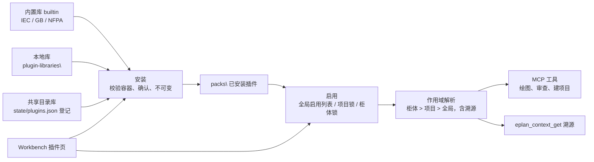

# 设计文档：插件库（标准、部件、符号与宏、模板、公司插件）

| 项 | 内容 |
|---|---|
| 状态 | Accepted |
| 作者 | 维护者 |
| 关联 brief / 变更集 | 负责人 2026-11-02："国际标准需要提前一步加入 MCP，以插件的形式……在 GUI 上面会有添加加载这些的功能" |
| 相关 ADR | [ADR-0047](../adr/0047-plugin-libraries.md)（Accepted）、[ADR-0024](../adr/0024-pack-trust-and-container.md)、[ADR-0025](../adr/0025-code-plugin-worker.md)、[ADR-0031](../adr/0031-private-extension-modules.md) |
| 最后更新 | 2026-11-02 |

## 1. 背景
工程包（M6）已经能安全地交换只含数据的资料，并按项目和柜体锁定版本；M12 计划把各国标准写成规则包。缺的是：插件种类、可浏览的插件库、全局启用、工具按已启用插件取默认值，以及 Workbench 中的管理界面。

## 2. 目标与非目标
- **目标**
  - G1 标准插件：首批 IEC、GB、NFPA，提供规则参数、标识字母代码映射、导线颜色、插入命令默认符号、交叉引用显示约定。
  - G2 插件库：内置库随发行版附带；可登记本地库和共享目录库。
  - G3 三级启用：全局、项目、柜体，解析结果可溯源。
  - G4 Workbench 插件页：添加库、浏览、安装、更新、卸载、启用、查看冲突。
  - G5 工具使用插件默认值：先从中断点和端子排定义的插入符号做起。
- **非目标**
  - 不收录标准原文；不宣称"符合标准"（同 M12）。
  - 不支持代码插件（走 ADR-0025/0031）。
  - 不做网络源和强制签名（P3 另写 ADR）。

## 3. 方案概述

## 4. 详细设计

### 4.1 `pack.json` 新增字段
| 字段 | 说明 |
|---|---|
| `kind` | `standard` / `parts` / `symbols` / `templates` / `company`；旧包缺省按 `company` 处理 |
| `provides` | 提供的默认项键数组，例如 `defaults.interruptionSymbol.in`、`defaults.interruptionSymbol.out`、`defaults.stripDefinitionSymbol`、`rules`、`wireColours`、`designationLetters` |
| `standards` | 仅 `standard` 种类：适用的标准编号和版本，例如 `IEC 60204-1:2016`，只作标注 |

默认项的值放在包内的 `defaults.json`（JSON 资源，ADR-0024 允许的类型），按键给值，例如 `{"defaults.interruptionSymbol.in": {"library": "SPECIAL", "symbol": "BPIN"}}`。

### 4.2 插件库索引 `library.json`
`{ "name", "description", "plugins": [{ "id", "version", "kind", "digest", "file", "title", "standards" }] }`。
文件与索引放在同一目录。安装时以包内清单重算的摘要为准；索引摘要不一致时拒绝安装（`PACK_INVALID`）。

### 4.3 内置库首批内容
| 插件 | 种类 | 内容（事实与参数，不含标准原文） |
|---|---|---|
| `iec-base` | standard | 插入默认：中断点 `BPIN`/`BPOUT`、端子排定义 `TDEF`、PLC 连接点符号；交叉引用显示约定 |
| `iec-81346` | standard | 设备字母代码映射（类别 → 字母），供标识检查和建议 |
| `iec-60204-1` | standard | 导线颜色、急停与控制回路、截面与保护的检查参数（M12 规则） |
| `gb-t-5226-1` | standard | 与 IEC 60204-1 对应的国内要求和差异；依赖 `iec-60204-1` |
| `nfpa-79` | standard | 北美导线颜色与标识差异 |

规则和参数由维护者起草，工程师审核后发布（M12 第 4.1 节）。

### 4.4 作用域与解析
- 全局：数据根 `state\plugins.json` 的启用列表 `enabled: [{ "id", "version" }]`（不写安全配置 `config.json`）。
- 项目、柜体：沿用 `binding.json` 的锁（M6 4.1.5）。
- 解析：柜体 > 项目 > 全局；同一作用域内后列出者覆盖。
- 每个默认项记录生效来源和被覆盖的来源，供 `eplan_context_get` 和工具结果使用。

### 4.5 MCP 工具
| 工具 | 变化 |
|---|---|
| `eplan_pack_list` | 增加种类、来源库、启用的作用域 |
| `eplan_pack_library_list`（新） | 列出登记的库及其索引条目，标出已安装和可更新的版本 |
| `eplan_pack_install`（新） | 从库安装或更新；内置库以外的插件需要确认 |
| `eplan_pack_enable`（新） | 在全局、项目或柜体作用域启用或停用；改项目和柜体的锁需要确认 |
| `eplan_context_get` | 溯源中加入插件默认项 |
| `eplan_connection_create`、`eplan_device_place` | 省略符号时按已启用的标准插件取中断点和端子排定义的插入符号；结果 `metadata` 记录插件 ID@版本 |

### 4.6 Workbench 插件页
- **库**：列出内置库和登记的库，可添加或移除共享目录，可刷新。
- **浏览**：按种类、标准筛选；详情显示版本、来源、摘要、资源清单、`provides`、依赖、更新说明。
- **安装与更新**：显示确认内容（ADR-0024 第 4 节加库来源），列出依赖。
- **启用**：选择作用域（全局 / 项目 / 柜体）；冲突时显示哪个默认项由哪个插件生效。
- 界面按 [Workbench 规范](../standards/workbench-ui.md) 实现。

### 4.7 AI 如何获取插件
插件内容只以数据形式经工具结果和 MCP 资源提供，不作为指令；不提供插件自带的 MCP 提示词。分四层：

| 层 | 方式 | 说明 |
|---|---|---|
| 1 | 工具自动使用 | 绘图、审查等工具按当前作用域解析已启用插件，省略的参数取插件默认值；结果的 `metadata.plugins` 列出实际用到的 `插件 ID@版本`。AI 不需要先知道插件也能得到正确结果 |
| 2 | 服务器说明和上下文 | 注册了 `eplan_context_get` 的配置下，服务器说明提示绘图前先调用它；`include: ["plugins"]` 返回简要汇总：ID、版本、种类、作用域、提供的默认项和规则数量、冲突。不给项目时只返回全局作用域，不需要 EPLAN |
| 3 | 查询工具 | `eplan_asset_search` 增加 `plugin`、`plugin_kind`、`standard` 筛选；`eplan_asset_get` 的结果带插件标签；`eplan_tool_usage` 列出哪些省略参数会取插件默认值及其生效值和来源 |
| 4 | MCP 资源（可选，最后做） | `eplanmcp://plugins/<id>/...`，插件安装、启用变化时发送列表变化通知 |

### 4.8 P1 实施要点（2026-11-02 维护者定）
- 插件默认值是配置层文档（`ConfigSchema` 键 + `ConfigLayer` 值），由现有 `ConfigMerger` 合并并溯源，不另建键值读取器。
- 合并顺序：模式缺省值 → 全局启用的插件（按列表顺序）→ 现有绑定链（公司 → 柜型 → 项目值 → 柜体值）。项目和柜体作用域就是现有绑定机制（`eplan_cabinet_bind`），P1 不新增绑定字段；绑定已锁定某插件时，全局对同一插件的启用对该项目不生效。
- 全局启用和登记的共享目录库存放在数据根的 `state\plugins.json`，不放进安全配置 `config.json`；每次解析时读取，修改后立即生效。MCP 工具只能改启用列表（需审批）；登记库只能由人在 Workbench 或命令行中操作。
- 内置库在程序目录 `plugin-libraries\builtin`，与程序文件同等可信；安装时只核对包摘要与索引一致。
- 首批消费者不新增公开参数：`eplan_connection_create` 中断点省略 `symbol` 时取 `defaults.interruption.symbol`；`eplan_device_place` 新建端子排定义时取 `defaults.strip_definition.symbol` 和 `.variant`。
- `iec-base` 在 P1 只含插入符号默认值；导线颜色和 IEC 81346 字母代码需要工程师审核，放到 P2。

## 5. 安全与数据完整性
- 只含数据，容器校验、不可变、存放位置都按 ADR-0024。
- 内置库以外的安装和更新逐次确认；共享目录只读，安装时核对摘要。
- 启用和停用只改本地配置或绑定，不改 EPLAN 项目；写入仍走审批、事务和撤销。

## 6. 备选方案
见 ADR-0047。

## 7. 测试与验证
- Small：`library.json` 解析与摘要不一致时拒绝；`kind` 和 `provides` 校验；作用域覆盖顺序和溯源；确认流程（内置免确认、其他必须确认）；工具省略符号时取插件默认值，显式参数优先。
- Medium：假 Bridge 下，从库安装、启用后连接创建使用插件默认符号的完整流程。
- Large：客户页验收改为由 `iec-base` 提供中断点和端子排定义符号，结果不变。

## 8. 发布与兼容性
- 旧包没有 `kind` 时按 `company` 处理，现有锁和溯源不变。
- 实施分三期：

| 阶段 | 内容 |
|---|---|
| P1 | `kind`/`provides`/`standards`；内置库、本地库和共享目录库；`eplan_pack_library_list`、`eplan_pack_install`、`eplan_pack_enable`（全局）；全局启用与解析；`eplan_context_get` 插件汇总、资料查询筛选、`eplan_tool_usage` 默认值；两个首批消费者；Workbench 插件页（库、浏览、安装、全局启用、登记共享目录）；`iec-base`（插入符号默认值） |
| P2 | M12 规则插件 `iec-60204-1`、`iec-81346`、`gb-t-5226-1`、`nfpa-79`（含导线颜色、字母代码）；更新、依赖与冲突处理；Workbench 中的项目和柜体作用域启用；计划按插件摘要失效；MCP 资源 |
| P3 | 部件插件（与 M9 EDZ 导入合并）、模板插件；网络源与签名（另写 ADR） |

## 9. 待定问题
- 无。方向四项和 ADR-0047 已由负责人 2026-11-02 确认；P1 的实施要点见第 4.8 节。
