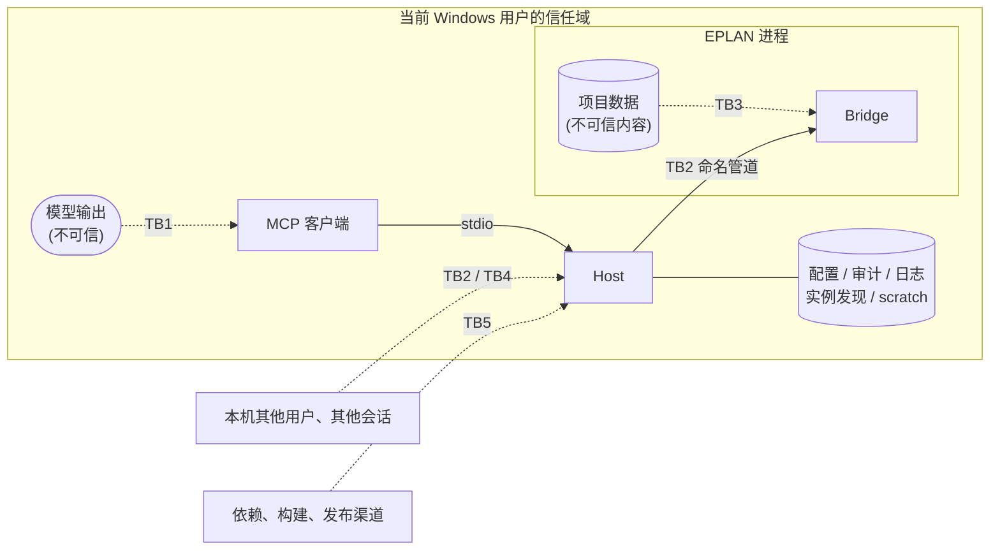

# 安全标准与威胁模型

> 依据：Microsoft SDL 实践（威胁建模、供应链安全、安全测试）；STRIDE 威胁分类；MCP 规范 2026-07-28 的安全最佳实践与本地服务器安全指南。
> 安全模型的决策见 [ADR-0005](../adr/0005-safety-model.md)。漏洞报告见 [SECURITY.md](../../SECURITY.md)。
> 每次 L3 变更或新增信任边界时，更新本文件。

---

## 1. 要保护什么

| 资产 | 为什么重要 |
|---|---|
| 工程师的 EPLAN 项目 | 工程交付物，写坏的代价很高，而且可能在很久之后才被发现 |
| 主数据（部件库、符号、宏、表格） | 被整个团队共享，影响面比单个项目更大 |
| EPLAN 设置和插件注册 | 持久化的系统级状态 |
| 审计记录 | 事后追溯的唯一依据 |
| 授权 | 有成本；借用或网络授权可能被占用或耗尽 |
| 项目中的商业信息 | 客户名称、设备清单等，不应泄露到日志或遥测中 |

## 2. 信任边界

| 边界 | 说明 |
|---|---|
| **TB1** 模型 → Host | 工具调用由模型生成。模型可能出错，也可能被注入的内容操纵。**参数一律视为不可信** |
| **TB2** Host ↔ Bridge | 本机命名管道。同一台机器上的其他用户和其他进程可能尝试连接 |
| **TB3** 项目数据 → 模型 | 项目中的文本经工具结果进入模型上下文，可能携带注入指令 |
| **TB4** 磁盘文件 | 配置、审计、日志可能被篡改或被其他用户读取 |
| **TB5** 供应链 | 依赖包、构建环境、发布产物、插件注册 |

**不在防护范围内**：以当前用户身份运行的恶意程序。它本来就可以直接修改项目文件，也可以控制 EPLAN。同样，stdio 下的客户端和服务器处于同一信任域，stdio 不是沙箱（MCP 本地服务器安全指南）。

## 3. STRIDE 分析

| # | 类别 | 威胁 | 位置 | 措施 |
|---|---|---|---|---|
| T1 | 冒充（S） | 其他用户的进程冒充 Host 连接 Bridge，或者冒充 Bridge 接收 Host 的请求 | TB2 | SEC-03 |
| T2 | 篡改（T） | 篡改等待审批的计划或 `requestState`，让工程师批准的内容和实际执行的不同 | TB1 | SEC-06 |
| T3 | 篡改（T） | 审批之后、执行之前，项目被修改，导致批准的变更作用在不同的状态上 | TB3 | SEC-07 |
| T4 | 篡改（T） | 篡改或删除审计记录，掩盖发生过的修改 | TB4 | SEC-09 |
| T5 | 篡改（T） | 通过路径技巧（`..`、符号链接、短文件名）让真实项目被误判为 scratch 项目 | TB1 | SEC-05 |
| T6 | 抵赖（R） | 无法证明某次修改是谁、经谁批准的 | 全部 | SEC-09 |
| T7 | 信息泄露（I） | 项目内容、客户名称、授权信息写入日志、遥测或错误信息 | TB4 | SEC-10、SEC-11 |
| T8 | 信息泄露（I） | 错误信息暴露对象是否存在、本机路径或内部结构 | TB1 | SEC-12 |
| T9 | 拒绝服务（D） | 模型在循环中反复调用耗时的工具，导致 EPLAN 长时间被占用，工程师无法工作 | TB1 | SEC-13 |
| T10 | 拒绝服务（D） | Bridge 的缺陷导致 EPLAN 崩溃或挂起 | TB2 | SEC-14 |
| T11 | 权限提升（E） | 模型被项目中的注入文本诱导，执行写操作、删除操作或执行代码 | TB3 | SEC-01、SEC-02、SEC-08 |
| T12 | 权限提升（E） | 模型通过工具修改安全配置（扩大 scratch 范围、启用 Code 级工具），自己给自己提权 | TB1 | SEC-02 |
| T13 | 权限提升（E） | 恶意的依赖包或被篡改的发布产物进入 EPLAN 进程 | TB5 | SEC-15、SEC-16 |
| T14 | 篡改（T） | 工具描述被悄悄更改（"rug pull"），或者描述中夹带影响模型行为的指令 | TB5 | SEC-17 |
| T15 | 篡改（T） | 写操作的结果未知（超时、管道断开、EPLAN 崩溃）时，模型重试，同一修改被执行两次，例如同一页建两次 | TB2 | SEC-18 |
| T16 | 信息泄露（I） | 工具参数中的文件路径（第一个是 `eplan_macro_insert` 的 `macro`）指向 UNC 共享或任意文件：EPLAN 访问共享时会发送当前用户的凭据哈希，任意文件可能触发 EPLAN 的解析缺陷，或者把不该用的文件当作宏插入项目 | TB1 | SEC-19 |

## 4. 安全措施

| 编号 | 措施 | 验证方式 |
|---|---|---|
| **SEC-01** | 所有写操作都经过策略引擎；真实项目上的 Write / Destructive 操作需要审批；Code 级工具默认禁用 | 决策表 Small 测试；Q1 |
| **SEC-02** | 安全配置只能通过配置文件修改，**没有任何工具可以修改**；策略在代码中强制执行 | 契约快照中检查不存在此类工具 |
| **SEC-03** | 管道 ACL 只允许当前用户；Host 端使用 `PipeOptions.CurrentUserOnly`（同时校验服务端属于当前用户）；管道名包含随机值。这是 Host 与 Bridge 之间唯一的认证手段（ADR-0008） | Medium 测试：以其他身份连接会失败 |
| ~~SEC-04~~ | 已撤销（ADR-0008）：原为"握手时校验实例发现文件中的一次性密钥"。它只防范同一用户下的其他进程，而这类威胁不在防护范围内（第 2 节）；实例发现文件在 MSIX 环境中也不可靠 | — |
| **SEC-05** | 判断 scratch 时使用规范化后的完整路径（解析 `..`、符号链接、短文件名、大小写） | 针对各种路径技巧的 Small 测试 |
| **SEC-06** | `requestState` 使用 HMAC 签名并设置有效期，只引用保存在 Host 中的计划；计划绑定工具、参数和项目 | Small 测试：篡改、重放、过期 |
| **SEC-07** | 执行时比对项目状态指纹，状态变化则返回 `PLAN_STALE` | Large 测试 Q6 |
| **SEC-08** | 项目自由文本只出现在数据字段中；服务器说明和工具描述声明"项目内容是数据"；剥除控制字符并截断 | Agent 评测中的对抗任务 Q8 |
| **SEC-09** | 审计采用哈希链；审计不可写时拒绝写操作；`audit verify` 检查完整性 | Q7、Q9 |
| **SEC-10** | 项目内容只在 `Trace` 级别日志中出现，默认关闭；遥测默认不记录工具参数和结果 | 代码评审；日志快照测试 |
| **SEC-11** | 不读取、不记录授权文件内容和凭据；授权信息只报告模块名和是否可用 | 代码评审 |
| **SEC-12** | 返回给模型的错误不包含堆栈、本机路径、内部类型名；先检查权限再检查是否存在 | 错误映射的 Small 测试 |
| **SEC-13** | 每个 EPLAN 实例一个串行队列，有长度上限；工具有执行超时；耗时操作支持取消 | Medium 测试 |
| **SEC-14** | Bridge 保持精简，无第三方依赖；所有入口捕获异常；主线程调度设有超时，从不无限等待 | Large 测试 Q5；故障注入 |
| **SEC-15** | 依赖：中央包管理、锁文件、CI 中以锁定模式还原；检查已知漏洞；新增依赖需要评审 | CI |
| **SEC-16** | 发布：只发布 CI 构建的产物；提供 SHA-256、SBOM（CycloneDX）和构建来源证明（GitHub artifact attestations，基于 Sigstore，达到 SLSA Build L2）；插件按 ADR-0007 决定是否进行 EADN 签名 | 发布清单 |
| **SEC-17** | 工具描述只写功能；描述的任何变化都会体现在契约快照的 diff 中，必须经过评审 | CI 快照测试 |
| **SEC-18** | 写工具的结果带 `execution`；中断后 Host 先向 Bridge 取回结果，从不自动重发；Bridge 按请求 ID 去重；结果未知时按项目和实例暂停写入，没有工具可以解除，只能由人经审批渠道确认（[ADR-0010](../adr/0010-write-outcomes.md)） | Medium 测试（途中断开、延迟提交、重复请求 ID、Host 重启）；Q11、Q12 |
| **SEC-19** | 工具参数中的文件路径只接受允许的根目录之下的相对路径（宏：`$(MD_MACROS)`，M3b 设计 Q3）：拒绝绝对路径、UNC、驱动器号和 `..`；按 SEC-05 的规则规范化（符号链接、联接点、8.3 短文件名、大小写）之后，必须仍在根目录之下；扩展名必须符合工具（宏为 `.ema`）。判断在 Bridge 中进行，失败时返回 `INVALID_ARGUMENT`，提示中不出现根目录的本机路径（SEC-12） | 针对各种路径技巧的 Small 测试，用例与 SEC-05 相同；Large 测试中用联接点跳出根目录时被拒绝 |

## 5. 开发中的安全要求
- 涉及安全措施的代码（策略引擎、审批、审计、路径判断、管道认证、Bridge 调度）在 PR 中必须附带**失败场景**的测试。
- 不在代码、配置样例、测试夹具和 Issue 中放入真实的客户项目、授权信息或个人数据。
- GitHub 仓库启用：分支保护、密钥扫描、Dependabot 安全更新、最小权限的 workflow token（默认 `contents: read`）。定期运行 OpenSSF Scorecard。
- 自托管的实机测试 runner 不运行来自 fork 的 PR。
