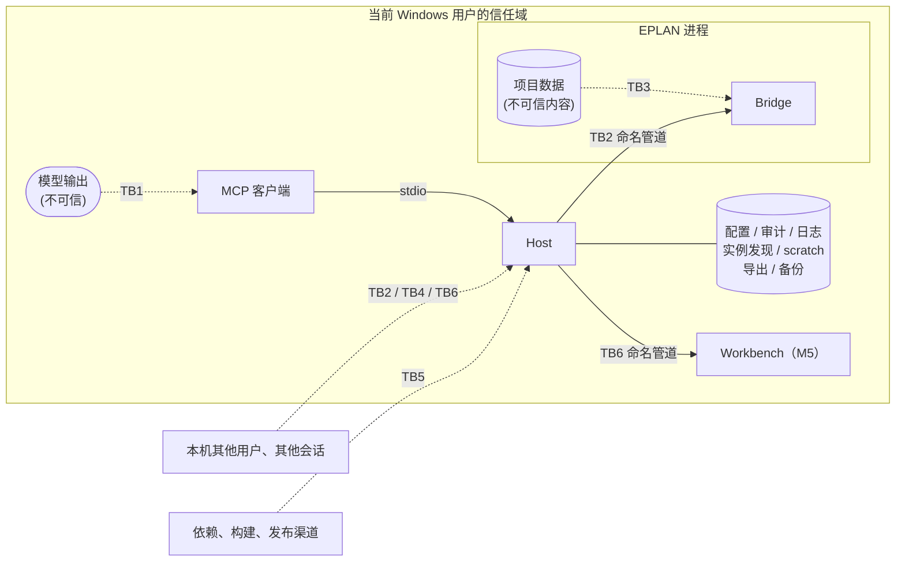

# 安全标准与威胁模型

> 依据：Microsoft SDL 实践（威胁建模、供应链安全、安全测试）；STRIDE 威胁分类；MCP 规范 2026-07-28 的安全最佳实践与本地服务器安全指南。
> 安全模型的决策见 [ADR-0005](../adr/0005-safety-model.md)。漏洞报告见 [SECURITY.md](../../SECURITY.md)。
> 每次 L3 变更或新增信任边界时，更新本文件。

---

## 1. 要保护什么

| 资产 | 为什么重要 |
|---|---|
| 工程师的 EPLAN 项目 | 工程交付物，写坏的代价很高，而且可能在很久之后才被发现 |
| 主数据（部件库、符号、宏、表格） | 被整个团队共享，影响面比单个项目更大 |
| EPLAN 设置和插件注册 | 持久化的系统级状态 |
| 审计记录 | 事后追溯的唯一依据 |
| 授权 | 有成本；借用或网络授权可能被占用或耗尽 |
| 项目中的商业信息 | 客户名称、设备清单等，不应泄露到日志或遥测中 |

## 2. 信任边界

| 边界 | 说明 |
|---|---|
| **TB1** 模型 → Host | 工具调用由模型生成。模型可能出错，也可能被注入的内容操纵。**参数一律视为不可信** |
| **TB2** Host ↔ Bridge | 本机命名管道。同一台机器上的其他用户和其他进程可能尝试连接 |
| **TB3** 项目数据 → 模型 | 项目中的文本经工具结果进入模型上下文，可能携带注入指令 |
| **TB4** 磁盘文件 | 配置、审计、日志可能被篡改或被其他用户读取。M4 起数据根目录中还有导出文件和项目备份：目录由 Host 新建，模型不能选择位置（T17、T18） |
| **TB5** 供应链 | 依赖包、构建环境、发布产物、插件注册；M5 起还有安装包和自托管的实机 runner（T22、T23） |
| **TB6** Host ↔ Workbench（M5） | 本机命名管道，Workbench 是服务器，Host 每次审批连接一次（[ADR-0014](../adr/0014-workbench-approval-channel.md)）。其他程序可能抢先占用管道名；Workbench 把项目中的文本展示给工程师，这些文本可能误导人（T19–T21） |

**不在防护范围内**：以当前用户身份运行的恶意程序。它本来就可以直接修改项目文件，也可以控制 EPLAN。同样，stdio 下的客户端和服务器处于同一信任域，stdio 不是沙箱（MCP 本地服务器安全指南）。这也包括代理经客户端的 shell 工具执行的命令：它们以当前用户身份运行，可以用 UI Automation 操作任一个审批窗口（spike S8 的驱动程序就这样回答过 EPLAN 的对话框，[api-notes](../eplan/api-notes.md) A15），也可以替换按用户安装目录中的文件。审批渠道（ADR-0011、ADR-0014）防的是客户端自己回答或被配置为自动回答，不防这类程序；入门指南提醒工程师保留客户端对 shell 命令的确认（[M5 设计](../design/2026-10-20-m5-operability.md) Q9）。

## 3. STRIDE 分析

| # | 类别 | 威胁 | 位置 | 措施 |
|---|---|---|---|---|
| T1 | 冒充（S） | 其他用户的进程冒充 Host 连接 Bridge，或者冒充 Bridge 接收 Host 的请求 | TB2 | SEC-03 |
| T2 | 篡改（T） | 篡改等待审批的计划，或者让一个批准用在别的请求上（伪造、重放、迟到的回答），使工程师批准的内容和实际执行的不同 | TB1 | SEC-06 |
| T3 | 篡改（T） | 审批之后、执行之前，项目被修改，导致批准的变更作用在不同的状态上 | TB3 | SEC-07 |
| T4 | 篡改（T） | 篡改或删除审计记录，掩盖发生过的修改 | TB4 | SEC-09 |
| T5 | 篡改（T） | 通过路径技巧（`..`、符号链接、短文件名）让真实项目被误判为 scratch 项目 | TB1 | SEC-05 |
| T6 | 抵赖（R） | 无法证明某次修改是谁、经谁批准的 | 全部 | SEC-09 |
| T7 | 信息泄露（I） | 项目内容、客户名称、授权信息写入日志、遥测或错误信息 | TB4 | SEC-10、SEC-11 |
| T8 | 信息泄露（I） | 错误信息暴露对象是否存在、本机路径或内部结构 | TB1 | SEC-12 |
| T9 | 拒绝服务（D） | 模型在循环中反复调用耗时的工具，导致 EPLAN 长时间被占用，工程师无法工作 | TB1 | SEC-13 |
| T10 | 拒绝服务（D） | Bridge 的缺陷导致 EPLAN 崩溃或挂起 | TB2 | SEC-14 |
| T11 | 权限提升（E） | 模型被项目中的注入文本诱导，执行写操作、删除操作或执行代码 | TB3 | SEC-01、SEC-02、SEC-08 |
| T12 | 权限提升（E） | 模型通过工具修改安全配置（扩大 scratch 范围、启用 Code 级工具），自己给自己提权 | TB1 | SEC-02 |
| T13 | 权限提升（E） | 恶意的依赖包或被篡改的发布产物进入 EPLAN 进程 | TB5 | SEC-15、SEC-16 |
| T14 | 篡改（T） | 工具描述被悄悄更改（"rug pull"），或者描述中夹带影响模型行为的指令 | TB5 | SEC-17 |
| T15 | 篡改（T） | 写操作的结果未知（超时、管道断开、EPLAN 崩溃）时，模型重试，同一修改被执行两次，例如同一页建两次 | TB2 | SEC-18 |
| T16 | 信息泄露（I） | 工具参数中的文件路径（第一个是 `eplan_macro_insert` 的 `macro`）指向 UNC 共享或任意文件：EPLAN 访问共享时会发送当前用户的凭据哈希，任意文件可能触发 EPLAN 的解析缺陷，或者把不该用的文件当作宏插入项目 | TB1 | SEC-19 |
| T17 | 篡改（T） | 导出工具（M4）把文件写到允许的目录之外，或者覆盖已有文件：模型给的文件名带路径或 `..`，EPLAN 方案中配置的目录、子目录和文件名格式，目录中的链接或联接点；写到 UNC 共享时，EPLAN 还会发送当前用户的凭据哈希（同 T16） | TB1 | SEC-20 |
| T18 | 篡改（T） | Destructive 操作（M4 的删页、重编号）造成难以恢复的损失：模型出错或被诱导，或者结果与预期不同（删页会留下没有主功能的辅助功能，重编号后可能仍有带 `?` 的标识，api-notes A18）；EPLAN 在途中崩溃时，事务中已做的修改留在项目里，撤销历史随进程消失（A15） | TB1 | SEC-01、SEC-21 |
| T19 | 冒充（S） | 其他程序冒充 Workbench 回答审批：抢先占用 Workbench 的管道名，或开发构建与安装的版本错配；或者冒充 Host 在 Workbench 中提问 | TB6 | SEC-22 |
| T20 | 篡改（T） | 审批界面中的项目文本误导工程师：变更清单中的文字冒充界面说明（如"已预先批准"），双向文字控制符改变显示顺序，换行伪造出多行，超长文本把关键的行挤出视野 | TB6 | SEC-23 |
| T21 | 篡改（T） | 回答落到别的问题上：回答完一个问题后下一个顶上来，或多个 Host 同时提问时误点；同一问题同时出现在 Workbench 和 EPLAN 对话框中，两处都能回答 | TB6 | SEC-24、SEC-06 |
| T22 | 篡改（T） | 安装与升级：下载的安装包被替换；安装程序要管理员权限、修改 PATH 或 EPLAN 目录；在 MSIX 客户端内注册插件，注册落到重定向的目录中；升级或卸载删除审计、备份等数据 | TB5 | SEC-25、SEC-16 |
| T23 | 权限提升（E） | 自托管的实机 runner 运行不可信的代码（fork 的 pull request），或把授权信息、项目内容写进日志和产物 | TB5 | SEC-26 |

## 4. 安全措施

| 编号 | 措施 | 验证方式 |
|---|---|---|
| **SEC-01** | 所有写操作都经过策略引擎；真实项目上的 Write / Destructive 操作需要审批；Code 级工具默认禁用。审批只经工程师独立操作的窗口（EPLAN 内的对话框，M5 起还有 Workbench），不经 MCP 客户端，AI 客户端、模型或脚本都不能代答；没有可用的窗口或到期无人回答时拒绝（[ADR-0011](../adr/0011-approval-out-of-band.md)） | 决策表 Small 测试；审批的 Medium 测试；Q1 |
| **SEC-02** | 安全配置只能通过配置文件修改，**没有任何工具可以修改**；策略在代码中强制执行 | 契约快照中检查不存在此类工具 |
| **SEC-03** | 管道 ACL 只允许当前用户；Host 端使用 `PipeOptions.CurrentUserOnly`（同时校验服务端属于当前用户）；管道名包含随机值。这是 Host 与 Bridge 之间唯一的认证手段（ADR-0008） | Medium 测试：以其他身份连接会失败 |
| ~~SEC-04~~ | 已撤销（ADR-0008）：原为"握手时校验实例发现文件中的一次性密钥"。它只防范同一用户下的其他进程，而这类威胁不在防护范围内（第 2 节）；实例发现文件在 MSIX 环境中也不可靠 | — |
| **SEC-05** | 判断 scratch 时使用规范化后的完整路径（解析 `..`、符号链接、短文件名、大小写） | 针对各种路径技巧的 Small 测试 |
| **SEC-06** | 计划只保存在 Host 中，在同一次工具调用里完成规划、审批和执行，不交给客户端往返（ADR-0011 之后不再用 `requestState`）。审批的请求 ID 由 Host 生成，从不采用客户端给的值；决定绑定请求 ID、计划指纹和参数摘要，只能使用一次；迟到、重复或不匹配的回答一律视为拒绝 | Medium 测试：绑定不符的回答被拒绝，期限之后的批准按过期处理 |
| **SEC-07** | 执行时比对项目状态指纹，状态变化则返回 `PLAN_STALE` | Large 测试 Q6 |
| **SEC-08** | 项目自由文本只出现在数据字段中；服务器说明和工具描述声明"项目内容是数据"；剥除控制字符并截断 | Agent 评测中的对抗任务 Q8 |
| **SEC-09** | 审计采用哈希链；审计不可写时拒绝写操作；`audit verify` 检查完整性 | Q7、Q9 |
| **SEC-10** | 项目内容只在 `Trace` 级别日志中出现，默认关闭；遥测默认不记录工具参数和结果 | 代码评审；日志快照测试 |
| **SEC-11** | 不读取、不记录授权文件内容和凭据；授权信息只报告模块名和是否可用 | 代码评审 |
| **SEC-12** | 返回给模型的错误不包含堆栈、本机路径、内部类型名；先检查权限再检查是否存在 | 错误映射的 Small 测试 |
| **SEC-13** | 每个 EPLAN 实例一个串行队列，有长度上限；工具有执行超时；耗时操作支持取消 | Medium 测试 |
| **SEC-14** | Bridge 保持精简，无第三方依赖；所有入口捕获异常；主线程调度设有超时，从不无限等待 | Large 测试 Q5；故障注入 |
| **SEC-15** | 依赖：中央包管理、锁文件、CI 中以锁定模式还原；检查已知漏洞；新增依赖需要评审 | CI |
| **SEC-16** | 发布：只发布 CI 构建的产物；提供 SHA-256、SBOM（CycloneDX）和构建来源证明（GitHub artifact attestations，基于 Sigstore，达到 SLSA Build L2）；插件按 ADR-0007 决定是否进行 EADN 签名。M5 起：插件在自托管 runner 上由同一个发布工作流构建（SEC-26），安装包和程序的代码签名按 [M5 设计](../design/2026-10-20-m5-operability.md) Q6 决定 | 发布清单 |
| **SEC-17** | 工具描述只写功能；描述的任何变化都会体现在契约快照的 diff 中，必须经过评审 | CI 快照测试 |
| **SEC-18** | 写工具的结果带 `execution`；中断后 Host 先向 Bridge 取回结果，从不自动重发；Bridge 按请求 ID 去重；结果未知时按项目和实例暂停写入，没有工具可以解除，只能由人经审批渠道确认（[ADR-0010](../adr/0010-write-outcomes.md)） | Medium 测试（途中断开、延迟提交、重复请求 ID、Host 重启）；Q11、Q12 |
| **SEC-19** | 工具参数中的文件路径只接受允许的根目录之下的相对路径（宏：`$(MD_MACROS)`，M3b 设计 Q3）：拒绝绝对路径、UNC、驱动器号和 `..`；根目录之下的每一级（文件夹和文件）都不能是符号链接或联接点，所以路径解析后一定仍在根目录之下，也不会经链接访问别的位置（根目录本身可以是链接或网络路径）；扩展名必须符合工具（宏为 `.ema`）。判断在 Bridge 中进行，失败时返回 `INVALID_ARGUMENT`，提示中不出现根目录的本机路径（SEC-12） | 针对各种路径技巧的测试：`..`、绝对路径、UNC、驱动器号、大小写，以及临时目录中的联接点 |
| **SEC-20** | 导出只写进 Host 每次新建的空目录 `<数据根目录>\exports\<项目名>\<UTC 时间>-<随机后缀>\`，导出根目录固定，不能配置（[ADR-0012](../adr/0012-export-tier.md)，M4 设计 4.4、Q8）：参数中没有目录，只有 PDF 可以给文件名，不能含路径分隔符、驱动器号和 `..`，扩展名由工具补上；Host 按 SEC-19 的规则规范化，确认目录在导出根目录之下、每一级都不是链接或联接点，Bridge 确认目录存在而且为空才调用 EPLAN，并且总是把这个目录（PDF 是其中的完整文件名）交给 EPLAN，不让方案决定位置；导出后 Host 递归列出目录，每个文件都必须在目录之下、不是链接，否则按失败处理；失败或取消时只删除本次新建的目录；从不覆盖已有文件 | Small 测试：目录的新建、规范化和链接检查，文件名校验（路径分隔符、驱动器号、`..`、UNC），目录外的文件和链接；Large 测试：导出只在本次目录中产生文件，项目的设计数据不变（S11，A16） |
| **SEC-21** | Destructive 操作每次都需要审批，scratch 中也一样（ADR-0005）。审批之后、执行之前，用 `ProjectManager.CopyProject(…, CopyMode.Snapshot)` 把项目备份到 Host 新建的空目录 `<数据根目录>\backups\<项目名>\<UTC 时间>\`；备份失败、超时，或者副本的页数与源项目不符，就不执行，返回 `BACKUP_FAILED`（`execution: not_started`）；备份路径写入审计和工具结果（`backup`）；备份不覆盖已有文件，也不自动删除（[ADR-0013](../adr/0013-destructive-backup.md)）。变更清单列出会受影响、但不在请求中的对象，例如删页后失去主功能的设备 | Medium 测试：备份失败时不执行，scratch 中也要审批；Large 测试：备份副本能打开，页数与源项目相同（S12，A18） |
| **SEC-22** | Workbench 管道（[ADR-0014](../adr/0014-workbench-approval-channel.md)）：名称由用户 SID 和数据根目录算出；Workbench 以第一个实例创建，ACL 只允许当前用户、拒绝网络登录，所有者为当前用户；Host 以 `PipeOptions.CurrentUserOnly` 连接，并核对服务器进程的映像路径是 Host 所在目录下的 Workbench；Workbench 同样核对连接方是同一安装中的 `eplanmcp.exe`；协议严格解析，未知字段、重复字段和超过 1 MiB 的帧都拒绝。映像路径只防错配，不是认证（第 2 节） | Medium 测试：映像路径不符时改由 EPLAN 对话框询问；管道名已被占用；畸形和超长的帧 |
| **SEC-23** | Workbench 只把变更清单等项目文本作为纯文本，显示在标明"来自项目的数据"的等宽区域中：剥除控制字符和双向文字控制符（如 U+202E），换行显示为可见的符号，每行和整个清单都有长度上限并注明省略了多少；客户端自报的名称标注"未验证"；界面元素不由项目文本生成；Workbench 的日志不记录变更清单（SEC-10） | Small 测试：清洗规则；发布前的 Workbench 冒烟清单 |
| **SEC-24** | 一个问题只在一个窗口中询问：送达 Workbench 后连接断开按"已取消"处理，不执行，也不转到 EPLAN 对话框。每个问题单独回答，没有批量批准；两个按钮样式相同，都不是默认按钮，没有快捷键；详情区每次显示一个不同的问题、窗口每次由隐藏变为可见之后，500 毫秒内两个按钮都不响应。绑定、期限和一次性仍由 Host 判断（SEC-06） | Small 测试：防误触的状态机；Medium 测试：送达后断开，迟到、重复和不匹配的回答 |
| **SEC-25** | 安装（[ADR-0016](../adr/0016-per-user-installer.md)）：按用户安装，不需要管理员权限；不修改 PATH 和全局环境变量，不往 EPLAN 目录复制文件、不写 EPLAN 的注册表，插件只经 `EplApiModuleAction` 注册（I1、I2）；探测到 MSIX 重定向时 `install-addin` 拒绝执行；升级时不强制结束任何程序（Host 可能正在写入）；卸载撤销注册，保留数据根目录中的全部数据；安装包附 SHA-256 和来源证明（SEC-16） | 干净机器验收（I1–I10，标准用户）；`install-addin` 的 Small 测试 |
| **SEC-26** | 自托管的实机 runner：以单独的标准用户运行，只操作这个用户 scratch 中的副本；工作流只因定时、手动触发和发布标签运行，从不因 `pull_request` 或 `pull_request_target` 运行；仓库设置要求外部贡献者的工作流每次都经批准，改动了工作流的 fork PR 不批准；同时只运行一个；日志和产物不含授权信息和项目内容（SEC-10、SEC-11）。GitHub 提醒公开仓库几乎不应使用自托管 runner，所以这些条件缺一不可 | 工作流评审；仓库设置检查 |

## 5. 开发中的安全要求
- 涉及安全措施的代码（策略引擎、审批、审计、路径判断、导出目录与备份、管道认证、Bridge 调度，以及 M5 的 Workbench 审批界面和管道、`install-addin`）在 PR 中必须附带**失败场景**的测试。
- 不在代码、配置样例、测试夹具和 Issue 中放入真实的客户项目、授权信息或个人数据。
- GitHub 仓库启用：分支保护、密钥扫描、Dependabot 安全更新、最小权限的 workflow token（默认 `contents: read`）。定期运行 OpenSSF Scorecard。
- 自托管的实机测试 runner 不运行来自 fork 的 PR（SEC-26）。
