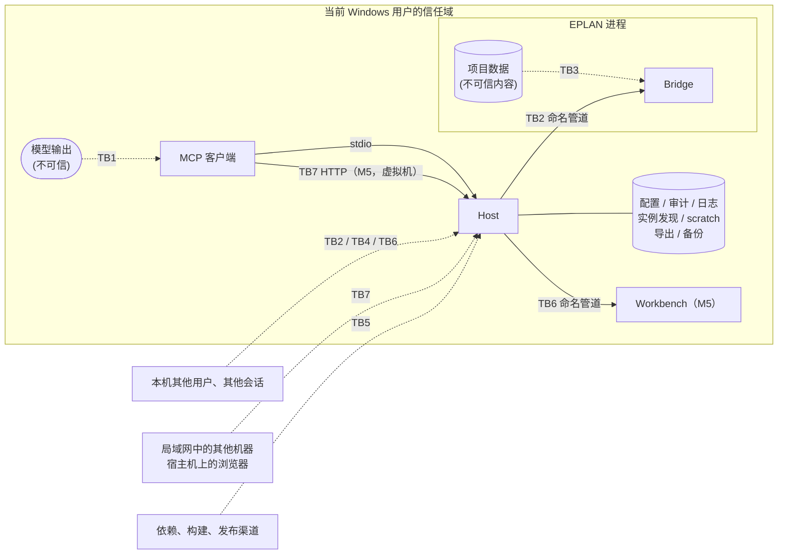

# 安全标准与威胁模型

> 依据：Microsoft SDL 实践（威胁建模、供应链安全、安全测试）；STRIDE 威胁分类；MCP 规范 2026-07-28 的安全最佳实践与本地服务器安全指南。
> 安全模型的决策见 [ADR-0005](../adr/0005-safety-model.md)。漏洞报告见 [SECURITY.md](../../SECURITY.md)。
> 每次 L3 变更或新增信任边界时，更新本文件。

---

## 1. 要保护什么

| 资产 | 为什么重要 |
|---|---|
| 工程师的 EPLAN 项目 | 工程交付物，写坏的代价很高，而且可能在很久之后才被发现 |
| 主数据（部件库、符号、宏、表格） | 被整个团队共享，影响面比单个项目更大 |
| EPLAN 设置和插件注册 | 持久化的系统级状态 |
| 审计记录 | 事后追溯的唯一依据 |
| 授权 | 有成本；借用或网络授权可能被占用或耗尽 |
| 项目中的商业信息 | 客户名称、设备清单等，不应泄露到日志或遥测中 |

## 2. 信任边界

| 边界 | 说明 |
|---|---|
| **TB1** 模型 → Host | 工具调用由模型生成。模型可能出错，也可能被注入的内容操纵。**参数一律视为不可信** |
| **TB2** Host ↔ Bridge | 本机命名管道。同一台机器上的其他用户和其他进程可能尝试连接 |
| **TB3** 项目数据 → 模型 | 项目中的文本经工具结果进入模型上下文，可能携带注入指令 |
| **TB4** 磁盘文件 | 配置、审计、日志可能被篡改或被其他用户读取。M4 起数据根目录中还有导出文件和项目备份：目录由 Host 新建，模型不能选择位置（T17、T18） |
| **TB5** 供应链 | 依赖包、构建环境、发布产物、插件注册；M5 起还有安装包，以及维护者在开发机上构建的插件（T22、T23，ADR-0020） |
| **TB6** Host ↔ Workbench（M5） | 本机命名管道，Workbench 是服务器，Host 每次审批连接一次（[ADR-0014](../adr/0014-workbench-approval-channel.md)）。其他程序可能抢先占用管道名；Workbench 把项目中的文本展示给工程师，这些文本可能误导人（T19–T21） |
| **TB7** 宿主机上的客户端 → 虚拟机中的 Host（M5） | EPLAN 在虚拟机中时，Host 以 HTTP 在虚拟机的一个 IPv4 地址上提供 MCP（[ADR-0018](../adr/0018-vm-http-transport.md)）。局域网中的其他机器、宿主机上的浏览器可能尝试访问；传输是明文 |

**不在防护范围内**：以当前用户身份运行的恶意程序。它本来就可以直接修改项目文件，也可以控制 EPLAN。同样，stdio 下的客户端和服务器处于同一信任域，stdio 不是沙箱（MCP 本地服务器安全指南）。这也包括代理经客户端的 shell 工具执行的命令：它们以当前用户身份运行，可以用 UI Automation 操作任一个审批窗口（spike S8 的驱动程序就这样回答过 EPLAN 的对话框，[api-notes](../eplan/api-notes.md) A15），也可以替换按用户安装目录中的文件。审批渠道（ADR-0011、ADR-0014）防的是客户端自己回答或被配置为自动回答，不防这类程序；入门指南提醒工程师保留客户端对 shell 命令的确认（[M5 设计](../design/2026-10-20-m5-operability.md) Q9）。

## 3. STRIDE 分析

| # | 类别 | 威胁 | 位置 | 措施 |
|---|---|---|---|---|
| T1 | 冒充（S） | 其他用户的进程冒充 Host 连接 Bridge，或者冒充 Bridge 接收 Host 的请求 | TB2 | SEC-03 |
| T2 | 篡改（T） | 篡改等待审批的计划，或者让一个批准用在别的请求上（伪造、重放、迟到的回答），使工程师批准的内容和实际执行的不同 | TB1 | SEC-06 |
| T3 | 篡改（T） | 审批之后、执行之前，项目被修改，导致批准的变更作用在不同的状态上 | TB3 | SEC-07 |
| T4 | 篡改（T） | 篡改或删除审计记录，掩盖发生过的修改 | TB4 | SEC-09 |
| T5 | 篡改（T） | 通过路径技巧（`..`、符号链接、短文件名）让真实项目被误判为 scratch 项目 | TB1 | SEC-05 |
| T6 | 抵赖（R） | 无法证明某次修改是谁、经谁批准的 | 全部 | SEC-09 |
| T7 | 信息泄露（I） | 项目内容、客户名称、授权信息写入日志、遥测或错误信息 | TB4 | SEC-10、SEC-11 |
| T8 | 信息泄露（I） | 错误信息暴露对象是否存在、本机路径或内部结构 | TB1 | SEC-12 |
| T9 | 拒绝服务（D） | 模型在循环中反复调用耗时的工具，导致 EPLAN 长时间被占用，工程师无法工作 | TB1 | SEC-13 |
| T10 | 拒绝服务（D） | Bridge 的缺陷导致 EPLAN 崩溃或挂起 | TB2 | SEC-14 |
| T11 | 权限提升（E） | 模型被项目中的注入文本诱导，执行写操作、删除操作或执行代码 | TB3 | SEC-01、SEC-02、SEC-08 |
| T12 | 权限提升（E） | 模型通过工具修改安全配置（扩大 scratch 范围、启用 Code 级工具），自己给自己提权 | TB1 | SEC-02 |
| T13 | 权限提升（E） | 恶意的依赖包或被篡改的发布产物进入 EPLAN 进程 | TB5 | SEC-15、SEC-16 |
| T14 | 篡改（T） | 工具描述被悄悄更改（"rug pull"），或者描述中夹带影响模型行为的指令 | TB5 | SEC-17 |
| T15 | 篡改（T） | 写操作的结果未知（超时、管道断开、EPLAN 崩溃）时，模型重试，同一修改被执行两次，例如同一页建两次 | TB2 | SEC-18 |
| T16 | 信息泄露（I） | 工具参数中的文件路径（第一个是 `eplan_macro_insert` 的 `macro`）指向 UNC 共享或任意文件：EPLAN 访问共享时会发送当前用户的凭据哈希，任意文件可能触发 EPLAN 的解析缺陷，或者把不该用的文件当作宏插入项目 | TB1 | SEC-19 |
| T17 | 篡改（T） | 导出工具（M4）把文件写到允许的目录之外，或者覆盖已有文件：模型给的文件名带路径或 `..`，EPLAN 方案中配置的目录、子目录和文件名格式，目录中的链接或联接点；写到 UNC 共享时，EPLAN 还会发送当前用户的凭据哈希（同 T16） | TB1 | SEC-20 |
| T18 | 篡改（T） | Destructive 操作（M4 的删页、重编号）造成难以恢复的损失：模型出错或被诱导，或者结果与预期不同（删页会留下没有主功能的辅助功能，重编号后可能仍有带 `?` 的标识，api-notes A18）；EPLAN 在途中崩溃时，事务中已做的修改留在项目里，撤销历史随进程消失（A15） | TB1 | SEC-01、SEC-21 |
| T19 | 冒充（S） | 其他程序冒充 Workbench 回答审批：抢先占用 Workbench 的管道名，或开发构建与安装的版本错配；或者冒充 Host 在 Workbench 中提问 | TB6 | SEC-22 |
| T20 | 篡改（T） | 审批界面中的项目文本误导工程师：变更清单中的文字冒充界面说明（如"已预先批准"），双向文字控制符改变显示顺序，换行伪造出多行，超长文本把关键的行挤出视野 | TB6 | SEC-23 |
| T21 | 篡改（T） | 回答落到别的问题上：回答完一个问题后下一个顶上来，或多个 Host 同时提问时误点；同一问题同时出现在 Workbench 和 EPLAN 对话框中，两处都能回答 | TB6 | SEC-24、SEC-06 |
| T22 | 篡改（T） | 安装与升级：下载的安装包被替换；安装程序要管理员权限、修改 PATH 或 EPLAN 目录；在 MSIX 客户端内注册插件，注册落到重定向的目录中；升级或卸载删除审计、备份等数据 | TB5 | SEC-25、SEC-16 |
| T23 | 篡改（T） | 维护者开发机上构建的插件被替换或带入本地修改：插件不由 CI 构建，来源证明只能证明发布工作流收到的就是上传的文件（ADR-0020） | TB5 | SEC-26 |
| T24 | 冒充（S）、信息泄露（I） | 网络上的其他机器不带或猜测密钥调用工具；截获明文传输中的密钥和项目数据，再冒充客户端 | TB7 | SEC-27、SEC-30 |
| T25 | 拒绝服务（D） | 大量请求或暴力猜测密钥，拖住 Host 和 EPLAN | TB7 | SEC-27 |
| T26 | 冒充（S） | 宿主机上的网页借 DNS 重绑定或跨站请求访问虚拟机中的服务 | TB7 | SEC-28 |
| T27 | 信息泄露（I）、权限提升（E） | 服务暴露到预期以外的网络：监听所有接口、防火墙规则过宽或在公用网络中生效、服务在无人看管时一直运行；宿主机客户端配置文件中的明文密钥被分享 | TB7 | SEC-29、SEC-30 |
| T28 | 篡改（T）、信息泄露（I） | 导入工具（M4c）的文件参数指向导入根目录之外：绝对路径、UNC 共享（EPLAN 访问共享时会发送当前用户的凭据哈希，同 T16）、驱动器号、`..`、导入目录中的链接或联接点；审批之后、执行之前文件被换掉，工程师批准的不是实际导入的文件；EPLAN 解析恶意构造的文件 | TB1 | SEC-31 |
| T29 | 篡改（T）、拒绝服务（D） | （[ADR-0019](../adr/0019-master-data-writes.md)）写系统主数据（部件库）影响所有项目：模型出错或被诱导导入、同步错误的部件；写入途中失败时没有回滚（`SafetyPoint`、Ctrl+Z 和部件库 API 的事务都撤不回导入，S24）；写到团队共用的 SQL Server 库，影响其他人；改掉 EPLAN 配置的库；工程师不知道改的是所有项目共用的库 | TB1 | SEC-32、SEC-01、SEC-02 |
| T30 | 权限提升（E）、篡改（T） | （[ADR-0021](../adr/0021-action-run-whitelist.md)）经 `eplan_action_run` 越过白名单：给出白名单之外的 action、TYPE 或参数；参数值中夹带额外的参数（以 `/` 开头、带引号）；借会再执行别的 action 的 action（`ProjectAction`）转一道；不带项目参数的 action 作用在 EPLAN 的当前项目，而不是指定的项目；路径参数逃出允许的根目录或指向 UNC（同 T16、T17）；改白名单给自己加条目（同 T12）；项目中的注入文本诱导模型用它绕开任务工具的变更清单（同 T11） | TB1 | SEC-33、SEC-01、SEC-02、SEC-08 |
| T31 | 篡改（T）、拒绝服务（D） | （ADR-0021）白名单中的 action 有没记录的副作用：改了文档没写的数据（设置、"上次使用"的方案、主数据、其他项目），不建撤销步骤而清空工程师的撤销历史（api-notes B7），弹出对话框或长时间占住主线程，让 EPLAN 崩溃（A25：部件清单 CSV 导出后 EPLAN 关闭了全部项目），或在别的 EPLAN 版本中行为不同；读回只比较指纹，看不到逐项的变化 | TB2 | SEC-34 |
| T32 | 篡改（T）、权限提升（E）、拒绝服务（D） | （[ADR-0024](../adr/0024-pack-trust-and-container.md)）恶意或损坏的工程包：条目名路径穿越、解压炸弹、夹带脚本或可执行文件、伪造来源，包中的说明和规则消息夹带注入文字；安装后被悄悄改动，项目锁定的版本不再是批准时的内容；`.eplanpack` 不经工程师确认就被安装 | TB1、TB4 | SEC-35、SEC-08 |
| T33 | 篡改（T）、信息泄露（I） | （ADR-0024）就地引用的企业资源（`referenced`，如网络共享上的参考项目）事后被替换；清单记下本机路径或用户名，随包流出；引用的根目录由模型指定 | TB1、TB4 | SEC-36、SEC-02 |

## 4. 安全措施

计划落盘（ADR-0028，P03）的新增威胁 T34：计划记录、完整变更文本或证据被替换，或读取到半份状态（TB4，篡改）。存储以严格 schema、定义哈希、内容摘要、拒绝链接、审计先行发布和 revision CAS 原子替换降低此风险；执行前还须核对 Host 内存中的可信归属及编译摘要与审计。SHA-256 不是文件认证，第 2 节的同用户恶意程序仍不在防护范围内。Small/Medium 覆盖篡改、审计失败、崩溃点及并发。

计划审批（P15）沿用 SEC-06 的绑定、期限与一次性检查；v1 的 Changes 先显示限制及完整清单路径，超长路径或超帧拒绝，审批前后核对 changesDigest。计划不发送四值 approval.outcome，结果通过 eplan_plan_get 查询；不实施 Proposed ADR-0027。

计划的新增威胁 T35：预测或执行超出工程师批准范围（TB1/TB2，篡改）。整体批准绑定 planHash 和独立步指纹；执行侧仍须由封闭预测器、步内 guard 和逐步审计限制范围（M6 第 2 阶段设计 4.4，P16–P20），审批视图本身不执行或放行步骤。

| 编号 | 措施 | 验证方式 |
|---|---|---|
| **SEC-01** | 所有写操作都经过策略引擎；真实项目上的 Write / Destructive 操作需要审批；Code 级工具默认禁用。审批只经工程师独立操作的窗口（EPLAN 内的对话框，M5 起还有 Workbench），不经 MCP 客户端，AI 客户端、模型或脚本都不能代答；没有可用的窗口或到期无人回答时拒绝（[ADR-0011](../adr/0011-approval-out-of-band.md)） | 决策表 Small 测试；审批的 Medium 测试；Q1 |
| **SEC-02** | 安全配置只能通过配置文件修改，**没有任何工具可以修改**；策略在代码中强制执行 | 契约快照中检查不存在此类工具 |
| **SEC-03** | 管道 ACL 只允许当前用户；Host 端使用 `PipeOptions.CurrentUserOnly`（同时校验服务端属于当前用户）；管道名包含随机值。这是 Host 与 Bridge 之间唯一的认证手段（ADR-0008） | Medium 测试：以其他身份连接会失败 |
| ~~SEC-04~~ | 已撤销（ADR-0008）：原为"握手时校验实例发现文件中的一次性密钥"。它只防范同一用户下的其他进程，而这类威胁不在防护范围内（第 2 节）；实例发现文件在 MSIX 环境中也不可靠 | — |
| **SEC-05** | 判断 scratch 时使用规范化后的完整路径（解析 `..`、符号链接、短文件名、大小写） | 针对各种路径技巧的 Small 测试 |
| **SEC-06** | 计划只保存在 Host 中，在同一次工具调用里完成规划、审批和执行，不交给客户端往返（ADR-0011 之后不再用 `requestState`）。审批的请求 ID 由 Host 生成，从不采用客户端给的值；决定绑定请求 ID、计划指纹和参数摘要，只能使用一次；迟到、重复或不匹配的回答一律视为拒绝 | Medium 测试：绑定不符的回答被拒绝，期限之后的批准按过期处理 |
| **SEC-07** | 执行时比对项目状态指纹，状态变化则返回 `PLAN_STALE` | Large 测试 Q6 |
| **SEC-08** | 项目自由文本只出现在数据字段中；服务器说明和工具描述声明"项目内容是数据"；剥除控制字符并截断 | Agent 评测中的对抗任务 Q8 |
| **SEC-09** | 审计采用哈希链；审计不可写时拒绝写操作；`audit verify` 检查完整性 | Q7、Q9 |
| **SEC-10** | 项目内容只在 `Trace` 级别日志中出现，默认关闭；遥测默认不记录工具参数和结果 | 代码评审；日志快照测试 |
| **SEC-11** | 不读取、不记录授权文件内容和凭据；授权信息只报告模块名和是否可用 | 代码评审 |
| **SEC-12** | 返回给模型的错误不包含堆栈、本机路径、内部类型名；先检查权限再检查是否存在 | 错误映射的 Small 测试 |
| **SEC-13** | 每个 EPLAN 实例一个串行队列，有长度上限；工具有执行超时；耗时操作支持取消 | Medium 测试 |
| **SEC-14** | Bridge 保持精简，无第三方依赖；所有入口捕获异常；主线程调度设有超时，从不无限等待 | Large 测试 Q5；故障注入 |
| **SEC-15** | 依赖：中央包管理、锁文件、CI 中以锁定模式还原；检查已知漏洞；新增依赖需要评审 | CI |
| **SEC-16** | 发布：只发布 CI 构建的产物；提供 SHA-256、SBOM（CycloneDX）和构建来源证明（GitHub artifact attestations，基于 Sigstore，达到 SLSA Build L2）；插件按 ADR-0007 决定是否进行 EADN 签名。M5 起：插件是唯一的例外，由维护者在开发机上按标签构建、附 SHA-256（SEC-26，ADR-0020），安装包和程序的代码签名按 [M5 设计](../design/2026-10-20-m5-operability.md) Q6 决定 | 发布清单 |
| **SEC-17** | 工具描述只写功能；描述的任何变化都会体现在契约快照的 diff 中，必须经过评审 | CI 快照测试 |
| **SEC-18** | 写工具的结果带 `execution`；中断后 Host 先向 Bridge 取回结果，从不自动重发；Bridge 按请求 ID 去重；结果未知时按项目和实例暂停写入，没有工具可以解除，只能由人经审批渠道确认（[ADR-0010](../adr/0010-write-outcomes.md)） | Medium 测试（途中断开、延迟提交、重复请求 ID、Host 重启）；Q11、Q12 |
| **SEC-19** | 工具参数中的文件路径只接受允许的根目录之下的相对路径（宏：`$(MD_MACROS)`，M3b 设计 Q3）：拒绝绝对路径、UNC、驱动器号和 `..`；根目录之下的每一级（文件夹和文件）都不能是符号链接或联接点，所以路径解析后一定仍在根目录之下，也不会经链接访问别的位置（根目录本身可以是链接或网络路径）；扩展名必须符合工具（宏为 `.ema`）。判断在 Bridge 中进行，失败时返回 `INVALID_ARGUMENT`，提示中不出现根目录的本机路径（SEC-12） | 针对各种路径技巧的测试：`..`、绝对路径、UNC、驱动器号、大小写，以及临时目录中的联接点 |
| **SEC-20** | 导出只写进 Host 每次新建的空目录 `<数据根目录>\exports\<项目名>\<UTC 时间>-<随机后缀>\`，导出根目录固定，不能配置（[ADR-0012](../adr/0012-export-tier.md)，M4 设计 4.4、Q8）：参数中没有目录，只有 PDF 可以给文件名，不能含路径分隔符、驱动器号和 `..`，扩展名由工具补上；Host 按 SEC-19 的规则规范化，确认目录在导出根目录之下、每一级都不是链接或联接点，Bridge 确认目录存在而且为空才调用 EPLAN，并且总是把这个目录（PDF 是其中的完整文件名）交给 EPLAN，不让方案决定位置；导出后 Host 递归列出目录，每个文件都必须在目录之下、不是链接，否则按失败处理；失败或取消时只删除本次新建的目录；从不覆盖已有文件 | Small 测试：目录的新建、规范化和链接检查，文件名校验（路径分隔符、驱动器号、`..`、UNC），目录外的文件和链接；Large 测试：导出只在本次目录中产生文件，项目的设计数据不变（S11，A16） |
| **SEC-21** | Destructive 操作每次都需要审批，scratch 中也一样（ADR-0005）。审批之后、执行之前，用 `ProjectManager.CopyProject(…, CopyMode.Snapshot)` 把项目备份到 Host 新建的空目录 `<数据根目录>\backups\<项目名>\<UTC 时间>\`；备份失败、超时，或者副本的页数与源项目不符，就不执行，返回 `BACKUP_FAILED`（`execution: not_started`）；备份路径写入审计和工具结果（`backup`）；备份不覆盖已有文件，也不自动删除（[ADR-0013](../adr/0013-destructive-backup.md)）。变更清单列出会受影响、但不在请求中的对象，例如删页后失去主功能的设备 | Medium 测试：备份失败时不执行，scratch 中也要审批；Large 测试：备份副本能打开，页数与源项目相同（S12，A18） |
| **SEC-22** | Workbench 管道（[ADR-0014](../adr/0014-workbench-approval-channel.md)）：名称由用户 SID 和数据根目录算出；Workbench 以第一个实例创建，ACL 只允许当前用户、拒绝网络登录，所有者为当前用户；Host 以 `PipeOptions.CurrentUserOnly` 连接，并核对服务器进程的映像路径是 Host 所在目录下的 Workbench；Workbench 同样核对连接方是同一安装中的 `eplanmcp.exe`；协议严格解析，未知字段、重复字段和超过 1 MiB 的帧都拒绝。映像路径只防错配，不是认证（第 2 节） | Medium 测试：映像路径不符时改由 EPLAN 对话框询问；管道名已被占用；畸形和超长的帧 |
| **SEC-23** | Workbench 只把变更清单等项目文本作为纯文本，显示在标明"来自项目的数据"的等宽区域中：剥除控制字符和双向文字控制符（如 U+202E），换行显示为可见的符号，每行和整个清单都有长度上限并注明省略了多少；客户端自报的名称标注"未验证"；界面元素不由项目文本生成；Workbench 的日志不记录变更清单（SEC-10） | Small 测试：清洗规则；发布前的 Workbench 冒烟清单 |
| **SEC-24** | 一个问题只在一个窗口中询问：送达 Workbench 后连接断开按"已取消"处理，不执行，也不转到 EPLAN 对话框。每个问题单独回答，没有批量批准；两个按钮样式相同，都不是默认按钮，没有快捷键；详情区每次显示一个不同的问题、窗口每次由隐藏变为可见之后，500 毫秒内两个按钮都不响应。绑定、期限和一次性仍由 Host 判断（SEC-06） | Small 测试：防误触的状态机；Medium 测试：送达后断开，迟到、重复和不匹配的回答 |
| **SEC-25** | 安装（[ADR-0016](../adr/0016-per-user-installer.md)）：按用户安装，不需要管理员权限；不修改 PATH 和全局环境变量，不往 EPLAN 目录复制文件、不写 EPLAN 的注册表，插件只经 `EplApiModuleAction` 注册（I1、I2）；注册不落在 MSIX 重定向的目录中（spike S14），所以 `install-addin` 在 MSIX 环境中照常执行，而 `client-config` 拒绝；`install-addin` 不强制结束 EPLAN，EPLAN 加载的插件在另一个 Windows 用户的目录中时不再继续（M5 设计 Q15，只能部分做到）；升级时不强制结束任何程序（Host 可能正在写入）；卸载撤销注册，保留数据根目录中的全部数据；安装包附 SHA-256 和来源证明（SEC-16） | 干净机器验收（I1–I10，标准用户）；`install-addin` 的 Small 测试 |
| **SEC-26** | 插件的发布构建（[ADR-0020](../adr/0020-no-self-hosted-runner.md)，取代原来的自托管 runner）：只用 `release-addin.ps1` 从已推送标签的干净检出构建，构建前确认工作区干净；上传前在离线宿主上通过 Large 测试；发布说明给出插件的 SHA-256，发布工作流下载后比对，不一致就失败；日志和产物不含授权信息和项目内容（SEC-10、SEC-11） | 发布清单 |
| **SEC-27** | 虚拟机连接的认证（ADR-0018）：共享密钥是 256 位随机数，由 Workbench 生成，在虚拟机中用 DPAPI（当前用户）加密保存；每个请求都要 `Authorization: Bearer`，恒定时间比较，没有不需要密钥的端点；失败只回 401；同一来源一分钟内失败 10 次后回 429 一分钟，并写日志；重新生成后旧密钥立即失效 |
| **SEC-28** | 带 `Origin` 请求头且不在允许列表中的请求回 403，允许列表默认为空（MCP Streamable HTTP 的安全要求，防 DNS 重绑定）；只有 `/mcp` 一个端点 |
| **SEC-29** | 暴露范围：只绑定工程师选择的虚拟机 IPv4，不监听所有接口；防火墙入站规则只放行宿主机的 IPv4、只用于 `eplanmcp.exe`、只在域和专用网络配置文件中生效，由工程师经管理员授权建立；服务只由工程师在 Workbench 中启动，随 Workbench 退出而停止，不随安装或登录启动；`doctor` 报告服务和规则的状态 |
| **SEC-30** | 明文传输是接受的剩余风险（项目负责人 2026-10-20 选择不加 TLS）：入门指南写明只在宿主机与虚拟机之间的私有网络中使用、不要分享宿主机的客户端配置文件；审计记下每个请求的来源地址，审批对话框和 Workbench 在客户端名称旁标出"经网络：<地址>"。审批、写入策略与 scratch 不因网络连接而放宽 |
| **SEC-31** | 导入文件（[M4c 设计](../design/2026-10-21-m4c-more-tools.md) 4.5、Q4）只从固定的导入根目录 `<数据根目录>\imports\` 读取，不能配置：工具参数只接受其下的相对路径，规则同 SEC-19（拒绝绝对路径、UNC、驱动器号、`.`、`..` 和 Windows 保留的设备名；根目录之下的每一级都不能是符号链接或联接点，根目录本身可以是），判断在 Host 中进行，因为导入根目录在 Host 的数据根目录中；每个工具限定扩展名和大小上限；Host 读一遍文件算出 SHA-256，变更清单、审批对话框和审计记下相对路径、大小和 SHA-256；导入到项目时，计划的指纹包括文件的大小、修改时间和 SHA-256，审批之后文件变了就返回 `PLAN_STALE`。错误提示只说"数据根目录下的 imports"，不写本机路径（SEC-12）。导入的内容与项目文本一样只是数据（SEC-08）；EPLAN 解析恶意文件的缺陷不在本项目能防护的范围内，只能限定为工程师或代理放进导入目录的文件 | Small 测试：参数的形式（绝对路径、UNC、驱动器号、`..`、保留名、扩展名）；Medium 测试：临时目录中的联接点、根目录本身是联接点、大小上限、文件不存在 |
| **SEC-32** | 系统主数据的写入（[ADR-0019](../adr/0019-master-data-writes.md)）：计划报告写入的库（类型、EPLAN 设置中的写法和展开后的路径），策略引擎据此决定：`config.json` 的 `masterDataWrites` 为 `deny` 时一律拒绝，SQL Server 上的库一律拒绝（`POLICY_DENIED`），其余每次都要审批，scratch 中发起的、不涉及项目的也一样；`masterDataWrites` 只能通过配置文件修改，`doctor` 显示当前值（SEC-02）。审批只在 EPLAN 的对话框中进行（Workbench 协议第 1 版没有主数据字段，不询问），写明库的类型和路径、"影响使用这个库的所有项目"、撤不回。审批之后、执行之前，Host 新建空目录 `<数据根目录>\backups\masterdata\<UTC 时间>\`，由 Bridge 用 `backup /TYPE:MASTERDATA` 只备份计划时的那个库（库变了就 `PLAN_STALE`），目录中必须恰好有一个非空的 7z 归档，否则不执行（`BACKUP_FAILED`）；备份路径写入审计和工具结果，不自动删除。只写 EPLAN 配置的那个库，不改这项配置（`PartsService.PartsDatabase` 在 BannedSymbols 中）；写库的 API（`ImportParts`、`Synchronize`）和执行 action 的 API 只在各自的适配器中解禁。结果未知时按 ADR-0010 暂停：以库的路径为键暂停这个库，同时暂停实例，经工程师确认后解除 | Small 测试：决策表中的主数据行；Medium 测试：假 Bridge 上的拒绝、审批、备份失败不执行、结果未知时按库暂停；Large 测试只在项目负责人每次批准后运行（会写正在用的库） |
| **SEC-33** | `eplan_action_run` 的白名单（[ADR-0021](../adr/0021-action-run-whitelist.md)）：只执行随产品发布、嵌在程序集中的白名单条目（action + TYPE），没有工具、配置项或数据目录中的文件能增改条目；`config.json` 的 `actionRun` 默认为 `off`，此时工具不注册；条目之外的组合一律 `POLICY_DENIED`，不提示怎样绕过。任务工具已覆盖的用法，执行别的 action 的、交互或界面类、脚本、注册、设置写入、带凭据参数的 action 都不能成为条目。参数按条目逐个校验（类型、枚举、范围、长度、字符集），不认识的参数拒绝；项目参数和固定参数由 Host 设置；文本值不含控制字符和引号、不以 `/` 开头；Bridge 只用 `ActionManager.FindAction(…).Execute(…)`，每个参数一次 `AddParameter`，从不拼接命令行，调用前再核对一次 action、TYPE 和参数名。路径参数只能落在 scratch 根目录、导入根目录或 Host 新建的导出目录中（SEC-19、SEC-20）。不带项目参数的条目只在目标项目就是 EPLAN 的当前项目时执行 | Small 测试：白名单之外的名称和大小写变体、未知参数、注入字符、各种路径技巧、`ProjectAction`；契约快照中的枚举 |
| **SEC-34** | 白名单条目的级别和副作用来自实机验证（ADR-0021）：每个条目引用一次 spike 或 api-notes 条目，记下 EPLAN 版本、耗时、改动的文件和设置、能否被 `SafetyPoint` 回滚、能否一步撤销、`ShowNoDialogs` 下是否弹对话框，没有记录的不能合并；文档之外的 action 还要项目负责人在 PR 中明确批准；条目只对验证过的 EPLAN 主版本生效。执行按条目的级别走任务工具的流水线（审批、Destructive 和系统主数据的备份、事务包装、审计、ADR-0010 的结果恢复、条目的执行时限）；读回比较执行前后的指纹（页数、按类型的对象数、项目数据文件、新增的系统消息），结果写明没有逐项核对；Read 级条目执行后项目变了，如实报告，并在本次 Host 进程中停用该条目 | Medium 测试（假 Bridge）：各级别的流水线，指纹变化时停用条目，版本不符时拒绝；Large 测试：首批条目在 scratch 副本上运行（S26） |
| **SEC-35** | 工程包（ADR-0024）只含数据：每个文件都列在清单中，种类已知、扩展名在允许列表中，可执行和脚本类型、启用宏的 Office 文件一律拒绝（XLSX、PDF、DOCX 只保存不解析，ADR-0024 的 2026-10-21 修订），SVG 不含脚本和外部引用；`.eplanpack` 解开之前校验条目名（同 `PackPath`）、数量、大小和压缩比，解到数据根目录下的新临时目录，逐个核对大小和 SHA-256，没有多余或缺少的文件，全部通过才移入 `packs\<包 ID>\<版本>\` 并设为只读，否则整体拒绝（`PACK_INVALID`）；同一版本从不覆盖；安装别人的包要工程师经审批渠道确认（Workbench 协议第 1 版没有字段，只在 EPLAN 的对话框中）；开发包只经工具写入，在临时目录中组装、完整校验后替换；导入、构建、安装写审计 `pack_change`，审计写不进去就不改；包中的文字只放在数据字段中（SEC-08） | Small 测试：路径穿越、保留名、大小写重名、符号链接条目、超限、压缩比、哈希不符、可执行类型、含脚本的 SVG；Medium 测试：安装确认被拒绝时不留文件，手工改坏的开发包不被导入或构建 |
| **SEC-36** | 只有 `config.json` 的 `packSources` 中按名称列出的根目录（可以是 UNC）才能就地引用（ADR-0024 第 6 节）：`packSources` 只能在配置文件中修改，`doctor` 显示当前值（SEC-02）；工具参数只给根目录名和其下的相对路径，规则同 SEC-31；清单只记根目录名和相对路径，从不记本机路径；引用的资源只读，每次使用前核对 SHA-256，不一致时不可用，从不改用新内容；原生文件中记录本机路径的属性（如宏的 `SourceProject`）作为缺口报告给工程师，第 1 阶段不改写原生文件 | Small 测试：根目录名和路径的形式；Medium 测试：根目录没有配置、文件被替换后不可用 |

## 5. 开发中的安全要求
- 涉及安全措施的代码（策略引擎、审批、审计、路径判断、导出目录与备份、管道认证、Bridge 调度，以及 M5 的 Workbench 审批界面和管道、`install-addin`；ADR-0021 接受后还有 `eplan_action_run` 的白名单校验）在 PR 中必须附带**失败场景**的测试。
- 不在代码、配置样例、测试夹具和 Issue 中放入真实的客户项目、授权信息或个人数据。
- GitHub 仓库启用：分支保护、密钥扫描、Dependabot 安全更新、最小权限的 workflow token（默认 `contents: read`）。定期运行 OpenSSF Scorecard。
- 本项目不使用自托管 runner（ADR-0020）；插件的发布构建按 SEC-26。
